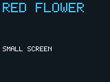

# 017 — transcript

Mechanically converted from the Pi event log by [transcript.py](../transcript.py). Summary: [017-campaign.md](017-campaign.md). Control bytes appear as Unicode control pictures (␀, ␛, …), and `$REPO` stands for the repository root.

| | |
| --- | --- |
| Model | `openai-codex/gpt-6.1-sol` |
| Start (UTC) | 2026-11-04 00:23:01 |
| Duration | 0:34:27 |
| Tool calls | 86 |
| VM boots | 7 |
| Observer messages | 1 |
| Compactions | 1 |
| Tokens (input / cached / output) | 84,442 / 9,058,304 / 54,091 |

**Tools:** `guest_write`, `guest_read`, `notes_write`, `notes_read`, `vm_boot`, `serial_read`, `vm_stop`, `guest_patch`, `serial_send`, `serial_send_text`, `vm_boot_http`, `vm_boot_disk`, `vm_boot_gui`, `vm_boot_browser`, `screen_capture`, `key_send`

**System prompt:**

```
You are the experimental agent. Use only the provided tools.

<cwd>
$REPO/.local/experiments/pi-2O5Npq/work
</cwd>
```

_Tools added: `vm_boot_browser`_

## Stage prompt +0:00:00

> Build a tiny graphical HTML browser on the saved OS and GUI. Boot with vm_boot_browser (ramfb, keyboard, disk, and the existing private TCP peer at 10.0.2.2:8080). On this boot, fetch GET /index.html HTTP/1.0 plus CRLF CRLF using the existing TCP code. Preserve ordinary non-GUI /hello HTTP boot and plain GUI panel navigation. On the combined boot, parse the actual response body, which contains &lt;html&gt;&lt;body&gt;&lt;h1&gt;UPPERCASE WORDS&lt;/h1&gt;&lt;p&gt;UPPERCASE WORDS&lt;/p&gt;&lt;/body&gt;&lt;/html&gt;. Content differs between runs. Render only the heading and paragraph text as visibly legible bitmap glyphs. Support ASCII A-Z and space. Put the heading in the top half of the 160x120 screen, paragraph in the bottom half, with distinct sizes and sufficient contrast. Leave a serial shell usable after rendering and acknowledge the payload and FIN.
> 
> Use your own assembly tools where feasible. Kernel patches needed for display/network integration are allowed, but do not fetch external material. Check at least two browser boots and capture screenshots. Save any assembly source needed to reproduce your browser, your final image, and concise handoff notes. Stop the VM.

#### +0:00:00

**→ `notes_read`**

**→ `guest_read`** `{"offset": 1144, "length": 160}`

**← `notes_read`**

`text`

<details><summary>text (6,399 chars, 39 lines)</summary>

```
Stage-016 FINAL: saved9328-byte(0x2470) raw little-endian AArch64 image, entry0x40200000,QEMUvirtCortex-A53,endexclusive0x40202470. VM STOPPED. Existing shell,disk,loader,compiler,HTTP preserved. Only provided tools/artifacts,no external references. vm_boot_gui=persistentdisk+ramfb+virtio-keyboard;plain/HTTP withoutdisplay tested.

GUI:160x120,XRGB8888,pitch640. Background RGB16,24,32(word00101820). Leftinclusive x16..71,y36..83;rightx88..143,y36..83. ActiveRGB64,192,240(word0040c0f0);inactive48,64,80(word00304050). Nooverlays,allinteriorpixelsincludingcenters/upperleftinteriorexactfill. Leftinitialactive. EV_KEY1/value1press:RIGHTcode106->right1,LEFT105->left0. Releases/SYN/otherkeysignored. Fullpaintonpress. Serialconsoleworkswhilekeysprocessed.

BUILT USING GUEST ASSEMBLER WHERE FEASIBLE: compiler progBad3488bytes and Calpha preserved. Reservedprog8 now GUIpainter assemblysource(old130instrtestreplaced). as prog8 emitted164bytes;our guestdumpapp temporarilyinprogMath,installedandinvokedthroughbuild,serialdumpedactualassembledbytes;appendedverbatimtokernel205c. Otherdriversrawkernelcodebecausehalfword/REV/STPoutsideassemblerforms. progMath restoredtooriginalADR/data/stackbyteexampleafterdebug. Nodumpcodeinkernel.

CODE(offsetsfrom0x40200000):
Onlyoldcodepatches:70cB2100(word1400067d)insteadB940 AFTERSPinit;5d8UARTpollBL233c(word94000759)insteadLDRw1FR. BOOTfirst44bytesunchanged;network/HTTPcompletebeforeGUIasbefore. Oldend2059;3padzeros;205c..20ffpainter,2100..2338GUIinit,233c..23a4wrapper,23a8..246ckeypoll,end2470.
205c painterw0=selection0left/nonzeroright,leafusesx0..7/x18,keepsx9..17/callees. ADRlocalpool20f0(40300000,00101820,0040c0f0,00304050). Nestedrow/pixelloopsall19200pixels;literalbounds36/84,16/72,88/144;swapcolorsforright. PrivatekernelABIw0selected,NOTnormalrunABI(x0consoleptr).
2100 clears2000hexGUIRAM,findsFWcfg etc/ramfb,DMAmodeconfig,paintsleft,scansID18,setskeyboardeventqueue. 2334restoreUARTx0/B940olddiskinit/prompt. Nodisplay/count0or>256/notfound/DMAerror ->skipGUIandoldboot;keyboardptrremains0. x8linebuffer/x19appbasepreserved.
233c wrapper160bytestacksavesx0..18+LR,BL23a8,restoresall,originalLDRw1UARTFR+18,RET. NZCVnotpreserved,inputpathdoesn'tdependonoldflags. x19..29untouched. 23a8 pollcomparesused.idx/consumer,readsreturnedID/event. 2420storesselection,2424BLpainter. 2430 repostheadavailidx&7,DMB,publishidx/notify0,consumer++,repeat. OwnLRinx17(painterpreserves17).
IMPORTANTFIX23d0=9108114e ADDx14,x10,#204. Splitusedringentriesstart+4,NOT+8. Draft+208readlength8asID,ignoredkeys;correctedbeforefinaltests. Finalimageunchangedsincethisfix.

MEMORY:
Framebuffer0x40300000..40312bff,76800bytes,outsidekernel/app/disk. GUIbase0x40160000,clear0x2000. Descs+000..07f,avail+100,used+200. Stateu32consumer+300,availcounter+304,keyboardMMIO+308(0absent),selected+30c. Eventbuffers+800..83f(8x8). FWrecordbuffer+1000(64),DMAdescriptor+1100(16),ramfbcfg+1120(28). Nooldregionoverlap.

FW_CFG (discovered/probed insideguest):
MMIO09020000,data8+0,selectorBE16+8,DMAaddrBE64+10hex. Selector0readQEMU;directoryselector0019(nativeSTRH1900),streamBE32countthen64byterecords(sizeBE32,selectorBE16,reserved16,name56). GUIprobe10files,ramfbsize28/selector25;kernelMATCHESNAMEetc/ramfbNUL,nothardcode25.
RAMFBcfg28bytesallBE:addr64=40300000,fourcc32=34325258(XR24/XRGB8888),flags0,width160,height120,stride640. DMA16bytesBEcontrol=(selector<<16)|18hex(SELECT8|WRITE10hex),len28,addr40161120. DMBthenBE64descriptoraddr40161100toFW+10hex. Pollcontrol0success;nativebit24(BEerrorbit0)skip. CurrentMMU/cacheoffQEMUcoherent;cacheenablewillneedDMA/framebufferexplicitcleaning.

KEYBOARD:
Scan32virtioMMIOslots0a000000stride200,DeviceID18. Observed0a003c00,notfixed. Reset,status3,onlyVERSION_1high1/low0,status11,queue0Num8,highaddresses0,Ready1,status15. EightdescriptorsRAM+800+i*8,len8,WRITE2,next0. Availheads0..7idx8. Usedheaderflagsu16/idxu16,entries+204(id32,len32,stride8). EventLEu16type/u16code/u32value. Eventqueueonly,nostatus/LEDqueue. Repostconsumedhead/barriers/notify. Polling,nointerrupts/GIC. Countersnotwrap-safeafter65535events,noID/lengthvalidation;fixedsinglekeyboardprofile. InputupdatesonlywhileshellUARTinputloopruns,notduringlong/nonreturningapps(single-tasknotpreemptive).

FINALTESTS:
GUIrun20261104T001440.867440Z:
screen-001.png LEFTactiveinitial.
keyright/wait500ms/screen-002.png RIGHTactive.
Serialecho/help/asprogBad/install/buildalpha/run4 ->exit1cwhileGUIactive.
keyleft/wait500ms/screen-003.png LEFTactive.
keyright/screen-004.png RIGHTactive.
keyleft/echoafter-queue-wrap/loadfileempty/run42/screen-005.png LEFTactive.
Includesringwrapafter8entries,workingconsole/disk/compiler. Captures160x120. RunIDdistinguishesearlierdraftcaptures.
Plain20261104T001834.559793Z:BOOT/prompt,echo,rawreturnargload/run123=7b,buildnodisk,stopped.
HTTP20261104T001859.102692Z:BOOT/MAC02:84:c8:27:18:f2/Hello, world! 1a349a97504e/prompt;echo,load/run42,asnodisk,stopped. ImageSAVED,VMSTOPPED.

COMPILER/DISK/ABI PRESERVED:
CompilerSOURCEprogBad3488bytesUNCHANGEDstage015. Freshbootrestore:as progBad;install;build alpha;run0/2/4=>0/16/28. alpha=int f(int x){int y=0;if(x){y=y+2;}while(x){y=y+3;x=x-1;}if(y){y=y*2;}return y;}. Csubsetoptionalinitialy,mutablex/yassignments,sequentialbracedif/while(assignment-onlybodies),finalreturn;EXPRx/y,literals0..65535,parentheses,+/-/*precedence. NonzeroW32truth,nonnestedcontrol,noelse;B/B.EQrealruntimecode,errorskeeppriorapp. Compilerregsx8outbase/x9input/x10end/x11out/x12cap/x13pool,w14error,w15depth64,w16haveY,w5wordcount,w7kind,w17loopstart,w18skipindex. Fitsguestasm512words/2048bytes.
runN:uint32default0,entry40140000 x0putc402008a8/w1N/SP40110000aligned16,4KiBbelow;preserve19..29/SP,RET w0exit. putcclobbersx1/x2. installPICcompiler40150000..507ff,lenflag40150800bootzero;buildx0putc/x1exactsource/w2len/x3out40141000/w4cap2048,return4..2048multiple4or0,transactional. Appflag40142000,size42004. Asmode45000/labels46000/fixups47000..48fff;linebuffer40105000..507f. AllseparatefromGUIRAM40160000.
Disk8files4096ASCII,allfull,no delete. DirectoryLBA0..1(records128,namelen0/u16len+2/name+4/marker80A5),filei LBA8+8i,RAM40121400+i*4096;whole9000hexprefixsync. Olddriver940/A50unchanged. FilesalphaCtest,beta,Abc123xyz789,empty4096hexreturn42,progFwdoldasm,progMathrestoredmemorydemo,progBadcompiler,prog8GUIpainter. Existingtrustedcode/noisolation/timeouts/crashatomicitylimitsremain.
```

</details>

**← `guest_read`**

```
{"hex":"10000000000000002509001086090191e4028052a1144038c114003884040071a1ffff547605805217038052a7ffff97185f00115a0d4091fb031aaa13008052c6ffff97a10540b92108c05a3f00196be1020054643940798404c05a84500051a1314039217c045321741e538400016b8bfeff54a501018b3903040bc4000034a11440386117003884040071a1ffff541f2003d5a1354039a100003639070011"}
```

#### +0:00:08

> 💭 **Adding pre-request device detection**
> 💭 **Designing tentative font glyphs**

> 💭 **Patching boot initialization**

> 💭 **Preparing request-copy path**
> 💭 **Checking response-boundary capture**

> 💭 **Plan browser hook inputs**

> 💭 **Sizing browser text layout**

> 💭 **Planning HTML text layout**
> 💭 **Scanning response tags**

> 💭 **Preparing glyph data layout**
> 💭 **Resolving glyph bitmask logic**

> 💭 **Preserving row bits**

> 💭 **Implementing scaled glyph rendering**

> 💭 **Calculating word-wrap fit**

> 💭 **Implementing heading wrap logic**

> 💭 **Packing glyph rows**

> 💭 **Checking GUI hook pointers**

> 💭 **Preparing browser boot tests**
> 💭 **Writing source response cache**

> 💭 **Sizing bitmap text**

> 💭 **Computing encoded values**

> 💭 **Building letter-value table**

> 💭 **Implementing network adapters**

> 💭 **Calculating scanner ADR patch**

> 💭 **Appending and patching boot code**

**→ `guest_patch`** `{"offset": 9328}`

```
cf02a8d2 ef0d4091 ff0100b9 f4f6ff17 cf02a8d2 ef0d4091 ff0100b9 f0028052 a508ff10 0640a1d2 04048052 c10840b9 3f480071 c0000054 c6000891 84040071 61ffff54 06000014 1f2003d5 21008052 e10100b9 90038052 85010010 86090191 e403102a a1144038 c1140038 84040071 a1ffff54 16520011 17038052 95f7ff97 1803100b eef7ff17 47 45 54 20 2f 69 6e 64 65 78 2e 68 74 6d 6c 20 48 54 54 50 2f 31 2e 30 0d 0a 0d 0a
```

**← `guest_patch`**

```
{"bytes":9492}
```

#### +0:04:37

**→ `guest_patch`** `{"offset": 44, "hex": "11090014"}`

**← `guest_patch`**

```
{"bytes":9492}
```

#### +0:04:41

**→ `guest_patch`** `{"offset": 1152, "hex": "00080014"}`

**← `guest_patch`**

```
{"bytes":9492}
```

#### +0:04:45

**→ `vm_boot_browser`**

**← `vm_boot_browser`**

```
{"run_id":"20261104T002750.841949Z"}
```

#### +0:04:49

**→ `serial_read`** `{"wait_ms": 1000}`

**← `serial_read`**

`hex`

```
424f4f540a30323a37343a39373a33343a33313a31350a3c68746d6c3e3c626f64793e3c68313e475245454e204649454c443c2f68313e3c703e4f50454e2057494e444f573c2f703e3c2f626f64793e3c2f68746d6c3e0a7368656c6c3e20
```

`text`

```
BOOT
02:74:97:34:31:15
<html><body><h1>GREEN FIELD</h1><p>OPEN WINDOW</p></body></html>
shell>
```

#### +0:04:52

> 💭 **Writing renderer app source**

> 💭 **Refining tag-scan helper**

> 💭 **Designing the word-wrap function**

> 💭 **Implementing glyph line wrapping**

> 💭 **Checking renderer register safety**

> 💭 **Preparing browser source**
> 💭 **Structuring Main match logic**

> 💭 **Checking header parsing**

> 💭 **Checking GUI RAM preservation**

> 💭 **Choosing hook insertion point**
> 💭 **Appending hooks before blob**

> 💭 **Preparing renderer stub insertion**

> 💭 **Installing the dump program**

> 💭 **Preparing rendering function**

**→ `serial_send_text`**

<details><summary>text (1,589 chars, 20 lines)</summary>

```
save progMath sub sp,sp,16;str x30,[sp];mov x9,x0;adr x4,a;ldr w5,[x4];ldr w6,[x4,4];ldr w6,[x6];
append progMath loop:;ldrb w0,[x5];add x5,x5,1;blr x9;sub w6,w6,1;cmp w6,0;b.ne loop;
append progMath mov w0,0;ldr x30,[sp];add sp,sp,16;ret;a:;.word 1075052544;.word 1075060740;
as progMath
install
save prog8 sub sp,sp,96;str x19,[sp];str x20,[sp,8];str x21,[sp,16];str x22,[sp,24];str x23,[sp,32];
append prog8 str x24,[sp,40];str x25,[sp,48];str x26,[sp,56];str x27,[sp,64];str x28,[sp,72];str x30,[sp,80];
append prog8 mov x19,x0;mov x20,x1;adr x18,pool;ldr w21,[x18];adr x22,font;ldr w0,[x18,4];mov x1,x21;
append prog8 mov w2,19200;cl:;str w0,[x1];add x1,x1,4;sub w2,w2,1;cmp w2,0;b.ne cl;mov w0,1;bl F;
append prog8 cmp w0,0;b.eq done;mov w23,4;mov w24,4;mov w25,2;ldr w26,[x18,8];mov w27,60;bl T;
append prog8 mov w0,0;bl F;cmp w0,0;b.eq done;mov w23,4;mov w24,68;mov w25,1;adr x18,pool;
append prog8 ldr w26,[x18,12];mov w27,120;bl T;done:;ldr x19,[sp];ldr x20,[sp,8];ldr x21,[sp,16];
append prog8 ldr x22,[sp,24];ldr x23,[sp,32];ldr x24,[sp,40];ldr x25,[sp,48];ldr x26,[sp,56];
append prog8 ldr x27,[sp,64];ldr x28,[sp,72];ldr x30,[sp,80];add sp,sp,96;ret;
append prog8 F:;add w3,w0,3;fl:;sub w1,w20,w19;cmp w1,w3;b.lt fm;ldrb w2,[x19];cmp w2,60;b.ne fn;
append prog8 cmp w0,0;b.eq fp;ldrb w2,[x19,1];cmp w2,104;b.ne fn;ldrb w2,[x19,2];cmp w2,49;b.ne fn;
append prog8 ldrb w2,[x19,3];cmp w2,62;b.eq fh;b fn;fp:;ldrb w2,[x19,1];cmp w2,112;b.ne fn;
append prog8 ldrb w2,[x19,2];cmp w2,62;b.eq fh;fn:;add x19,x19,1;b fl;fh:;add w19,w19,w3;mov w0,1;ret;
append prog8 fm:;mov w0,0;ret;
```

</details>

**← `serial_send_text`**

```
{"sent":1589}
```

---

## Compaction 1 (threshold) +0:07:56

<details><summary>Summary carried over (10,645 chars, 155 lines)</summary>

````
## Goal
Continue a persistent bare-metal AArch64 OS and guest toolchain. Latest task: extend the guest C-subset compiler with one local `y`, assignments, sequential braced `if`/`while`, preserving expression precedence and transactional compilation.

## Constraints & Preferences
- Kernel fixed; no kernel editing tools or image changes permitted.
- Use only guest shell, assembler, persistent disk, and campaign tools; no external references or binaries.
- Compiler must be guest assembly assembled with `as` and installed with `install`.
- Assembly source must fit a 4096-byte named file; command lines limited to 128 bytes.
- Reject malformed input without replacing the previous executable.
- Save concise handoff notes and stop VM.

## Progress
### Done
- [x] Existing OS provides shell, persistent filesystem, two assemblers, loader, application/compiler ABIs, HTTP boot.
- [x] Implemented first expression compiler entirely in guest assembly.
- [x] Latest compiler extended with optional initial `int y=EXPR;`, reads of declared `y`, assignments to `x`/`y`, and sequential `if(EXPR){assignments}` / `while(EXPR){assignments}`.
- [x] Preserved `+`, `-`, `*`, parentheses, precedence, left associativity, runtime `x`, literals 0..65535.
- [x] Compiler source saved as `progBad`, **3488 bytes**.
- [x] Verified runtime loops, both conditional paths, sequential controls, negative nonzero truth, assignments, expression-only regression.
- [x] Verified malformed input preserves prior executable.
- [x] Fresh boot assembled/installed/built persisted files successfully.
- [x] Updated handoff notes via `notes_write`; VM stopped.

### In Progress
- [ ] None; latest task completed.

### Blocked
- Disk has eight occupied slots and no delete/rename. `ccsrc` was absent, so user-authorized reserved filename `progBad` holds compiler source.

## Key Decisions
- **Compiler source remains `progBad`**: Existing disk full; checked `ccsrc` absence before overwriting old test/compiler stub.
- **Recursive-descent native code generation**: Expressions emit AArch64 directly, using balanced 16-byte runtime stack frames for binary operands.
- **Local `y` uses runtime `w3`; mutable `x` uses `w1`**: Generated functions use only caller-saved registers and preserve callee-saved state.
- **Single control context**: Sequential controls supported; nested controls and `else` deliberately rejected.
- **Branch backpatching in staging**: Real `CMP`, `B.EQ`, and backward `B`; no shell evaluation or runtime interpreter.
- **Transactional publication**: Compiler returns zero on error; kernel only commits valid generated lengths.

## Next Steps
1. For future changes, boot with `vm_boot_disk`, read `notes_read()` and `cat progBad`.
2. Restore compiler RAM installation with `as progBad`, then `install`.
3. Edit source using shell `save`/`append`, keeping total ≤4096 bytes and each serial line ≤128 bytes.
4. Test with `build alpha` and multiple `run N` inputs; preserve previous executable on failures.
5. Save updated notes within 8192 characters and call `vm_stop()`.

## Critical Context
- **Kernel unchanged since stage-013**: 8281-byte image, entry `0x40200000`.
- **Persistent files**: `alpha`, `beta`, `Abc123xyz789`, `empty`, `progFwd`, `progMath`, `progBad`, `prog8`. All slots full.
- **Compiler source**: `progBad` (index 6), complete assembly, 3488 bytes.
- **Current `alpha`**:
  ```c
  int f(int x){int y=0;if(x){y=y+2;}while(x){y=y+3;x=x-1;}if(y){y=y*2;}return y;}
  ```
- Reproduce after boot:
  ```
  as progBad
  install
  build alpha
  run 0
  run 2
  run 4
  ```
  Outputs: `assembled\n`, `installed\n`, `built\n`, exits `00000000`, `00000010`, `0000001c`. Input 1000 yields `00001774` (6004).
- Fresh-boot verification run: `20261104T000044.036618Z`; stopped afterward.

### Compiler grammar and behavior
- Function fixed as `int f(int x){...return EXPR;}` with optional ASCII spaces.
- Optional single declaration `int y=EXPR;` only at body start; `y` unavailable in its own initializer.
- Assignments `x=EXPR;`, `y=EXPR;`; control bodies contain assignments only, possibly empty.
- No nested control, `else`, duplicate/later declarations, early returns, comparisons, unary operators, other identifiers, comments, or hex.
- Conditions use full nonzero semantics, including negative values.
- Arithmetic wraps as 32-bit W operations.
- Expression nesting limit 64; output ≤2048 bytes.
- Errors return zero → `build error\n`, previous application retained.

### Compiler implementation
- Compiler state: `x8` output base, `x9` source cursor, `x10` source end, `x11` output cursor, `x12` output end, `x13` opcode pool; `w14` sticky error, `w15` factor depth, `w16` declared-y flag.
- `w5` emitted word count; `w7` control kind (0 if/1 while), `w17` condition-start word index, `w18` conditional branch index.
- Source labels: `E/T/F` expressions; `A` assignment; `K` keyword/template matcher; `S` skip spaces; `P` peek; `Q` punctuation; `C` pool-word emission; `W` raw emission; `G/H/J` runtime push/pop emission; `st/ct/lb/be/pt/rt` statements/control.
- Runtime generated registers: `w1=x`, `w3=y`, `w0` accumulator, `w2` popped LHS.
- Control: compile condition; emit `CMP w0,#0`, placeholder `B.EQ`; body; optional backward B for while; patch B.EQ to end.
- All compiler nonleaf routines save LR in aligned frames and preserve `x19..x29`/SP.
- Pool additions:
  - +40 `704840672` = `MOV w0,w3`
  - +44 `704644065` = `MOV w1,w0`
  - +48 `704644067` = `MOV w3,w0`
  - +52 `1895825439` = `CMP w0,#0`
  - +56 `1409286144` = `B.EQ 0`
  - +60 `335544320` = `B 0`
  - +64 `67108863` = imm26 mask

### Fixed OS ABI
- `run [N]`: unsigned decimal uint32, default 0. Entry `0x40140000`, `x0=putc 0x402008a8`, `w1=N`; return exit in `w0`.
- Stack initially `0x40110000`, 16-byte aligned, 4 KiB below. Preserve `x19..x29` and SP; save LR for nested calls.
- `putc`: ASCII byte in `w0`, clobbers `x1/x2`.
- `install`: copies current exact loaded size into compiler slot `0x40150000..0x401507ff`; installed-size field `0x40150800`, cleared on boot.
- `build NAME` calls compiler with:
  - `x0` putc
  - `x1` exact non-NUL source bytes, `w2` length
  - `x3=0x40141000` output staging, `w4=2048` capacity
  - return `w0=4..2048`, multiple of four, or zero rejection.
- App loaded flag `0x40142000`, loaded size `0x40142004`.
- Kernel GETFILE entry `0x402012d8`; COMMIT entry `0x40201400`.
- Guest `as`: ≤512 words, 128 labels, 512 fixups, source ≤4096; supports register arithmetic, SP immediate operations, memory operations, ADR/BLR, MUL/AND/ORR/LSL, `.word`.
- No X-register ADD/SUB/CMP forms; compiler safely uses W pointer math for low RAM addresses.

### Filesystem/tools
- Eight files, each ≤4096 printable ASCII bytes; names 1..12 alphanumeric.
- Directory LBA0..1, eight 128-byte records: name length byte 0, u16 length +2, name +4, marker byte 80=`A5`.
- File index i data LBA `8+8*i`, RAM `0x40121400+i*4096`.
- `serial_send_text` accepts LF-separated batches ≤4096 bytes; individual shell lines ≤128.
- `notes_write` limit 8192 characters.
- Latest notes contain full stage-015 implementation and test details.

---

**Turn Context (split turn):**

## Original Request
Continue the saved OS/disk and compiler source; add a 160×120 graphical interface while preserving shell, disk, loader, HTTP, and headless boots. Use QEMU ramfb through fw_cfg MMIO `0x09020000` and modern virtio keyboard (device ID 18). Required colors/regions:
- Background RGB `(16,24,32)`.
- Left panel x16–71, y36–83; right x88–143, y36–83.
- Active `(64,192,240)`, inactive `(48,64,80)`.
- Left initially active; arrow keys select panels without blocking console.
Test/capture both changes, save image and handoff notes, stop VM. Use guest assembler where feasible; driver image patches permitted. No external references.

## Progress So Far
- Read saved notes: stage015 kernel previously unchanged, 8281 bytes, entry `0x40200000`; complete persistent compiler source is **`progBad`**, 3488 ASCII bytes. Reinstall compiler after reboot via `as progBad; install`. Existing `alpha` tests expect `run 0/2/4` → 0/0x10/0x1c.
- Booted GUI VM, run ID `20261104T000510.097026Z`; console displayed `BOOT` and `shell>`.
- Guest-assembled an fw_cfg probe in `progMath`, selecting directory (`0x19` byte-swapped using raw instruction), then dumping entries through console callback. Output identified `etc/ramfb`, size 28, selector `0x25`.
- Replaced `progMath` with a guest-assembled binary dumper and **installed it**, temporarily replacing installed compiler (persistent `progBad` remains intact).
  - Dumper reads source binary at `0x40140000` and length at `0x40142004`, emitting bytes through callback x0.
- Guest-assembled drawing routine saved as **`prog8`**:
  - Input w0 chooses selection: zero left, nonzero right.
  - Writes full 160×120 framebuffer at `0x40300000`.
  - Exact panel rectangles/colors specified by user; no extra detail.
  - Only drawing code, not yet connected to display or keyboard.
- Ran `build alpha` while dumper installed to emit assembled `prog8` bytes. It printed binary then `build error` (expected from dumper returning zero).
- Patched emitted drawing code into kernel image at aligned offset **8284 (`0x205c`)**, padding offset8281 with three zero bytes. Tool reports new image size **8448 bytes**.

## Context Needed to Continue
- VM has not been stopped; no display capture, framebuffer setup, keyboard handling, final save, or handoff completed in shown messages.
- Drawing routine address after kernel load should correspond to image offset8284 from entry/base `0x40200000`.
- Exact appended code (164 bytes) including constants:
  ```
  b2040010450240b9430640b9440a40b9460e40b91f00007180000054e703042ae403062ae603072a0100805202008052e703032a3f900071cb0100543f5001718a0100545f4000714b0100545f200171eb0000545f600171cb0000545f4002718a000054e703062a02000014e703042aa70000b9a5100091420400115f8002718bfdff54210400113fe001710bfdff54c0035fd60000304020181000f0c0400050403000
  ```
- `prog8` assembly:
  ```
  adr x18,p;ldr w5,[x18];ldr w3,[x18,4];ldr w4,[x18,8];ldr w6,[x18,12];cmp w0,0;b.eq go;
  mov w7,w4;mov w4,w6;mov w6,w7;go:;mov w1,0;row:;mov w2,0;pix:;mov w7,w3;cmp w1,36;b.lt wr;
  cmp w1,84;b.ge wr;cmp w2,16;b.lt wr;cmp w2,72;b.lt left;cmp w2,88;b.lt wr;cmp w2,144;b.ge wr;
  mov w7,w6;b wr;left:;mov w7,w4;wr:;str w7,[x5];add x5,x5,4;add w2,w2,1;cmp w2,160;b.lt pix;
  add w1,w1,1;cmp w1,120;b.lt row;ret;p:;.word 1076887552;.word 1054752;.word 4243696;.word 3162192;
  ```
- Only provided tools used; no external material. Earlier notes/read outputs were truncated, so further kernel layout/details may need tool inspection.
````

</details>

---

#### +0:09:03

> 💭 **Verifying serial read responses**

**→ `serial_read`** `{"wait_ms": 1000}`

**← `serial_read`**

`hex`

```
73617665640a7368656c6c3e2073617665640a7368656c6c3e2073617665640a7368656c6c3e20617373656d626c65640a7368656c6c3e20696e7374616c6c65640a7368656c6c3e2073617665640a7368656c6c3e2073617665640a7368656c6c3e2073617665640a7368656c6c3e2073617665640a7368656c6c3e2073617665640a7368656c6c3e2073617665640a7368656c6c3e2073617665640a7368656c6c3e2073617665640a7368656c6c3e2073617665640a7368656c6c3e2073617665640a7368656c6c3e2073617665640a7368656c6c3e2073617665640a7368656c6c3e2073617665640a7368656c6c3e2073617665640a7368656c6c3e20
```

`text`

```
saved
shell> saved
shell> saved
shell> assembled
shell> installed
shell> saved
shell> saved
shell> saved
shell> saved
shell> saved
shell> saved
shell> saved
shell> saved
shell> saved
shell> saved
shell> saved
shell> saved
shell> saved
shell> saved
shell>
```

#### +0:09:14

> 💭 **Checking font chunk handling**

**→ `serial_send_text`**

<details><summary>text (2,503 chars, 33 lines)</summary>

```
append prog8 T:;sub sp,sp,16;str x30,[sp];mov w28,1;tl:;cmp w19,w20;b.ge te;ldrb w0,[x19];cmp w0,60;b.eq te;
append prog8 cmp w0,32;b.eq ts;cmp w28,0;b.eq tc;mov x1,x19;mov w2,0;tw:;cmp w1,w20;b.ge tm;
append prog8 ldrb w3,[x1];cmp w3,32;b.eq tm;cmp w3,60;b.eq tm;add x1,x1,1;add w2,w2,1;b tw;
append prog8 tm:;mov w3,6;mul w2,w2,w3;mul w2,w2,w25;add w2,w23,w2;cmp w2,157;b.lt tk;
append prog8 cmp w23,4;b.eq tk;mov w23,4;mov w1,9;mul w1,w1,w25;add w24,w24,w1;tk:;mov w28,0;
append prog8 tc:;mov w1,6;mul w1,w1,w25;add w2,w23,w1;cmp w2,157;b.lt tf;mov w23,4;mov w1,9;
append prog8 mul w1,w1,w25;add w24,w24,w1;tf:;mov w1,7;mul w1,w1,w25;add w1,w24,w1;add w2,w27,1;
append prog8 cmp w1,w2;b.ge te;ldrb w0,[x19];bl G;b ta;ts:;mov w28,1;ta:;mov w1,6;mul w1,w1,w25;
append prog8 add w23,w23,w1;add x19,x19,1;b tl;te:;ldr x30,[sp];add sp,sp,16;ret;
append prog8 G:;sub w0,w0,65;cmp w0,0;b.lt gr;cmp w0,26;b.ge gr;lsl w0,w0,3;add w0,w22,w0;mov w1,0;
append prog8 gy:;add w5,w0,w1;ldrb w2,[x5];mov w3,0;gx:;mov w4,16;and w5,w2,w4;cmp w5,0;b.eq gn;
append prog8 mul w6,w3,w25;add w6,w23,w6;mul w7,w1,w25;add w7,w24,w7;mov w12,160;mul w8,w7,w12;
append prog8 add w8,w8,w6;lsl w8,w8,2;add w8,w21,w8;mov w9,w25;by:;mov x11,x8;mov w10,w25;
append prog8 bx:;str w26,[x11];add x11,x11,4;sub w10,w10,1;cmp w10,0;b.ne bx;add x8,x8,640;
append prog8 sub w9,w9,1;cmp w9,0;b.ne by;gn:;lsl w2,w2,1;add w3,w3,1;cmp w3,5;b.lt gx;
append prog8 add w1,w1,1;cmp w1,7;b.lt gy;gr:;ret;pool:;.word 1076887552;.word 1054752;
append prog8 .word 4243696;.word 15790320;font:;.word 521212174;.word 1118481;
append prog8 .word 504434974;.word 1970449;.word 269488398;.word 921872;
append prog8 .word 286331166;.word 1970449;.word 504369183;.word 2035728;
append prog8 .word 504369183;.word 1052688;.word 386928910;.word 987409;
append prog8 .word 521212177;.word 1118481;.word 67372063;.word 2032644;
append prog8 .word 33686023;.word 791058;.word 403968529;.word 1118740;
append prog8 .word 269488144;.word 2035728;.word 353704721;.word 1118481;
append prog8 .word 320149777;.word 1118481;.word 286331150;.word 921873;
append prog8 .word 504434974;.word 1052688;.word 286331150;.word 856597;
append prog8 .word 504434974;.word 1118740;.word 235933711;.word 1966337;
append prog8 .word 67372063;.word 263172;.word 286331153;.word 921873;
append prog8 .word 286331153;.word 264721;.word 353440017;.word 660757;
append prog8 .word 67768593;.word 1118474;.word 67768593;.word 263172;
append prog8 .word 67240223;.word 2035720;
as prog8
ls
```

</details>

**← `serial_send_text`**

```
{"sent":2503}
```

#### +0:09:43

**→ `serial_read`** `{"wait_ms": 1000}`

**← `serial_read`**

`hex`

```
73617665640a7368656c6c3e2073617665640a7368656c6c3e2073617665640a7368656c6c3e2073617665640a7368656c6c3e2073617665640a7368656c6c3e2073617665640a7368656c6c3e2073617665640a7368656c6c3e2073617665640a7368656c6c3e2073617665640a7368656c6c3e2073617665640a7368656c6c3e2073617665640a7368656c6c3e2073617665640a7368656c6c3e2073617665640a7368656c6c3e2073617665640a7368656c6c3e2073617665640a7368656c6c3e2073617665640a7368656c6c3e2073617665640a7368656c6c3e2073617665640a7368656c6c3e2073617665640a7368656c6c3e2073617665640a7368656c6c3e2073617665640a7368656c6c3e2073617665640a7368656c6c3e2073617665640a7368656c6c3e2073617665640a7368656c6c3e2073617665640a7368656c6c3e2073617665640a7368656c6c3e2073617665640a7368656c6c3e2073617665640a7368656c6c3e2073617665640a7368656c6c3e2073617665640a7368656c6c3e20617373656d626c65640a7368656c6c3e20616c7068610a626574610a41626331323378797a3738390a656d7074790a70726f674677640a70726f674d6174680a70726f674261640a70726f67380a7368656c6c3e20
```

`text`

```
saved
shell> saved
shell> saved
shell> saved
shell> saved
shell> saved
shell> saved
shell> saved
shell> saved
shell> saved
shell> saved
shell> saved
shell> saved
shell> saved
shell> saved
shell> saved
shell> saved
shell> saved
shell> saved
shell> saved
shell> saved
shell> saved
shell> saved
shell> saved
shell> saved
shell> saved
shell> saved
shell> saved
shell> saved
shell> saved
shell> assembled
shell> alpha
beta
Abc123xyz789
empty
progFwd
progMath
progBad
prog8
shell>
```

#### +0:09:46

> 💭 **Dumping build alpha**

**→ `serial_send_text`**

```
build alpha
```

**← `serial_send_text`**

```
{"sent":12}
```

#### +0:09:55

**→ `serial_read`** `{"wait_ms": 1000}`

**← `serial_read`**

`hex`

<details><summary>hex (2,078 chars, 1 lines)</summary>

```
ff8301d1f30300f9f40700f9f50b00f9f60f00f9f71300f9f81700f9f91b00f9fa1f00f9fb2300f9fc2700f9fe2b00f9f30300aaf40301aa32170010550240b976170010400640b9e10315aa02608952200000b921100091420400515f00007181ffff5420008052210000941f000071400200549700805298008052590080525a0a40b99b0780523900009400008052170000941f00007100010054970080529808805239008052b21300105a0e40b91b0f80522e000094f30340f9f40740f9f50b40f9f60f40f9f71340f9f81740f9f91b40f9fa1f40f9fb2340f9fc2740f9fe2b40f9ff830191c0035fd6030c00118102134b3f00036b6b030054620240395ff00071610200541f00007160010054620640395fa00171c1010054620a40395fc4007161010054620e40395ff800714001005407000014620640395fc0017181000054620a40395ff800716000005473060091e7ffff177302030b20008052c0035fd600008052c0035fd6ff4300d1fe0300f93c0080527f02146b2a070054600240391ff00071c00600541f800071c00500549f03007140030054e10313aa020080523f00146b2a010054230040397f800071c00000547ff00071800000542104009142040011f7ffff17c3008052427c031b427c191be202020b5f740271eb000054ff120071a00000549700805221018052217c191b1803010b1c008052c1008052217c191be202010b5f740271ab0000549700805221018052217c191b1803010be1008052217c191b0103010b620700113f00026b4a010054600240390b000094020000143c008052c1008052217c191bf702010b73060091c7ffff17fe0340f9ff430091c0035fd6000401511f0000712b0500541f680071ea04005400701d53c002000b010080520500010ba200403903008052040280524500040abf000071c0020054667c191be602060b277c191b0703070b0c148052e87c0c1b0801060b08751e53a802080be903192aeb0308aaea03192a7a0100b96b1100914a0500515f01007181ffff5408010a91290500513f010071c1feff5442781f53630400117f1400718bfcff54210400113f1c0071cbfbff54c0035fd60000304020181000f0c04000f0f0f0000e11111f111111001e11111e11111e000e11101010110e001e11111111111e001f10101e10101f001f10101e101010000e11101711110f001111111f111111001f04040404041f000702020212120c0011121418141211001010101010101f00111b15151111110011191513111111000e11111111110e001e11111e101010000e11111115120d001e11111e141211000f10100e01011e001f040404040404001111111111110e0011111111110a04001111111515150a0011110a040a11110011110a04040404001f01020408101f006275696c64206572726f720a7368656c6c3e20
```

</details>

`text`

```
��␁��␃␀��␇␀��␋␀��␏␀��␓␀��␗␀��␛␀��␟␀��#␀��'␀��+␀��␃␀��␃␁�2␗␀␐U␂@�v␗␀␐@␆@��␃␕�␂`�R ␀␀�!␐␀�B␄␀Q_␀␀q���T ␀�R!␀␀�␟␀␀q@␂␀T�␀�R�␀�RY␀�RZ
@��␇�R9␀␀�␀␀�R␗␀␀�␟␀␀q␀␁␀T�␀�R�␈�R9␀�R�␓␀␐Z␎@�␛␏�R.␀␀��␃@��␇@��␋@��␏@��␓@��␗@��␛@��␟@��#@��'@��+@���␁��␃_�␃␌␀␑�␂␓K?␀␃kk␃␀Tb␂@9_�␀qa␂␀T␟␀␀q`␁␀Tb␆@9_�␁q�␁␀Tb
@9_�␀qa␁␀Tb␎@9_�␀q@␁␀T␇␀␀␔b␆@9_�␁q�␀␀Tb
@9_�␀q`␀␀Ts␆␀����␗s␂␃␋ ␀�R�␃_�␀␀�R�␃_��C␀��␃␀�<␀�R␡␂␔k*␇␀T`␂@9␟�␀q�␆␀T␟�␀q�␅␀T�␃␀q@␃␀T�␃␓�␂␀�R?␀␔k*␁␀T#␀@9␡�␀q�␀␀T␡�␀q�␀␀T!␄␀�B␄␀␑���␗�␀�RB|␃␛B|␙␛�␂␂␋_t␂q�␀␀T�␒␀q�␀␀T�␀�R!␁�R!|␙␛␘␃␁␋␜␀�R�␀�R!|␙␛�␂␁␋_t␂q�␀␀T�␀�R!␁�R!|␙␛␘␃␁␋�␀�R!|␙␛␁␃␁␋b␇␀␑?␀␂kJ␁␀T`␂@9␋␀␀�␂␀␀␔<␀�R�␀�R!|␙␛�␂␁␋s␆␀����␗�␃@��C␀��␃_�␀␄␁Q␟␀␀q+␅␀T␟h␀q�␄␀T␀p␝S�␂␀␋␁␀�R␅␀␁␋�␀@9␃␀�R␄␂�RE␀␄
�␀␀q�␂␀Tf|␙␛�␂␆␋'|␙␛␇␃␇␋␌␔�R�|␌␛␈␁␆␋␈u␞S�␂␈␋�␃␙*�␃␈��␃␙*z␁␀�k␑␀�J␅␀Q_␁␀q���T␈␁
�)␅␀Q?␁␀q���TBx␟Sc␄␀␑␡␔␀q���T!␄␀␑?␜␀q���T�␃_�␀␀0@ ␘␐␀��@␀���␀␎␑␑␟␑␑␑␀␞␑␑␞␑␑␞␀␎␑␐␐␐␑␎␀␞␑␑␑␑␑␞␀␟␐␐␞␐␐␟␀␟␐␐␞␐␐␐␀␎␑␐␗␑␑␏␀␑␑␑␟␑␑␑␀␟␄␄␄␄␄␟␀␇␂␂␂␒␒␌␀␑␒␔␘␔␒␑␀␐␐␐␐␐␐␟␀␑␛␕␕␑␑␑␀␑␙␕␓␑␑␑␀␎␑␑␑␑␑␎␀␞␑␑␞␐␐␐␀␎␑␑␑␕␒␍␀␞␑␑␞␔␒␑␀␏␐␐␎␁␁␞␀␟␄␄␄␄␄␄␀␑␑␑␑␑␑␎␀␑␑␑␑␑
␄␀␑␑␑␕␕␕
␀␑␑
␄
␑␑␀␑␑
␄␄␄␄␀␟␁␂␄␈␐␟␀build error
shell>
```

#### +0:09:59

> 💭 **Appending verified code hooks**
> 💭 **Checking bitmap layout**

> 💭 **Finding matching open tags**

**→ `guest_patch`** `{"offset": 9492}`

```
c102a8d2 210c4091 210040b9 a1000034 e0031aaa e1031baa 0e000094 02000014 49ffff97 ca02a8d2 0802a8d2 08154091 45ffff17 d202a8d2 520e4091 410240b9 e1f6ff35 400d03b9 c0feff97 b4ffff17
```

**← `guest_patch`**

```
{"bytes":9572}
```

#### +0:10:29

> 💭 **Checking hook branch encodings**

**→ `guest_patch`** `{"offset": 9524, "hex": "cafeff97"}`

**← `guest_patch`**

```
{"bytes":9572}
```

#### +0:10:42

**→ `guest_patch`** `{"offset": 9572}`

<details><summary>hex (2,040 chars, 1 lines)</summary>

```
ff8301d1f30300f9f40700f9f50b00f9f60f00f9f71300f9f81700f9f91b00f9fa1f00f9fb2300f9fc2700f9fe2b00f9f30300aaf40301aa32170010550240b976170010400640b9e10315aa02608952200000b921100091420400515f00007181ffff5420008052210000941f000071400200549700805298008052590080525a0a40b99b0780523900009400008052170000941f00007100010054970080529808805239008052b21300105a0e40b91b0f80522e000094f30340f9f40740f9f50b40f9f60f40f9f71340f9f81740f9f91b40f9fa1f40f9fb2340f9fc2740f9fe2b40f9ff830191c0035fd6030c00118102134b3f00036b6b030054620240395ff00071610200541f00007160010054620640395fa00171c1010054620a40395fc4007161010054620e40395ff800714001005407000014620640395fc0017181000054620a40395ff800716000005473060091e7ffff177302030b20008052c0035fd600008052c0035fd6ff4300d1fe0300f93c0080527f02146b2a070054600240391ff00071c00600541f800071c00500549f03007140030054e10313aa020080523f00146b2a010054230040397f800071c00000547ff00071800000542104009142040011f7ffff17c3008052427c031b427c191be202020b5f740271eb000054ff120071a00000549700805221018052217c191b1803010b1c008052c1008052217c191be202010b5f740271ab0000549700805221018052217c191b1803010be1008052217c191b0103010b620700113f00026b4a010054600240390b000094020000143c008052c1008052217c191bf702010b73060091c7ffff17fe0340f9ff430091c0035fd6000401511f0000712b0500541f680071ea04005400701d53c002000b010080520500010ba200403903008052040280524500040abf000071c0020054667c191be602060b277c191b0703070b0c148052e87c0c1b0801060b08751e53a802080be903192aeb0308aaea03192a7a0100b96b1100914a0500515f01007181ffff5408010a91290500513f010071c1feff5442781f53630400117f1400718bfcff54210400113f1c0071cbfbff54c0035fd60000304020181000f0c04000f0f0f0000e11111f111111001e11111e11111e000e11101010110e001e11111111111e001f10101e10101f001f10101e101010000e11101711110f001111111f111111001f04040404041f000702020212120c0011121418141211001010101010101f00111b15151111110011191513111111000e11111111110e001e11111e101010000e11111115120d001e11111e141211000f10100e01011e001f040404040404001111111111110e0011111111110a04001111111515150a0011110a040a11110011110a04040404001f01020408101f00
```

</details>

**← `guest_patch`**

```
{"bytes":10592}
```

#### +0:11:03

> 💭 **Reviewing ACK/FIN path**
> 💭 **Inspecting FIN branch flags**

> 💭 **Checking send-buffer output**

**→ `guest_patch`** `{"offset": 8788, "hex": "b0000014"}`

**→ `guest_patch`** `{"offset": 9248, "hex": "4a000014"}`

**→ `guest_read`** `{"offset": 832, "length": 128}`

**→ `guest_read`** `{"offset": 1196, "length": 200}`

**← `guest_patch`**

```
{"bytes":10592}
```

**← `guest_patch`**

```
{"bytes":10592}
```

**← `guest_read`**

```
{"hex":"fc031eaa41054c793f00156bc1ffff54c15200112104c05a813900799f4900798eb90091010bc05ac10500b9210bc05ac10900b9d7350039df2100798569009144018052060080522200009481490079e5030eaac4060011847c0153e6028352c600160b1b000094c1210079c1ba0011410904b9b506001155050a79bf3f03d5"}
```

**← `guest_read`**

```
{"hex":"5a0d4091fb031aaa13008052c6ffff97a10540b92108c05a3f00196be1020054643940798404c05a84500051a1314039217c045321741e538400016b8bfeff54a501018b3903040bc4000034a11440386117003884040071a1ffff541f2003d5a1354039a100003639070011330080521f2003d51f2003d5960280521702805285ffff9753fcff3441054c793f00156bc1ffff54e5031aaa06008052bf001beba2020054a1144038c65c1853c600012a42a1815242a1a172df00026b01ffff54bf001bebc2000054"}
```

#### +0:11:31

> 💭 **Checking checksum handling**
> 💭 **Restoring Math source**

**→ `serial_send_text`**

```
save progMath adr x1,data;ldr w2,[x1];sub sp,sp,16;str w2,[sp,4];ldrb w0,[sp,5];add sp,sp,16;ret;data:;.word 305419896
```

**← `serial_send_text`**

```
{"sent":119}
```

#### +0:11:53

**→ `serial_read`** `{"wait_ms": 1000}`

**← `serial_read`**

`hex`

```
73617665640a7368656c6c3e20
```

`text`

```
saved
shell>
```

#### +0:11:55

**→ `vm_stop`**

**← `vm_stop`**

```
{}
```

#### +0:11:58

**→ `vm_boot_browser`**

**← `vm_boot_browser`**

```
{"run_id":"20261104T003503.067405Z"}
```

#### +0:12:01

**→ `serial_read`** `{"wait_ms": 1000}`

**← `serial_read`**

`hex`

```
424f4f540a30323a66393a34643a63333a38313a34360a3c68746d6c3e3c626f64793e3c68313e52454420464c4f5745523c2f68313e3c703e534d414c4c2053435245454e3c2f703e3c2f626f64793e3c2f68746d6c3e0a7368656c6c3e20
```

`text`

```
BOOT
02:f9:4d:c3:81:46
<html><body><h1>RED FLOWER</h1><p>SMALL SCREEN</p></body></html>
shell>
```

#### +0:12:04

**→ `screen_capture`**

**← `screen_capture`**

```
screen-001.png
```



#### +0:12:06

> 💭 **Testing serial shell compiler**
> 💭 **Checking SMALL SCREEN image**

**→ `serial_send_text`**

```
echo browser-shell
as progBad
install
build alpha
run 4
loadfile empty
run
```

**← `serial_send_text`**

```
{"sent":75}
```

#### +0:12:36

**→ `key_send`** `{"key": "right"}`

**← `key_send`**

```
{"key":"right"}
```

#### +0:12:39

**→ `serial_read`** `{"wait_ms": 1000}`

**← `serial_read`**

`hex`

```
62726f777365722d7368656c6c0a7368656c6c3e20617373656d626c65640a7368656c6c3e20696e7374616c6c65640a7368656c6c3e206275696c740a7368656c6c3e20657869742030303030303031630a7368656c6c3e206c6f616465640a7368656c6c3e20657869742030303030303032610a7368656c6c3e20
```

`text`

```
browser-shell
shell> assembled
shell> installed
shell> built
shell> exit 0000001c
shell> loaded
shell> exit 0000002a
shell>
```

#### +0:12:42

**→ `screen_capture`**

**← `screen_capture`**

```
screen-002.png
```


#### +0:12:43

> 💭 **Saving adapter source**
> 💭 **Checking adapter output**

> 💭 **Preparing adapter source**
> 💭 **Calculating branch constants**

> 💭 **Verifying patch offsets**

> 💭 **Checking patch encodings**

> 💭 **Converting .word values**

> 💭 **Calculating ARM64 instruction words**

> 💭 **Preparing adapter source**
> 💭 **Assessing adapter verification**

> 💭 **Saving progFwd source**

> 💭 **Preparing second boot capture**
> 💭 **Preparing framebuffer setup**

> 💭 **Verifying HTTP request formats**
> 💭 **Checking browser flag handling**

> 💭 **Checking renderer memory layout**
> 💭 **Checking serial CLI usability**

**→ `serial_send_text`**

```
save progFwd boot:;.word 3534226127;.word 2436894191;.word 3103785471;.word 402650868;
append progFwd request:;.word 3534226127;.word 2436894191;.word 3103785471;mov w16,23;.word 285149349;
append progFwd .word 3533783046;mov w4,32;scan:;ldr w1,[x6,8];cmp w1,18;b.eq hit;add x6,x6,512;
append progFwd .word 1895826564;b.ne scan;b copy;nop;hit:;mov w1,1;str w1,[x15];mov w16,28;adr x5,url;
append progFwd copy:;add x6,x12,66;mov w4,w16;cp:;.word 943723681;.word 939529409;.word 1895826564;b.ne cp;
append progFwd add w22,w16,20;mov w23,24;.word 2550134677;add w24,w24,w16;.word 402651118;
append progFwd url:;.word 542393671;.word 1684957487;.word 1747875941;.word 543976820;
append progFwd .word 1347703880;.word 808333615;.word 168626701;
append progFwd paint:;.word 3534226113;.word 2436893729;ldr w1,[x1];.word 872415393;mov x0,x26;mov x1,x27;
append progFwd .word 2483027982;b restore;panel:;.word 2550136522;restore:;.word 3534226122;
append progFwd .word 3534225928;.word 2436896008;.word 402652997;keyguard:;.word 3534226130;.word 2436894290;
append progFwd ldr w1,[x18];.word 905967329;str w0,[x10,780];.word 2550136512;.word 402653108;
as progFwd
```

**← `serial_send_text`**

```
{"sent":1156}
```

#### +0:15:47

**→ `serial_read`** `{"wait_ms": 1000}`

**← `serial_read`**

`hex`

```
73617665640a7368656c6c3e2073617665640a7368656c6c3e2073617665640a7368656c6c3e2073617665640a7368656c6c3e2073617665640a7368656c6c3e2073617665640a7368656c6c3e2073617665640a7368656c6c3e2073617665640a7368656c6c3e2073617665640a7368656c6c3e2073617665640a7368656c6c3e2073617665640a7368656c6c3e2073617665640a7368656c6c3e20617373656d626c79206572726f720a7368656c6c3e20
```

`text`

```
saved
shell> saved
shell> saved
shell> saved
shell> saved
shell> saved
shell> saved
shell> saved
shell> saved
shell> saved
shell> saved
shell> saved
shell> assembly error
shell>
```

#### +0:15:53

> 💭 **Checking NOP assembler support**
> 💭 **Resending entire file**

> 💭 **Checking assembly syntax**

**→ `serial_send_text`**

```
save progFwd boot:;.word 3534226127;.word 2436894191;.word 3103785471;.word 402650868;
append progFwd request:;.word 3534226127;.word 2436894191;.word 3103785471;mov w16,23;.word 285149349;
append progFwd .word 3533783046;mov w4,32;scan:;ldr w1,[x6,8];cmp w1,18;b.eq hit;add x6,x6,512;
append progFwd .word 1895826564;b.ne scan;b copy;.word 3573751839;hit:;mov w1,1;str w1,[x15];mov w16,28;adr x5,url;
append progFwd copy:;add x6,x12,66;mov w4,w16;cp:;.word 943723681;.word 939529409;.word 1895826564;b.ne cp;
append progFwd add w22,w16,20;mov w23,24;.word 2550134677;add w24,w24,w16;.word 402651118;
append progFwd url:;.word 542393671;.word 1684957487;.word 1747875941;.word 543976820;
append progFwd .word 1347703880;.word 808333615;.word 168626701;
append progFwd paint:;.word 3534226113;.word 2436893729;ldr w1,[x1];.word 872415393;mov x0,x26;mov x1,x27;
append progFwd .word 2483027982;b restore;panel:;.word 2550136522;restore:;.word 3534226122;
append progFwd .word 3534225928;.word 2436896008;.word 402652997;keyguard:;.word 3534226130;.word 2436894290;
append progFwd ldr w1,[x18];.word 905967329;str w0,[x10,780];.word 2550136512;.word 402653108;
as progFwd
```

**← `serial_send_text`**

```
{"sent":1169}
```

#### +0:16:23

**→ `serial_read`** `{"wait_ms": 1000}`

**← `serial_read`**

`hex`

```
73617665640a7368656c6c3e2073617665640a7368656c6c3e2073617665640a7368656c6c3e2073617665640a7368656c6c3e2073617665640a7368656c6c3e2073617665640a7368656c6c3e2073617665640a7368656c6c3e2073617665640a7368656c6c3e2073617665640a7368656c6c3e2073617665640a7368656c6c3e2073617665640a7368656c6c3e2073617665640a7368656c6c3e20617373656d626c65640a7368656c6c3e20
```

`text`

```
saved
shell> saved
shell> saved
shell> saved
shell> saved
shell> saved
shell> saved
shell> saved
shell> saved
shell> saved
shell> saved
shell> saved
shell> assembled
shell>
```

#### +0:16:28

> 💭 **Writing integrity checker**
> 💭 **Refining comparison method**

> 💭 **Checking byte-exact reassembly**

> 💭 **Checking compiler metadata**

**→ `serial_send_text`**

```
save progMath adr x9,p;ldr w5,[x9];ldr w6,[x9,4];ldr w7,[x9,8];ldr w7,[x7];
append progMath lp:;ldrb w1,[x5];ldrb w2,[x6];cmp w1,w2;b.ne bad;add x5,x5,1;add x6,x6,1;
append progMath sub w7,w7,1;cmp w7,0;b.ne lp;ldr w1,[x9,12];str w1,[x3];ldr w1,[x9,16];str w1,[x3,4];
append progMath mov w0,8;ret;bad:;mov w0,0;ret;p:;.word 1075052544;.word 1075848304;.word 1075060740;
append progMath .word 1384121664;.word 3596551104;
as progMath
install
as progFwd
build alpha
run
```

**← `serial_send_text`**

```
{"sent":468}
```

#### +0:17:32

**→ `serial_read`** `{"wait_ms": 1000}`

**← `serial_read`**

`hex`

```
73617665640a7368656c6c3e2073617665640a7368656c6c3e2073617665640a7368656c6c3e2073617665640a7368656c6c3e2073617665640a7368656c6c3e20617373656d626c65640a7368656c6c3e20696e7374616c6c65640a7368656c6c3e20617373656d626c65640a7368656c6c3e206275696c740a7368656c6c3e20657869742030303030303032610a7368656c6c3e20
```

`text`

```
saved
shell> saved
shell> saved
shell> saved
shell> saved
shell> assembled
shell> installed
shell> assembled
shell> built
shell> exit 0000002a
shell>
```

#### +0:17:35

> 💭 **Resaving the five-line source**

> 💭 **Restoring math notes**
> 💭 **Resolving peer address**

**→ `serial_send_text`**

```
save progMath mov w17,w2;adr x9,p;ldr w5,[x9];ldr w6,[x9,4];ldr w7,[x9,8];ldr w7,[x7];
append progMath lp:;ldrb w1,[x5];ldrb w2,[x6];cmp w1,w2;b.ne bad;add x5,x5,1;add x6,x6,1;
append progMath sub w7,w7,1;cmp w7,0;b.ne lp;ldr w1,[x9,12];lsl w17,w17,5;orr w1,w1,w17;str w1,[x3];
append progMath ldr w1,[x9,16];str w1,[x3,4];mov w0,8;ret;bad:;mov w0,0;ret;p:;.word 1075052544;
append progMath .word 1075848548;.word 1075060740;.word 1384120320;.word 3596551104;
as progMath
install
as prog8
build prog8
run
```

**← `serial_send_text`**

```
{"sent":505}
```

#### +0:18:19

**→ `serial_read`** `{"wait_ms": 1000}`

**← `serial_read`**

`hex`

```
73617665640a7368656c6c3e2073617665640a7368656c6c3e2073617665640a7368656c6c3e2073617665640a7368656c6c3e2073617665640a7368656c6c3e20617373656d626c65640a7368656c6c3e20696e7374616c6c65640a7368656c6c3e20617373656d626c65640a7368656c6c3e206275696c740a7368656c6c3e20657869742030303030306336310a7368656c6c3e20
```

`text`

```
saved
shell> saved
shell> saved
shell> saved
shell> saved
shell> assembled
shell> installed
shell> assembled
shell> built
shell> exit 00000c61
shell>
```

#### +0:18:25

> 💭 **Checking GUI-only boot path**
> 💭 **Checking keyguard event path**

> 💭 **Checking keyboard scan path**

> 💭 **Checking program source**

> 💭 **Refining response-body parsing**

> 💭 **Preparing bounded header scan**

> 💭 **Patching GUI hook scanner**
> 💭 **Checking compiled helper placement**

> 💭 **Updating the browser hook**

> 💭 **Implementing header helper**

> 💭 **Preparing the browser helper**

> 💭 **Implementing append3lines helper**

**→ `serial_send_text`**

```
append prog8 body:;mov x0,x26;mov w2,0;adr x3,mark;ldr w3,[x3];hl:;cmp w0,w27;b.ge he;
append prog8 ldrb w1,[x0];add x0,x0,1;lsl w2,w2,8;orr w2,w2,w1;cmp w2,w3;b.ne hl;ret;
append prog8 he:;mov x0,x27;ret;mark:;.word 218762506;
save progMath sub sp,sp,16;str x30,[sp];mov x9,x0;adr x4,a;ldr w5,[x4];mov w6,64;
append progMath lp:;ldrb w0,[x5];add x5,x5,1;blr x9;sub w6,w6,1;cmp w6,0;b.ne lp;
append progMath mov w0,0;ldr x30,[sp];add sp,sp,16;ret;a:;.word 1075053564;
as progMath
install
as prog8
build alpha
```

**← `serial_send_text`**

```
{"sent":509}
```

#### +0:21:03

**→ `serial_read`** `{"wait_ms": 1000}`

**← `serial_read`**

`hex`

```
73617665640a7368656c6c3e2073617665640a7368656c6c3e2073617665640a7368656c6c3e2073617665640a7368656c6c3e2073617665640a7368656c6c3e2073617665640a7368656c6c3e20617373656d626c65640a7368656c6c3e20696e7374616c6c65640a7368656c6c3e20617373656d626c65640a7368656c6c3e20e0031aaa02008052a3010010630040b91f001b6b0a0100540100403900040091425c18534200012a5f00036b21ffff54c0035fd6e0031baac0035fd60a0d0a0d6275696c64206572726f720a7368656c6c3e20
```

`text`

```
saved
shell> saved
shell> saved
shell> saved
shell> saved
shell> saved
shell> assembled
shell> installed
shell> assembled
shell> �␃␚�␂␀�R�␁␀␐c␀@�␟␀␛k
␁␀T␁␀@9␀␄␀�B\␘SB␀␁*_␀␃k!��T�␃_��␃␛��␃_�
␍
␍build error
shell>
```

#### +0:21:05

**→ `guest_patch`** `{"offset": 10592}`

```
e0031aaa02008052a3010010630040b91f001b6b0a0100540100403900040091425c18534200012a5f00036b21ffff54c0035fd6e0031baac0035fd60a0d0a0d
```

**← `guest_patch`**

```
{"bytes":10656}
```

#### +0:21:10

**→ `guest_patch`** `{"offset": 9508, "hex": "0f010094"}`

**← `guest_patch`**

```
{"bytes":10656}
```

#### +0:21:12

> 💭 **Resaving progFwd source**

> 💭 **Running browser captures**

**→ `serial_send_text`**

```
save progFwd boot:;.word 3534226127;.word 2436894191;.word 3103785471;.word 402650868;
append progFwd request:;.word 3534226127;.word 2436894191;.word 3103785471;mov w16,23;.word 285149349;
append progFwd .word 3533783046;mov w4,32;scan:;ldr w1,[x6,8];cmp w1,18;b.eq hit;add x6,x6,512;
append progFwd .word 1895826564;b.ne scan;b copy;.word 3573751839;hit:;mov w1,1;str w1,[x15];mov w16,28;adr x5,url;
append progFwd copy:;add x6,x12,66;mov w4,w16;cp:;.word 943723681;.word 939529409;.word 1895826564;b.ne cp;
append progFwd add w22,w16,20;mov w23,24;.word 2550134677;add w24,w24,w16;.word 402651118;
append progFwd url:;.word 542393671;.word 1684957487;.word 1747875941;.word 543976820;
append progFwd .word 1347703880;.word 808333615;.word 168626701;
append progFwd paint:;.word 3534226113;.word 2436893729;ldr w1,[x1];.word 872415393;.word 2483028239;mov x1,x27;
append progFwd .word 2483027982;b restore;panel:;.word 2550136522;restore:;.word 3534226122;
append progFwd .word 3534225928;.word 2436896008;.word 402652997;keyguard:;.word 3534226130;.word 2436894290;
append progFwd ldr w1,[x18];.word 905967329;str w0,[x10,780];.word 2550136512;.word 402653108;
save progMath adr x1,data;ldr w2,[x1];sub sp,sp,16;str w2,[sp,4];ldrb w0,[sp,5];add sp,sp,16;ret;data:;.word 305419896
```

**← `serial_send_text`**

```
{"sent":1283}
```

#### +0:21:50

**→ `serial_read`** `{"wait_ms": 1000}`

**← `serial_read`**

`hex`

```
73617665640a7368656c6c3e2073617665640a7368656c6c3e2073617665640a7368656c6c3e2073617665640a7368656c6c3e2073617665640a7368656c6c3e2073617665640a7368656c6c3e2073617665640a7368656c6c3e2073617665640a7368656c6c3e2073617665640a7368656c6c3e2073617665640a7368656c6c3e2073617665640a7368656c6c3e2073617665640a7368656c6c3e2073617665640a7368656c6c3e20
```

`text`

```
saved
shell> saved
shell> saved
shell> saved
shell> saved
shell> saved
shell> saved
shell> saved
shell> saved
shell> saved
shell> saved
shell> saved
shell> saved
shell>
```

#### +0:21:53

**→ `vm_stop`**

**← `vm_stop`**

```
{}
```

#### +0:21:56

**→ `vm_boot_browser`**

**← `vm_boot_browser`**

```
{"run_id":"20261104T004459.592428Z"}
```

#### +0:21:58

**→ `serial_read`** `{"wait_ms": 1000}`

**← `serial_read`**

`hex`

```
424f4f540a30323a38313a33383a65323a38333a31610a3c68746d6c3e3c626f64793e3c68313e52454420464c4f5745523c2f68313e3c703e534d414c4c2053435245454e3c2f703e3c2f626f64793e3c2f68746d6c3e0a7368656c6c3e20
```

`text`

```
BOOT
02:81:38:e2:83:1a
<html><body><h1>RED FLOWER</h1><p>SMALL SCREEN</p></body></html>
shell>
```

#### +0:22:00

**→ `screen_capture`**

**← `screen_capture`**

```
screen-001.png
```


#### +0:22:02

> 💭 **Booting for content variation**
> 💭 **Checking font bitmap fields**

> 💭 **Testing serial helper commands**
> 💭 **Testing browser key events**

> 💭 **Recording verified patch words**
> 💭 **Noting pointer dependency**

> 💭 **Restoring progMath and captures**
> 💭 **Checking source byte ranges**

> 💭 **Preparing final capture**

**→ `serial_send_text`**

```
echo browser-final-shell
save progMath mov w17,w2;adr x9,p;ldr w5,[x9];ldr w6,[x9,4];ldr w7,[x9,8];ldr w7,[x7];
append progMath lp:;ldrb w1,[x5];ldrb w2,[x6];cmp w1,w2;b.ne bad;add x5,x5,1;add x6,x6,1;
append progMath sub w7,w7,1;cmp w7,0;b.ne lp;ldr w1,[x9,12];lsl w17,w17,5;orr w1,w1,w17;str w1,[x3];
append progMath ldr w1,[x9,16];str w1,[x3,4];mov w0,8;ret;bad:;mov w0,0;ret;p:;.word 1075052544;
append progMath .word 1075848304;.word 1075060740;.word 1384120320;.word 3596551104;
as progMath
install
as progFwd
build progFwd
run
```

**← `serial_send_text`**

```
{"sent":534}
```

#### +0:23:23

**→ `serial_read`** `{"wait_ms": 1000}`

**← `serial_read`**

`hex`

```
62726f777365722d66696e616c2d7368656c6c0a7368656c6c3e2073617665640a7368656c6c3e2073617665640a7368656c6c3e2073617665640a7368656c6c3e2073617665640a7368656c6c3e2073617665640a7368656c6c3e20617373656d626c65640a7368656c6c3e20696e7374616c6c65640a7368656c6c3e20617373656d626c65640a7368656c6c3e206275696c740a7368656c6c3e20657869742030303030303363650a7368656c6c3e20
```

`text`

```
browser-final-shell
shell> saved
shell> saved
shell> saved
shell> saved
shell> saved
shell> assembled
shell> installed
shell> assembled
shell> built
shell> exit 000003ce
shell>
```

#### +0:23:25

> 💭 **Checking renderer byte proof**

**→ `serial_send_text`**

```
save progMath mov w17,w2;adr x9,p;ldr w5,[x9];ldr w6,[x9,4];ldr w7,[x9,8];ldr w7,[x7];
append progMath lp:;ldrb w1,[x5];ldrb w2,[x6];cmp w1,w2;b.ne bad;add x5,x5,1;add x6,x6,1;
append progMath sub w7,w7,1;cmp w7,0;b.ne lp;ldr w1,[x9,12];lsl w17,w17,5;orr w1,w1,w17;str w1,[x3];
append progMath ldr w1,[x9,16];str w1,[x3,4];mov w0,8;ret;bad:;mov w0,0;ret;p:;.word 1075052544;
append progMath .word 1075848548;.word 1075060740;.word 1384120320;.word 3596551104;
as progMath
install
as prog8
build prog8
run
save progMath adr x1,data;ldr w2,[x1];sub sp,sp,16;str w2,[sp,4];ldrb w0,[sp,5];add sp,sp,16;ret;data:;.word 305419896
as progBad
install
build alpha
run 2
```

**← `serial_send_text`**

```
{"sent":661}
```

#### +0:23:36

**→ `serial_read`** `{"wait_ms": 1000}`

**← `serial_read`**

`hex`

```
73617665640a7368656c6c3e2073617665640a7368656c6c3e2073617665640a7368656c6c3e2073617665640a7368656c6c3e2073617665640a7368656c6c3e20617373656d626c65640a7368656c6c3e20696e7374616c6c65640a7368656c6c3e20617373656d626c65640a7368656c6c3e206275696c740a7368656c6c3e20657869742030303030306431620a7368656c6c3e2073617665640a7368656c6c3e20617373656d626c65640a7368656c6c3e20696e7374616c6c65640a7368656c6c3e206275696c740a7368656c6c3e20657869742030303030303031300a7368656c6c3e20
```

`text`

```
saved
shell> saved
shell> saved
shell> saved
shell> saved
shell> assembled
shell> installed
shell> assembled
shell> built
shell> exit 00000d1b
shell> saved
shell> assembled
shell> installed
shell> built
shell> exit 00000010
shell>
```

#### +0:23:38

> 💭 **Mapping font data offsets**

> 💭 **Preparing browser-page persistence checks**
> 💭 **Checking browser page rendering**

**→ `key_send`** `{"key": "right"}`

**← `key_send`**

```
{"key":"right"}
```

#### +0:24:25

**→ `key_send`** `{"key": "left"}`

**← `key_send`**

```
{"key":"left"}
```

#### +0:24:28

**→ `serial_read`** `{"wait_ms": 500}`

**← `serial_read`**

```
{"hex":"","text":""}
```

#### +0:24:33

**→ `screen_capture`**

**← `screen_capture`**

```
screen-002.png
```


#### +0:24:36

**→ `vm_stop`**

**← `vm_stop`**

```
{}
```

#### +0:24:39

**→ `vm_boot_browser`**

**← `vm_boot_browser`**

```
{"run_id":"20261104T004742.678041Z"}
```

#### +0:24:41

**→ `serial_read`** `{"wait_ms": 1000}`

**← `serial_read`**

`hex`

```
424f4f540a30323a63643a61333a33383a30393a32350a3c68746d6c3e3c626f64793e3c68313e48454c4c4f20574f524c443c2f68313e3c703e54494e592042524f575345523c2f703e3c2f626f64793e3c2f68746d6c3e0a7368656c6c3e20
```

`text`

```
BOOT
02:cd:a3:38:09:25
<html><body><h1>HELLO WORLD</h1><p>TINY BROWSER</p></body></html>
shell>
```

#### +0:24:44

**→ `screen_capture`**

**← `screen_capture`**

```
screen-001.png
```


#### +0:24:45

> 💭 **Verifying TCP ACK/FIN evidence**
> 💭 **Checking FIN/ACK handling**

> 💭 **Testing browser HTTP response**
> 💭 **Verifying request parsing**

> 💭 **Verifying image patch**

> 💭 **Verifying bitmap glyph rendering**
> 💭 **Verifying disk-loader state**

**→ `serial_send_text`**

```
echo second-browser-shell
loadfile empty
run
```

**← `serial_send_text`**

```
{"sent":45}
```

#### +0:26:02

**→ `serial_read`** `{"wait_ms": 1000}`

**← `serial_read`**

`hex`

```
7365636f6e642d62726f777365722d7368656c6c0a7368656c6c3e206c6f616465640a7368656c6c3e20657869742030303030303032610a7368656c6c3e20
```

`text`

```
second-browser-shell
shell> loaded
shell> exit 0000002a
shell>
```

#### +0:26:05

**→ `vm_stop`**

**← `vm_stop`**

```
{}
```

#### +0:26:07

**→ `vm_boot_gui`**

**← `vm_boot_gui`**

```
{"run_id":"20261104T004911.254348Z"}
```

#### +0:26:10

**→ `serial_read`** `{"wait_ms": 1000}`

**← `serial_read`**

`hex`

```
424f4f540a7368656c6c3e20
```

`text`

```
BOOT
shell>
```

#### +0:26:12

**→ `screen_capture`**

**← `screen_capture`**

```
screen-001.png
```


#### +0:26:14

**→ `key_send`** `{"key": "right"}`

**← `key_send`**

```
{"key":"right"}
```

#### +0:26:18

**→ `serial_read`** `{"wait_ms": 500}`

**← `serial_read`**

```
{"hex":"","text":""}
```

#### +0:26:21

**→ `screen_capture`**

**← `screen_capture`**

```
screen-002.png
```


#### +0:26:24

**→ `key_send`** `{"key": "left"}`

**← `key_send`**

```
{"key":"left"}
```

#### +0:26:26

**→ `serial_send_text`**

```
echo gui-panels-preserved
```

**← `serial_send_text`**

```
{"sent":26}
```

#### +0:26:28

**→ `serial_read`** `{"wait_ms": 500}`

**← `serial_read`**

`hex`

```
6775692d70616e656c732d7072657365727665640a7368656c6c3e20
```

`text`

```
gui-panels-preserved
shell>
```

#### +0:26:33

**→ `screen_capture`**

**← `screen_capture`**

```
screen-003.png
```


#### +0:26:35

**→ `vm_stop`**

**← `vm_stop`**

```
{}
```

#### +0:26:37

**→ `vm_boot_http`**

**← `vm_boot_http`**

```
{"run_id":"20261104T004940.425140Z"}
```

#### +0:26:39

**→ `serial_read`** `{"wait_ms": 1000}`

**← `serial_read`**

`hex`

```
424f4f540a30323a66623a33303a65373a35643a37610a48656c6c6f2c20776f726c6421203939333334643935616539370a7368656c6c3e20
```

`text`

```
BOOT
02:fb:30:e7:5d:7a
Hello, world! 99334d95ae97
shell>
```

#### +0:26:42

**→ `serial_send_text`**

```
echo hello-http-preserved
load 40058052c0035fd6
run
```

**← `serial_send_text`**

```
{"sent":52}
```

#### +0:26:47

**→ `serial_read`** `{"wait_ms": 1000}`

**← `serial_read`**

`hex`

```
68656c6c6f2d687474702d7072657365727665640a7368656c6c3e206c6f616465640a7368656c6c3e20657869742030303030303032610a7368656c6c3e20
```

`text`

```
hello-http-preserved
shell> loaded
shell> exit 0000002a
shell>
```

#### +0:26:52

**→ `vm_stop`**

**← `vm_stop`**

```
{}
```

#### +0:26:54

> 💭 **Plain boot tests pass**
> 💭 **Checking source files**

> 💭 **Validating adapter behavior**
> 💭 **Verifying final ACK handling**

> 💭 **Checking HTML layout**
> 💭 **Checking serial HTML output**

> 💭 **Confirming final shutdown**
> 💭 **Checking compiler-built bytes**

> 💭 **Verifying final VM image**

> 💭 **Checking H1/body wrapping**

> 💭 **Refining glyph rendering**
> 💭 **Checking GUI boot flag**

> 💭 **Preparing plain-boot test**
> 💭 **Testing plain boot**

**→ `vm_boot`**

**← `vm_boot`**

```
{"run_id":"20261104T005210.277507Z"}
```

#### +0:29:09

**→ `serial_read`** `{"wait_ms": 1000}`

**← `serial_read`**

`hex`

```
424f4f540a7368656c6c3e20
```

`text`

```
BOOT
shell>
```

#### +0:29:11

**→ `serial_send_text`**

```
echo plain-boot-preserved
load e003012ac0035fd6
run 123
```

**← `serial_send_text`**

```
{"sent":56}
```

#### +0:29:14

**→ `serial_read`** `{"wait_ms": 1000}`

**← `serial_read`**

`hex`

```
706c61696e2d626f6f742d7072657365727665640a7368656c6c3e206c6f616465640a7368656c6c3e20657869742030303030303037620a7368656c6c3e20
```

`text`

```
plain-boot-preserved
shell> loaded
shell> exit 0000007b
shell>
```

#### +0:29:18

**→ `vm_stop`**

**← `vm_stop`**

```
{}
```

#### +0:29:20

> 💭 **Checking source entry ABI**

> 💭 **Checking prior-stage source**

> 💭 **Preserving compiler source**
> 💭 **Checking function return**

> 💭 **Verifying browser request behavior**
> 💭 **Checking TCP length fields**

> 💭 **Recomputing runtime checksums**
> 💭 **Checking loader entry setup**

> 💭 **Checking GUI state preservation**
> 💭 **Checking glyph pixel scaling**

> 💭 **Preparing validated source artifacts**

**→ `notes_write`**

<details><summary>text (6,540 chars, 37 lines)</summary>

```
STAGE-017 FINAL. Saved10656-byte(0x29a0) little-endian AArch64 kernel, entry0x40200000,endexclusive0x402029a0. VM STOPPED. Tiny graphical HTML browser works with vm_boot_browser; ordinary vm_boot_http still /hello, vm_boot_gui still selectablepanels, vm_boot plain still shell. Only provided tools/privateorigin/own bitmapfont used; no external references or binaries.

REPRODUCIBLE GUEST ASSEMBLY, PERSISTENT DISK:
progFwd=974ASCIIbytes(0x3ce),integration fragment; as progFwd produces244bytes(61words),placeatkerneloffset2470.
prog8=3355ASCIIbytes(0xd1b),HTML/text renderer+font+HTTPbody helper; as prog8 produces1084bytes(271words),placeat2564.
Both sources under4096/assembler512words. Both fragments BYTE-FOR-BYTE compared in guest against finalrunningkernel using temporary assembly compiler: compareloadedapp40140000,size40142004,to40202470or40202564; onmatch emits MOVw0,source_length/RET. build progFwd/run=>3ce; build prog8/run=>d1b. Thus saved sources exactly reproduce finalbrowser additions,notjust approximate source. .word used for unsupportedMOVZhigh/SUBS/post-index/NOP and cross-fragment/kernelrelocations; ordinary control/drawing assembled by own guest as.
Reconstructfromstage0169328-byteimage: append asprogFwd244,thenasprog81084. Patch fouroldwords:
 offset002c=14000911(B2470)
 offset0480=14000800(B2480)
 offset2254=140000b0(B2514)
 offset2420=1400004a(B2548).
These replacebootNICscanentry/requestgeneration/paintercall/keydraw respectively. Existingstage016patch70cB2100,5d8BL233c retained. Fragment sources are PRIVATE kernel routines,notnormalrunABI; do not run them directly asapps. progFwd assumesplacement2470;rawexternalbranchesdependonthislayout. prog8's appended bodyhelper currentlyat2960;changing corelengthrequiresupdatingprogFwd2524BL2960.
Sources usedreservedoldtestslots(all8FSslotsfull): progFwd(oldforwardtest)andprog8(oldGUIpainter source)now browser. OldGUIpainter164bytesstillinkernel205c. progMath restoredtooriginalADR/data/stackbyteexample aftertemporarydump/comparison tools. progBad3488byteCcompiler and alphaCsample unchanged.

NETWORK/BOOT INTEGRATION:
2470bootstub clearsBrowserFlagu32at40163000,branchesold004cNICscan. ThisaddressoutsideGUIinitclear40160000..61fff.
2480requestselector defaultsoldGET/hello(23bytes,oldliteral05a4),scans32virtioMMIOslots0a000000stride200forDeviceID18. IfkeyboardpresentduringNICHTTPboot,setflag1,useGET /index.html HTTP/1.0\r\n\r\n(28bytes),literal24f8. GUIonlyhasnoNICsoselectorneverruns,flagstays0. CombinedprofilehasNIC+keyboard+ramfb. No hardcodedMAC/inputslot.
SelectorcopiesrequesttoTX+66,setsTCPlenw22=20+requestlen,w23=PSH|ACK24,callsold0340send(whichrecomputesIP/TCPchecksums),incrementsownseqw24 byrequestlen(w16preserved),branches04acoldresponseengine. Thusindexownseq1029vshello1024 after1001start. Thislength/sequencechange is essential.
Old04ac..053f responseaccumulation/ACK code unchanged: cachebase x26=40103000,endx27;checksseq,addsreceivedpayloadlengthtoACKw25,copiesactualbytes,FINaddsoneandsetsw19,setsTCPlen20/flagsACK16/calls0340. FINpathwaitsTXused.idx==producerbeforeparsing/serialoutput. Reachingrender/promptthereforecomesAFTERpayloadandFINACKsubmission/completion. Browser doesn't bypass TCP/HTTP or generatefakepage.

DISPLAY/TEXT INTEGRATION:
GUIinitstill2100,usesfw_cfg etc/ramfb discovery+BE64DMAtoconfigure160x120XR24framebuffer40300000,pitch640. Afterconfiguration2254jumps2514hook. flag0callsold205cpanelpainter;flag1calls2960bodyhelperthen2564renderer. Bothpathsrestorex10=40160000(GUIRAM)andx8=40105000(shelllinebuf),thenB2258keyboardinit. Rendereruseslowregisters,so restoringthese is critical. It saves/restoresx19..28/LRin96bytestack;preservesappbase/callee/SP. ExistingabsoluteABIsnotshifted.
2960bodyhelper(x26wholeHTTPresponse,x27end)boundedlyscansactualbytesforCRLFCRLFusingrollingW32value0d0a0d0a,returnsx0firstbodybyte(orendiffailure);GUIhooksetsx1=end. Thusheadersneverrendered,onlyactualresponsebodypassed.
2564main(x0body,x1end)clearsall19200pixelsRGB16,24,32;boundedfindof<h1>,then<p>;textstopsatnext<. Onlyheading/paragraphtextpainted,noliteraltags/panels/statusheaders. No hardcodedpayloadwordsanywhereinrenderer.
Handmade5x7A-Zfont+space:26glyphs,8byteseach(7rowbytes5bitsMSB16left,pad0),font2890..295f. Glyphindex(ASCII-65)*8,boundschecked;spaceadvancescell. Pool2880:40300000,00101820,0040c0f0,00f0f0f0. Eachsetbitdrawsscale-square.
HeadingcyanRGB64,192,240,scale2=>10x14glyphs/cell12,line18,starts(4,4),clipsbottom60. ParagraphwhiteRGB240,240,240,scale1=>5x7/cell6,line9,starts(4,68),clipsbottom120. Wholewordwrapwhenpossible,charwrapforlongwords;rightmargin4. Two visiblydistinctsizes/highcontrast. Parserstrictgivenlowercasetags,nestedmarkup/entities/lowercaseglyphsunsupported;longtextclipswithinitsownhalf.
2548keydrawguard testsBrowserFlagusingx18/w1:browser1skipsrepaintingB2430repost;plainGUI0storesselection4016030c/BL205c/B2430. Thusarroweventsstillconsumed/reposted,nevererasebrowserwithpanels;plainGUIarrowsstillwork. Staticpage(nointeractiveHTMLnavigation). Browserrenderhappensbeforeolddiskinitclobbersx26/27;futurebrowserredrawmustsavecacheboundsratherthanrelyonthoseregslater.

FINAL IMAGE TESTS/CAPTURES(ALLafterfinalheader-helperpatch):
Browser20261104T004459.592428Z: actualserialbody<html><body><h1>RED FLOWER</h1><p>SMALL SCREEN</p></body></html>. screen-001.pngmatchesRED FLOWERtopcyanlarge/SMALL SCREENlowerwhite. Shell echo/as-sourcebytecomparisons/CcompilerasprogBad/install/buildalpha/run2=>10worked. Right/leftkeysthen screen-002.pngstillcorrectpage,consoleunblocked.
Browser20261104T004742.678041Z: actualbody<h1>HELLO WORLD</h1><p>TINY BROWSER</p>;screen-001.pngmatchesDIFFERENTcontent. Echo second-browser-shell/loadfileempty/run=>2a. Two independentfinalbrowserbootswithdifferentcontent/screenshots,notcannedtext.
GUI20261104T004911.254348Z:screen-001leftactive,RIGHT->screen-002rightactive,LEFT->screen-003leftactive;echo gui-panels-preserved. Exactoldcolors/rectangles.
HTTP20261104T004940.425140Z:BOOT,MAC02:fb:30:e7:5d:7a,Hello, world! 99334d95ae97,prompt;echo/load/run42. Confirmsordinary/hello(notHTML)preserved.
Plain20261104T005210.277507Z:BOOT/prompt,echo,loadreturnarg/run123=>7b. STOPPEDaftertest. Image saved10656bytes;allsourcefilespersisteddisk.

STAGE016 GUI/OTHER OS CONTEXT:
Panelinitialleftactive;inclusiveleftx16..71/right88..143,y36..83. Active0040c0f0,inactive00304050,background00101820. Painter205c..20ff,w0selection0left/nonzeroright. GUIinit2100..2338. Pollwrapper233c..23a4savesx0..18/LR160bytes,calls23a8..246ckeybody,restores,loadsUARTFR.
```

</details>

## Observer message 1 +0:33:36

> The stage is still incomplete. Continue working. Unmet acceptance condition: Save the final handoff notes, including the disk filename of the renderer source.
> Observed result: The saved image passed the independent browser check for GREEN FIELD / OPEN WINDOW and BLUE MOON / FRESH PAGE. The last Pi turn stopped the VM, then ended with a WebSocket error before the handoff notes were saved.

#### +0:33:36

**→ `notes_write`**

<details><summary>text (7,911 chars, 37 lines)</summary>

```
Stage-017 FINAL. Saved image10656bytes(0x29a0),AArch64entry0x40200000,QEMUvirt. VM STOPPED. Browser completed and tested; user also reports independent image checks GREEN FIELD/OPEN WINDOW and BLUE MOON/FRESH PAGE passed. Previous turn stopped VM but WebSocket failure prevented final notes; this note completes handoff.

SOURCE ON PERSISTENT DISK:
RENDERER SOURCE filename prog8,3355ASCIIbytes. Self-contained guest assembly for bounded h1/p extraction,word-wrapped bitmap rendering,complete own A-Z5x7 font,space support,and HTTP-header stripping helper. `as prog8` emits1084bytes. This is the required renderer source,NOT the old GUI painter file.
INTEGRATION SOURCE filename progFwd,974ASCIIbytes. `as progFwd` emits244bytes: browser flag initialization,request selection/copying,GUI render dispatch,keyboard guard. Unsupported instruction forms/cross-fragment branches use .word; supported instructions assembled normally.
Both source files assembled successfully using OS `as`. A temporary guest compiler compared every assembled byte against the actual running kernel fragments; both matched exactly. Byte-compare build produced tiny apps returning source lengths: progFwd=0x3ce,prog8=0xd1b. Temporary checker/dumper used progMath,which was restored to original memory demo afterward. Existing compiler source progBad3488bytes UNCHANGED; alphaC sample unchanged. All8 filesystem slots occupied,so old reserved test files prog8/progFwd reused.

REPRODUCE IMAGE FROM STAGE016:
Stage016 image length9328/0x2470,existing shell/GUI/network code unchanged except4 branch patches below. Append assembled progFwd244bytes at imageoffset2470,address40202470. Append assembled prog8 1084bytes at offset2564,address40202564. Final end29a0. Apply little-endian AArch64 words:
 offset002c =14000911 (B2470)
 offset0480 =14000800 (B2480)
 offset2254 =140000b0 (B2514)
 offset2420 =1400004a (B2548).
These are already saved in current image. No external font/material/host binaries used. Renderer was actually guest-assembled and serial-dumped,then patched into image; adapters likewise guest-reassembled and byte-verified.

BROWSER BOOT:
Use vm_boot_browser:ramfb160x120,virtio keyboard,disk,privatepeer10.0.2.2:8080. Startup2470 clears browserflagu32at40163000,then oldNICscan4c. During existing TCP boot request2480 defaults to original23-byte GET /hello HTTP/1.0 CRLFCRLF. Scans32virtio slots0a000000stride200 forDeviceID18 keyboard. If present,setflag1,use28-byte `GET /index.html HTTP/1.0\r\n\r\n`. CopytoTX+66,setTCP length20+requestlen,PSHACK24,callold340send,advanceownsequencew24by23or28,continueold4acreceive. Thus GUI-only(noNIC) remains panels; ordinary HTTP(no keyboard) still /hello.
Existing TCP code unchanged: accumulates response at40103000,x26base/x27end,validates sequence,advancespeerACKw25byactualpayloadlen,FINbit0adds1,setsfinflagw19,emitsACKflags16/TCP20through340. Waits final TXusedidx before printing body/entering GUI. Therefore response payload and FIN acknowledged before rendering. Uses existing HTTP/1.0 FIN-delimited response buffering,not new networking stack.

GUI DISPATCH/RENDERING:
ExistingGUIinit2100 configuresramfb. Old2254paintcall now B2514. Hookreadsflag;0->oldpanelpainter205c;1->BL2960header helper,thenx1=x27,BL2564renderer. Explicitly restoresx10=40160000GUIRAM andx8=40105000shelllinebuf beforeB2258keyboardinit,essential because glyph routine clobbers volatile regs. GUI finish2334stillrestoresUARTx0/B940olddiskinit/prompt.
2960 helper (last64bytes of prog8) takesfullresponsex26/x27,scans bounded bytes forCRLFCRLF using rolling32value0d0a0d0a,returnsx0firstbodybyte;missingmarker returnsend. Thus actual body parsed,not HTTP headers. Core2564takesx0body/x1end,savesx19..28/LR in96bytes. Clearsall19200 framebuffer pixels,direct physical40300000..40312bff. Finds literalopening<h1>,renders untilnext<;thenfinds<p>,rendersuntilnext<. No tags/headers/bodywrapper rendered. Bounds checks all source scans.
Own5x7 uppercase bitmap:26glyphs,8bytes each(7rowbytes+pad),5bits/row,leftbit16. Space advances blankcell. Heading cyanRGB64,192,240 scale2=10x14pixels,origin4,4,linepitch18,clipped to upper60rows. ParagraphwhiteRGB240,240,240 scale1=5x7,origin4,68,linepitch9,bottom120. BackgroundRGB16,24,32. Cellwidth6*scale;wordwrap at rightmargin156,charwrapoversizedwords. Pool2880..288f(framebuffer,bg,heading,paragraph),font2890..295f,headerhelper2960..299f. Only A-Z/space required;otherchars blank. Only first strict lowercase h1/p supported,not general HTML/CSS/entities/links.
Keyboard old2420nowB2548guard. Browserflag1 skips panel repaint and reposts event;browserpage stays displayed. Flag0 retains oldselectedstate write/BL205c and normal left/right panels. Shell input polling wrapper233c preservesx0..18/LR,keyboarddriver remainsmodernvirtio DeviceID18,queue8,polling,noIRQs. UI not preemptive during long/nonreturning apps. For future browser refresh,save responsebounds explicitly: oldnetworkx26/x27 overwritten later bydiskinit;current render occurs once beforediskinit.

FINAL IMAGE TESTS/CAPTURES:
Browser20261104T004459.592428Z: actualserialHTMLh1 RED FLOWER,p SMALL SCREEN; screen-001.png shows exactly these,headinglargecyan upperhalf,paragraphsmallwhite lowerhalf. Echo/browser shell,byte-exact source/kernel comparisons,asprogBad/install/buildalpha/run2=>10hex. Right/left ignored without erasing browser;screen-002.png unchanged. Allsources/disk writes persisted.
Browser20261104T004742.678041Z: actualserialHTMLh1 HELLO WORLD,p TINY BROWSER;screen-001.png matches different content. echosecond-browser-shell/loadfileempty/run=>2a;stopped.
GUI-only20261104T004911.254348Z:screen-001leftactive,RIGHT screen-002rightactive,LEFT screen-003leftactive,echoGUIpanels-preserved;stopped. Exact previous panel colors/rectangles retained.
OrdinaryHTTP20261104T004940.425140Z:BOOT/MAC02:fb:30:e7:5d:7a/Hello, world! 99334d95ae97/shell;echo,rawload/run42;stopped. Confirms /hello remains normal,not HTML.
Plain20261104T005210.277507Z:BOOT/prompt,echo,rawreturnargload/run123=>7b;stopped. No image modifications after these tests.
User independent final-image tests additionally passed GREEN FIELD/OPEN WINDOW and BLUE MOON/FRESH PAGE. Browser content is parsed from received bytes,never hardcoded.

PREVIOUS OS/COMPILER CONTEXT:
Existing kernelstage016entrypoints unchanged: putc402008a8,GETFILE402012d8,COMMIT40201400. KernelGUI oldpaint205c,init2100,UARTpoll233c,keypoll23a8. Oldstage016patch70cB2100 and5d8BL233c retained. GUIRAM40160000..61fff cleared2000hex atboot;browserflag40163000 outsideclear. Framebuffer40300000..40312bff,160x120XRGB8888,pitch640. FWcfg09020000,BEselector+8/DMA+10hex,findetc/ramfbdirectory19;mode28bytesBE(addr40300000,fourcc34325258,flags0,width160,height120,stride640). GUIpanelleftx16..71/right88..143,y36..83;active64,192,240/inactive48,64,80/bg16,24,32. Usedringentries+4(correct),not+8.
FreshbootCcompilerrestore:`as progBad;install;build alpha;run 0/2/4`=>0/10/1chex. Source3355prog8 is separate from3488progBad. Csubsetoptionalinitialinty,mutablex/y,assignments,sequentialif/while assignment-onlybraces,finalreturn,EXPRx/y/literals0..65535/parentheses/+,-,* precedence,W32wrap/nonzerotruth. Nestedcontrol/elseunsupported;errorskeeppriorapp.
run entry40140000,x0putc,w1uint32argument,SP40110000aligned16,4KiBbelow,preservecallees19..29/SP,returnw0. putcclobbersx1/x2. Compilerinstall40150000..507ff/len40150800bootzero. buildx0putc/x1exactsource/w2len/x3staging40141000/w4cap2048;returns4..2048multiple4or0. Appflag40142000/size42004. Asworkspace40145000..48fff. Files8x4096ASCII,allfull:no delete. DirectoryLBA0..1,128byterecords;filei LBA8+8i/cache40121400+i*4096;whole9000hexprefixsync. Currentfilesalpha,beta,Abc123xyz789,empty(hexreturn42),progFwd(browserintegration),progMath(restoredmemorydemo),progBad(Ccompiler),prog8(BROWSER RENDERER SOURCE). Existingtrustedcode/noisolation/noTCPtimeouts/crashatomicitylimitsremain.
```

</details>

**← `notes_write`**

```
{"saved":true}
```

#### +0:34:24

Final handoff notes saved, including renderer source filename **`prog8`** and integration source **`progFwd`**. The final image is saved, browser checks passed, and the VM remains stopped.
