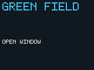

# 027 — transcript

Mechanically converted from the Pi event log by [transcript.py](../transcript.py). Summary: [027-campaign.md](027-campaign.md). Control bytes appear as Unicode control pictures (␀, ␛, …), and `$REPO` stands for the repository root.

| | |
| --- | --- |
| Model | `openai-codex/gpt-6.1-sol` |
| Start (UTC) | 2026-11-04 06:57:33 |
| Duration | 1:10:28 |
| Tool calls | 518 |
| VM boots | 42 |
| Observer messages | 1 |
| Compactions | 0 |
| Tokens (input / cached / output) | 283,486 / 39,060,096 / 54,325 |

**Tools:** `guest_write`, `guest_read`, `notes_write`, `notes_read`, `vm_boot`, `serial_read`, `vm_stop`, `guest_patch`, `serial_send`, `serial_send_text`, `vm_boot_http`, `vm_boot_disk`, `vm_boot_gui`, `vm_boot_browser`, `vm_boot_browser_paths`, `screen_capture`, `key_send`, `key_type`

**System prompt:**

```
You are the experimental agent. Use only the provided tools.

<cwd>
$REPO/.local/experiments/pi-2O5Npq/work
</cwd>
```

_Tools added: `guest_write`, `guest_read`, `notes_write`, `notes_read`, `vm_boot`, `serial_read`, `vm_stop`, `guest_patch`, `serial_send`, `serial_send_text`, `vm_boot_http`, `vm_boot_disk`, `vm_boot_gui`, `vm_boot_browser`, `vm_boot_browser_paths`, `screen_capture`, `key_send`, `key_type`_

## Stage prompt +0:00:00

> Extend the stage-026 guest browser to accept a path typed with its physical keyboard and fetch and display multiple pages in a single boot. Keep the stage-026 toolchain, disk files and ordinary GUI/shell entry points. Inspect the inherited image and use guest assembly to build new code where practical. Preserve the exact source and document integration offsets and reproduction.
>
> Use vm_boot_browser_paths. This has the existing isolated Ethernet peer and a host-only HTTP origin at the existing peer address and port. The origin accepts HTTP/1.0 GET paths consisting of a slash followed by up to 23 lowercase letters, digits, dots or hyphens. It serves distinct simple h1/p HTML for different paths in a single boot, selected at boot. The same path yields the same page. The peer accepts new SYNs after sending a response. The existing vm_boot_browser remains for the old single-path fixture. No external network is available.
>
> Use key_type to send physical keyboard events for paths and key_send ret to submit. The guest must derive the path from the keyboard events, issue GET for that exact path, and display the response using its existing HTML renderer. Support at least a slash followed by a mixture of lowercase letters and digits; longer paths, dots and hyphens are desirable. After displaying a page, typing a new path and pressing Enter must work without rebooting or restarting the VM. Boot-time /index.html may remain. Leave no hardcoded route for the typed tests. A serial command must not be necessary to enter the path. Links and Back are deferred.
>
> Test two different paths and a return to the first path in the same boot. Capture the screen for the different pages. Save the new image, source and handoff, and stop the VM. Preserve existing disk contents. If you temporarily borrow a disk slot, snapshot and restore its exact original bytes; all 16 named slots are occupied and empty is the stage-023 compiler. Historical renderer integration starts at offset 0x2470 and renderer at 0x2564 in the inherited image.

#### +0:00:00

**→ `guest_read`** `{"offset": 0, "length": 128}`

**← `guest_read`**

```
{"hex":"0020a1d241088052010000b9e1098052010000b9e1098052010000b9810a8052010000b941018052010000b91109001463010014e1ff2737010040b9021840b9e2ff2f37010000b9faffff170340a1d204048052610840b93f040071c0000054630008918404007161ffff54f1ffff171f2003d57f7000b961008052617000b9"}
```

#### +0:00:02

**→ `notes_read`**

**← `notes_read`**

`text`

<details><summary>text (7,644 chars, 40 lines)</summary>

```
STAGE026: 8192-byte executable pipeline completed. Final guest image 13564 bytes; VM stopped after final reboot/regressions. Disk files preserved (all 16 original names). Only temporary test workspace was empty, now restored to length zero and cat-verified AFTER reboot. progMath stage025, prog8 stage024, progFwd, kernel0/kernel1, src, bin and all other original contents retained. No disk test artifacts left: reproduce tests from templates below. Kernel image is the tool saved guest image, NOT the old kernel0/1 disk files.

MEMORY / ABI
Kernel loaded at 0x40200000; final image [0x40200000,0x402034fc), 13564 bytes. Loaded executable [0x40140000,0x40142000), max8192. Loaded valid flag u32=0x40142000; loaded byte-size u32=0x40142004. Installed compiler [0x40150000,0x40152000), max8192. Installed byte-size u32 NOW 0x40152000 (OLD +2048 metadata overlapped large compiler instructions!). Shared assembly/raw-load/build scratch base NOW 0x41000000. Reserve [0x41000000,0x41008000) =32768 bytes for bounded internal assembly workspace; published assembled/generated outputs max8192 bytes. Build x3=0x41000000, x4=8192. Kernel assembly internal cap configuration is8192; explicit final publication guard rejects byte length >8192 before any copy/size/flag change. Original build >=4, aligned length validation retained; upper byte check now8192. Failure retains previous runnable image. Install takes only already validated loaded image. Compiler ABI unchanged: x1 source,x2 length,x3 output,x4 capacity,w0 byte count or0; preserve callee-saved registers/SP. New kernel call wrapper additionally saves x1..x18,LR across compiler call. No persistent state uses scratch. IMPORTANT 0x40160000 is scheduler/polling state, NOT free workspace! A transient experimental scratch there caused hangs; final image has no scratch references there. Existing process/network/display entry points remain at original offsets; original kernel bytes only changed at manifest offsets below.

FINAL IMAGE PATCH MANIFEST (decimal byte offsets, exact replacement bytes; relative to original13412-byte campaign kernel). All other original bytes unchanged, notably4376 restored to original. Append block below at13412.
1968: 0b20a8d2
2024: 0520a8d2
4224: 0f20a8d2
4348: 0f20a8d2
5120: 3b080014
5460: 02008452
6208: 0f20a8d2
7988: ed0020b9
8024: 810260b9
8044: 0320a8d2
8048: 04008452
8060: 44050094
8088: bf094071
8104: 2f050094
Append152 exact bytes at13412:
0520a8d2e7f7ff170520a8d2e4031b2a2af7ff17fe0f1ff880023fd609008052fe0741f8c0035fd6ff8302d1e10b00a9e31301a9e51b02a9e72303a9e92b04a9eb3305a9ed3b06a9ef4307a9f14b08a9fe4b00f980023fd6e10b40a9e31341a9e51b42a9e72343a9e92b44a9eb3345a9ed3b46a9ef4347a9f14b48a9fe4b40f9ff830291c0035fd6bf09407128e3fe540520a8d2c3f7ff17
Active appended routines:13412 build publication sets x5 scratch, b5124;13452 stack160 save x1..18,LR/blr x20/restore/ret;13548 cmp w13,8192,b.hi4436 assembly error,mov x5 scratch,b5124. Bytes13420..13451 are inert development trampolines, no callers. Raw load scratch destination1968 AND final copy source2024 both moved. Main assembly emit/fixup scratch moved at4224,4348,6208. Shared publication at5120 is used by as/loadfile, not just older dead inline copy at4372. This was important in testing relocation.

EXTRACTION / RECONSTRUCTION
Use guest_read offset0 length13564 to extract final kernel raw hex. Original disk kernel0/kernel1 are binary8192 +5220 bytes =13412 original kernel; cat kernel0/cat kernel1 serial hex payloads (exclude shell framing) reconstruct original; apply manifest and append to reproduce final. Check utility on disk refers to OLD kernel length; do not use it to overwrite files. guest_write can restore reconstructed kernel image. Boot via vm_boot_disk. Test sources below can be recreated using save/append in temporary empty, restoring save empty<space> at end. Shell command line <=127 bytes; use append chunks at semicolon boundaries <=100 source chars. No new disk slots available.
TEST BIG (implemented in guest assembler, not an image patch): source string exactly 'b Tail;' + ('ret;' repeated520 times) + this tail:
Tail:;ldrb w5,[x1];cmp w5,32;b.ne Bad;mov w5,8192;cmp w4,w5;b.lt Fail;mov x6,x3;mov w7,2047;adr x8,Ops;ldr w9,[x8];Loop:;str w9,[x6];add x6,x6,4;sub w7,w7,1;cmp w7,0;b.ne Loop;ldr w9,[x8,4];str w9,[x6];mov w0,8192;ret;Bad:;mov w0,8196;ret;Fail:;mov w0,0;ret;Ops:;.word 1384124256;.word 3596551104;
Reproduce save empty b Tail; then20 append commands each containing26 copies of ret; then append tail in <=100-char chunks at semicolons. as empty => assembled2184 bytes (0x888, independently read installed size). Entry b jumps to Tail at2084, executing actual compiler implementation beyond offset2048. install => installed; build alpha => built8192; run0 =>0000007b. alpha begins with space, selects successful output. Generated exact executable =2047 mov w0,123 (bytes600f8052) followed by ret(c0035fd6); execution traverses every instruction past2048 through RET at8188. build beta =>build error (compiler returns8196), subsequent run0 =>0000007b retaining all8192 prior bytes/image size. This full sequence passed after final kernel reboot. Kernel as/install thus really handled2184-byte compiler; build ran8192 output using same ABI.

BOUNDARY / OVERSIZE ASSEMBLY TEST (guest assembler utility, temporary empty):
add w4,w1,2048;mov w6,w4;adr x2,D;ldr w2,[x2];adr x3,R;ldr w3,[x3];L:;str w3,[x2];add x2,x2,4;sub w4,w4,1;cmp w4,0;b.ne L;adr x5,H;ldr w5,[x5];lsl w0,w6,18;add w0,w0,5;str w0,[x5];mov w0,w6;ret;D:;.word 1073771520;H:;.word 1073743232;R:;.word 997483890;
Save/append that source into empty, as empty. run1 returns801 and creates in-RAM empty containing2049 ret; instructions (8196 bytes), header0x40000580 packed len<<16|5, data0x40007400. as empty =>assembly error; run0 still runs PREVIOUS utility and returns800, now generating2048 RET words/8192 bytes. as empty =>assembled;install=>installed; raw installed-size reader run0=>00002000. This passed final kernel after reboot. Thus inclusive8192 assembled/install boundary and oversized8196 rejection verified; failed as preserved previous utility. WARNING run1 temporarily writes four bytes into next slot's in-RAM source; DO NOT save/append anything after it until reboot. Disk is unmodified by run; reboot restores original progFwd. All final disk writes were done only after such reboot.

REGRESSIONS / FINAL STATE
After final kernel reboot: as progMath;install;build src;run2=>00000115. as prog8;install;build alpha;run4=>0000000e. Standalone: temporary empty='mov w0,77;ret;';as progFwd;install;build empty;run0=>0000004d. Then Big test passed including failure retention. empty restored blank; reboot; cat empty blank; both C tests repeated successfully. VM stopped. All16 ls filenames same. No process/network/display code removed or relocated, but those subsystems were not actively exercised in this stage.
Prior stage025: progMath is exact512-word compiler with char a[N] local1..16, runtime indexing, byte ldrb/strb, x4 stack array base, no bounds checks; fixed-name grammar x/y/p/a. src nested helper/index arithmetic expected run0/2/4=10f/115/11b. bin is pointer regression; prog8 and progFwd untouched. Original detailed stage025 implementation notes superseded here only for space; compiler sources on disk are authoritative.

OBSERVER CORRECTION: empty was a 6000-byte stage-023 compiler before 026, not a blank file. After Pi stopped, the observer restored its exact bytes from stage-024 UART logs via recv, verified exact contents after reboot, and assembled it to build alpha and run 4 (exit 0000000e). The final kernel image and progMath were not edited.
```

</details>

#### +0:00:04

**→ `guest_read`** `{"offset": 9328, "length": 2200}`

**← `guest_read`**

<details><summary>result (4,410 chars, 1 lines)</summary>

```
{"hex":"cf02a8d2ef0d4091ff0100b949010014cf02a8d2ef0d4091ff0100b9f0028052a508ff100640a1d204048052c10840b93f480071c0000054c60008918404007161ffff54060000141f2003d521008052e10100b9900380528501001086090191e403102aa1144038c114003884040071a1ffff54165200111703805295f7ff971803100beef7ff17474554202f696e6465782e68746d6c20485454502f312e300d0a0d0ac102a8d2210c4091210040b9a10000340f010094e1031baa0e00009402000014cafeff97ca02a8d20802a8d20815409145ffff17d202a8d2520e4091410240b9e1f6ff35400d03b9c0feff97b4ffff17ff8301d1f30300f9f40700f9f50b00f9f60f00f9f71300f9f81700f9f91b00f9fa1f00f9fb2300f9fc2700f9fe2b00f9f30300aaf40301aa32170010550240b976170010400640b9e10315aa02608952200000b921100091420400515f00007181ffff5420008052210000941f000071400200549700805298008052590080525a0a40b99b0780523900009400008052170000941f00007100010054970080529808805239008052b21300105a0e40b91b0f80522e000094f30340f9f40740f9f50b40f9f60f40f9f71340f9f81740f9f91b40f9fa1f40f9fb2340f9fc2740f9fe2b40f9ff830191c0035fd6030c00118102134b3f00036b6b030054620240395ff00071610200541f00007160010054620640395fa00171c1010054620a40395fc4007161010054620e40395ff800714001005407000014620640395fc0017181000054620a40395ff800716000005473060091e7ffff177302030b20008052c0035fd600008052c0035fd6ff4300d1fe0300f93c0080527f02146b2a070054600240391ff00071c00600541f800071c00500549f03007140030054e10313aa020080523f00146b2a010054230040397f800071c00000547ff00071800000542104009142040011f7ffff17c3008052427c031b427c191be202020b5f740271eb000054ff120071a00000549700805221018052217c191b1803010b1c008052c1008052217c191be202010b5f740271ab0000549700805221018052217c191b1803010be1008052217c191b0103010b620700113f00026b4a010054600240390b000094020000143c008052c1008052217c191bf702010b73060091c7ffff17fe0340f9ff430091c0035fd6000401511f0000712b0500541f680071ea04005400701d53c002000b010080520500010ba200403903008052040280524500040abf000071c0020054667c191be602060b277c191b0703070b0c148052e87c0c1b0801060b08751e53a802080be903192aeb0308aaea03192a7a0100b96b1100914a0500515f01007181ffff5408010a91290500513f010071c1feff5442781f53630400117f1400718bfcff54210400113f1c0071cbfbff54c0035fd60000304020181000f0c04000f0f0f0000e11111f111111001e11111e11111e000e11101010110e001e11111111111e001f10101e10101f001f10101e101010000e11101711110f001111111f111111001f04040404041f000702020212120c0011121418141211001010101010101f00111b15151111110011191513111111000e11111111110e001e11111e101010000e11111115120d001e11111e141211000f10100e01011e001f040404040404001111111111110e0011111111110a04001111111515150a0011110a040a11110011110a04040404001f01020408101f00e0031aaa02008052a3010010630040b91f001b6b0a0100540100403900040091425c18534200012a5f00036b21ffff54c0035fd6e0031baac0035fd60a0d0a0d4f240010e10140b902008052227400b9227401b9f00540b900021fd6ff8301d1f30300f9f40700f9f50b00f9f60f00f9f71300f9f81700f9f91b00f9fa1f00f9fb2300f9fc2700f9fd2b00f9fe2f00f9cf210010f61d40b9c701001421010054010140b9e23540b93f00026ba1000054010540b9e23940b93f00026b200f0054ff1800718b090054010140b9e23d40b93f00026b01090054011140393fb80171a1080054011540393f80007141080054e418005105190091cd0000943f000071a0160054f403002ae11540b9220040b95f00007100160054380440b9f30140b937008052617640b93f000071c00000547302049157008052617640b93f00007161140054e3060051624c1453f90d40b93903020b62481353fa1140b95a03020be50313aa020080d284028052a20000f9a5200091840400519f00007181ffff5401110010612e00f97a3200f9793600f9747200b9627a00b9e51940b9e60319aae403182aa10040b9c10000b9a5100091c6100091841000519f00007141ffff549f3f03d51f7508d59f3f03d5df3f03d521008052617600b9a5190010b0000094e0c20011c0023fd640018052c0023fd67b000014ff180071810f0054010140b9e24140b93f00026b010f0054011140393f800071a10e0054011540393fc400712b0d00543fcc0071ea0c005421c40051215c1853f30140b97302010b617640b93f000071000c00543f080071410c0054747a40b9051600109100009415018052807e1c531f2800716b000054005c01110200001400c00011c0023fd6946e1c53b5060051bf020071c1feff5440018052c0023fd601008052617600b950000014ea0940b9e10140b921000491410100b9e1030091410500f98f100010e90140b9ea0940b94b0140b97f01096b4100005429010491217540b93f04007140010054ec0140b93f010c6b610000542901049102000014e9030c2a217540b93f040071e1060054490100b92b3140f97f010091303540f9330140f9340540f9350940f9360d40f9371140f9381540f9391940f93a1d40f93b2140f93c2540f93d2940f93e2d40f9e01d40b9217140b94200001077000014aa0b00104a0940b9490140b9330100f9340500f9350900f9360d00f9371100f9381500f9391900f93a1d00f93b2100f93c2500f93d2900f93e2d00f9eb0300912b3100f93e3500f9070000144a0900104a0940b9"}
```

</details>

#### +0:00:07

> 💭 **Inspecting shell help**

**→ `vm_boot_browser_paths`**

**← `vm_boot_browser_paths`**

```
{"run_id":"20261104T065749.106975Z"}
```

#### +0:00:16

**→ `serial_read`** `{"wait_ms": 1000}`

**← `serial_read`**

`hex`

```
424f4f540a30323a38663a66303a30633a38643a33640a3c68746d6c3e3c626f64793e3c68313e48454c4c4f20574f524c443c2f68313e3c703e54494e592042524f575345523c2f703e3c2f626f64793e3c2f68746d6c3e0a7368656c6c3e20
```

`text`

```
BOOT
02:8f:f0:0c:8d:3d
<html><body><h1>HELLO WORLD</h1><p>TINY BROWSER</p></body></html>
shell>
```

#### +0:00:18

**→ `guest_read`** `{"offset": 0, "length": 1024}`

**← `guest_read`**

<details><summary>result (2,058 chars, 1 lines)</summary>

```
{"hex":"0020a1d241088052010000b9e1098052010000b9e1098052010000b9810a8052010000b941018052010000b91109001463010014e1ff2737010040b9021840b9e2ff2f37010000b9faffff170340a1d204048052610840b93f040071c0000054630008918404007161ffff54f1ffff171f2003d57f7000b961008052617000b921008052612400b9612000b97f2400b97f2000b961018052617000b90a02a8d2e5030aaa04c08052bf8400f884040071c1ffff544b0920916c0540914b0100f901008152410900b9410080524119007921008052410502794c0102f9c1068052410904b92100805241050a79850900108631009144058052a1144038c114003884040071a1ffff5404008052e5030aaaa6000491a7000891643000b921008052613800b9658000b97f8400b9669000b97f9400b967a000b97fa400b9614400b984040011a50010919f08007121feff54e1018052617000b9bf3f03d57f5000b921008052615000b941054479e1ffff34bf3f03d56131407902c180523f00026bc1030054614140793f0008716103005465890091c4008052a6144038c17c04533f28007163000054219c00111f2003d521c00011021840b9e2ff2f37010000b9c10c00123f28007163000054219c00111f2003d521c00011021840b9e2ff2f37010000b9840400714001005441078052010000b9e9ffff17410542792104001141050279bf3f03d57f5000b9d7ffff1741018052010000b90c000014ffffffffffff525400123456080600010800060400015254001234560a00020f0000000000000a00020200003400805235008052c50f001086310091c4068052a1144038c114003884040071a1ffff546589009186310091c4008052a1144038c114003884040071a1ffff54187d80521900805296028052570080522a0000944d000094b90540b9390bc05a3907001118070011170280522300009472000014012e8d52c1edac72a10000b941018052a110003936038052170380521a0000943d000094643940798404c05a84500051a1314039217c045321741e538400016b0dffff54a501018bb90540b9390bc05a3903040be603042aa1144038021840b9e2ff2f37010000b9c604007161ffff54181700119602805217028052020000943dffff17fc031eaa41054c793f00156bc1ffff54c15200112104c05a813900799f4900798eb90091010bc05ac10500b9210bc05ac10900b9d7350039df2100798569009144018052060080522200009481490079e5030eaac4060011847c0153e6028352c600160b1b000094c1210079c1ba0011410904b9b506001155050a79bf3f03d521008052615000b9fe031caac0035fd69406001154050279bf3f03d57f5000b9410544793f00146bc1ffff54bf3f03d5613140793f200071c1feff54618d4039"}
```

</details>

#### +0:00:22

> 💭 **Identifying keyboard-loop GUI**

**→ `serial_send_text`**

```
help
```

**← `serial_send_text`**

```
{"sent":5}
```

#### +0:00:28

**→ `serial_read`** `{"wait_ms": 100}`

**← `serial_read`**

`hex`

```
68656c70206563686f206c6f61642072756e207361766520617070656e6420636174206c732061736d206c6f616466696c6520617320696e7374616c6c206275696c640a7368656c6c3e20
```

`text`

```
help echo load run save append cat ls asm loadfile as install build
shell>
```

#### +0:00:30

**→ `guest_read`** `{"offset": 8192, "length": 1160}`

**← `guest_read`**

<details><summary>result (2,330 chars, 1 lines)</summary>

```
{"hex":"726f720a696e76616c696420617267756d656e740a68656c70206563686f206c6f61642072756e207361766520617070656e6420636174206c732061736d206c6f616466696c6520617320696e7374616c6c206275696c640a000000b2040010450240b9430640b9440a40b9460e40b91f00007180000054e703042ae403062ae603072a0100805202008052e703032a3f900071cb0100543f5001718a0100545f4000714b0100545f200171eb0000545f600171cb0000545f4002718a000054e703062a02000014e703042aa70000b9a5100091420400115f8002718bfdff54210400113fe001710bfdff54c0035fd60000304020181000f0c0400050403000ca02a8d2e5030aaa04808052bf8400f884040071c1ffff544b20a1d20120835261110079060080528400805261014039c65c1853c600012a8404007181ffff54a60f0034df000471680f00544c054091e5030caa0408805261014039a114003884040071a1ffff54810940b9a28c8e5262eca5723f00026b61060054810d40b9422e8c52a2cdac723f00026bc1050054814140393f88017161050054814540392105003587094079e704c05a8d8104918e0104910106a8d2210cc0daa10100f9014b8a524186a6722108c05aa10900b9bf0d00b9011480522108c05aa11100b9010f80522108c05aa11500b9015080522108c05aa11900b9e13c1053020380522100022a2108c05ac10100b9810380522108c05ac10500b9e1030daa210cc0dac10500f9bf3f03d5e1030eaa210cc0da610900f9c10140b9c1000034c107c037fdffff17c604007141f8ff543a00001400008052b00000140940a1d204048052210940b93f480071c0000054290108918404007161ffff542f0000141f2003d5490903b93f7100b961008052217100b921008052212500b9212100b93f2500b93f2100b961018052217100b9e5030aaa4601209147110491030080520201805241008052a60000f9a20800b9a1180079e3240078a5400091c6200091630400117f20007101ffff540101805241050279410503b93f3100b9213900b92a8100b93f8500b941010491219100b93f9500b94101089121a100b93fa500b921008052214500b9e1018052217100b9bf3f03d53f5100b90020a1d282f9ff17ff8302d1e00700a9e20f01a9e41702a9e61f03a9e82704a9ea2f05a9ec3706a9ee3f07a9f04708a9f27b09a910000094e00740a9e20f41a9e41742a9e61f43a9e82744a9ea2f45a9ec3746a9ee3f47a9f04748a9f27b49a9ff830291011840b9c0035fd61f2003d51f2003d5f1031eaaca02a8d2490943b9a90500344c0143b94d0544799f010d6b20050054bf3f03d5810900124e110891ce0d018bcf0140b94e012091ce0d0f8bc10140b9c20540b95f0400710102005423008052230da0723f00036be0000054430da0723f00036b2101005420008052030000141f2003d5000080524a0000140effff971f2003d51f2003d5500543b9010a00124e110491ce05018bcf01007910060011500503b9bf3f03d550050279bf3f03d53f5100b98c0500114c0103b9d6ffff17fe0311aac0035fd6cf02a8d2ef0d4091ff0100b949010014cf02a8d2ef0d4091"}
```

</details>

#### +0:00:33

> 💭 **Checking keyboard offsets**

**→ `guest_read`** `{"offset": 8960, "length": 760}`

**← `guest_read`**

<details><summary>result (1,530 chars, 1 lines)</summary>

```
{"hex":"3f8500b941010491219100b93f9500b94101089121a100b93fa500b921008052214500b9e1018052217100b9bf3f03d53f5100b90020a1d282f9ff17ff8302d1e00700a9e20f01a9e41702a9e61f03a9e82704a9ea2f05a9ec3706a9ee3f07a9f04708a9f27b09a910000094e00740a9e20f41a9e41742a9e61f43a9e82744a9ea2f45a9ec3746a9ee3f47a9f04748a9f27b49a9ff830291011840b9c0035fd61f2003d51f2003d5f1031eaaca02a8d2490943b9a90500344c0143b94d0544799f010d6b20050054bf3f03d5810900124e110891ce0d018bcf0140b94e012091ce0d0f8bc10140b9c20540b95f0400710102005423008052230da0723f00036be0000054430da0723f00036b2101005420008052030000141f2003d5000080524a0000140effff971f2003d51f2003d5500543b9010a00124e110491ce05018bcf01007910060011500503b9bf3f03d550050279bf3f03d53f5100b98c0500114c0103b9d6ffff17fe0311aac0035fd6cf02a8d2ef0d4091ff0100b949010014cf02a8d2ef0d4091ff0100b9f0028052a508ff100640a1d204048052c10840b93f480071c0000054c60008918404007161ffff54060000141f2003d521008052e10100b9900380528501001086090191e403102aa1144038c114003884040071a1ffff54165200111703805295f7ff971803100beef7ff17474554202f696e6465782e68746d6c20485454502f312e300d0a0d0ac102a8d2210c4091210040b9a10000340f010094e1031baa0e00009402000014cafeff97ca02a8d20802a8d20815409145ffff17d202a8d2520e4091410240b9e1f6ff35400d03b9c0feff97b4ffff17ff8301d1f30300f9f40700f9f50b00f9f60f00f9f71300f9f81700f9f91b00f9fa1f00f9fb2300f9fc2700f9fe2b00f9f30300aaf40301aa32170010550240b976170010400640b9e10315aa02608952200000b921100091420400515f00007181ffff5420008052210000941f000071400200549700805298008052590080525a0a40b99b078052390000940000805217000094"}
```

</details>

#### +0:00:42

> 💭 **Checking keyboard hook offsets**

**→ `guest_read`** `{"offset": 9120, "length": 232}`

**← `guest_read`**

```
{"hex":"1f2003d51f2003d5f1031eaaca02a8d2490943b9a90500344c0143b94d0544799f010d6b20050054bf3f03d5810900124e110891ce0d018bcf0140b94e012091ce0d0f8bc10140b9c20540b95f0400710102005423008052230da0723f00036be0000054430da0723f00036b2101005420008052030000141f2003d5000080524a0000140effff971f2003d51f2003d5500543b9010a00124e110491ce05018bcf01007910060011500503b9bf3f03d550050279bf3f03d53f5100b98c0500114c0103b9d6ffff17fe0311aac0035fd6cf02a8d2ef0d4091ff0100b949010014cf02a8d2ef0d4091"}
```

#### +0:00:53

> 💭 **Preparing hook at 9204**

**→ `serial_send_text`**

```
asm mov w0,77;ret;
```

**← `serial_send_text`**

```
{"sent":19}
```

#### +0:01:05

**→ `serial_read`** `{"wait_ms": 100}`

**← `serial_read`**

`hex`

```
696e76616c69642066696c650a7368656c6c3e20
```

`text`

```
invalid file
shell>
```

#### +0:01:08

> 💭 **Preparing empty snapshot slot**

**→ `serial_send_text`**

```
cat empty
```

**← `serial_send_text`**

```
{"sent":10}
```

#### +0:01:19

**→ `serial_read`** `{"wait_ms": 100}`

**← `serial_read`**

<details><summary>result (12,308 chars, 1 lines)</summary>

```
{"hex":"7375622073702c73702c33323b737472207833302c5b73705d3b737472207831392c5b73702c385d3b6d6f762078392c78313b616464207731302c77312c77323b6d6f762078382c78333b6d6f76207831312c78333b616464207731322c77332c77343b616472207831332c706f6f6c3b6d6f76207731342c303b6d6f76207731352c303b6d6f76207731362c303b6d6f76207731392c303b6d6f762077352c303b6164722078362c69743b626c204b3b626c20533b636d702077302c3130333b622e65712067643b6d6f762077322c3130323b626c20513b622068643b67643a3b6164642078392c78392c313b6d6f76207731392c323b68643a3b6164722078362c70663b6164642078362c78362c363b626c204b3b636d70207731392c323b622e6e652062643b6d6f762077302c36303b626c20433b6164722078362c72723b626c204b3b626c20453b6d6f762077322c35393b626c20513b6d6f762077322c3132353b626c20513b6d6f762077302c33363b626c20433b6c64722077302c5b7831332c36305d3b6f72722077302c77302c77353b7374722077302c5b78385d3b6d6f76207731392c313b6164722078362c70663b626c204b3b62643a3b626c20533b636d702077302c3130353b622e6e652073743b6c6472622077302c5b78392c315d3b636d702077302c3131303b622e6e652073743b6164722078362c64693b626c204b3b626c20453b6d6f762077322c35393b626c20513b6d6f76207731362c313b6d6f762077302c34383b626c20433b73743a3b636d70207731342c303b622e6e65206261643b626c20533b636d702077302c3131343b622e65712072743b636d702077302c3130353b622e65712063693b636d702077302c3131393b622e65712063773b626c20413b622073743b63693a3b6d6f762077372c303b6164722078362c69693b622063743b63773a3b6d6f762077372c313b6164722078362c77773b63743a3b626c204b3b6d6f76207731372c77353b626c20453b6d6f762077322c34313b626c20513b6d6f762077322c3132333b626c20513b6d6f762077302c35323b626c20433b6d6f76207731382c77353b6d6f762077302c35363b626c20433b6c623a3b636d70207731342c303b622e6e65206261643b626c20533b636d702077302c3132353b622e65712062653b626c20413b62206c623b62653a3b6164642078392c78392c313b636d702077372c303b622e65712070743b7375622077302c7731372c77353b6c64722077312c5b7831332c36345d3b616e642077302c77302c77313b6c64722077312c5b7831332c36305d3b6f72722077302c77302c77313b626c20573b70743a3b7375622077302c77352c7731383b6c736c2077302c77302c353b6c64722077312c5b7831332c35365d3b6f72722077302c77302c77313b6c736c2077312c7731382c323b6164642077312c77382c77313b7374722077302c5b78315d3b622073743b72743a3b6164722078362c72723b626c204b3b626c20453b6d6f762077322c35393b626c20513b6d6f762077322c3132353b626c20513b626c20533b636d702077392c7731303b622e6e65206261643b6d6f762077302c33363b626c20433b636d70207731342c303b622e6e65206261643b7375622077302c7731312c77383b62207a3b6261643a3b6d6f762077302c303b7a3a3b6c6472207831392c5b73702c385d3b6c6472207833302c5b73705d3b6164642073702c73702c33323b7265743b20413a3b7375622073702c73702c31363b737472207833302c5b73705d3b626c20533b636d702077302c3132303b622e65712061783b636d702077302c3132313b622e6e652061623b636d70207731362c303b622e65712061623b6d6f762077322c34383b622061673b61783a3b6d6f762077322c34343b61673a3b7374722077322c5b73702c385d3b6164642078392c78392c313b6d6f762077322c36313b626c20513b626c20453b6d6f762077322c35393b626c20513b6c64722077302c5b73702c385d3b626c20433b6220523b61623a3b6d6f76207731342c313b6220523b4b3a3b7375622073702c73702c31363b737472207833302c5b73705d3b6d6f762077312c303b626c20533b6b303a3b6c6472622077322c5b78365d3b6164642078362c78362c313b636d702077322c313b622e6571206b653b636d702077322c33333b622e6c74206b733b636d702077322c39373b622e6765206b6c3b626c20533b6b6c3a3b626c20503b636d702077302c77323b622e6e652061623b6164642078392c78392c313b6d6f762077312c77323b636d702077322c3132333b622e6571206b703b636d702077322c39373b622e6765206b303b6b703a3b6d6f762077312c303b626c20533b62206b303b6b733a3b636d702077312c39373b622e6c74206b743b626c20423b6b743a3b626c20533b6d6f762077312c303b62206b303b6b653a3b636d702077312c39373b622e6c7420523b626c20423b6220523b423a3b636d702077392c7731303b622e67652062723b6c6472622077302c5b78395d3b636d702077302c39353b622e65712062783b636d702077302c34383b622e6c742062723b636d702077302c35383b622e6c742062783b636d702077302c36353b622e6c742062723b636d702077302c39313b622e6c742062783b636d702077302c39373b622e6c742062723b636d702077302c3132333b622e67652062723b62783a3b6d6f76207731342c313b62723a3b7265743b453a3b7375622073702c73702c31363b737472207833302c5b73705d3b626c20543b65303a3b636d70207731342c303b622e6e6520523b626c20533b636d702077302c34333b622e65712065703b636d702077302c34353b622e6e6520523b6d6f762077322c32383b622065673b65703a3b6d6f762077322c32343b65673a3b7374722077322c5b73702c385d3b6164642078392c78392c313b626c20473b626c20543b626c20483b6c64722077302c5b73702c385d3b626c20433b622065303b543a3b7375622073702c73702c31363b737472207833302c5b73705d3b626c20463b74303a3b636d70207731342c303b622e6e6520523b626c20533b636d702077302c34323b622e6e6520523b6164642078392c78392c313b626c20473b626c20463b626c20483b6d6f762077302c33323b626c20433b622074303b20463a3b7375622073702c73702c31363b737472207833302c5b73705d3b616464207731352c7731352c313b636d70207731352c36353b622e67652066623b636d70207731342c303b622e6e652066723b626c20533b636d702077302c3130333b622e65712066633b636d702077302c34303b622e65712066703b636d702077302c3132303b622e65712066783b636d702077302c3132313b622e65712066793b7375622077322c77302c34383b636d702077322c303b622e6c742066623b636d702077322c31303b622e67652066623b6d6f762077332c303b6e303a3b6d6f762077342c31303b6d756c2077332c77332c77343b6164642077332c77332c77323b6d6f762077342c36353533353b636d702077332c77343b622e6c74206e6b3b622e6571206e6b3b622066623b6e6b3a3b6164642078392c78392c313b626c20503b7375622077322c77302c34383b636d702077322c303b622e6c74206e643b636d702077322c31303b622e6c74206e303b6e643a3b6c736c2077332c77332c353b6c64722077302c5b7831332c345d3b6f72722077302c77302c77333b626c20573b622066723b66783a3b6d6f762077302c303b622066763b66793a3b636d70207731362c303b622e65712066623b6d6f762077302c34303b66763a3b6164642078392c78392c313b626c20433b622066723b66633a3b636d70207731392c313b622e6e652066623b6164642078392c78392c313b6d6f762077322c34303b626c20513b626c20453b6d6f762077322c34313b626c20513b6164642078362c7831332c36383b636c3a3b6c64722077302c5b78365d3b6164642078362c78362c343b636d702077302c303b622e65712066723b636d702077302c313b622e6e652063653b7375622077302c77302c77353b6c64722077312c5b7831332c36345d3b616e642077302c77302c77313b6d6f762077312c3134383b6c736c2077312c77312c32343b6f72722077302c77302c77313b63653a3b626c20573b6220636c3b66703a3b6164642078392c78392c313b626c20453b6d6f762077322c34313b626c20513b622066723b66623a3b6d6f76207731342c313b66723a3b737562207731352c7731352c313b6220523b473a3b6d6f762077302c383b62204a3b483a3b6d6f762077302c31363b4a3a3b7375622073702c73702c31363b737472207833302c5b73705d3b7374722077302c5b73702c385d3b626c20433b6c64722077302c5b73702c385d3b6164642077302c77302c343b626c20433b6220523b513a3b7375622073702c73702c31363b737472207833302c5b73705d3b626c20533b636d702077302c77323b622e6e652061623b6164642078392c78392c313b523a3b6c6472207833302c5b73705d3b6164642073702c73702c31363b7265743b533a3b636d702077392c7731303b622e676520656e643b6c6472622077302c5b78395d3b636d702077302c33323b622e65712073733b636d702077302c393b622e6c7420736c3b636d702077302c31343b622e6c742073733b736c3a3b636d702077302c34373b622e6e652073723b6164642077302c77392c313b636d702077302c7731303b622e67652073723b6c6472622077302c5b78392c315d3b636d702077302c34373b622e6571206c696e653b636d702077302c34323b622e6e652073723b6164642078392c78392c323b626c6f636b3a3b636d702077392c7731303b622e676520756e3b6c6472622077302c5b78395d3b6164642078392c78392c313b636d702077302c34323b622e6e6520626c6f636b3b636d702077392c7731303b622e676520756e3b6c6472622077302c5b78395d3b636d702077302c34373b622e6e6520626c6f636b3b73733a3b6164642078392c78392c313b6220533b6c696e653a3b6164642078392c78392c323b6c6c3a3b636d702077392c7731303b622e676520656e643b6c6472622077302c5b78395d3b636d702077302c31303b622e65712073733b636d702077302c31333b622e65712073733b6164642078392c78392c313b62206c6c3b756e3a3b6d6f76207731342c313b6220656e643b73723a3b6c6472622077302c5b78395d3b7265743b503a3b636d702077392c7731303b622e676520656e643b6c6472622077302c5b78395d3b7265743b656e643a3b6d6f762077302c303b7265743b433a3b6164642077312c7731332c77303b6c64722077302c5b78315d3b6220573b573a3b6164642078312c7831312c343b636d70207731322c77313b622e6c742066756c6c3b7374722077302c5b7831315d3b616464207831312c7831312c343b6164642077352c77352c313b7265743b66756c6c3a3b6d6f76207731342c313b7265743b2069743a3b2e776f7264203534343530313335333b2e776f726420313b70663a3b2e776f7264203534343530313335333b2e776f726420323632313534","text":"sub sp,sp,32;str x30,[sp];str x19,[sp,8];mov x9,x1;add w10,w1,w2;mov x8,x3;mov x11,x3;add w12,w3,w4;adr x13,pool;mov w14,0;mov w15,0;mov w16,0;mov w19,0;mov w5,0;adr x6,it;bl K;bl S;cmp w0,103;b.eq gd;mov w2,102;bl Q;b hd;gd:;add x9,x9,1;mov w19,2;hd:;adr x6,pf;add x6,x6,6;bl K;cmp w19,2;b.ne bd;mov w0,60;bl C;adr x6,rr;bl K;bl E;mov w2,59;bl Q;mov w2,125;bl Q;mov w0,36;bl C;ldr w0,[x13,60];orr w0,w0,w5;str w0,[x8];mov w19,1;adr x6,pf;bl K;bd:;bl S;cmp w0,105;b.ne st;ldrb w0,[x9,1];cmp w0,110;b.ne st;adr x6,di;bl K;bl E;mov w2,59;bl Q;mov w16,1;mov w0,48;bl C;st:;cmp w14,0;b.ne bad;bl S;cmp w0,114;b.eq rt;cmp w0,105;b.eq ci;cmp w0,119;b.eq cw;bl A;b st;ci:;mov w7,0;adr x6,ii;b ct;cw:;mov w7,1;adr x6,ww;ct:;bl K;mov w17,w5;bl E;mov w2,41;bl Q;mov w2,123;bl Q;mov w0,52;bl C;mov w18,w5;mov w0,56;bl C;lb:;cmp w14,0;b.ne bad;bl S;cmp w0,125;b.eq be;bl A;b lb;be:;add x9,x9,1;cmp w7,0;b.eq pt;sub w0,w17,w5;ldr w1,[x13,64];and w0,w0,w1;ldr w1,[x13,60];orr w0,w0,w1;bl W;pt:;sub w0,w5,w18;lsl w0,w0,5;ldr w1,[x13,56];orr w0,w0,w1;lsl w1,w18,2;add w1,w8,w1;str w0,[x1];b st;rt:;adr x6,rr;bl K;bl E;mov w2,59;bl Q;mov w2,125;bl Q;bl S;cmp w9,w10;b.ne bad;mov w0,36;bl C;cmp w14,0;b.ne bad;sub w0,w11,w8;b z;bad:;mov w0,0;z:;ldr x19,[sp,8];ldr x30,[sp];add sp,sp,32;ret; A:;sub sp,sp,16;str x30,[sp];bl S;cmp w0,120;b.eq ax;cmp w0,121;b.ne ab;cmp w16,0;b.eq ab;mov w2,48;b ag;ax:;mov w2,44;ag:;str w2,[sp,8];add x9,x9,1;mov w2,61;bl Q;bl E;mov w2,59;bl Q;ldr w0,[sp,8];bl C;b R;ab:;mov w14,1;b R;K:;sub sp,sp,16;str x30,[sp];mov w1,0;bl S;k0:;ldrb w2,[x6];add x6,x6,1;cmp w2,1;b.eq ke;cmp w2,33;b.lt ks;cmp w2,97;b.ge kl;bl S;kl:;bl P;cmp w0,w2;b.ne ab;add x9,x9,1;mov w1,w2;cmp w2,123;b.eq kp;cmp w2,97;b.ge k0;kp:;mov w1,0;bl S;b k0;ks:;cmp w1,97;b.lt kt;bl B;kt:;bl S;mov w1,0;b k0;ke:;cmp w1,97;b.lt R;bl B;b R;B:;cmp w9,w10;b.ge br;ldrb w0,[x9];cmp w0,95;b.eq bx;cmp w0,48;b.lt br;cmp w0,58;b.lt bx;cmp w0,65;b.lt br;cmp w0,91;b.lt bx;cmp w0,97;b.lt br;cmp w0,123;b.ge br;bx:;mov w14,1;br:;ret;E:;sub sp,sp,16;str x30,[sp];bl T;e0:;cmp w14,0;b.ne R;bl S;cmp w0,43;b.eq ep;cmp w0,45;b.ne R;mov w2,28;b eg;ep:;mov w2,24;eg:;str w2,[sp,8];add x9,x9,1;bl G;bl T;bl H;ldr w0,[sp,8];bl C;b e0;T:;sub sp,sp,16;str x30,[sp];bl F;t0:;cmp w14,0;b.ne R;bl S;cmp w0,42;b.ne R;add x9,x9,1;bl G;bl F;bl H;mov w0,32;bl C;b t0; F:;sub sp,sp,16;str x30,[sp];add w15,w15,1;cmp w15,65;b.ge fb;cmp w14,0;b.ne fr;bl S;cmp w0,103;b.eq fc;cmp w0,40;b.eq fp;cmp w0,120;b.eq fx;cmp w0,121;b.eq fy;sub w2,w0,48;cmp w2,0;b.lt fb;cmp w2,10;b.ge fb;mov w3,0;n0:;mov w4,10;mul w3,w3,w4;add w3,w3,w2;mov w4,65535;cmp w3,w4;b.lt nk;b.eq nk;b fb;nk:;add x9,x9,1;bl P;sub w2,w0,48;cmp w2,0;b.lt nd;cmp w2,10;b.lt n0;nd:;lsl w3,w3,5;ldr w0,[x13,4];orr w0,w0,w3;bl W;b fr;fx:;mov w0,0;b fv;fy:;cmp w16,0;b.eq fb;mov w0,40;fv:;add x9,x9,1;bl C;b fr;fc:;cmp w19,1;b.ne fb;add x9,x9,1;mov w2,40;bl Q;bl E;mov w2,41;bl Q;add x6,x13,68;cl:;ldr w0,[x6];add x6,x6,4;cmp w0,0;b.eq fr;cmp w0,1;b.ne ce;sub w0,w0,w5;ldr w1,[x13,64];and w0,w0,w1;mov w1,148;lsl w1,w1,24;orr w0,w0,w1;ce:;bl W;b cl;fp:;add x9,x9,1;bl E;mov w2,41;bl Q;b fr;fb:;mov w14,1;fr:;sub w15,w15,1;b R;G:;mov w0,8;b J;H:;mov w0,16;J:;sub sp,sp,16;str x30,[sp];str w0,[sp,8];bl C;ldr w0,[sp,8];add w0,w0,4;bl C;b R;Q:;sub sp,sp,16;str x30,[sp];bl S;cmp w0,w2;b.ne ab;add x9,x9,1;R:;ldr x30,[sp];add sp,sp,16;ret;S:;cmp w9,w10;b.ge end;ldrb w0,[x9];cmp w0,32;b.eq ss;cmp w0,9;b.lt sl;cmp w0,14;b.lt ss;sl:;cmp w0,47;b.ne sr;add w0,w9,1;cmp w0,w10;b.ge sr;ldrb w0,[x9,1];cmp w0,47;b.eq line;cmp w0,42;b.ne sr;add x9,x9,2;block:;cmp w9,w10;b.ge un;ldrb w0,[x9];add x9,x9,1;cmp w0,42;b.ne block;cmp w9,w10;b.ge un;ldrb w0,[x9];cmp w0,47;b.ne block;ss:;add x9,x9,1;b S;line:;add x9,x9,2;ll:;cmp w9,w10;b.ge end;ldrb w0,[x9];cmp w0,10;b.eq ss;cmp w0,13;b.eq ss;add x9,x9,1;b ll;un:;mov w14,1;b end;sr:;ldrb w0,[x9];ret;P:;cmp w9,w10;b.ge end;ldrb w0,[x9];ret;end:;mov w0,0;ret;C:;add w1,w13,w0;ldr w0,[x1];b W;W:;add x1,x11,4;cmp w12,w1;b.lt full;str w0,[x11];add x11,x11,4;add w5,w5,1;ret;full:;mov w14,1;ret; it:;.word 544501353;.word 1;pf:;.word 544501353;.word 262154"}
```

</details>

#### +0:01:22

> 💭 **Checking loading behavior**

**→ `serial_send_text`**

```
load 60098052c0035fd6
run0
```

**← `serial_send_text`**

```
{"sent":27}
```

#### +0:01:33

**→ `serial_read`** `{"wait_ms": 100}`

**← `serial_read`**

`hex`

<details><summary>hex (3,898 chars, 1 lines)</summary>

```
323b2e776f7264203534343530313335333b2e776f726420323638373039363b2e776f7264203337393b64693a3b2e776f7264203534343530313335333b2e776f72642032303737353033333b69693a3b2e776f7264203637313131343835373b2e776f726420313b77773a3b2e776f726420313831383834373335313b2e776f72642031393339383735373b72723a3b2e776f726420313937303536323431383b2e776f72642039333831303b706f6f6c3a3b6d6f762077302c77313b6d6f762077302c303b7375622073702c73702c31363b7374722077302c5b73705d3b6c64722077322c5b73705d3b6164642073702c73702c31363b6164642077302c77322c77303b7375622077302c77322c77303b6d756c2077302c77322c77303b7265743b6d6f762077302c77333b6d6f762077312c77303b6d6f762077332c77303b636d702077302c303b2e776f726420313430393238363134343b2e776f7264203333353534343332303b2e776f72642036373130383836333b7375622073702c73702c33323b7374722078312c5b73705d3b7374722078332c5b73702c385d3b737472207833302c5b73702c31365d3b6d6f762077312c77303b2e776f726420313b6c6472207833302c5b73702c31365d3b6c64722078332c5b73702c385d3b6c64722078312c5b73705d3b6164642073702c73702c33323b2e776f726420303b2020202020202020202020202020202020202020202020202020202020202020202020202020202020202020202020202020202020202020202020202020202020202020202020202020202020202020202020202020202020202020202020202020202020202020202020202020202020202020202020202020202020202020202020202020202020202020202020202020202020202020202020202020202020202020202020202020202020202020202020202020202020202020202020202020202020202020202020202020202020202020202020202020202020202020202020202020202020202020202020202020202020202020202020202020202020202020202020202020202020202020202020202020202020202020202020202020202020202020202020202020202020202020202020202020202020202020202020202020202020202020202020202020202020202020202020202020202020202020202020202020202020202020202020202020202020202020202020202020202020202020202020202020202020202020202020202020202020202020202020202020202020202020202020202020202020202020202020202020202020202020202020202020202020202020202020202020202020202020202020202020202020202020202020202020202020202020202020202020202020202020202020202020202020202020202020202020202020202020202020202020202020202020202020202020202020202020202020202020202020202020202020202020202020202020202020202020202020202020202020202020202020202020202020202020202020202020202020202020202020202020202020202020202020202020202020202020202020202020202020202020202020202020202020202020202020202020202020202020202020202020202020202020202020202020202020202020202020202020202020202020202020202020202020202020202020202020202020202020202020202020202020202020202020202020202020202020202020202020202020202020202020202020202020202020202020202020202020202020202020202020202020202020202020202020202020202020202020202020202020202020202020202020202020202020202020202020202020202020202020202020202020202020202020202020202020202020202020202020202020202020202020202020202020202020202020202020202020202020202020202020202020202020202020202020202020202020202020202020202020202020202020202020202020202020202020202020202020202020202020202020202020202020202020202020202020202020202020202020202020202020202020202020202020202020202020202020202020202020202020202020202020202020202020202020202020202020202020202020202020202020202020202020202020202020202020202020202020202020202020202020202020202020202020202020202020202020202020202020202020202020202020202020202020202020202020202020202020202020202020202020202020202020202020202020202020202020202020202020202020202020202020202020202020202020202020202020202020202020202020202020202020202020202020202020202020202020202020202020202020202020202020202020202020202020202020202020202020202020202020202020202020202020202020202020202020202020202020202020202020202020202020202020202020202020202020202020202020202020202020202020202020202020202020202020202020202020202020202020202020202020202020202020200a7368656c6c3e206c6f616465640a7368656c6c3e20756e6b6e6f776e20636f6d6d616e640a7368656c6c3e20
```

</details>

`text`

<details><summary>text (1,949 chars, 4 lines)</summary>

```
2;.word 544501353;.word 2687096;.word 379;di:;.word 544501353;.word 20775033;ii:;.word 671114857;.word 1;ww:;.word 1818847351;.word 19398757;rr:;.word 1970562418;.word 93810;pool:;mov w0,w1;mov w0,0;sub sp,sp,16;str w0,[sp];ldr w2,[sp];add sp,sp,16;add w0,w2,w0;sub w0,w2,w0;mul w0,w2,w0;ret;mov w0,w3;mov w1,w0;mov w3,w0;cmp w0,0;.word 1409286144;.word 335544320;.word 67108863;sub sp,sp,32;str x1,[sp];str x3,[sp,8];str x30,[sp,16];mov w1,w0;.word 1;ldr x30,[sp,16];ldr x3,[sp,8];ldr x1,[sp];add sp,sp,32;.word 0;
shell> loaded
shell> unknown command
shell>
```

</details>

#### +0:01:36

> 💭 **Checking syntax**
> 💭 **Preparing source injection**
> 💭 **Inspecting save code**

**→ `guest_read`** `{"offset": 1600, "length": 600}`

**← `guest_read`**

```
{"hex":"850400704401805216000014ff14007123020054010140b9a26c8c5202edad723f00026b81010054011140393f8000712101005405150091e41400510b00009441018052021840b9e2ff2f37010000b9cdffff1745020030040280521f2003d502000094c8ffff1704010034a1144038021840b9e2ff2f37010000b98404007161ffff541f2003d5c0035fd67368656c6c3e2068656c70206563686f0a756e6b6e6f776e20636f6d6d616e640a0000000802a8d2081540919302a8d21f2003d5ea0500142102a8d23f0000917d060014e6000014ff10007121010054010140b902ad8c52820dae723f00026b8100005425c7003084088052daffff17ff0c0071010100540101407942ae8e523f00026b21faff54010940393fb80171e0060054ff10007183f9ff54010140b982ed8d52228cac723f00026ba1f6ff546d0000143f80007181f8ff54e41400519f200071e30400549f000171a804005481080012610400358d7c0153ec030d2a051500910b20a8d2a1144038410000943f400071600300542a6c1c53a11440383c0000943f400071c00200544101012a611500388c05007181feff540520a8d2eb0313aaec030d2aa1144038611500388c050071a1ffff54337b0bd59f3f03d51f7508d59f3f03d5df3f03d521008052a805001425070070e40080529effff1705070050040280529bffff1776050014010300344003001060023fd6f403002a0020a1d20802a8d20815409185060030a400805292ffff971501805294729413800e00121f28007143000054009c001100c000110a000094b506007101ffff5440018052060000940020a1d2"}
```

#### +0:02:00

> 💭 **Locating disk routines**

**→ `guest_read`** `{"offset": 2400, "length": 1000}`

**← `guest_read`**

<details><summary>result (2,010 chars, 1 lines)</summary>

```
{"hex":"61ffff54170080d217ffff171f2003d5e50316aa04208052bf8400f884040071c1ffff54ff7200b961008052e17200b921008052e12600b9e12200b9ff2600b9ff2200b961018052e17200b9ff3200b981008052e13a00b9f68200b9ff8600b9c1020491e19200b9ff9600b9c1020891e1a200b9ffa600b921008052e14600b9c1020c91c10200f901028052c10a00b9210080522100a072c10e00b9c1021091c10a00f98100a052c11a00b9610080524100a072c11e00b9c1420c91c11200f921008052c12a00b941008052c12e00b918008052e1018052e17200b901008052040000948f090014170080d2defeff17c10203b922781f53630080526200024bc23a0079e21f8052c2420c3902070012c6120491c604028bdf00007918070011bf3f03d5d8060279bf3f03d5ff5200b9c10644793f00186bc1ffff54bf3f03d5c1424c39c0035fd6c1000014ff080071c100005401014079826d8e523f00026ba1e2ff547f000014ff10007143e2ff54010140b9622c8c52820ea4723f00026b81000054120080528a0080520d000014ff14007103e1ff54622e8c52c2aeac723f00026b81e0ff54011140393f80007121e0ff5432008052aa0080521f2003d5171000b419010a8be50319aa1a0080525f01076b40020054a11440384a0500113f8000712002005421c000513f240071e9000054214400513f64007189000054218000513f640071280e00545a0700115f330071e9fdff546d000014920d00351c00805207000014320d0034fb0305aafc000a4b9f030271a80c00541f2003d57a0c00347c010034e5031baae4031c2aa1144038218000513f780171880b00548404007161ffff541f2003d51f2003d5cb0210910c0080d20d02805261014039810000356c0000b5ec030baa1f2003d53f001a6b81010054e50319aa66110091e4031a2aa1144038c21440383f00026ba10000548404007161ffff540b0000141f2003d56b010291ad05007181fdff54a70100142c0800b4eb030caa050000141f2003d51f2003d5660000141f2003d5a90100147c050039e50319aa66110091e4031a2aa1144038c114003884040071a1ffff5466410091e5031baae4031c2ac4000034a1144038c114003884040071a1ffff541f2003d5210080526dffff972105003545060070c40080527dfeff17b0010014654100917cfeff9713000014170300b4d90210911a02805224034039440100349f300071080100542513009172feff9741018052021840b9e2ff2f37010000b91f2003d5390302915a07007161feff5430feff17650300302400805264feff17050300504401805261feff1705030010040180525efeff17e5020010a40180525bfeff17e50200306401805258feff17e5020010"}
```

</details>

#### +0:02:11

> 💭 **Inspecting offset 3200**

**→ `guest_read`** `{"offset": 3072, "length": 256}`

**← `guest_read`**

```
{"hex":"e4031a2aa1144038c21440383f00026ba10000548404007161ffff540b0000141f2003d56b010291ad05007181fdff54a70100142c0800b4eb030caa050000141f2003d51f2003d5660000141f2003d5a90100147c050039e50319aa66110091e4031a2aa1144038c114003884040071a1ffff5466410091e5031baae4031c2ac4000034a1144038c114003884040071a1ffff541f2003d5210080526dffff972105003545060070c40080527dfeff17b0010014654100917cfeff9713000014170300b4d90210911a02805224034039440100349f300071080100542513009172feff9741018052021840b9e2ff2f37010000b91f2003d5390302915a070071"}
```

#### +0:02:17

**→ `guest_read`** `{"offset": 3216, "length": 48}`

**← `guest_read`**

```
{"hex":"a1ffff541f2003d5210080526dffff972105003545060070c40080527dfeff17b0010014654100917cfeff9713000014"}
```

#### +0:02:21

> 💭 **Preparing RAM snapshot**

**→ `guest_read`** `{"offset": 2636, "length": 128}`

**← `guest_read`**

```
{"hex":"defeff17c10203b922781f53630080526200024bc23a0079e21f8052c2420c3902070012c6120491c604028bdf00007918070011bf3f03d5d8060279bf3f03d5ff5200b9c10644793f00186bc1ffff54bf3f03d5c1424c39c0035fd6c1000014ff080071c100005401014079826d8e523f00026ba1e2ff547f000014ff100071"}
```

#### +0:02:31

> 💭 **Preparing disk-slot snapshot**
> 💭 **Preparing disk snapshot loader**

**→ `serial_send_text`**

```
load 0200a8d20340a8d204809052450040b9650000b94210009163100091840400519f00007161ffff54c0035fd6
run 0
```

**← `serial_send_text`**

```
{"sent":100}
```

#### +0:02:48

**→ `serial_read`** `{"wait_ms": 100}`

**← `serial_read`**

`hex`

```
696e76616c69642070726f6772616d0a7368656c6c3e20657869742030303030303034620a7368656c6c3e20
```

`text`

```
invalid program
shell> exit 0000004b
shell>
```

#### +0:02:52

> 💭 **Inspecting raw-load limits**

**→ `serial_send_text`**

```
load 0200a8d20340a8d2c0035fd6
run 0
```

**← `serial_send_text`**

```
{"sent":36}
```

#### +0:03:08

**→ `serial_read`** `{"wait_ms": 100}`

**← `serial_read`**

`hex`

```
6c6f616465640a7368656c6c3e20657869742034303230303861380a7368656c6c3e20
```

`text`

```
loaded
shell> exit 402008a8
shell>
```

#### +0:03:11

> 💭 **Hand-encoding snapshot loop**

**→ `serial_send_text`**

```
load 0200a8d20340a8d204809052454440b8654400b884040071a1ffff54c0035fd6
run 0
```

**← `serial_send_text`**

```
{"sent":76}
```

#### +0:03:24

**→ `serial_read`** `{"wait_ms": 100}`

**← `serial_read`**

`hex`

```
6c6f616465640a7368656c6c3e20657869742034303230303861380a7368656c6c3e20
```

`text`

```
loaded
shell> exit 402008a8
shell>
```

#### +0:03:26

> 💭 **Preparing source-code capture**

**→ `guest_read`** `{"offset": 600, "length": 260}`

**← `guest_read`**

```
{"hex":"c4068052a1144038c114003884040071a1ffff546589009186310091c4008052a1144038c114003884040071a1ffff54187d80521900805296028052570080522a0000944d000094b90540b9390bc05a3907001118070011170280522300009472000014012e8d52c1edac72a10000b941018052a110003936038052170380521a0000943d000094643940798404c05a84500051a1314039217c045321741e538400016b0dffff54a501018bb90540b9390bc05a3903040be603042aa1144038021840b9e2ff2f37010000b9c604007161ffff54181700119602805217028052020000943dffff17fc031eaa41054c793f00156bc1ffff54c15200112104c05a81390079"}
```

#### +0:03:43

> 💭 **Checking exact offsets**

**→ `guest_read`** `{"offset": 640, "length": 80}`

**← `guest_read`**

```
{"hex":"84040071a1ffff54187d80521900805296028052570080522a0000944d000094b90540b9390bc05a3907001118070011170280522300009472000014012e8d52c1edac72a10000b941018052a1100039"}
```

#### +0:03:51

> 💭 **Adjusting ACK timing**

**→ `guest_read`** `{"offset": 1120, "length": 112}`

**← `guest_read`**

```
{"hex":"00000a00020f0a0002029c401f90000003e800000000500210000000000000000008001486090191e4028052a1144038c114003884040071a1ffff547605805217038052a7ffff97185f00115a0d4091fb031aaa13008052c6ffff97a10540b92108c05a3f00196be102005464394079"}
```

#### +0:04:00

> 💭 **Patching request builder**

**→ `guest_read`** `{"offset": 9328, "length": 316}`

**← `guest_read`**

```
{"hex":"cf02a8d2ef0d4091ff0100b949010014cf02a8d2ef0d4091ff0100b9f0028052a508ff100640a1d204048052c10840b93f480071c0000054c60008918404007161ffff54060000141f2003d521008052e10100b9900380528501001086090191e403102aa1144038c114003884040071a1ffff54165200111703805295f7ff971803100beef7ff17474554202f696e6465782e68746d6c20485454502f312e300d0a0d0ac102a8d2210c4091210040b9a10000340f010094e1031baa0e00009402000014cafeff97ca02a8d20802a8d20815409145ffff17d202a8d2520e4091410240b9e1f6ff35400d03b9c0feff97b4ffff17ff8301d1f30300f9f40700f9f50b00f9f60f00f9f71300f9f81700f9f91b00f9fa1f00f9fb2300f9fc2700f9fe2b00f9f30300aaf40301aa32170010550240b976170010400640b9"}
```

#### +0:04:15

> 💭 **Tracing receive-path branches**
> 💭 **Checking wrapper restore path**

**→ `guest_read`** `{"offset": 9472, "length": 160}`

**← `guest_read`**

```
{"hex":"65782e68746d6c20485454502f312e300d0a0d0ac102a8d2210c4091210040b9a10000340f010094e1031baa0e00009402000014cafeff97ca02a8d20802a8d20815409145ffff17d202a8d2520e4091410240b9e1f6ff35400d03b9c0feff97b4ffff17ff8301d1f30300f9f40700f9f50b00f9f60f00f9f71300f9f81700f9f91b00f9fa1f00f9fb2300f9fc2700f9fe2b00f9f30300aaf40301aa32170010"}
```

#### +0:04:39

> 💭 **Tracing instruction flow**
> 💭 **Tracing keyboard return flow**

**→ `guest_read`** `{"offset": 9240, "length": 100}`

**← `guest_read`**

```
{"hex":"1f2003d5000080524a0000140effff971f2003d51f2003d5500543b9010a00124e110491ce05018bcf01007910060011500503b9bf3f03d550050279bf3f03d53f5100b98c0500114c0103b9d6ffff17fe0311aac0035fd6cf02a8d2ef0d4091ff0100b9"}
```

#### +0:04:59

> 💭 **Preparing the branch handler**
> 💭 **Building the binary dumper**

**→ `guest_read`** `{"offset": 9396, "length": 72}`

**← `guest_read`**

```
{"hex":"060000141f2003d521008052e10100b9900380528501001086090191e403102aa1144038c114003884040071a1ffff54165200111703805295f7ff971803100beef7ff1747455420"}
```

#### +0:05:25

> 💭 **Patching branch builder setup**
> 💭 **Building keyboard mapping table**

**→ `guest_read`** `{"offset": 9440, "length": 36}`

**← `guest_read`**

```
{"hex":"a1ffff54165200111703805295f7ff971803100beef7ff17474554202f696e6465782e68"}
```

#### +0:05:56

> 💭 **Creating and saving source**

**→ `serial_send_text`**

```
save empty H:;adr x6,State;cmp w1,28;b.eq Enter;cmp w1,53;b.hi Done;adr x5,Keys;lsl w0,w1,2;
append empty add x5,x5,x0;ldr w0,[x5];cmp w0,0;b.eq Done;ldr w7,[x6];cmp w0,47;b.ne Char;mov w7,0;
append empty Char:;cmp w7,0;b.ne Put;cmp w0,47;b.ne Done;Put:;cmp w7,24;b.hs Done;adr x5,Buf;
append empty add x5,x5,4;add x5,x5,x7;strb w0,[x5];add w7,w7,1;str w7,[x6];Done:;ret;
append empty Enter:;ldr w7,[x6];cmp w7,0;b.eq Done;adr x5,Buf;add x5,x5,4;add x5,x5,x7;
append empty adr x4,Suffix;mov w3,13;Copy:;ldrb w0,[x4];strb w0,[x5];add x4,x4,1;add x5,x5,1;
append empty sub w3,w3,1;cmp w3,0;b.ne Copy;add w7,w7,17;str w7,[x6,8];mov w0,1;str w0,[x6,4];ret;
append empty Tail:;adr x6,State;ldr w0,[x6,4];cmp w0,1;b.ne Done;mov w0,2;str w0,[x6,4];
append empty adr x0,Connect;ldr w0,[x0];br x0;Build:;adr x6,State;ldr w0,[x6,4];cmp w0,2;b.ne Old;
append empty ldr w16,[x6,8];adr x5,Buf;b Resume;Old:;mov w16,28;adr x5,Request;ldr w5,[x5];
append empty Resume:;adr x0,Continue;ldr w0,[x0];br x0;End:;adr x6,State;ldr w0,[x6,4];cmp w0,2;b.ne Normal;
append empty mov w0,0;str w0,[x6];str w0,[x6,4];adr x0,Unwind;ldr w0,[x0];br x0;
append empty Normal:;adr x0,Shell;ldr w0,[x0];br x0;State:;.word 0;.word 0;.word 0;
```

**← `serial_send_text`**

```
{"sent":1207}
```

#### +0:06:11

**→ `serial_read`** `{"wait_ms": 100}`

**← `serial_read`**

`hex`

```
73617665640a7368656c6c3e2073617665640a7368656c6c3e2073617665640a7368656c6c3e2073617665640a7368656c6c3e2073617665640a7368656c6c3e2073617665640a7368656c6c3e2073617665640a7368656c6c3e2073617665640a7368656c6c3e2073617665640a7368656c6c3e2073617665640a7368656c6c3e2073617665640a7368656c6c3e2073617665640a7368656c6c3e2073617665640a7368656c6c3e20
```

`text`

```
saved
shell> saved
shell> saved
shell> saved
shell> saved
shell> saved
shell> saved
shell> saved
shell> saved
shell> saved
shell> saved
shell> saved
shell> saved
shell>
```

#### +0:06:15

> 💭 **Calculating assembly addresses**

**→ `guest_read`** `{"offset": 9016, "length": 60}`

**← `guest_read`**

```
{"hex":"82f9ff17ff8302d1e00700a9e20f01a9e41702a9e61f03a9e82704a9ea2f05a9ec3706a9ee3f07a9f04708a9f27b09a910000094e00740a9e20f41a9"}
```

#### +0:06:24

> 💭 **Calculating request buffer words**

**→ `serial_send_text`**

```
append empty Connect:;.word 1075839624;Request:;.word 1075848440;Continue:;.word 1075848396;
append empty Unwind:;.word 1075848044;Shell:;.word 1075847768;Suffix:;.word 1414809632;.word 774975312;
append empty .word 218762544;.word 10;Buf:;.word 542393671;.word 0;.word 0;.word 0;.word 0;.word 0;
append empty .word 0;.word 0;.word 0;.word 0;.word 0;Keys:;.word 0;.word 0;.word 49;.word 50;.word 51;
append empty .word 52;.word 53;.word 54;.word 55;.word 56;.word 57;.word 48;.word 45;.word 0;.word 0;
append empty .word 0;.word 113;.word 119;.word 101;.word 114;.word 116;.word 121;.word 117;.word 105;
append empty .word 111;.word 112;.word 0;.word 0;.word 0;.word 0;.word 97;.word 115;.word 100;.word 102;
append empty .word 103;.word 104;.word 106;.word 107;.word 108;.word 0;.word 0;.word 0;.word 0;.word 0;
append empty .word 122;.word 120;.word 99;.word 118;.word 98;.word 110;.word 109;.word 46;.word 0;.word 47;
as empty
```

**← `serial_send_text`**

```
{"sent":930}
```

#### +0:06:41

**→ `serial_read`** `{"wait_ms": 100}`

**← `serial_read`**

`hex`

```
73617665640a7368656c6c3e2073617665640a7368656c6c3e2073617665640a7368656c6c3e2073617665640a7368656c6c3e2073617665640a7368656c6c3e2073617665640a7368656c6c3e2073617665640a7368656c6c3e2073617665640a7368656c6c3e2073617665640a7368656c6c3e20617373656d626c79206572726f720a7368656c6c3e20
```

`text`

```
saved
shell> saved
shell> saved
shell> saved
shell> saved
shell> saved
shell> saved
shell> saved
shell> saved
shell> assembly error
shell>
```

#### +0:06:45

> 💭 **Checking branch mnemonics**

**→ `guest_read`** `{"offset": 6600, "length": 1200}`

**← `guest_read`**

<details><summary>result (2,410 chars, 1 lines)</summary>

```
{"hex":"63bcff34c0035fd668656c70206563686f206c6f61642072756e207361766520617070656e6420636174206c732061736d206c6f616466696c652061730a0000210140393fb8007160000054ed0309aaeffeff175f1d0071a3b9ff54210540393fdc017141b9ff54210940393fbc0171e1b8ff54210d40393fc8017181b8ff54211140393f90017121b8ff54211540393f800071c1b7ff542d1900912e010a8b06008012beffff97eb03012a8cffff9782fdff17828d8c52420ea0727f01026bc0040054628e8e52420ea0727f01026ba0040054828d8c52424eac727f01026b80040054628e8e52424eac727f01026b60040054228c8c52420ea0727f01026b40090054428c8d52420ea0727f01026bc0090054a2ad8e52820da0727f01026b400a005422cc8d52820ca0727f01026b200a0054e24d8e52420ea0727f01026be0090054826d8e52820da0727f01026b400b00548efdff170b28b7520f0080520a0000140b20b7520f008052070000140b28a7522f008052040000140b20a7522f0080521f2003d566ffff97f003012aaf000035520800116b79022a040000141f2003d542afff351200805255ffff9741ffff977f6c0171a1aeff54ad050091690000945f04007121aeff54f103012a39ffff977f740171400200547fb0007161adff54ad050091e6ff8152c620d21a6bffff97220080524220d21a420400513f00026a41acff542124d21a215416536b01012a28ffff977f74017181abff54ad050091f3feff173effff975f040071e1aaff54f003012a32ffff970b00a2526b01102a05ffff1736ffff975f040071e1a9ff5421681b53ebc7ba526b01012a1fffff9715fdff170b808f520b60a372060000140b40a152040000140b40a552020000141f2003d526ffff9702a8ff35f003012a1bffff9722ffff9782a7ff35f103012a17ffff971effff9702a7ff356b41012acffeff171affff9782a6ff35f003012a0fffff9716ffff9702a6ff35f103012a0bffff97e603805230ffff97e203014b42100012423c1053e30380526300014b635416530b60aa526b01022a6b01032abbfeff170b50aa526b7d122a83feff170bdcd736ebdbf737dbfeff1711000094f003012af203022af5feff970d0000945f00126ba1a2ff54f103012af0feff97b2d3ff340200b0526b01022ae6ff815212ffff97215416536b01012aa4feff17bf010eeb22a1ff54a30140397f80007161000054ad050091faffff177fcc0171e1dcff54a10900913f000eebe89fff54a30540397fc00171819fff54ed0301aae103805222008052c0035fd6a955ff35ff1c0071c1010054010140b922cd8d52628eae723f00026b2101005401094079228c8d523f00026ba1000054011940393fb00171800900541f2003d5ff10007103baff54010140b942ae8e52c20da4723f00026b80020054ff18007123b9ff5442ac8e52228dad723f00026ba1b8ff5401094079820c84523f00026b21b8ff549100805212008052ca00805246fbff171f2003d5010080521f0000141f2003d51f2003d50d1100910e01078b95feff97060080120100805205008052bf010eeba2010054a301403963c000517f240071280100542108018b21f87fd32100038b3f0006eb880b0054ad050091a5040011f3ffff17050b003482feff97"}
```

</details>

#### +0:06:55

> 💭 **Locating ASCII sequence**
> 💭 **Rewriting first section**

**→ `serial_send_text`**

<details><summary>text (2,195 chars, 25 lines)</summary>

```
save empty H:;adr x6,State;cmp w1,28;b.eq Enter;cmp w1,53;b.hi Done;adr x5,Keys;lsl w0,w1,2;
append empty add x5,x5,x0;ldr w0,[x5];cmp w0,0;b.eq Done;ldr w7,[x6];cmp w0,47;b.ne Char;mov w7,0;
append empty Char:;cmp w7,0;b.ne Put;cmp w0,47;b.ne Done;Put:;cmp w7,24;b.ge Done;adr x5,Buf;
append empty add x5,x5,4;add x5,x5,x7;strb w0,[x5];add w7,w7,1;str w7,[x6];Done:;ret;
append empty Enter:;ldr w7,[x6];cmp w7,0;b.eq Done;adr x5,Buf;add x5,x5,4;add x5,x5,x7;
append empty adr x4,Suffix;mov w3,13;Copy:;ldrb w0,[x4];strb w0,[x5];add x4,x4,1;add x5,x5,1;
append empty sub w3,w3,1;cmp w3,0;b.ne Copy;add w7,w7,17;str w7,[x6,8];mov w0,1;str w0,[x6,4];ret;
append empty Tail:;adr x6,State;ldr w0,[x6,4];cmp w0,1;b.ne Done;mov w0,2;str w0,[x6,4];
append empty adr x0,Connect;ldr w0,[x0];.word 3592355840;Build:;adr x6,State;ldr w0,[x6,4];
append empty cmp w0,2;b.ne Old;ldr w16,[x6,8];adr x5,Buf;b Resume;Old:;mov w16,28;
append empty adr x5,Request;ldr w5,[x5];Resume:;adr x0,Continue;ldr w0,[x0];.word 3592355840;
append empty End:;adr x6,State;ldr w0,[x6,4];cmp w0,2;b.ne Normal;mov w0,0;str w0,[x6];str w0,[x6,4];
append empty adr x0,Unwind;ldr w0,[x0];.word 3592355840;Normal:;adr x0,Shell;ldr w0,[x0];.word 3592355840;
append empty State:;.word 0;.word 0;.word 0;Connect:;.word 1075839624;Request:;.word 1075848440;
append empty Continue:;.word 1075848396;Unwind:;.word 1075848044;Shell:;.word 1075847768;
append empty Suffix:;.word 1414809632;.word 774975312;.word 218762544;.word 10;Buf:;.word 542393671;
append empty .word 0;.word 0;.word 0;.word 0;.word 0;.word 0;.word 0;.word 0;.word 0;.word 0;
append empty Keys:;.word 0;.word 0;.word 49;.word 50;.word 51;.word 52;.word 53;.word 54;.word 55;
append empty .word 56;.word 57;.word 48;.word 45;.word 0;.word 0;.word 0;.word 113;.word 119;.word 101;
append empty .word 114;.word 116;.word 121;.word 117;.word 105;.word 111;.word 112;.word 0;.word 0;
append empty .word 0;.word 0;.word 97;.word 115;.word 100;.word 102;.word 103;.word 104;.word 106;
append empty .word 107;.word 108;.word 0;.word 0;.word 0;.word 0;.word 0;.word 122;.word 120;.word 99;
append empty .word 118;.word 98;.word 110;.word 109;.word 46;.word 0;.word 47;
as empty
```

</details>

**← `serial_send_text`**

```
{"sent":2195}
```

#### +0:07:23

**→ `serial_read`** `{"wait_ms": 100}`

**← `serial_read`**

`hex`

```
73617665640a7368656c6c3e2073617665640a7368656c6c3e2073617665640a7368656c6c3e2073617665640a7368656c6c3e2073617665640a7368656c6c3e2073617665640a7368656c6c3e2073617665640a7368656c6c3e2073617665640a7368656c6c3e2073617665640a7368656c6c3e2073617665640a7368656c6c3e2073617665640a7368656c6c3e2073617665640a7368656c6c3e2073617665640a7368656c6c3e2073617665640a7368656c6c3e2073617665640a7368656c6c3e2073617665640a7368656c6c3e2073617665640a7368656c6c3e2073617665640a7368656c6c3e2073617665640a7368656c6c3e2073617665640a7368656c6c3e2073617665640a7368656c6c3e2073617665640a7368656c6c3e2073617665640a7368656c6c3e20617373656d626c79206572726f720a7368656c6c3e20
```

`text`

```
saved
shell> saved
shell> saved
shell> saved
shell> saved
shell> saved
shell> saved
shell> saved
shell> saved
shell> saved
shell> saved
shell> saved
shell> saved
shell> saved
shell> saved
shell> saved
shell> saved
shell> saved
shell> saved
shell> saved
shell> saved
shell> saved
shell> saved
shell> assembly error
shell>
```

#### +0:07:26

> 💭 **Testing reduced slot source**

**→ `serial_send_text`**

```
save empty adr x6,State;cmp w1,28;b.eq Enter;cmp w1,54;b.ge Done;adr x5,Keys;lsl w0,w1,2;
append empty add x5,x5,x0;ldr w0,[x5];Done:;ret;Enter:;ret;State:;.word 0;Keys:;.word 0;
as empty
```

**← `serial_send_text`**

```
{"sent":188}
```

#### +0:07:39

**→ `serial_read`** `{"wait_ms": 100}`

**← `serial_read`**

`hex`

```
73617665640a7368656c6c3e2073617665640a7368656c6c3e20617373656d626c79206572726f720a7368656c6c3e20
```

`text`

```
saved
shell> saved
shell> assembly error
shell>
```

#### +0:07:41

**→ `serial_send_text`**

```
save empty adr x6,State;cmp w1,28;b.eq Enter;cmp w1,54;b.ge Done;adr x5,Keys;lsl w0,w1,2;
append empty add w5,w5,w0;ldr w0,[x5];Done:;ret;Enter:;ret;State:;.word 0;Keys:;.word 0;
as empty
```

**← `serial_send_text`**

```
{"sent":188}
```

#### +0:07:47

**→ `serial_read`** `{"wait_ms": 100}`

**← `serial_read`**

`hex`

```
73617665640a7368656c6c3e2073617665640a7368656c6c3e20617373656d626c65640a7368656c6c3e20
```

`text`

```
saved
shell> saved
shell> assembled
shell>
```

#### +0:07:49

> 💭 **Replacing unsupported add registers**

**→ `serial_send_text`**

<details><summary>text (2,195 chars, 25 lines)</summary>

```
save empty H:;adr x6,State;cmp w1,28;b.eq Enter;cmp w1,54;b.ge Done;adr x5,Keys;lsl w0,w1,2;
append empty add w5,w5,w0;ldr w0,[x5];cmp w0,0;b.eq Done;ldr w7,[x6];cmp w0,47;b.ne Char;mov w7,0;
append empty Char:;cmp w7,0;b.ne Put;cmp w0,47;b.ne Done;Put:;cmp w7,24;b.ge Done;adr x5,Buf;
append empty add x5,x5,4;add w5,w5,w7;strb w0,[x5];add w7,w7,1;str w7,[x6];Done:;ret;
append empty Enter:;ldr w7,[x6];cmp w7,0;b.eq Done;adr x5,Buf;add x5,x5,4;add w5,w5,w7;
append empty adr x4,Suffix;mov w3,13;Copy:;ldrb w0,[x4];strb w0,[x5];add x4,x4,1;add x5,x5,1;
append empty sub w3,w3,1;cmp w3,0;b.ne Copy;add w7,w7,17;str w7,[x6,8];mov w0,1;str w0,[x6,4];ret;
append empty Tail:;adr x6,State;ldr w0,[x6,4];cmp w0,1;b.ne Done;mov w0,2;str w0,[x6,4];
append empty adr x0,Connect;ldr w0,[x0];.word 3592355840;Build:;adr x6,State;ldr w0,[x6,4];
append empty cmp w0,2;b.ne Old;ldr w16,[x6,8];adr x5,Buf;b Resume;Old:;mov w16,28;
append empty adr x5,Request;ldr w5,[x5];Resume:;adr x0,Continue;ldr w0,[x0];.word 3592355840;
append empty End:;adr x6,State;ldr w0,[x6,4];cmp w0,2;b.ne Normal;mov w0,0;str w0,[x6];str w0,[x6,4];
append empty adr x0,Unwind;ldr w0,[x0];.word 3592355840;Normal:;adr x0,Shell;ldr w0,[x0];.word 3592355840;
append empty State:;.word 0;.word 0;.word 0;Connect:;.word 1075839624;Request:;.word 1075848440;
append empty Continue:;.word 1075848396;Unwind:;.word 1075848044;Shell:;.word 1075847768;
append empty Suffix:;.word 1414809632;.word 774975312;.word 218762544;.word 10;Buf:;.word 542393671;
append empty .word 0;.word 0;.word 0;.word 0;.word 0;.word 0;.word 0;.word 0;.word 0;.word 0;
append empty Keys:;.word 0;.word 0;.word 49;.word 50;.word 51;.word 52;.word 53;.word 54;.word 55;
append empty .word 56;.word 57;.word 48;.word 45;.word 0;.word 0;.word 0;.word 113;.word 119;.word 101;
append empty .word 114;.word 116;.word 121;.word 117;.word 105;.word 111;.word 112;.word 0;.word 0;
append empty .word 0;.word 0;.word 97;.word 115;.word 100;.word 102;.word 103;.word 104;.word 106;
append empty .word 107;.word 108;.word 0;.word 0;.word 0;.word 0;.word 0;.word 122;.word 120;.word 99;
append empty .word 118;.word 98;.word 110;.word 109;.word 46;.word 0;.word 47;
as empty
```

</details>

**← `serial_send_text`**

```
{"sent":2195}
```

#### +0:08:13

**→ `serial_read`** `{"wait_ms": 100}`

**← `serial_read`**

`hex`

```
73617665640a7368656c6c3e2073617665640a7368656c6c3e2073617665640a7368656c6c3e2073617665640a7368656c6c3e2073617665640a7368656c6c3e2073617665640a7368656c6c3e2073617665640a7368656c6c3e2073617665640a7368656c6c3e2073617665640a7368656c6c3e2073617665640a7368656c6c3e2073617665640a7368656c6c3e2073617665640a7368656c6c3e2073617665640a7368656c6c3e2073617665640a7368656c6c3e2073617665640a7368656c6c3e2073617665640a7368656c6c3e2073617665640a7368656c6c3e2073617665640a7368656c6c3e2073617665640a7368656c6c3e2073617665640a7368656c6c3e2073617665640a7368656c6c3e2073617665640a7368656c6c3e2073617665640a7368656c6c3e20617373656d626c65640a7368656c6c3e20
```

`text`

```
saved
shell> saved
shell> saved
shell> saved
shell> saved
shell> saved
shell> saved
shell> saved
shell> saved
shell> saved
shell> saved
shell> saved
shell> saved
shell> saved
shell> saved
shell> saved
shell> saved
shell> saved
shell> saved
shell> saved
shell> saved
shell> saved
shell> saved
shell> assembled
shell>
```

#### +0:08:17

> 💭 **Preparing a non-overwriting dump**

**→ `serial_send_text`**

```
load 0220a8d20320a1d204608052451440386500003984040071a1ffff54c0035fd6
run 0
```

**← `serial_send_text`**

```
{"sent":76}
```

#### +0:08:34

**→ `serial_read`** `{"wait_ms": 100}`

**← `serial_read`**

`hex`

<details><summary>hex (1,606 chars, 1 lines)</summary>

```
6c6f616465640a7368656c6c3e200220a8d20320a1d204608052451440386500003984040071a1ffff54c0035fd6a00040b91f00007120020054c70040b91fbc00714100005407008052ff000071610000541fbc007121010054ff600071ea00005445090010a5100091a500070ba0000039e7040011c70000b9c0035fd6c70040b9ff000071a0ffff5405080010a5100091a500070b24070010a301805280004039a000003984040091a5040091630400517f00007141ffff54e7440011c70800b920008052c00400b9c0035fd666040010c00440b91f04007101fdff5440008052c00400b900040010000040b900001fd646030010c00440b91f08007181000054d00840b9250400100400001490038052c5020010a50040b9a0020010000040b900001fd6a6010010c00440b91f080071e100005400008052c00000b9c00400b980010010000040b900001fd640010010000040b900001fd600000000000000000000000088022040f8242040cc2420406c2320405822204020485454502f312e300d0a0d0a00000047455420000000000000000000000000000000000000000000000000000000000000000000000000000000000000000000000000310000003200000033000000340000003500000036000000370000003800000039000000300000002d00000000000000000000000000000071000000770000006500000072000000740000007900000075000000690000006f00000070000000000000000000000000000000000000006100000073000000640000006600000067000000680000006a0000006b0000006c00000000000000000000000000000000000000000000007a000000780000006300000076000000620000006e0000006d0000002e000000000000002f0000000000000000000000000000000000000000000000000000000000000000000000000000000000000000000000000000000000000000000000000000000000000000000000000000000000000000000000000000000000000000000000000000000000000000000000000000000000000000000000000000000000000000000000657869742034303230303861380a7368656c6c3e20
```

</details>

`text`

```
loaded
shell> ␂ ��␃ ��␄`�RE␔@8e␀␀9�␄␀q���T�␃_֠␀@�␟␀␀q ␂␀T�␀@�␟�␀qA␀␀T␇␀�R�␀␀qa␀␀T␟�␀q!␁␀T�`␀q�␀␀TE	␀␐�␐␀��␀␇␋�␀␀9�␄␀␑�␀␀��␃_��␀@��␀␀q���T␅␈␀␐�␐␀��␀␇␋$␇␀␐�␁�R�␀@9�␀␀9�␄␀��␄␀�c␄␀Q␡␀␀qA��T�D␀␑�␈␀� ␀�R�␄␀��␃_�f␄␀␐�␄@�␟␄␀q␁��T@␀�R�␄␀�␀␄␀␐␀␀@�␀␀␟�F␃␀␐�␄@�␟␈␀q�␀␀T�␈@�%␄␀␐␄␀␀␔�␃�R�␂␀␐�␀@��␂␀␐␀␀@�␀␀␟֦␁␀␐�␄@�␟␈␀q�␀␀T␀␀�R�␀␀��␄␀��␁␀␐␀␀@�␀␀␟�@␁␀␐␀␀@�␀␀␟�␀␀␀␀␀␀␀␀␀␀␀␀�␂ @�$ @�$ @l# @X" @ HTTP/1.0␍
␍
␀␀␀GET ␀␀␀␀␀␀␀␀␀␀␀␀␀␀␀␀␀␀␀␀␀␀␀␀␀␀␀␀␀␀␀␀␀␀␀␀␀␀␀␀␀␀␀␀␀␀␀␀1␀␀␀2␀␀␀3␀␀␀4␀␀␀5␀␀␀6␀␀␀7␀␀␀8␀␀␀9␀␀␀0␀␀␀-␀␀␀␀␀␀␀␀␀␀␀␀␀␀␀q␀␀␀w␀␀␀e␀␀␀r␀␀␀t␀␀␀y␀␀␀u␀␀␀i␀␀␀o␀␀␀p␀␀␀␀␀␀␀␀␀␀␀␀␀␀␀␀␀␀␀a␀␀␀s␀␀␀d␀␀␀f␀␀␀g␀␀␀h␀␀␀j␀␀␀k␀␀␀l␀␀␀␀␀␀␀␀␀␀␀␀␀␀␀␀␀␀␀␀␀␀␀z␀␀␀x␀␀␀c␀␀␀v␀␀␀b␀␀␀n␀␀␀m␀␀␀.␀␀␀␀␀␀␀/␀␀␀␀␀␀␀␀␀␀␀␀␀␀␀␀␀␀␀␀␀␀␀␀␀␀␀␀␀␀␀␀␀␀␀␀␀␀␀␀␀␀␀␀␀␀␀␀␀␀␀␀␀␀␀␀␀␀␀␀␀␀␀␀␀␀␀␀␀␀␀␀␀␀␀␀␀␀␀␀␀␀␀␀␀␀␀␀␀␀␀␀␀␀␀␀␀␀␀␀␀␀␀␀␀␀␀␀␀␀␀␀␀␀␀␀␀␀␀␀␀␀␀␀␀␀␀␀␀␀␀exit 402008a8
shell>
```

#### +0:08:37

> 💭 **Reconstructing overwritten code bytes**
> 💭 **Preserving assembly first**

**→ `serial_send_text`**

```
as empty
install
load 0220a8d20200a0f20320a1d204508052451440386500003984040071a1ffff54c0035fd6
```

**← `serial_send_text`**

```
{"sent":95}
```

#### +0:08:55

> 💭 **Checking x2 encoding**

**→ `serial_send_text`**

```
load a202a8d20320a1d204508052451440386500003984040071a1ffff54c0035fd6
run 0
```

**← `serial_send_text`**

```
{"sent":76}
```

#### +0:09:07

**→ `serial_read`** `{"wait_ms": 100}`

**← `serial_read`**

`hex`

```
617373656d626c65640a7368656c6c3e20696e7374616c6c65640a7368656c6c3e20696e76616c69642070726f6772616d0a7368656c6c3e206c6f616465640a7368656c6c3e20660a00103f700071400300543fd80071ea020054a50c001020741e53a500000ba00040b91f00007120020054c70040b91fbc00714100005407008052ff000071610000541fbc007121010054ff600071ea00005445090010a5100091a500070ba0000039e7040011c70000b9c0035fd6c70040b9ff000071a0ffff5405080010a5100091a500070b24070010a301805280004039a000003984040091a5040091630400517f00007141ffff54e7440011c70800b920008052c00400b9c0035fd666040010c00440b91f04007101fdff5440008052c00400b900040010000040b900001fd646030010c00440b91f08007181000054d00840b9250400100400001490038052c5020010a50040b9a0020010000040b900001fd6a6010010c00440b91f080071e100005400008052c00000b9c00400b980010010000040b900001fd640010010000040b900001fd600000000000000000000000088022040f8242040cc2420406c2320405822204020485454502f312e300d0a0d0a00000047455420000000000000000000000000000000000000000000000000000000000000000000000000000000000000000000000000310000003200000033000000340000003500000036000000370000003800000039000000300000002d00000000000000000000000000000071000000770000006500000072000000740000007900000075000000690000006f00000070000000000000000000000000000000000000006100000073000000640000006600000067000000680000006a0000006b0000006c00000000000000000000000000000000000000000000007a000000780000006300000076000000620000006e0000006d0000002e000000000000002f000000657869742034303230303861380a7368656c6c3e20
```

`text`

```
assembled
shell> installed
shell> invalid program
shell> loaded
shell> f
␀␐?p␀q@␃␀T?�␀q�␂␀T�␌␀␐ t␞S�␀␀␋�␀@�␟␀␀q ␂␀T�␀@�␟�␀qA␀␀T␇␀�R�␀␀qa␀␀T␟�␀q!␁␀T�`␀q�␀␀TE	␀␐�␐␀��␀␇␋�␀␀9�␄␀␑�␀␀��␃_��␀@��␀␀q���T␅␈␀␐�␐␀��␀␇␋$␇␀␐�␁�R�␀@9�␀␀9�␄␀��␄␀�c␄␀Q␡␀␀qA��T�D␀␑�␈␀� ␀�R�␄␀��␃_�f␄␀␐�␄@�␟␄␀q␁��T@␀�R�␄␀�␀␄␀␐␀␀@�␀␀␟�F␃␀␐�␄@�␟␈␀q�␀␀T�␈@�%␄␀␐␄␀␀␔�␃�R�␂␀␐�␀@��␂␀␐␀␀@�␀␀␟֦␁␀␐�␄@�␟␈␀q�␀␀T␀␀�R�␀␀��␄␀��␁␀␐␀␀@�␀␀␟�@␁␀␐␀␀@�␀␀␟�␀␀␀␀␀␀␀␀␀␀␀␀�␂ @�$ @�$ @l# @X" @ HTTP/1.0␍
␍
␀␀␀GET ␀␀␀␀␀␀␀␀␀␀␀␀␀␀␀␀␀␀␀␀␀␀␀␀␀␀␀␀␀␀␀␀␀␀␀␀␀␀␀␀␀␀␀␀␀␀␀␀1␀␀␀2␀␀␀3␀␀␀4␀␀␀5␀␀␀6␀␀␀7␀␀␀8␀␀␀9␀␀␀0␀␀␀-␀␀␀␀␀␀␀␀␀␀␀␀␀␀␀q␀␀␀w␀␀␀e␀␀␀r␀␀␀t␀␀␀y␀␀␀u␀␀␀i␀␀␀o␀␀␀p␀␀␀␀␀␀␀␀␀␀␀␀␀␀␀␀␀␀␀a␀␀␀s␀␀␀d␀␀␀f␀␀␀g␀␀␀h␀␀␀j␀␀␀k␀␀␀l␀␀␀␀␀␀␀␀␀␀␀␀␀␀␀␀␀␀␀␀␀␀␀z␀␀␀x␀␀␀c␀␀␀v␀␀␀b␀␀␀n␀␀␀m␀␀␀.␀␀␀␀␀␀␀/␀␀␀exit 402008a8
shell>
```

#### +0:09:10

> 💭 **Verifying code offsets**
> 💭 **Restoring disk snapshot**

> 💭 **Checking snapshot state**

**→ `serial_send_text`**

```
load 0240a8d20300a8d204809052454440b8654400b884040071a1ffff54c0035fd6
run 0
load f3031eaaa0000010000040b92100805200003fd660025fd6500a2040
run 0
cat empty
```

**← `serial_send_text`**

```
{"sent":154}
```

#### +0:09:39

**→ `serial_read`** `{"wait_ms": 100}`

**← `serial_read`**

`hex`

<details><summary>hex (8,192 chars, 1 lines)</summary>

```
6c6f616465640a7368656c6c3e20657869742034303230303861380a7368656c6c3e206c6f616465640a7368656c6c3e20657869742034303230306135300a7368656c6c3e207375622073702c73702c33323b737472207833302c5b73705d3b737472207831392c5b73702c385d3b6d6f762078392c78313b616464207731302c77312c77323b6d6f762078382c78333b6d6f76207831312c78333b616464207731322c77332c77343b616472207831332c706f6f6c3b6d6f76207731342c303b6d6f76207731352c303b6d6f76207731362c303b6d6f76207731392c303b6d6f762077352c303b6164722078362c69743b626c204b3b626c20533b636d702077302c3130333b622e65712067643b6d6f762077322c3130323b626c20513b622068643b67643a3b6164642078392c78392c313b6d6f76207731392c323b68643a3b6164722078362c70663b6164642078362c78362c363b626c204b3b636d70207731392c323b622e6e652062643b6d6f762077302c36303b626c20433b6164722078362c72723b626c204b3b626c20453b6d6f762077322c35393b626c20513b6d6f762077322c3132353b626c20513b6d6f762077302c33363b626c20433b6c64722077302c5b7831332c36305d3b6f72722077302c77302c77353b7374722077302c5b78385d3b6d6f76207731392c313b6164722078362c70663b626c204b3b62643a3b626c20533b636d702077302c3130353b622e6e652073743b6c6472622077302c5b78392c315d3b636d702077302c3131303b622e6e652073743b6164722078362c64693b626c204b3b626c20453b6d6f762077322c35393b626c20513b6d6f76207731362c313b6d6f762077302c34383b626c20433b73743a3b636d70207731342c303b622e6e65206261643b626c20533b636d702077302c3131343b622e65712072743b636d702077302c3130353b622e65712063693b636d702077302c3131393b622e65712063773b626c20413b622073743b63693a3b6d6f762077372c303b6164722078362c69693b622063743b63773a3b6d6f762077372c313b6164722078362c77773b63743a3b626c204b3b6d6f76207731372c77353b626c20453b6d6f762077322c34313b626c20513b6d6f762077322c3132333b626c20513b6d6f762077302c35323b626c20433b6d6f76207731382c77353b6d6f762077302c35363b626c20433b6c623a3b636d70207731342c303b622e6e65206261643b626c20533b636d702077302c3132353b622e65712062653b626c20413b62206c623b62653a3b6164642078392c78392c313b636d702077372c303b622e65712070743b7375622077302c7731372c77353b6c64722077312c5b7831332c36345d3b616e642077302c77302c77313b6c64722077312c5b7831332c36305d3b6f72722077302c77302c77313b626c20573b70743a3b7375622077302c77352c7731383b6c736c2077302c77302c353b6c64722077312c5b7831332c35365d3b6f72722077302c77302c77313b6c736c2077312c7731382c323b6164642077312c77382c77313b7374722077302c5b78315d3b622073743b72743a3b6164722078362c72723b626c204b3b626c20453b6d6f762077322c35393b626c20513b6d6f762077322c3132353b626c20513b626c20533b636d702077392c7731303b622e6e65206261643b6d6f762077302c33363b626c20433b636d70207731342c303b622e6e65206261643b7375622077302c7731312c77383b62207a3b6261643a3b6d6f762077302c303b7a3a3b6c6472207831392c5b73702c385d3b6c6472207833302c5b73705d3b6164642073702c73702c33323b7265743b20413a3b7375622073702c73702c31363b737472207833302c5b73705d3b626c20533b636d702077302c3132303b622e65712061783b636d702077302c3132313b622e6e652061623b636d70207731362c303b622e65712061623b6d6f762077322c34383b622061673b61783a3b6d6f762077322c34343b61673a3b7374722077322c5b73702c385d3b6164642078392c78392c313b6d6f762077322c36313b626c20513b626c20453b6d6f762077322c35393b626c20513b6c64722077302c5b73702c385d3b626c20433b6220523b61623a3b6d6f76207731342c313b6220523b4b3a3b7375622073702c73702c31363b737472207833302c5b73705d3b6d6f762077312c303b626c20533b6b303a3b6c6472622077322c5b78365d3b6164642078362c78362c313b636d702077322c313b622e6571206b653b636d702077322c33333b622e6c74206b733b636d702077322c39373b622e6765206b6c3b626c20533b6b6c3a3b626c20503b636d702077302c77323b622e6e652061623b6164642078392c78392c313b6d6f762077312c77323b636d702077322c3132333b622e6571206b703b636d702077322c39373b622e6765206b303b6b703a3b6d6f762077312c303b626c20533b62206b303b6b733a3b636d702077312c39373b622e6c74206b743b626c20423b6b743a3b626c20533b6d6f762077312c303b62206b303b6b653a3b636d702077312c39373b622e6c7420523b626c20423b6220523b423a3b636d702077392c7731303b622e67652062723b6c6472622077302c5b78395d3b636d702077302c39353b622e65712062783b636d702077302c34383b622e6c742062723b636d702077302c35383b622e6c742062783b636d702077302c36353b622e6c742062723b636d702077302c39313b622e6c742062783b636d702077302c39373b622e6c742062723b636d702077302c3132333b622e67652062723b62783a3b6d6f76207731342c313b62723a3b7265743b453a3b7375622073702c73702c31363b737472207833302c5b73705d3b626c20543b65303a3b636d70207731342c303b622e6e6520523b626c20533b636d702077302c34333b622e65712065703b636d702077302c34353b622e6e6520523b6d6f762077322c32383b622065673b65703a3b6d6f762077322c32343b65673a3b7374722077322c5b73702c385d3b6164642078392c78392c313b626c20473b626c20543b626c20483b6c64722077302c5b73702c385d3b626c20433b622065303b543a3b7375622073702c73702c31363b737472207833302c5b73705d3b626c20463b74303a3b636d70207731342c303b622e6e6520523b626c20533b636d702077302c34323b622e6e6520523b6164642078392c78392c313b626c20473b626c20463b626c20483b6d6f762077302c33323b626c20433b622074303b20463a3b7375622073702c73702c31363b737472207833302c5b73705d3b616464207731352c7731352c313b636d70207731352c36353b622e67652066623b636d70207731342c303b622e6e652066723b626c20533b636d702077302c3130333b622e65712066633b636d702077302c34303b622e65712066703b636d702077302c3132303b622e65712066783b636d702077302c3132313b622e65712066793b7375622077322c77302c34383b636d702077322c303b622e6c742066623b636d702077322c31303b622e67652066623b6d6f762077332c303b6e303a3b6d6f762077342c31303b6d756c2077332c77332c77343b6164642077332c77332c77323b6d6f762077342c36353533353b636d702077332c77343b622e6c74206e6b3b622e6571206e6b3b622066623b6e6b3a3b6164642078392c78392c313b626c20503b7375622077322c77302c34383b636d702077322c303b622e6c74206e643b636d702077322c31303b622e6c74206e303b6e643a3b6c736c2077332c77332c353b6c64722077302c5b7831332c345d3b6f72722077302c77302c77333b626c20573b622066723b66783a3b6d6f762077302c303b622066763b66793a3b636d70207731362c303b622e65712066623b6d6f762077302c34303b66763a3b6164642078392c78392c313b626c20433b622066723b66633a3b636d70207731392c313b622e6e652066623b6164642078392c78392c313b6d6f762077322c34303b626c20513b626c20453b6d6f762077322c34313b626c20513b6164642078362c7831332c36383b636c3a3b6c64722077302c5b78365d3b6164642078362c78362c343b636d702077302c303b622e65712066723b636d702077302c313b622e6e652063653b7375622077302c77302c77353b6c64722077312c5b7831332c36345d3b616e642077302c77302c77313b6d6f762077312c3134383b6c736c2077312c77312c32343b6f72722077302c77302c77313b63653a3b626c20573b6220636c3b66703a3b6164642078392c78392c313b626c20453b6d6f762077322c34313b626c20513b622066723b66623a3b6d6f76207731342c313b66723a3b737562207731352c7731352c313b6220523b473a3b6d6f762077302c383b62204a3b483a3b6d6f762077302c31363b4a3a3b7375622073702c73702c31363b737472207833302c5b73705d3b7374722077302c5b73702c385d3b626c20433b6c64722077302c5b73702c385d3b6164642077302c77302c343b626c20433b6220523b513a3b7375622073702c73702c31363b737472207833302c5b73705d3b626c20533b636d702077302c77323b622e6e652061623b6164642078392c78392c313b523a3b6c6472207833302c5b73705d3b6164642073702c73702c31363b7265743b533a3b636d702077392c7731303b622e676520656e643b6c6472622077302c5b78395d3b636d702077302c33323b622e65712073733b636d702077302c393b622e6c7420736c3b636d702077302c31343b622e6c742073733b736c3a3b636d702077302c34373b622e6e652073723b6164642077302c77392c313b636d702077302c7731303b622e67652073723b6c6472622077302c5b78392c315d3b636d702077302c34373b622e6571206c696e653b636d702077302c34323b622e6e652073723b6164642078392c78392c323b626c6f636b3a3b636d702077392c7731303b622e676520756e3b6c6472622077302c5b78395d3b6164642078392c78392c313b636d702077302c34323b622e6e6520626c6f636b3b636d702077392c7731303b622e676520756e3b6c6472622077302c5b78395d3b636d702077302c34373b622e6e6520626c6f636b3b73733a3b6164642078392c78392c313b6220533b6c696e653a3b6164642078392c78392c323b6c6c3a3b636d702077392c7731303b622e676520656e643b6c6472622077302c5b78395d3b636d702077302c31303b622e65712073733b636d702077302c31333b622e65712073733b6164642078392c78392c313b62206c6c3b756e3a3b6d6f76207731342c313b6220656e643b73723a3b6c6472622077302c5b78395d3b7265743b503a3b636d702077392c7731303b622e676520656e643b6c6472622077302c5b78395d3b7265743b656e643a3b6d6f762077302c303b7265743b433a3b6164642077312c7731332c77303b6c64722077302c5b78315d3b6220573b573a3b6164642078312c7831312c343b636d70207731322c77313b622e6c742066756c6c3b7374722077302c5b7831315d3b616464207831312c7831312c343b6164642077352c77352c313b7265743b66756c6c3a3b6d6f762077
```

</details>

`text`

<details><summary>text (4,096 chars, 5 lines)</summary>

```
loaded
shell> exit 402008a8
shell> loaded
shell> exit 40200a50
shell> sub sp,sp,32;str x30,[sp];str x19,[sp,8];mov x9,x1;add w10,w1,w2;mov x8,x3;mov x11,x3;add w12,w3,w4;adr x13,pool;mov w14,0;mov w15,0;mov w16,0;mov w19,0;mov w5,0;adr x6,it;bl K;bl S;cmp w0,103;b.eq gd;mov w2,102;bl Q;b hd;gd:;add x9,x9,1;mov w19,2;hd:;adr x6,pf;add x6,x6,6;bl K;cmp w19,2;b.ne bd;mov w0,60;bl C;adr x6,rr;bl K;bl E;mov w2,59;bl Q;mov w2,125;bl Q;mov w0,36;bl C;ldr w0,[x13,60];orr w0,w0,w5;str w0,[x8];mov w19,1;adr x6,pf;bl K;bd:;bl S;cmp w0,105;b.ne st;ldrb w0,[x9,1];cmp w0,110;b.ne st;adr x6,di;bl K;bl E;mov w2,59;bl Q;mov w16,1;mov w0,48;bl C;st:;cmp w14,0;b.ne bad;bl S;cmp w0,114;b.eq rt;cmp w0,105;b.eq ci;cmp w0,119;b.eq cw;bl A;b st;ci:;mov w7,0;adr x6,ii;b ct;cw:;mov w7,1;adr x6,ww;ct:;bl K;mov w17,w5;bl E;mov w2,41;bl Q;mov w2,123;bl Q;mov w0,52;bl C;mov w18,w5;mov w0,56;bl C;lb:;cmp w14,0;b.ne bad;bl S;cmp w0,125;b.eq be;bl A;b lb;be:;add x9,x9,1;cmp w7,0;b.eq pt;sub w0,w17,w5;ldr w1,[x13,64];and w0,w0,w1;ldr w1,[x13,60];orr w0,w0,w1;bl W;pt:;sub w0,w5,w18;lsl w0,w0,5;ldr w1,[x13,56];orr w0,w0,w1;lsl w1,w18,2;add w1,w8,w1;str w0,[x1];b st;rt:;adr x6,rr;bl K;bl E;mov w2,59;bl Q;mov w2,125;bl Q;bl S;cmp w9,w10;b.ne bad;mov w0,36;bl C;cmp w14,0;b.ne bad;sub w0,w11,w8;b z;bad:;mov w0,0;z:;ldr x19,[sp,8];ldr x30,[sp];add sp,sp,32;ret; A:;sub sp,sp,16;str x30,[sp];bl S;cmp w0,120;b.eq ax;cmp w0,121;b.ne ab;cmp w16,0;b.eq ab;mov w2,48;b ag;ax:;mov w2,44;ag:;str w2,[sp,8];add x9,x9,1;mov w2,61;bl Q;bl E;mov w2,59;bl Q;ldr w0,[sp,8];bl C;b R;ab:;mov w14,1;b R;K:;sub sp,sp,16;str x30,[sp];mov w1,0;bl S;k0:;ldrb w2,[x6];add x6,x6,1;cmp w2,1;b.eq ke;cmp w2,33;b.lt ks;cmp w2,97;b.ge kl;bl S;kl:;bl P;cmp w0,w2;b.ne ab;add x9,x9,1;mov w1,w2;cmp w2,123;b.eq kp;cmp w2,97;b.ge k0;kp:;mov w1,0;bl S;b k0;ks:;cmp w1,97;b.lt kt;bl B;kt:;bl S;mov w1,0;b k0;ke:;cmp w1,97;b.lt R;bl B;b R;B:;cmp w9,w10;b.ge br;ldrb w0,[x9];cmp w0,95;b.eq bx;cmp w0,48;b.lt br;cmp w0,58;b.lt bx;cmp w0,65;b.lt br;cmp w0,91;b.lt bx;cmp w0,97;b.lt br;cmp w0,123;b.ge br;bx:;mov w14,1;br:;ret;E:;sub sp,sp,16;str x30,[sp];bl T;e0:;cmp w14,0;b.ne R;bl S;cmp w0,43;b.eq ep;cmp w0,45;b.ne R;mov w2,28;b eg;ep:;mov w2,24;eg:;str w2,[sp,8];add x9,x9,1;bl G;bl T;bl H;ldr w0,[sp,8];bl C;b e0;T:;sub sp,sp,16;str x30,[sp];bl F;t0:;cmp w14,0;b.ne R;bl S;cmp w0,42;b.ne R;add x9,x9,1;bl G;bl F;bl H;mov w0,32;bl C;b t0; F:;sub sp,sp,16;str x30,[sp];add w15,w15,1;cmp w15,65;b.ge fb;cmp w14,0;b.ne fr;bl S;cmp w0,103;b.eq fc;cmp w0,40;b.eq fp;cmp w0,120;b.eq fx;cmp w0,121;b.eq fy;sub w2,w0,48;cmp w2,0;b.lt fb;cmp w2,10;b.ge fb;mov w3,0;n0:;mov w4,10;mul w3,w3,w4;add w3,w3,w2;mov w4,65535;cmp w3,w4;b.lt nk;b.eq nk;b fb;nk:;add x9,x9,1;bl P;sub w2,w0,48;cmp w2,0;b.lt nd;cmp w2,10;b.lt n0;nd:;lsl w3,w3,5;ldr w0,[x13,4];orr w0,w0,w3;bl W;b fr;fx:;mov w0,0;b fv;fy:;cmp w16,0;b.eq fb;mov w0,40;fv:;add x9,x9,1;bl C;b fr;fc:;cmp w19,1;b.ne fb;add x9,x9,1;mov w2,40;bl Q;bl E;mov w2,41;bl Q;add x6,x13,68;cl:;ldr w0,[x6];add x6,x6,4;cmp w0,0;b.eq fr;cmp w0,1;b.ne ce;sub w0,w0,w5;ldr w1,[x13,64];and w0,w0,w1;mov w1,148;lsl w1,w1,24;orr w0,w0,w1;ce:;bl W;b cl;fp:;add x9,x9,1;bl E;mov w2,41;bl Q;b fr;fb:;mov w14,1;fr:;sub w15,w15,1;b R;G:;mov w0,8;b J;H:;mov w0,16;J:;sub sp,sp,16;str x30,[sp];str w0,[sp,8];bl C;ldr w0,[sp,8];add w0,w0,4;bl C;b R;Q:;sub sp,sp,16;str x30,[sp];bl S;cmp w0,w2;b.ne ab;add x9,x9,1;R:;ldr x30,[sp];add sp,sp,16;ret;S:;cmp w9,w10;b.ge end;ldrb w0,[x9];cmp w0,32;b.eq ss;cmp w0,9;b.lt sl;cmp w0,14;b.lt ss;sl:;cmp w0,47;b.ne sr;add w0,w9,1;cmp w0,w10;b.ge sr;ldrb w0,[x9,1];cmp w0,47;b.eq line;cmp w0,42;b.ne sr;add x9,x9,2;block:;cmp w9,w10;b.ge un;ldrb w0,[x9];add x9,x9,1;cmp w0,42;b.ne block;cmp w9,w10;b.ge un;ldrb w0,[x9];cmp w0,47;b.ne block;ss:;add x9,x9,1;b S;line:;add x9,x9,2;ll:;cmp w9,w10;b.ge end;ldrb w0,[x9];cmp w0,10;b.eq ss;cmp w0,13;b.eq ss;add x9,x9,1;b ll;un:;mov w14,1;b end;sr:;ldrb w0,[x9];ret;P:;cmp w9,w10;b.ge end;ldrb w0,[x9];ret;end:;mov w0,0;ret;C:;add w1,w13,w0;ldr w0,[x1];b W;W:;add x1,x11,4;cmp w12,w1;b.lt full;str w0,[x11];add x11,x11,4;add w5,w5,1;ret;full:;mov w
```

</details>

#### +0:09:42

> 💭 **Preparing four integration-hook patches**
> 💭 **Adjusting event-code extraction**

> 💭 **Patching return trampolines**
> 💭 **Patching UART-preserving jumps**
> 💭 **Checking network base preservation**

**→ `guest_read`** `{"offset": 832, "length": 220}`

**← `guest_read`**

```
{"hex":"fc031eaa41054c793f00156bc1ffff54c15200112104c05a813900799f4900798eb90091010bc05ac10500b9210bc05ac10900b9d7350039df2100798569009144018052060080522200009481490079e5030eaac4060011847c0153e6028352c600160b1b000094c1210079c1ba0011410904b9b506001155050a79bf3f03d521008052615000b9fe031caac0035fd69406001154050279bf3f03d57f5000b9410544793f00146bc1ffff54bf3f03d5613140793f200071c1feff54618d40393f18007161feff546db90091c0035fd6a22440784204c05ac600020b"}
```

#### +0:10:30

> 💭 **Tracing packet buffer pointers**
> 💭 **Reading network queue indices**

> 💭 **Checking packet pointer arithmetic**
> 💭 **Verifying register offsets**

> 💭 **Appending modified code**

**→ `guest_patch`** `{"offset": 13564}`

```
227c1053 660a00105f700071400300545fd80071ea020054a50c001040741e53a500000ba00040b91f00007120020054c70040b91fbc00714100005407008052ff000071610000541fbc007121010054ff600071ea00005445090010a5100091a500070ba0000039e7040011c70000b9c0035fd6c70040b9ff000071a0ffff5405080010a5100091a500070b24070010a301805280004039a000003984040091a5040091630400517f00007141ffff54e7440011c70800b920008052c00400b9c0035fd666040010c00440b91f04007101fdff5440008052c00400b900040010000040b900001fd646030010c00440b91f08007181000054d00840b9250400100400001490038052c5020010a50040b9a7020010e70040b9e0001fd6a6010010c00440b91f080071e100005400008052c00000b9c00400b980010010000040b900001fd640010010000040b900001fd600000000000000000000000088022040f8242040cc2420406c2320405822204020485454502f312e300d0a0d0a00000047455420000000000000000000000000000000000000000000000000000000000000000000000000000000000000000000000000310000003200000033000000340000003500000036000000370000003800000039000000300000002d00000000000000000000000000000071000000770000006500000072000000740000007900000075000000690000006f00000070000000000000000000000000000000000000006100000073000000640000006600000067000000680000006a0000006b0000006c00000000000000000000000000000000000000000000007a000000780000006300000076000000620000006e0000006d0000002e000000000000002f000000
```

**← `guest_patch`**

```
{"bytes":14208}
```

#### +0:11:24

> 💭 **Patching trampoline branches**

**→ `guest_patch`** `{"offset": 14208, "hex": "23008052c0035fd60020a1d20340a1d20a02a8d24b0920916c0540915405427955054a79b9f2ff17"}`

**← `guest_patch`**

```
{"bytes":14248}
```

#### +0:11:41

**→ `guest_patch`** `{"offset": 13676, "hex": "85000014"}`

**→ `guest_patch`** `{"offset": 13756, "hex": "71000014"}`

**→ `guest_patch`** `{"offset": 13912, "hex": "88372040"}`

**→ `guest_patch`** `{"offset": 9204, "hex": "42040094"}`

**→ `guest_patch`** `{"offset": 9320, "hex": "56040014"}`

**→ `guest_patch`** `{"offset": 9412, "hex": "480400141f2003d5"}`

**→ `guest_patch`** `{"offset": 9540, "hex": "34040014"}`

**← `guest_patch`**

```
{"bytes":14248}
```

**← `guest_patch`**

```
{"bytes":14248}
```

**← `guest_patch`**

```
{"bytes":14248}
```

**← `guest_patch`**

```
{"bytes":14248}
```

**← `guest_patch`**

```
{"bytes":14248}
```

**← `guest_patch`**

```
{"bytes":14248}
```

**← `guest_patch`**

```
{"bytes":14248}
```

#### +0:11:46

> 💭 **Stopping reboot**

**→ `vm_stop`**

**← `vm_stop`**

```
{}
```

#### +0:11:51

**→ `vm_boot_browser_paths`**

**← `vm_boot_browser_paths`**

```
{"run_id":"20261104T070928.383982Z"}
```

#### +0:11:55

**→ `serial_read`** `{"wait_ms": 1000}`

**← `serial_read`**

`hex`

```
424f4f540a30323a63313a65623a32623a65323a61370a
```

`text`

```
BOOT
02:c1:eb:2b:e2:a7
```

#### +0:11:58

> 💭 **Reading appended source offsets**

**→ `guest_read`** `{"offset": 13760, "length": 112}`

**← `guest_read`**

```
{"hex":"66040010c00440b91f04007101fdff5440008052c00400b900040010000040b900001fd646030010c00440b91f08007181000054d00840b9250400100400001490038052c5020010a50040b9a7020010e70040b9e0001fd6a6010010c00440b91f080071e100005400008052c00000b9"}
```

#### +0:12:11

> 💭 **Verifying branch offsets**
> 💭 **Checking instruction offsets**

**→ `guest_read`** `{"offset": 13888, "length": 80}`

**← `guest_read`**

```
{"hex":"40010010000040b900001fd600000000000000000000000088372040f8242040cc2420406c2320405822204020485454502f312e300d0a0d0a0000004745542000000000000000000000000000000000"}
```

#### +0:12:32

> 💭 **Verifying address offsets**
> 💭 **Inspecting dump offset 13796**

**→ `guest_read`** `{"offset": 13564, "length": 340}`

**← `guest_read`**

```
{"hex":"227c1053660a00105f700071400300545fd80071ea020054a50c001040741e53a500000ba00040b91f00007120020054c70040b91fbc00714100005407008052ff000071610000541fbc007121010054ff600071ea00005445090010a5100091a500070ba0000039e7040011c70000b985000014c70040b9ff000071a0ffff5405080010a5100091a500070b24070010a301805280004039a000003984040091a5040091630400517f00007141ffff54e7440011c70800b920008052c00400b97100001466040010c00440b91f04007101fdff5440008052c00400b900040010000040b900001fd646030010c00440b91f08007181000054d00840b9250400100400001490038052c5020010a50040b9a7020010e70040b9e0001fd6a6010010c00440b91f080071e100005400008052c00000b9c00400b980010010000040b900001fd640010010000040b900001fd600000000"}
```

#### +0:12:52

> 💭 **Checking state address offsets**

**→ `guest_read`** `{"offset": 13792, "length": 20}`

**→ `guest_read`** `{"offset": 13840, "length": 16}`

**→ `guest_read`** `{"offset": 13900, "length": 28}`

**→ `guest_read`** `{"offset": 14208, "length": 40}`

**← `guest_read`**

```
{"hex":"00001fd646030010c00440b91f08007181000054"}
```

**← `guest_read`**

```
{"hex":"e70040b9e0001fd6a6010010c00440b9"}
```

**← `guest_read`**

```
{"hex":"00000000000000000000000088372040f8242040cc2420406c232040"}
```

**← `guest_read`**

```
{"hex":"23008052c0035fd60020a1d20340a1d20a02a8d24b0920916c0540915405427955054a79b9f2ff17"}
```

#### +0:13:07

> 💭 **Verifying branch targets**
> 💭 **Tracing request loop**

**→ `serial_read`** `{"wait_ms": 1000}`

**← `serial_read`**

```
{"hex":"","text":""}
```

#### +0:13:26

> 💭 **Checking branch targets**

**→ `guest_read`** `{"offset": 9448, "length": 80}`

**← `guest_read`**

```
{"hex":"1703805295f7ff971803100beef7ff17474554202f696e6465782e68746d6c20485454502f312e300d0a0d0ac102a8d2210c4091210040b9a10000340f010094e1031baa0e00009402000014cafeff97"}
```

#### +0:13:43

> 💭 **Checking return string**

**→ `guest_patch`** `{"offset": 9540, "hex": "35040014"}`

**← `guest_patch`**

```
{"bytes":14248}
```

#### +0:13:51

**→ `vm_stop`**

**← `vm_stop`**

```
{}
```

#### +0:13:54

**→ `vm_boot_browser_paths`**

**← `vm_boot_browser_paths`**

```
{"run_id":"20261104T071130.153638Z"}
```

#### +0:13:57

**→ `serial_read`** `{"wait_ms": 1000}`

**← `serial_read`**

`hex`

```
424f4f540a30323a34663a66313a61663a36643a66330a
```

`text`

```
BOOT
02:4f:f1:af:6d:f3
```

#### +0:13:59

> 💭 **Preparing isolated boot test**

**→ `guest_patch`** `{"offset": 9412, "hex": "9003805285010010"}`

**← `guest_patch`**

```
{"bytes":14248}
```

#### +0:14:17

**→ `vm_stop`**

**← `vm_stop`**

```
{}
```

#### +0:14:20

**→ `vm_boot_browser_paths`**

**← `vm_boot_browser_paths`**

```
{"run_id":"20261104T071157.175300Z"}
```

#### +0:14:24

**→ `serial_read`** `{"wait_ms": 1000}`

**← `serial_read`**

`hex`

```
424f4f540a30323a36623a37343a38373a31383a31620a3c68746d6c3e3c626f64793e3c68313e48454c4c4f20574f524c443c2f68313e3c703e54494e592042524f575345523c2f703e3c2f626f64793e3c2f68746d6c3e0a7368656c6c3e20
```

`text`

```
BOOT
02:6b:74:87:18:1b
<html><body><h1>HELLO WORLD</h1><p>TINY BROWSER</p></body></html>
shell>
```

#### +0:14:27

> 💭 **Fixing Build flag register**

**→ `guest_patch`** `{"offset": 13800, "hex": "c20440b95f080071"}`

**→ `guest_patch`** `{"offset": 9412, "hex": "480400141f2003d5"}`

**← `guest_patch`**

```
{"bytes":14248}
```

**← `guest_patch`**

```
{"bytes":14248}
```

#### +0:14:39

**→ `vm_stop`**

**← `vm_stop`**

```
{}
```

#### +0:14:43

**→ `vm_boot_browser_paths`**

**← `vm_boot_browser_paths`**

```
{"run_id":"20261104T071219.410077Z"}
```

#### +0:14:46

**→ `serial_read`** `{"wait_ms": 1000}`

**← `serial_read`**

`hex`

```
424f4f540a30323a38623a38343a65613a36653a39390a3c68746d6c3e3c626f64793e3c68313e424c5545204d4f4f4e3c2f68313e3c703e465245534820504147453c2f703e3c2f626f64793e3c2f68746d6c3e0a7368656c6c3e20
```

`text`

```
BOOT
02:8b:84:ea:6e:99
<html><body><h1>BLUE MOON</h1><p>FRESH PAGE</p></body></html>
shell>
```

#### +0:14:49

**→ `key_type`** `{"path": "/alpha7"}`

**← `key_type`**

```
{"path":"/alpha7"}
```

#### +0:14:56

**→ `key_send`** `{"key": "ret"}`

**← `key_send`**

```
{"key":"ret"}
```

#### +0:14:59

**→ `serial_read`** `{"wait_ms": 1000}`

**← `serial_read`**

```
{"hex":"","text":""}
```

#### +0:15:04

> 💭 **Verifying trampoline jump patch**

**→ `screen_capture`**

**← `screen_capture`**

```
screen-001.png
```


#### +0:15:17

> 💭 **Checking RX queue indices**
> 💭 **Reading RX initialization**

**→ `serial_send_text`**

```
echo alive
```

**← `serial_send_text`**

```
{"sent":11}
```

#### +0:15:37

**→ `serial_read`** `{"wait_ms": 100}`

**← `serial_read`**

```
{"hex":"","text":""}
```

#### +0:15:42

> 💭 **Adding serial debug instrumentation**
> 💭 **Checking TCP buffer pointers**

**→ `guest_patch`** `{"offset": 14248, "hex": "0020a1d20340a1d20a02a8d24b0920916c0540915405427955054a792208805202000039b5f2ff17"}`

**← `guest_patch`**

```
{"bytes":14288}
```

#### +0:16:06

> 💭 **Correcting the patch offset**

**→ `guest_patch`** `{"offset": 14284, "hex": "aff2ff17"}`

**← `guest_patch`**

```
{"bytes":14288}
```

#### +0:16:15

**→ `guest_patch`** `{"offset": 13912, "hex": "a8372040"}`

**← `guest_patch`**

```
{"bytes":14288}
```

#### +0:16:19

**→ `vm_stop`**

**← `vm_stop`**

```
{}
```

#### +0:16:24

**→ `vm_boot_browser_paths`**

**← `vm_boot_browser_paths`**

```
{"run_id":"20261104T071400.376081Z"}
```

#### +0:16:27

**→ `serial_read`** `{"wait_ms": 1000}`

**← `serial_read`**

`hex`

```
424f4f540a30323a36663a32313a30653a37653a31320a3c68746d6c3e3c626f64793e3c68313e52454420464c4f5745523c2f68313e3c703e534d414c4c2053435245454e3c2f703e3c2f626f64793e3c2f68746d6c3e0a7368656c6c3e20
```

`text`

```
BOOT
02:6f:21:0e:7e:12
<html><body><h1>RED FLOWER</h1><p>SMALL SCREEN</p></body></html>
shell>
```

#### +0:16:30

**→ `key_type`** `{"path": "/alpha7"}`

**← `key_type`**

```
{"path":"/alpha7"}
```

#### +0:16:33

**→ `key_send`** `{"key": "ret"}`

**← `key_send`**

```
{"key":"ret"}
```

#### +0:16:37

**→ `serial_read`** `{"wait_ms": 100}`

**← `serial_read`**

```
{"hex":"","text":""}
```

#### +0:16:39

> 💭 **Checking keyboard return path**
> 💭 **Rechecking keyboard branch positions**

**→ `guest_read`** `{"offset": 9180, "length": 64}`

**← `guest_read`**

```
{"hex":"4e012091ce0d0f8bc10140b9c20540b95f0400710102005442040094230da0723f00036be0000054430da0723f00036b2101005420008052030000141f2003d5"}
```

#### +0:17:01

> 💭 **Checking patched jump targets**
> 💭 **Checking key-entry flow**

> 💭 **Debugging H code**

**→ `guest_patch`** `{"offset": 14288, "hex": "0020a1d22209805202000039227c105348ffff17"}`

**← `guest_patch`**

```
{"bytes":14308}
```

#### +0:17:30

> 💭 **Computing b offsets**

**→ `guest_patch`** `{"offset": 13564, "hex": "b5000014"}`

**← `guest_patch`**

```
{"bytes":14308}
```

#### +0:17:36

**→ `vm_stop`**

**← `vm_stop`**

```
{}
```

#### +0:17:39

**→ `vm_boot_browser_paths`**

**← `vm_boot_browser_paths`**

```
{"run_id":"20261104T071515.633194Z"}
```

#### +0:17:42

**→ `serial_read`** `{"wait_ms": 1000}`

**← `serial_read`**

`hex`

```
424f4f540a30323a30323a35363a31323a63313a36380a3c68746d6c3e3c626f64793e3c68313e424c5545204d4f4f4e3c2f68313e3c703e465245534820504147453c2f703e3c2f626f64793e3c2f68746d6c3e0a7368656c6c3e20
```

`text`

```
BOOT
02:02:56:12:c1:68
<html><body><h1>BLUE MOON</h1><p>FRESH PAGE</p></body></html>
shell>
```

#### +0:17:46

**→ `key_type`** `{"path": "/a7"}`

**← `key_type`**

```
{"path":"/a7"}
```

#### +0:17:50

**→ `serial_read`** `{"wait_ms": 100}`

**← `serial_read`**

<details><summary>result (12,308 chars, 1 lines)</summary>

```
{"hex":"49494949494949494949494949494949494949494949494949494949494949494949494949494949494949494949494949494949494949494949494949494949494949494949494949494949494949494949494949494949494949494949494949494949494949494949494949494949494949494949494949494949494949494949494949494949494949494949494949494949494949494949494949494949494949494949494949494949494949494949494949494949494949494949494949494949494949494949494949494949494949494949494949494949494949494949494949494949494949494949494949494949494949494949494949494949494949494949494949494949494949494949494949494949494949494949494949494949494949494949494949494949494949494949494949494949494949494949494949494949494949494949494949494949494949494949494949494949494949494949494949494949494949494949494949494949494949494949494949494949494949494949494949494949494949494949494949494949494949494949494949494949494949494949494949494949494949494949494949494949494949494949494949494949494949494949494949494949494949494949494949494949494949494949494949494949494949494949494949494949494949494949494949494949494949494949494949494949494949494949494949494949494949494949494949494949494949494949494949494949494949494949494949494949494949494949494949494949494949494949494949494949494949494949494949494949494949494949494949494949494949494949494949494949494949494949494949494949494949494949494949494949494949494949494949494949494949494949494949494949494949494949494949494949494949494949494949494949494949494949494949494949494949494949494949494949494949494949494949494949494949494949494949494949494949494949494949494949494949494949494949494949494949494949494949494949494949494949494949494949494949494949494949494949494949494949494949494949494949494949494949494949494949494949494949494949494949494949494949494949494949494949494949494949494949494949494949494949494949494949494949494949494949494949494949494949494949494949494949494949494949494949494949494949494949494949494949494949494949494949494949494949494949494949494949494949494949494949494949494949494949494949494949494949494949494949494949494949494949494949494949494949494949494949494949494949494949494949494949494949494949494949494949494949494949494949494949494949494949494949494949494949494949494949494949494949494949494949494949494949494949494949494949494949494949494949494949494949494949494949494949494949494949494949494949494949494949494949494949494949494949494949494949494949494949494949494949494949494949494949494949494949494949494949494949494949494949494949494949494949494949494949494949494949494949494949494949494949494949494949494949494949494949494949494949494949494949494949494949494949494949494949494949494949494949494949494949494949494949494949494949494949494949494949494949494949494949494949494949494949494949494949494949494949494949494949494949494949494949494949494949494949494949494949494949494949494949494949494949494949494949494949494949494949494949494949494949494949494949494949494949494949494949494949494949494949494949494949494949494949494949494949494949494949494949494949494949494949494949494949494949494949494949494949494949494949494949494949494949494949494949494949494949494949494949494949494949494949494949494949494949494949494949494949494949494949494949494949494949494949494949494949494949494949494949494949494949494949494949494949494949494949494949494949494949494949494949494949494949494949494949494949494949494949494949494949494949494949494949494949494949494949494949494949494949494949494949494949494949494949494949494949494949494949494949494949494949494949494949494949494949494949494949494949494949494949494949494949494949494949494949494949494949494949494949494949494949494949494949494949494949494949494949494949494949494949494949494949494949494949494949494949494949494949494949494949494949494949494949494949494949494949494949494949494949494949494949494949494949494949494949494949494949494949494949494949494949494949494949494949494949494949494949494949494949494949494949494949494949494949494949494949494949494949494949494949494949494949494949494949494949494949494949494949494949494949494949494949494949494949494949494949494949494949494949494949494949494949494949494949494949494949494949494949494949494949494949494949494949494949494949494949494949494949494949494949494949494949494949494949494949494949494949494949494949494949494949494949494949494949494949494949494949494949494949494949494949494949494949494949494949494949494949494949494949494949494949494949494949494949494949494949494949494949494949494949494949494949494949494949494949494949494949494949494949494949494949494949494949494949494949494949494949494949494949494949494949494949494949494949494949494949494949494949494949494949494949494949494949494949494949494949494949494949494949494949494949494949494949494949494949494949494949494949494949494949494949494949494949494949494949494949494949494949494949494949494949494949494949494949494949494949494949494949494949494949494949494949494949494949494949494949494949494949494949494949494949494949494949494949494949494949494949494949494949494949494949494949494949494949494949494949494949494949494949494949494949494949494949494949494949494949494949494949494949494949494949494949494949494949494949494949494949494949494949494949494949494949494949494949494949494949494949494949494949494949494949494949494949494949494949494949494949494949494949494949494949494949494949494949494949494949494949494949494949494949494949494949494949494949494949494949494949494949494949494949494949494949494949494949494949494949494949494949494949494949494949494949494949494949494949494949494949494949494949494949494949494949494949494949494949494949494949494949494949494949494949494949494949494949494949494949494949494949494949494949494949494949494949494949494949494949494949494949494949494949494949494949494949494949494949494949494949494949494949494949494949494949494949494949494949494949494949494949494949494949494949494949494949494949494949494949494949494949494949494949494949494949494949494949494949494949494949494949494949494949494949494949494949494949494949494949494949494949494949494949494949494949494949494949494949494949494949494949494949494949494949494949494949494949494949494949494949494949494949494949494949494949494949494949494949494949494949494949494949494949494949494949494949494949494949494949494949494949494949494949494949494949494949494949494949494949494949494949494949494949494949494949494949494949494949494949494949494949494949494949494949494949494949494949494949494949494949494949494949494949494949494949494949494949494949494949494949494949494949494949494949494949494949494949494949494949494949494949494949494949494949494949494949494949494949494949494949494949494949494949494949494949494949494949494949494949494949494949494949494949494949494949494949494949494949494949494949494949494949494949494949494949494949494949494949494949494949494949494949494949494949494949494949494949494949494949494949494949494949494949494949494949494949494949494949494949494949494949494949494949494949494949494949494949494949494949494949494949494949494949494949494949494949494949494949494949494949494949494949494949494949494949494949494949494949494949494949494949494949494949494949494949494949494949494949494949494949494949494949494949494949494949494949494949494949494949494949494949494949494949494949494949494949494949494949494949494949494949494949494949494949494949494949494949494949494949494949494949494949494949494949494949494949494949494949494949494949494949494949494949494949494949494949494949494949494949494949494949494949494949494949494949494949494949494949494949494949494949494949494949494949494949494949494949494949494949494949494949494949494949494949494949494949494949494949494949494949494949494949494949494949494949494949494949494949494949494949494949494949494949494949494949494949494949494949494949494949494949494949494949494949494949494949494949494949494949494949494949494949494949494949494949494949494949494949494949494949494949494949494949494949494949494949494949494949494949494949494949494949494949494949494949494949494949494949494949494949494949494949494949494949494949494949494949494949494949494949494949494949494949494949494949494949494949494949494949494949494949494949494949494949494949494949494949494949494949494949494949494949494949494949494949494949494949494949494949494949494949494949494949","text":"IIIIIIIIIIIIIIIIIIIIIIIIIIIIIIIIIIIIIIIIIIIIIIIIIIIIIIIIIIIIIIIIIIIIIIIIIIIIIIIIIIIIIIIIIIIIIIIIIIIIIIIIIIIIIIIIIIIIIIIIIIIIIIIIIIIIIIIIIIIIIIIIIIIIIIIIIIIIIIIIIIIIIIIIIIIIIIIIIIIIIIIIIIIIIIIIIIIIIIIIIIIIIIIIIIIIIIIIIIIIIIIIIIIIIIIIIIIIIIIIIIIIIIIIIIIIIIIIIIIIIIIIIIIIIIIIIIIIIIIIIIIIIIIIIIIIIIIIIIIIIIIIIIIIIIIIIIIIIIIIIIIIIIIIIIIIIIIIIIIIIIIIIIIIIIIIIIIIIIIIIIIIIIIIIIIIIIIIIIIIIIIIIIIIIIIIIIIIIIIIIIIIIIIIIIIIIIIIIIIIIIIIIIIIIIIIIIIIIIIIIIIIIIIIIIIIIIIIIIIIIIIIIIIIIIIIIIIIIIIIIIIIIIIIIIIIIIIIIIIIIIIIIIIIIIIIIIIIIIIIIIIIIIIIIIIIIIIIIIIIIIIIIIIIIIIIIIIIIIIIIIIIIIIIIIIIIIIIIIIIIIIIIIIIIIIIIIIIIIIIIIIIIIIIIIIIIIIIIIIIIIIIIIIIIIIIIIIIIIIIIIIIIIIIIIIIIIIIIIIIIIIIIIIIIIIIIIIIIIIIIIIIIIIIIIIIIIIIIIIIIIIIIIIIIIIIIIIIIIIIIIIIIIIIIIIIIIIIIIIIIIIIIIIIIIIIIIIIIIIIIIIIIIIIIIIIIIIIIIIIIIIIIIIIIIIIIIIIIIIIIIIIIIIIIIIIIIIIIIIIIIIIIIIIIIIIIIIIIIIIIIIIIIIIIIIIIIIIIIIIIIIIIIIIIIIIIIIIIIIIIIIIIIIIIIIIIIIIIIIIIIIIIIIIIIIIIIIIIIIIIIIIIIIIIIIIIIIIIIIIIIIIIIIIIIIIIIIIIIIIIIIIIIIIIIIIIIIIIIIIIIIIIIIIIIIIIIIIIIIIIIIIIIIIIIIIIIIIIIIIIIIIIIIIIIIIIIIIIIIIIIIIIIIIIIIIIIIIIIIIIIIIIIIIIIIIIIIIIIIIIIIIIIIIIIIIIIIIIIIIIIIIIIIIIIIIIIIIIIIIIIIIIIIIIIIIIIIIIIIIIIIIIIIIIIIIIIIIIIIIIIIIIIIIIIIIIIIIIIIIIIIIIIIIIIIIIIIIIIIIIIIIIIIIIIIIIIIIIIIIIIIIIIIIIIIIIIIIIIIIIIIIIIIIIIIIIIIIIIIIIIIIIIIIIIIIIIIIIIIIIIIIIIIIIIIIIIIIIIIIIIIIIIIIIIIIIIIIIIIIIIIIIIIIIIIIIIIIIIIIIIIIIIIIIIIIIIIIIIIIIIIIIIIIIIIIIIIIIIIIIIIIIIIIIIIIIIIIIIIIIIIIIIIIIIIIIIIIIIIIIIIIIIIIIIIIIIIIIIIIIIIIIIIIIIIIIIIIIIIIIIIIIIIIIIIIIIIIIIIIIIIIIIIIIIIIIIIIIIIIIIIIIIIIIIIIIIIIIIIIIIIIIIIIIIIIIIIIIIIIIIIIIIIIIIIIIIIIIIIIIIIIIIIIIIIIIIIIIIIIIIIIIIIIIIIIIIIIIIIIIIIIIIIIIIIIIIIIIIIIIIIIIIIIIIIIIIIIIIIIIIIIIIIIIIIIIIIIIIIIIIIIIIIIIIIIIIIIIIIIIIIIIIIIIIIIIIIIIIIIIIIIIIIIIIIIIIIIIIIIIIIIIIIIIIIIIIIIIIIIIIIIIIIIIIIIIIIIIIIIIIIIIIIIIIIIIIIIIIIIIIIIIIIIIIIIIIIIIIIIIIIIIIIIIIIIIIIIIIIIIIIIIIIIIIIIIIIIIIIIIIIIIIIIIIIIIIIIIIIIIIIIIIIIIIIIIIIIIIIIIIIIIIIIIIIIIIIIIIIIIIIIIIIIIIIIIIIIIIIIIIIIIIIIIIIIIIIIIIIIIIIIIIIIIIIIIIIIIIIIIIIIIIIIIIIIIIIIIIIIIIIIIIIIIIIIIIIIIIIIIIIIIIIIIIIIIIIIIIIIIIIIIIIIIIIIIIIIIIIIIIIIIIIIIIIIIIIIIIIIIIIIIIIIIIIIIIIIIIIIIIIIIIIIIIIIIIIIIIIIIIIIIIIIIIIIIIIIIIIIIIIIIIIIIIIIIIIIIIIIIIIIIIIIIIIIIIIIIIIIIIIIIIIIIIIIIIIIIIIIIIIIIIIIIIIIIIIIIIIIIIIIIIIIIIIIIIIIIIIIIIIIIIIIIIIIIIIIIIIIIIIIIIIIIIIIIIIIIIIIIIIIIIIIIIIIIIIIIIIIIIIIIIIIIIIIIIIIIIIIIIIIIIIIIIIIIIIIIIIIIIIIIIIIIIIIIIIIIIIIIIIIIIIIIIIIIIIIIIIIIIIIIIIIIIIIIIIIIIIIIIIIIIIIIIIIIIIIIIIIIIIIIIIIIIIIIIIIIIIIIIIIIIIIIIIIIIIIIIIIIIIIIIIIIIIIIIIIIIIIIIIIIIIIIIIIIIIIIIIIIIIIIIIIIIIIIIIIIIIIIIIIIIIIIIIIIIIIIIIIIIIIIIIIIIIIIIIIIIIIIIIIIIIIIIIIIIIIIIIIIIIIIIIIIIIIIIIIIIIIIIIIIIIIIIIIIIIIIIIIIIIIIIIIIIIIIIIIIIIIIIIIIIIIIIIIIIIIIIIIIIIIIIIIIIIIIIIIIIIIIIIIIIIIIIIIIIIIIIIIIIIIIIIIIIIIIIIIIIIIIIIIIIIIIIIIIIIIIIIIIIIIIIIIIIIIIIIIIIIIIIIIIIIIIIIIIIIIIIIIIIIIIIIIIIIIIIIIIIIIIIIIIIIIIIIIIIIIIIIIIIIIIIIIIIIIIIIIIIIIIIIIIIIIIIIIIIIIIIIIIIIIIIIIIIIIIIIIIIIIIIIIIIIIIIIIIIIIIIIIIIIIIIIIIIIIIIIIIIIIIIIIIIIIIIIIIIIIIIIIIIIIIIIIIIIIIIIIIIIIIIIIIIIIIIIIIIIIIIIIIIIIIIIIIIIIIIIIIIIIIIIIIIIIIIIIIIIIIIIIIIIIIIIIIIIIIIIIIIIIIIIIIIIIIIIIIIIIIIIIIIIIIIIIIIIIIIIIIIIIIIIIIIIIIIIIIIIIIIIIIIIIIIIIIIIIIIIIIIIIIIIIIIIIIIIIIIIIIIIIIIIIIIIIIIIIIIIIIIIIIIIIIIIIIIIIIIIIIIIIIIIIIIIIIIIIIIIIIIIIIIIIIIIIIIIIIIIIIIIIIIIIIIIIIIIIIIIIIIIIIIIIIIIIIIIIIIIIIIIIIIIIIIIIIIIIIIIIIIIIIIIIIIIIIIIIIIIIIIIIIIIIIIIIIIIIIIIIIIIIIIIIIIIIIIIIIIIIIIIIIIIIIIIIIIIIIIIIIIIIIIIIIIIIIIIIIIIIIIIIIIIIIIIIIIIIIIIIIIIIIIIIIIIIIIIIIIIIIIIIIIIIIIIIIIIIIIIIIIIIIIIIIIIIIIIIIIIIIIIIIIIIIIIIIIIIIIIIIIIIIIIIIIIIIIIIIIIIIIIIIIIIIIIIIIIIIIIIIIIIIIIIIIIIIIIIIIIIIIIIIIIIIIIIIIIIIIIIIIIIIIIIIIIIIIIIIIIIIIIIIIIIIIIIIIIIIIIIIIIIIIIIIIIIIIIIIIIIIIIIIIIIIIIIIIIIIIIIIIIIIIIIIIIIIIIIIIIIIIIIIIIIIIIIIIIIIIIIIIIIIIIIIIIIIIIIIIIIIIIIIIIIIIIIIIIIIIIIIIIIIIIIIIIIIIIIIIIIIIIIIIIIIIIIIIIIIIIIIIIIIIIIIIIIIIIIIIIIIIIIIIIIIIIIIIIIIIIIIIIIIIIIIIIIIIIIIIIIIIIIIIIIIIIIIIIIIIIIIIIIIIIIIIIIIIIIIIIIIIIIIIIIIIIIIIIIIIIIIIIIIIIIIIIIIIIIIIIIIIIIIIIIIIIIIIIIIIIIIIIIIIIIIIIIIIIIIIIIIIIIIIIIIIIIIIIIIIIIIIIIIIIIIIIIIIIIIIIIIIIIIIIIIIIIIIIIIIIIIIIIIIIIIIIIIIIIIIIIIIIIIIIIIIIIIIIIIIIIIIIIIIIIIIIIIIIIIIIIIIIIIIIIIIIIIIIIIIIIIIIIIIIIIIIIIIIIIIIIIIIIIIIIIIIIIIIIIIII"}
```

</details>

#### +0:17:53

> 💭 **Checking the return path**

**→ `guest_read`** `{"offset": 9296, "length": 32}`

**← `guest_read`**

```
{"hex":"50050279bf3f03d53f5100b98c0500114c0103b9d6ffff1756040014c0035fd6"}
```

#### +0:18:05

> 💭 **Correcting the 9324 hook placement**

**→ `guest_patch`** `{"offset": 9320, "hex": "fe0311aa55040014"}`

**→ `guest_patch`** `{"offset": 13564, "hex": "227c1053"}`

**→ `guest_patch`** `{"offset": 13912, "hex": "88372040"}`

**← `guest_patch`**

```
{"bytes":14308}
```

**← `guest_patch`**

```
{"bytes":14308}
```

**← `guest_patch`**

```
{"bytes":14308}
```

#### +0:18:16

**→ `vm_stop`**

**← `vm_stop`**

```
{}
```

#### +0:18:19

**→ `vm_boot_browser_paths`**

**← `vm_boot_browser_paths`**

```
{"run_id":"20261104T071555.780672Z"}
```

#### +0:18:22

**→ `serial_read`** `{"wait_ms": 1000}`

**← `serial_read`**

`hex`

```
424f4f540a30323a31613a39663a33383a62653a35340a3c68746d6c3e3c626f64793e3c68313e424c5545204d4f4f4e3c2f68313e3c703e465245534820504147453c2f703e3c2f626f64793e3c2f68746d6c3e0a7368656c6c3e20
```

`text`

```
BOOT
02:1a:9f:38:be:54
<html><body><h1>BLUE MOON</h1><p>FRESH PAGE</p></body></html>
shell>
```

#### +0:18:25

**→ `key_type`** `{"path": "/alpha7"}`

**← `key_type`**

```
{"path":"/alpha7"}
```

#### +0:18:29

**→ `key_send`** `{"key": "ret"}`

**← `key_send`**

```
{"key":"ret"}
```

#### +0:18:32

**→ `serial_read`** `{"wait_ms": 1000}`

**← `serial_read`**

```
{"hex":"","text":""}
```

#### +0:18:37

> 💭 **Reconnecting debug marker**

**→ `guest_patch`** `{"offset": 13912, "hex": "a8372040"}`

**← `guest_patch`**

```
{"bytes":14308}
```

#### +0:18:49

**→ `vm_stop`**

**← `vm_stop`**

```
{}
```

#### +0:18:52

**→ `vm_boot_browser_paths`**

**← `vm_boot_browser_paths`**

```
{"run_id":"20261104T071628.831205Z"}
```

#### +0:18:55

**→ `serial_read`** `{"wait_ms": 1000}`

**← `serial_read`**

`hex`

```
424f4f540a30323a64393a31613a31663a39643a32360a3c68746d6c3e3c626f64793e3c68313e475245454e204649454c443c2f68313e3c703e4f50454e2057494e444f573c2f703e3c2f626f64793e3c2f68746d6c3e0a7368656c6c3e20
```

`text`

```
BOOT
02:d9:1a:1f:9d:26
<html><body><h1>GREEN FIELD</h1><p>OPEN WINDOW</p></body></html>
shell>
```

#### +0:18:58

**→ `key_type`** `{"path": "/alpha7"}`

**← `key_type`**

```
{"path":"/alpha7"}
```

#### +0:19:02

**→ `serial_send_text`**

```
echo alive
```

**← `serial_send_text`**

```
{"sent":11}
```

#### +0:19:06

**→ `serial_read`** `{"wait_ms": 100}`

**← `serial_read`**

`hex`

```
616c6976650a7368656c6c3e20
```

`text`

```
alive
shell>
```

#### +0:19:10

**→ `key_send`** `{"key": "ret"}`

**← `key_send`**

```
{"key":"ret"}
```

#### +0:19:13

**→ `serial_read`** `{"wait_ms": 1000}`

**← `serial_read`**

```
{"hex":"41","text":"A"}
```

#### +0:19:16

> 💭 **Patching debug markers**

**→ `guest_patch`** `{"offset": 14308, "hex": "4208805202000039f9f2ff17"}`

**← `guest_patch`**

```
{"bytes":14320}
```

#### +0:19:30

**→ `guest_patch`** `{"offset": 668, "hex": "520d0094"}`

**← `guest_patch`**

```
{"bytes":14320}
```

#### +0:19:34

> 💭 **Verifying delta arithmetic**

**→ `vm_stop`**

**← `vm_stop`**

```
{}
```

#### +0:19:45

**→ `vm_boot_browser_paths`**

**← `vm_boot_browser_paths`**

```
{"run_id":"20261104T071722.571644Z"}
```

#### +0:19:49

**→ `serial_read`** `{"wait_ms": 1000}`

**← `serial_read`**

`hex`

```
424f4f540a30323a64643a38643a34363a62313a35380a423c68746d6c3e3c626f64793e3c68313e424c5545204d4f4f4e3c2f68313e3c703e465245534820504147453c2f703e3c2f626f64793e3c2f68746d6c3e0a7368656c6c3e20
```

`text`

```
BOOT
02:dd:8d:46:b1:58
B<html><body><h1>BLUE MOON</h1><p>FRESH PAGE</p></body></html>
shell>
```

#### +0:19:52

**→ `key_type`** `{"path": "/alpha7"}`

**← `key_type`**

```
{"path":"/alpha7"}
```

#### +0:19:57

**→ `key_send`** `{"key": "ret"}`

**← `key_send`**

```
{"key":"ret"}
```

#### +0:19:59

**→ `serial_read`** `{"wait_ms": 1000}`

**← `serial_read`**

```
{"hex":"4142","text":"AB"}
```

#### +0:20:03

> 💭 **Checking packet header values**
> 💭 **Inspecting response receive code**

**→ `guest_read`** `{"offset": 1200, "length": 340}`

**← `guest_read`**

```
{"hex":"fb031aaa13008052c6ffff97a10540b92108c05a3f00196be1020054643940798404c05a84500051a1314039217c045321741e538400016b8bfeff54a501018b3903040bc4000034a11440386117003884040071a1ffff541f2003d5a1354039a100003639070011330080521f2003d51f2003d5960280521702805285ffff9753fcff3441054c793f00156bc1ffff54e5031aaa06008052bf001beba2020054a1144038c65c1853c600012a42a1815242a1a172df00026b01ffff54bf001bebc2000054a1144038021840b9e2ff2f37010000b9faffff173f28007120d5ff5441018052021840b9e2ff2f37010000b9a4feff17474554202f68656c6c6f20485454502f312e300d0a0d0a004d0000140815409145080010e400805237000094070080520900805259070094e1ff2737010040b9211c00123f280071a001005449ffff35ff000271e20000540601078bc1000039"}
```

#### +0:20:20

> 💭 **Checking SYN-ACK checksum**
> 💭 **Dumping outgoing packet**

**→ `guest_patch`** `{"offset": 14320, "hex": "81310091c2068052241440380400003942040071a1ffff54f2f2ff17"}`

**← `guest_patch`**

```
{"bytes":14348}
```

#### +0:20:42

> 💭 **Verifying instruction encodings**

**→ `guest_patch`** `{"offset": 668, "hex": "550d0094"}`

**← `guest_patch`**

```
{"bytes":14348}
```

#### +0:20:52

**→ `vm_stop`**

**← `vm_stop`**

```
{}
```

#### +0:20:56

**→ `vm_boot_browser_paths`**

**← `vm_boot_browser_paths`**

```
{"run_id":"20261104T071833.033068Z"}
```

#### +0:20:59

**→ `serial_read`** `{"wait_ms": 1000}`

**← `serial_read`**

`hex`

```
424f4f540a30323a33653a63613a32643a37623a36660a023eca2d7b6f52540012345608004500002800004000400622c00a00020f0a0002029c401f90000003e80000000050021000c81900003c68746d6c3e3c626f64793e3c68313e48454c4c4f20574f524c443c2f68313e3c703e54494e592042524f575345523c2f703e3c2f626f64793e3c2f68746d6c3e0a7368656c6c3e20
```

`text`

```
BOOT
02:3e:ca:2d:7b:6f
␂>�-{oRT␀␒4V␈␀E␀␀(␀␀@␀@␆"�
␀␂␏
␀␂␂�@␟�␀␀␃�␀␀␀␀P␂␐␀�␙␀␀<html><body><h1>HELLO WORLD</h1><p>TINY BROWSER</p></body></html>
shell>
```

#### +0:21:03

**→ `key_type`** `{"path": "/alpha7"}`

**← `key_type`**

```
{"path":"/alpha7"}
```

#### +0:21:08

**→ `key_send`** `{"key": "ret"}`

**← `key_send`**

```
{"key":"ret"}
```

#### +0:21:11

**→ `serial_read`** `{"wait_ms": 1000}`

**← `serial_read`**

`hex`

```
41023eca2d7b6f52540012345608004500002800004000400622c00a00020f0a0002029c401f90000003e80000000050021000c8190000
```

`text`

```
A␂>�-{oRT␀␒4V␈␀E␀␀(␀␀@␀@␆"�
␀␂␏
␀␂␂�@␟�␀␀␃�␀␀␀␀P␂␐␀�␙␀␀
```

#### +0:21:13

> 💭 **Investigating receive-index mismatch**
> 💭 **Preparing queue-index diagnostics**

**→ `guest_patch`** `{"offset": 14236, "hex": "54054479"}`

**→ `guest_patch`** `{"offset": 13912, "hex": "88372040"}`

**→ `guest_patch`** `{"offset": 668, "hex": "4d000094"}`

**← `guest_patch`**

```
{"bytes":14348}
```

**← `guest_patch`**

```
{"bytes":14348}
```

**← `guest_patch`**

```
{"bytes":14348}
```

#### +0:21:41

**→ `vm_stop`**

**← `vm_stop`**

```
{}
```

#### +0:21:44

**→ `vm_boot_browser_paths`**

**← `vm_boot_browser_paths`**

```
{"run_id":"20261104T071920.491747Z"}
```

#### +0:21:47

**→ `serial_read`** `{"wait_ms": 1000}`

**← `serial_read`**

`hex`

```
424f4f540a30323a62373a32643a38343a61623a34660a3c68746d6c3e3c626f64793e3c68313e48454c4c4f20574f524c443c2f68313e3c703e54494e592042524f575345523c2f703e3c2f626f64793e3c2f68746d6c3e0a7368656c6c3e20
```

`text`

```
BOOT
02:b7:2d:84:ab:4f
<html><body><h1>HELLO WORLD</h1><p>TINY BROWSER</p></body></html>
shell>
```

#### +0:21:50

**→ `key_type`** `{"path": "/alpha7"}`

**← `key_type`**

```
{"path":"/alpha7"}
```

#### +0:21:53

**→ `key_send`** `{"key": "ret"}`

**← `key_send`**

```
{"key":"ret"}
```

#### +0:21:56

**→ `serial_read`** `{"wait_ms": 1000}`

**← `serial_read`**

```
{"hex":"","text":""}
```

#### +0:22:01

> 💭 **Checking SYN delivery**
> 💭 **Inspecting TX ring state**

> 💭 **Rewriting stub14320 print**

**→ `guest_patch`** `{"offset": 14320, "hex": "1400003915000039420544790200003942054c7902000039f2f2ff17"}`

**← `guest_patch`**

```
{"bytes":14348}
```

#### +0:22:34

**→ `guest_patch`** `{"offset": 668, "hex": "550d0094"}`

**← `guest_patch`**

```
{"bytes":14348}
```

#### +0:22:38

**→ `vm_stop`**

**← `vm_stop`**

```
{}
```

#### +0:22:43

**→ `vm_boot_browser_paths`**

**← `vm_boot_browser_paths`**

```
{"run_id":"20261104T072019.094691Z"}
```

#### +0:22:46

**→ `serial_read`** `{"wait_ms": 1000}`

**← `serial_read`**

`hex`

```
424f4f540a30323a63313a63353a35323a33363a38640a010201023c68746d6c3e3c626f64793e3c68313e52454420464c4f5745523c2f68313e3c703e534d414c4c2053435245454e3c2f703e3c2f626f64793e3c2f68746d6c3e0a7368656c6c3e20
```

`text`

```
BOOT
02:c1:c5:52:36:8d
␁␂␁␂<html><body><h1>RED FLOWER</h1><p>SMALL SCREEN</p></body></html>
shell>
```

#### +0:22:49

**→ `key_type`** `{"path": "/alpha7"}`

**← `key_type`**

```
{"path":"/alpha7"}
```

#### +0:22:52

**→ `key_send`** `{"key": "ret"}`

**← `key_send`**

```
{"key":"ret"}
```

#### +0:22:56

**→ `serial_read`** `{"wait_ms": 1000}`

**← `serial_read`**

```
{"hex":"03060305","text":"\u0003\u0006\u0003\u0005"}
```

#### +0:22:59

> 💭 **Checking pending TX completion**
> 💭 **Checking SYN transmit path**

> 💭 **Reproducing the network probe**
> 💭 **Preparing network probe patch**

**→ `guest_patch`** `{"offset": 14348}`

```
0340a1d204048052610840b93f040071c0000054630008918404007161ffff540020a1d20a02a8d24b0920916c0540915405447955054a7991f2ff17
```

**← `guest_patch`**

```
{"bytes":14408}
```

#### +0:23:43

**→ `guest_patch`** `{"offset": 13912, "hex": "0c382040"}`

**→ `guest_patch`** `{"offset": 668, "hex": "4d000094"}`

**← `guest_patch`**

```
{"bytes":14408}
```

**← `guest_patch`**

```
{"bytes":14408}
```

#### +0:23:47

**→ `vm_stop`**

**← `vm_stop`**

```
{}
```

#### +0:23:50

**→ `vm_boot_browser_paths`**

**← `vm_boot_browser_paths`**

```
{"run_id":"20261104T072127.119133Z"}
```

#### +0:23:54

**→ `serial_read`** `{"wait_ms": 1000}`

**← `serial_read`**

`hex`

```
424f4f540a30323a65623a35643a61663a65373a66660a3c68746d6c3e3c626f64793e3c68313e475245454e204649454c443c2f68313e3c703e4f50454e2057494e444f573c2f703e3c2f626f64793e3c2f68746d6c3e0a7368656c6c3e20
```

`text`

```
BOOT
02:eb:5d:af:e7:ff
<html><body><h1>GREEN FIELD</h1><p>OPEN WINDOW</p></body></html>
shell>
```

#### +0:23:58

**→ `key_type`** `{"path": "/alpha7"}`

**← `key_type`**

```
{"path":"/alpha7"}
```

#### +0:24:02

**→ `key_send`** `{"key": "ret"}`

**← `key_send`**

```
{"key":"ret"}
```

#### +0:24:06

**→ `serial_read`** `{"wait_ms": 1000}`

**← `serial_read`**

```
{"hex":"","text":""}
```

#### +0:24:10

> 💭 **Correcting b.eq target**

**→ `guest_patch`** `{"offset": 14364, "hex": "80000054"}`

**← `guest_patch`**

```
{"bytes":14408}
```

#### +0:24:24

**→ `vm_stop`**

**← `vm_stop`**

```
{}
```

#### +0:24:28

**→ `vm_boot_browser_paths`**

**← `vm_boot_browser_paths`**

```
{"run_id":"20261104T072208.857424Z"}
```

#### +0:24:35

**→ `serial_read`** `{"wait_ms": 1000}`

**← `serial_read`**

`hex`

```
424f4f540a30323a63323a39633a63323a61663a61340a3c68746d6c3e3c626f64793e3c68313e52454420464c4f5745523c2f68313e3c703e534d414c4c2053435245454e3c2f703e3c2f626f64793e3c2f68746d6c3e0a7368656c6c3e20
```

`text`

```
BOOT
02:c2:9c:c2:af:a4
<html><body><h1>RED FLOWER</h1><p>SMALL SCREEN</p></body></html>
shell>
```

#### +0:24:40

**→ `key_type`** `{"path": "/alpha7"}`

**← `key_type`**

```
{"path":"/alpha7"}
```

#### +0:24:43

**→ `key_send`** `{"key": "ret"}`

**← `key_send`**

```
{"key":"ret"}
```

#### +0:24:46

**→ `serial_read`** `{"wait_ms": 1000}`

**← `serial_read`**

`hex`

```
3c68746d6c3e3c626f64793e3c68313e48454c4c4f20574f524c443c2f68313e3c703e54494e592042524f575345523c2f703e3c2f626f64793e3c2f68746d6c3e0a
```

`text`

```
<html><body><h1>HELLO WORLD</h1><p>TINY BROWSER</p></body></html>
```

#### +0:24:50

**→ `screen_capture`**

**← `screen_capture`**

```
screen-001.png
```


#### +0:24:54

**→ `key_type`** `{"path": "/beta9"}`

**← `key_type`**

```
{"path":"/beta9"}
```

#### +0:24:57

**→ `key_send`** `{"key": "ret"}`

**← `key_send`**

```
{"key":"ret"}
```

#### +0:25:01

**→ `serial_read`** `{"wait_ms": 1000}`

**← `serial_read`**

```
{"hex":"","text":""}
```

#### +0:25:06

> 💭 **Checking wrapper register preservation**
> 💭 **Adding extra register saves**

> 💭 **Connecting network points**

**→ `guest_patch`** `{"offset": 14408}`

```
ff4301d1f35300a9f55b01a9f76302a9f96b03a9fb7304a9ebffff17f35340a9f55b41a9f76342a9f96b43a9fb7344a9ff430191bcfaff17
```

**← `guest_patch`**

```
{"bytes":14464}
```

#### +0:25:39

**→ `guest_patch`** `{"offset": 13912, "hex": "48382040"}`

**→ `guest_patch`** `{"offset": 13924, "hex": "64382040"}`

**← `guest_patch`**

```
{"bytes":14464}
```

**← `guest_patch`**

```
{"bytes":14464}
```

#### +0:25:44

**→ `vm_stop`**

**← `vm_stop`**

```
{}
```

#### +0:25:48

**→ `vm_boot_browser_paths`**

**← `vm_boot_browser_paths`**

```
{"run_id":"20261104T072325.161002Z"}
```

#### +0:25:52

**→ `serial_read`** `{"wait_ms": 1000}`

**← `serial_read`**

`hex`

```
424f4f540a30323a37613a65613a37303a30343a36300a3c68746d6c3e3c626f64793e3c68313e475245454e204649454c443c2f68313e3c703e4f50454e2057494e444f573c2f703e3c2f626f64793e3c2f68746d6c3e0a7368656c6c3e20
```

`text`

```
BOOT
02:7a:ea:70:04:60
<html><body><h1>GREEN FIELD</h1><p>OPEN WINDOW</p></body></html>
shell>
```

#### +0:25:55

**→ `key_type`** `{"path": "/alpha7"}`

**← `key_type`**

```
{"path":"/alpha7"}
```

#### +0:25:58

**→ `key_send`** `{"key": "ret"}`

**← `key_send`**

```
{"key":"ret"}
```

#### +0:26:02

**→ `serial_read`** `{"wait_ms": 1000}`

**← `serial_read`**

`hex`

```
3c68746d6c3e3c626f64793e3c68313e52454420464c4f5745523c2f68313e3c703e534d414c4c2053435245454e3c2f703e3c2f626f64793e3c2f68746d6c3e0a
```

`text`

```
<html><body><h1>RED FLOWER</h1><p>SMALL SCREEN</p></body></html>
```

#### +0:26:07

**→ `screen_capture`**

**← `screen_capture`**

```
screen-001.png
```


#### +0:26:12

**→ `key_type`** `{"path": "/beta9"}`

**← `key_type`**

```
{"path":"/beta9"}
```

#### +0:26:16

**→ `key_send`** `{"key": "ret"}`

**← `key_send`**

```
{"key":"ret"}
```

#### +0:26:20

**→ `serial_read`** `{"wait_ms": 1000}`

**← `serial_read`**

```
{"hex":"","text":""}
```

#### +0:26:25

**→ `serial_send_text`**

```
echo alive
```

**← `serial_send_text`**

```
{"sent":11}
```

#### +0:26:31

**→ `serial_read`** `{"wait_ms": 100}`

**← `serial_read`**

```
{"hex":"","text":""}
```

#### +0:26:35

> 💭 **Locating exact hook 9540**

**→ `guest_read`** `{"offset": 9492, "length": 92}`

**← `guest_read`**

```
{"hex":"c102a8d2210c4091210040b9a10000340f010094e1031baa0e00009402000014cafeff97ca02a8d20802a8d20815409135040014d202a8d2520e4091410240b9e1f6ff35400d03b9c0feff97b4ffff17ff8301d1f30300f9f40700f9"}
```

#### +0:26:48

> 💭 **Checking renderer state impact**

**→ `guest_read`** `{"offset": 13848, "length": 84}`

**← `guest_read`**

```
{"hex":"a6010010c00440b91f080071e100005400008052c00000b9c00400b980010010000040b900001fd640010010000040b900001fd600000000000000000000000048382040f8242040cc2420406438204058222040"}
```

#### +0:26:59

> 💭 **Checking wrapper addresses**
> 💭 **Checking tail register preservation**

> 💭 **Calculating ADR and branch encodings**

**→ `guest_patch`** `{"offset": 14464, "hex": "0020a1d2a20880520200003906eeff1063ffff17"}`

**← `guest_patch`**

```
{"bytes":14484}
```

#### +0:27:30

**→ `guest_patch`** `{"offset": 13848, "hex": "9a000014"}`

**← `guest_patch`**

```
{"bytes":14484}
```

#### +0:27:34

**→ `vm_stop`**

**← `vm_stop`**

```
{}
```

#### +0:27:38

**→ `vm_boot_browser_paths`**

**← `vm_boot_browser_paths`**

```
{"run_id":"20261104T072515.485176Z"}
```

#### +0:27:42

**→ `serial_read`** `{"wait_ms": 1000}`

**← `serial_read`**

`hex`

```
424f4f540a30323a35663a38613a35663a34653a33380a3c68746d6c3e3c626f64793e3c68313e475245454e204649454c443c2f68313e3c703e4f50454e2057494e444f573c2f703e3c2f626f64793e3c2f68746d6c3e0a457368656c6c3e20
```

`text`

```
BOOT
02:5f:8a:5f:4e:38
<html><body><h1>GREEN FIELD</h1><p>OPEN WINDOW</p></body></html>
Eshell>
```

#### +0:27:47

**→ `key_type`** `{"path": "/alpha7"}`

**← `key_type`**

```
{"path":"/alpha7"}
```

#### +0:27:51

**→ `key_send`** `{"key": "ret"}`

**← `key_send`**

```
{"key":"ret"}
```

#### +0:27:59

**→ `serial_read`** `{"wait_ms": 1000}`

**← `serial_read`**

`hex`

```
3c68746d6c3e3c626f64793e3c68313e48454c4c4f20574f524c443c2f68313e3c703e54494e592042524f575345523c2f703e3c2f626f64793e3c2f68746d6c3e0a45
```

`text`

```
<html><body><h1>HELLO WORLD</h1><p>TINY BROWSER</p></body></html>
E
```

#### +0:28:05

> 💭 **Appending restore-wrapper diagnostics**

**→ `guest_patch`** `{"offset": 14484, "hex": "0020a1d2e143019102148052241440380400003942040071a1ffff54edffff17"}`

**← `guest_patch`**

```
{"bytes":14516}
```

#### +0:28:25

**→ `guest_patch`** `{"offset": 13924, "hex": "94382040"}`

**← `guest_patch`**

```
{"bytes":14516}
```

#### +0:28:31

**→ `vm_stop`**

**← `vm_stop`**

```
{}
```

#### +0:28:36

**→ `vm_boot_browser_paths`** `{"run_id": "20261104T072612.664822Z"}`

**← `vm_boot_browser_paths`** ⚠️ error

```
Validation failed for tool "vm_boot_browser_paths":
  - run_id: unknown field

Received arguments:
{
  "run_id": "20261104T072612.664822Z"
}
```

#### +0:28:39

**→ `vm_boot_browser_paths`**

**← `vm_boot_browser_paths`**

```
{"run_id":"20261104T072616.399294Z"}
```

#### +0:28:43

**→ `serial_read`** `{"wait_ms": 1000}`

**← `serial_read`**

`hex`

```
424f4f540a30323a61613a63393a64363a37383a30310a3c68746d6c3e3c626f64793e3c68313e48454c4c4f20574f524c443c2f68313e3c703e54494e592042524f575345523c2f703e3c2f626f64793e3c2f68746d6c3e0a457368656c6c3e20
```

`text`

```
BOOT
02:aa:c9:d6:78:01
<html><body><h1>HELLO WORLD</h1><p>TINY BROWSER</p></body></html>
Eshell>
```

#### +0:28:47

**→ `key_type`** `{"path": "/alpha7"}`

**← `key_type`**

```
{"path":"/alpha7"}
```

#### +0:28:51

**→ `key_send`** `{"key": "ret"}`

**← `key_send`**

```
{"key":"ret"}
```

#### +0:28:54

**→ `serial_read`** `{"wait_ms": 1000}`

**← `serial_read`**

`hex`

```
3c68746d6c3e3c626f64793e3c68313e52454420464c4f5745523c2f68313e3c703e534d414c4c2053435245454e3c2f703e3c2f626f64793e3c2f68746d6c3e0a4500000000000000000000000000000000000000000000000000000000000000000000000000000000000000000000000000000000000000000000000000000000000000000000000000000000000000000000000000000000000000000000000000000000000000000000000000000000000000000000000000000000000000000000000000000000000000000000000000000000000000000000000000000000
```

`text`

```
<html><body><h1>RED FLOWER</h1><p>SMALL SCREEN</p></body></html>
E␀␀␀␀␀␀␀␀␀␀␀␀␀␀␀␀␀␀␀␀␀␀␀␀␀␀␀␀␀␀␀␀␀␀␀␀␀␀␀␀␀␀␀␀␀␀␀␀␀␀␀␀␀␀␀␀␀␀␀␀␀␀␀␀␀␀␀␀␀␀␀␀␀␀␀␀␀␀␀␀␀␀␀␀␀␀␀␀␀␀␀␀␀␀␀␀␀␀␀␀␀␀␀␀␀␀␀␀␀␀␀␀␀␀␀␀␀␀␀␀␀␀␀␀␀␀␀␀␀␀␀␀␀␀␀␀␀␀␀␀␀␀␀␀␀␀␀␀␀␀␀␀␀␀␀␀␀␀␀␀
```

#### +0:28:59

**→ `guest_read`** `{"offset": 1432, "length": 176}`

**← `guest_read`**

```
{"hex":"e2ff2f37010000b9a4feff17474554202f68656c6c6f20485454502f312e300d0a0d0a004d0000140815409145080010e400805237000094070080520900805259070094e1ff2737010040b9211c00123f280071a001005449ffff35ff000271e20000540601078bc1000039e7040011f4ffff171f2003d51f2003d529008052f0ffff171f2003d5e7080014ff10007121010054010140b902ad8c52820dae723f00026bc10200548504007044018052"}
```

#### +0:29:13

> 💭 **Tracing boot stack setup**

**→ `guest_read`** `{"offset": 10656, "length": 1700}`

**← `guest_read`**

<details><summary>result (3,410 chars, 1 lines)</summary>

```
{"hex":"4f240010e10140b902008052227400b9227401b9f00540b900021fd6ff8301d1f30300f9f40700f9f50b00f9f60f00f9f71300f9f81700f9f91b00f9fa1f00f9fb2300f9fc2700f9fd2b00f9fe2f00f9cf210010f61d40b9c701001421010054010140b9e23540b93f00026ba1000054010540b9e23940b93f00026b200f0054ff1800718b090054010140b9e23d40b93f00026b01090054011140393fb80171a1080054011540393f80007141080054e418005105190091cd0000943f000071a0160054f403002ae11540b9220040b95f00007100160054380440b9f30140b937008052617640b93f000071c00000547302049157008052617640b93f00007161140054e3060051624c1453f90d40b93903020b62481353fa1140b95a03020be50313aa020080d284028052a20000f9a5200091840400519f00007181ffff5401110010612e00f97a3200f9793600f9747200b9627a00b9e51940b9e60319aae403182aa10040b9c10000b9a5100091c6100091841000519f00007141ffff549f3f03d51f7508d59f3f03d5df3f03d521008052617600b9a5190010b0000094e0c20011c0023fd640018052c0023fd67b000014ff180071810f0054010140b9e24140b93f00026b010f0054011140393f800071a10e0054011540393fc400712b0d00543fcc0071ea0c005421c40051215c1853f30140b97302010b617640b93f000071000c00543f080071410c0054747a40b9051600109100009415018052807e1c531f2800716b000054005c01110200001400c00011c0023fd6946e1c53b5060051bf020071c1feff5440018052c0023fd601008052617600b950000014ea0940b9e10140b921000491410100b9e1030091410500f98f100010e90140b9ea0940b94b0140b97f01096b4100005429010491217540b93f04007140010054ec0140b93f010c6b610000542901049102000014e9030c2a217540b93f040071e1060054490100b92b3140f97f010091303540f9330140f9340540f9350940f9360d40f9371140f9381540f9391940f93a1d40f93b2140f93c2540f93d2940f93e2d40f9e01d40b9217140b94200001077000014aa0b00104a0940b9490140b9330100f9340500f9350900f9360d00f9371100f9381500f9391900f93a1d00f93b2100f93c2500f93d2900f93e2d00f9eb0300912b3100f93e3500f9070000144a0900104a0940b9490140b9207900b941008052217500b94b0540f97f010091beffff17c50a001004000014c50a001002000014850a0010310000946f070010f02140b902000014f02540b9e02940b9e82d40b9f30340f9f40740f9f50b40f9f60f40f9f71340f9f81740f9f91b40f9fa1f40f9fb2340f9fc2740f9fd2b40f9fe2f40f9ff83019100021fd69f0400712b0300549f2c0071ea0200540000805242018052e63140b9a300403963c000517f0000710b0200547f280071ca0100541f00066b8b000054610100547f1800712a010054007c021b0000030ba5040091840400519f00007101feff5421008052c0035fd601008052c0035fd6ff4300d1fe0300f9a00040391f00007180000054a5040091c0023fd6fbffff17fe0340f9ff430091c0035fd6000017404c0020400002174000001840004018400020144000001440a8082040c4052040100720400000000900501040999999197363686564756c657370617777616974706964200000000065786974200000006e6f207069640a006572726f720a00004300001000021fd6c40d0010850040b9a50040b9a50002911f040071800600541f0c0071e0040054210c00513f0000712b0c00543f080071ea0b0054216c1c53a500018ba60040f9df000071400b00541f100071e00200541f080071c10a0054a70840b9a80c40b90801074b7f00086b43000054e303082ae003032ae800030ba80800b9c600078b7f00007180090054c900403949000039c604009142040091630400517f00007141ffff54c0035fd6060080d2a60000f900008052c0035fd63f04007181070054e003032a860c40b97f0000714007005447004039c70000b94204009163040051faffff175f0400712b0600545f340071ea05005470008052a60040f9df000071c0000054a540009190008052a60040f9df000071c1040054860440b9880840b90f028052c7004039ff00026b41030054c7004039ff000071e0020054c9100091ea0301aaeb03022a2c0140394d0140399f010d6b01020054290500914a0500916b0500517f01007101ffff54a80000f907008052a70800b9c7084039c90c4039295d1853e700092aa70c00b90f000014c0035fd6c6000291080940911f2003d5ef050051ff010071e1fbff5400008052"}
```

</details>

#### +0:29:26

> 💭 **Tracing renderer entry path**
> 💭 **Checking stack overlap**

> 💭 **Planning SP save/restore**
> 💭 **Patching SP save/restore**

**→ `guest_patch`** `{"offset": 14516, "hex": "e103009162000010410000f9d3ffff170000000000000000c2ffff10410040f93f000091e3ffff17"}`

**← `guest_patch`**

```
{"bytes":14556}
```

#### +0:30:13

**→ `guest_patch`** `{"offset": 14432, "hex": "15000014"}`

**→ `guest_patch`** `{"offset": 13924, "hex": "cc382040"}`

**→ `guest_patch`** `{"offset": 13848, "hex": "a6010010"}`

**← `guest_patch`**

```
{"bytes":14556}
```

**← `guest_patch`**

```
{"bytes":14556}
```

**← `guest_patch`**

```
{"bytes":14556}
```

#### +0:30:19

**→ `vm_stop`**

**← `vm_stop`**

```
{}
```

#### +0:30:24

**→ `vm_boot_browser_paths`**

**← `vm_boot_browser_paths`**

```
{"run_id":"20261104T072800.456294Z"}
```

#### +0:30:27

**→ `serial_read`** `{"wait_ms": 1000}`

**← `serial_read`**

`hex`

```
424f4f540a30323a33313a34363a33303a30303a61630a3c68746d6c3e3c626f64793e3c68313e424c5545204d4f4f4e3c2f68313e3c703e465245534820504147453c2f703e3c2f626f64793e3c2f68746d6c3e0a7368656c6c3e20
```

`text`

```
BOOT
02:31:46:30:00:ac
<html><body><h1>BLUE MOON</h1><p>FRESH PAGE</p></body></html>
shell>
```

#### +0:30:30

**→ `key_type`** `{"path": "/alpha7"}`

**← `key_type`**

```
{"path":"/alpha7"}
```

#### +0:30:35

**→ `key_send`** `{"key": "ret"}`

**← `key_send`**

```
{"key":"ret"}
```

#### +0:30:39

**→ `serial_read`** `{"wait_ms": 1000}`

**← `serial_read`**

```
{"hex":"","text":""}
```

#### +0:30:43

> 💭 **Checking the network probe**
> 💭 **Reworking the async unwind**

**→ `guest_read`** `{"offset": 8784, "length": 64}`

**← `guest_read`**

```
{"hex":"00008052b00000140940a1d204048052210940b93f480071c0000054290108918404007161ffff542f0000141f2003d5490903b93f7100b961008052217100b9"}
```

#### +0:31:05

> 💭 **Preparing End branch changes**

**→ `guest_patch`** `{"offset": 13912, "hex": "0c382040"}`

**→ `guest_patch`** `{"offset": 13924, "hex": "58222040"}`

**← `guest_patch`**

```
{"bytes":14556}
```

**← `guest_patch`**

```
{"bytes":14556}
```

#### +0:31:22

**→ `vm_stop`**

**← `vm_stop`**

```
{}
```

#### +0:31:27

**→ `vm_boot_browser_paths`**

**← `vm_boot_browser_paths`**

```
{"run_id":"20261104T072904.156271Z"}
```

#### +0:31:31

**→ `serial_read`** `{"wait_ms": 1000}`

**← `serial_read`**

`hex`

```
424f4f540a30323a30613a38313a33623a36363a36630a3c68746d6c3e3c626f64793e3c68313e52454420464c4f5745523c2f68313e3c703e534d414c4c2053435245454e3c2f703e3c2f626f64793e3c2f68746d6c3e0a7368656c6c3e20
```

`text`

```
BOOT
02:0a:81:3b:66:6c
<html><body><h1>RED FLOWER</h1><p>SMALL SCREEN</p></body></html>
shell>
```

#### +0:31:35

**→ `key_type`** `{"path": "/alpha7"}`

**← `key_type`**

```
{"path":"/alpha7"}
```

#### +0:31:40

**→ `key_send`** `{"key": "ret"}`

**← `key_send`**

```
{"key":"ret"}
```

#### +0:31:44

**→ `serial_read`** `{"wait_ms": 1000}`

**← `serial_read`**

`hex`

```
3c68746d6c3e3c626f64793e3c68313e48454c4c4f20574f524c443c2f68313e3c703e54494e592042524f575345523c2f703e3c2f626f64793e3c2f68746d6c3e0a7368656c6c3e20
```

`text`

```
<html><body><h1>HELLO WORLD</h1><p>TINY BROWSER</p></body></html>
shell>
```

#### +0:31:48

**→ `screen_capture`**

**← `screen_capture`**

```
screen-001.png
```


#### +0:31:51

**→ `key_type`** `{"path": "/beta9"}`

**← `key_type`**

```
{"path":"/beta9"}
```

#### +0:31:55

**→ `key_send`** `{"key": "ret"}`

**← `key_send`**

```
{"key":"ret"}
```

#### +0:32:00

**→ `serial_read`** `{"wait_ms": 1000}`

**← `serial_read`**

```
{"hex":"","text":""}
```

#### +0:32:07

> 💭 **Locating the shell entry**

**→ `guest_read`** `{"offset": 2304, "length": 120}`

**← `guest_read`**

```
{"hex":"61642072756e0a6c6f616465640a696e76616c69642070726f6772616d0a6e6f2070726f6772616d0a65786974200000ff140071c3f7ff540111403991ffff171600a8d21740a1d204048052e10a40b93f080071e0000054f70208918404007161ffff54170080d217ffff171f2003d5e50316aa04208052"}
```

#### +0:32:23

> 💭 **Locating possible shell entry**

**→ `guest_read`** `{"offset": 2592, "length": 52}`

**← `guest_read`**

```
{"hex":"21008052c12a00b941008052c12e00b918008052e1018052e17200b901008052040000948f090014170080d2defeff17c10203b9"}
```

#### +0:32:42

> 💭 **Preparing shell-state restoration**

**→ `guest_read`** `{"offset": 1788, "length": 56}`

**← `guest_read`**

```
{"hex":"1f2003d5ea0500142102a8d23f0000917d060014e6000014ff10007121010054010140b902ad8c52820dae723f00026b8100005425c70030"}
```

#### +0:33:01

> 💭 **Checking branch disk init**

**→ `guest_read`** `{"offset": 1752, "length": 56}`

**← `guest_read`**

```
{"hex":"6563686f0a756e6b6e6f776e20636f6d6d616e640a0000000802a8d2081540919302a8d21f2003d5ea0500142102a8d23f0000917d060014"}
```

#### +0:33:10

> 💭 **Preparing wrapper backup**
> 💭 **Prefetching wrapper snapshot**

> 💭 **Calculating restore branch offsets**

**→ `guest_patch`** `{"offset": 14556}`

```
0060a8d2135000a9155801a9176002a9196803a91b7004a9e1030091012800f900800191e203009103058052444440b8044400b863040071a1ffff54bdffff170060a8d2135040a9155841a9176042a9196843a91b7044a9012840f93f00009100800191e203009103058052044440b8444400b863040071a1ffff5485faff17
```

**← `guest_patch`**

```
{"bytes":14684}
```

#### +0:33:49

**→ `guest_patch`** `{"offset": 13912, "hex": "dc382040"}`

**→ `guest_patch`** `{"offset": 13924, "hex": "1c392040"}`

**← `guest_patch`**

```
{"bytes":14684}
```

**← `guest_patch`**

```
{"bytes":14684}
```

#### +0:33:54

**→ `vm_stop`**

**← `vm_stop`**

```
{}
```

#### +0:33:59

**→ `vm_boot_browser_paths`**

**← `vm_boot_browser_paths`**

```
{"run_id":"20261104T073136.102375Z"}
```

#### +0:34:03

**→ `serial_read`** `{"wait_ms": 1000}`

**← `serial_read`**

`hex`

```
424f4f540a30323a34343a37343a63303a62303a63610a3c68746d6c3e3c626f64793e3c68313e475245454e204649454c443c2f68313e3c703e4f50454e2057494e444f573c2f703e3c2f626f64793e3c2f68746d6c3e0a7368656c6c3e20
```

`text`

```
BOOT
02:44:74:c0:b0:ca
<html><body><h1>GREEN FIELD</h1><p>OPEN WINDOW</p></body></html>
shell>
```

#### +0:34:07

**→ `key_type`** `{"path": "/alpha7"}`

**← `key_type`**

```
{"path":"/alpha7"}
```

#### +0:34:11

**→ `key_send`** `{"key": "ret"}`

**← `key_send`**

```
{"key":"ret"}
```

#### +0:34:14

**→ `serial_read`** `{"wait_ms": 1000}`

**← `serial_read`**

`hex`

```
3c68746d6c3e3c626f64793e3c68313e424c5545204d4f4f4e3c2f68313e3c703e465245534820504147453c2f703e3c2f626f64793e3c2f68746d6c3e0a
```

`text`

```
<html><body><h1>BLUE MOON</h1><p>FRESH PAGE</p></body></html>
```

#### +0:34:18

**→ `key_type`** `{"path": "/beta9"}`

**← `key_type`**

```
{"path":"/beta9"}
```

#### +0:34:22

**→ `key_send`** `{"key": "ret"}`

**← `key_send`**

```
{"key":"ret"}
```

#### +0:34:25

**→ `serial_read`** `{"wait_ms": 1000}`

**← `serial_read`**

```
{"hex":"","text":""}
```

#### +0:34:31

> 💭 **Dumping wrapper source snapshot**
> 💭 **Preserving the original return address**

> 💭 **Restoring the final branch stub**

**→ `guest_patch`** `{"offset": 14684, "hex": "112c00f900800191e7ffff170060a8d2112c40f90020a1d2fe0311aac0035fd6"}`

**← `guest_patch`**

```
{"bytes":14716}
```

#### +0:35:07

**→ `guest_patch`** `{"offset": 14588, "hex": "18000014"}`

**→ `guest_patch`** `{"offset": 14680, "hex": "04000014"}`

**← `guest_patch`**

```
{"bytes":14716}
```

**← `guest_patch`**

```
{"bytes":14716}
```

#### +0:35:13

**→ `vm_stop`**

**← `vm_stop`**

```
{}
```

#### +0:35:19

**→ `vm_boot_browser_paths`**

**← `vm_boot_browser_paths`**

```
{"run_id":"20261104T073256.305098Z"}
```

#### +0:35:23

**→ `serial_read`** `{"wait_ms": 1000}`

**← `serial_read`**

`hex`

```
424f4f540a30323a39353a66323a66383a30613a64650a3c68746d6c3e3c626f64793e3c68313e475245454e204649454c443c2f68313e3c703e4f50454e2057494e444f573c2f703e3c2f626f64793e3c2f68746d6c3e0a7368656c6c3e20
```

`text`

```
BOOT
02:95:f2:f8:0a:de
<html><body><h1>GREEN FIELD</h1><p>OPEN WINDOW</p></body></html>
shell>
```

#### +0:35:27

**→ `key_type`** `{"path": "/alpha7"}`

**← `key_type`**

```
{"path":"/alpha7"}
```

#### +0:35:35

**→ `key_send`** `{"key": "ret"}`

**← `key_send`**

```
{"key":"ret"}
```

#### +0:35:40

**→ `serial_read`** `{"wait_ms": 1000}`

**← `serial_read`**

`hex`

```
3c68746d6c3e3c626f64793e3c68313e424c5545204d4f4f4e3c2f68313e3c703e465245534820504147453c2f703e3c2f626f64793e3c2f68746d6c3e0a
```

`text`

```
<html><body><h1>BLUE MOON</h1><p>FRESH PAGE</p></body></html>
```

#### +0:35:44

**→ `key_type`** `{"path": "/beta9"}`

**← `key_type`**

```
{"path":"/beta9"}
```

#### +0:35:48

**→ `key_send`** `{"key": "ret"}`

**← `key_send`**

```
{"key":"ret"}
```

#### +0:35:53

**→ `serial_read`** `{"wait_ms": 1000}`

**← `serial_read`**

```
{"hex":"","text":""}
```

#### +0:35:58

> 💭 **Inspect context pointers**

**→ `guest_patch`** `{"offset": 14716, "hex": "0020a1d20160a8d2020c8052241440380400003942040071a1ffff54e1ffff17"}`

**← `guest_patch`**

```
{"bytes":14748}
```

#### +0:36:13

**→ `guest_patch`** `{"offset": 13924, "hex": "7c392040"}`

**← `guest_patch`**

```
{"bytes":14748}
```

#### +0:36:19

**→ `vm_stop`**

**← `vm_stop`**

```
{}
```

#### +0:36:23

**→ `vm_boot_browser_paths`**

**← `vm_boot_browser_paths`**

```
{"run_id":"20261104T073400.164810Z"}
```

#### +0:36:27

**→ `serial_read`** `{"wait_ms": 1000}`

**← `serial_read`**

`hex`

```
424f4f540a30323a37663a33653a64383a61653a64370a3c68746d6c3e3c626f64793e3c68313e424c5545204d4f4f4e3c2f68313e3c703e465245534820504147453c2f703e3c2f626f64793e3c2f68746d6c3e0a7368656c6c3e20
```

`text`

```
BOOT
02:7f:3e:d8:ae:d7
<html><body><h1>BLUE MOON</h1><p>FRESH PAGE</p></body></html>
shell>
```

#### +0:36:32

**→ `key_type`** `{"path": "/alpha7"}`

**← `key_type`**

```
{"path":"/alpha7"}
```

#### +0:36:39

**→ `key_send`** `{"key": "ret"}`

**← `key_send`**

```
{"key":"ret"}
```

#### +0:36:43

**→ `serial_read`** `{"wait_ms": 1000}`

**← `serial_read`**

`hex`

```
3c68746d6c3e3c626f64793e3c68313e475245454e204649454c443c2f68313e3c703e4f50454e2057494e444f573c2f703e3c2f626f64793e3c2f68746d6c3e0a0000144000000000030000000000000005000000000000000000004000000000003e000a000000000100000000000000000800400000000000000000000000000000000000000000300520400000000060ff1040000000006c23204000000000
```

`text`

```
<html><body><h1>GREEN FIELD</h1><p>OPEN WINDOW</p></body></html>
␀␀␔@␀␀␀␀␃␀␀␀␀␀␀␀␅␀␀␀␀␀␀␀␀␀␀@␀␀␀␀␀>␀
␀␀␀␀␁␀␀␀␀␀␀␀␀␈␀@␀␀␀␀␀␀␀␀␀␀␀␀␀␀␀␀␀␀␀␀0␅ @␀␀␀␀`�␐@␀␀␀␀l# @␀␀␀␀
```

#### +0:36:47

> 💭 **Inspecting restore-loop branch**

**→ `guest_read`** `{"offset": 14620, "length": 100}`

**← `guest_read`**

```
{"hex":"0060a8d2135040a9155841a9176042a9196843a91b7044a9012840f93f00009100800191e203009103058052044440b8444400b863040071a1ffff5404000014112c00f900800191e7ffff170060a8d2112c40f90020a1d2fe0311aac0035fd60020a1d2"}
```

#### +0:37:02

> 💭 **Checking receive-path SP overwrite**
> 💭 **Dumping context snapshot**

> 💭 **Calculating loop offsets**

**→ `guest_patch`** `{"offset": 14748, "hex": "0020a1d20160a8d22180019102148052241440380400003942040071a1ffff54d8ffff17"}`

**← `guest_patch`**

```
{"bytes":14784}
```

#### +0:37:30

**→ `guest_patch`** `{"offset": 13924, "hex": "9c392040"}`

**← `guest_patch`**

```
{"bytes":14784}
```

#### +0:37:33

**→ `vm_stop`**

**← `vm_stop`**

```
{}
```

#### +0:37:38

**→ `vm_boot_browser_paths`**

**← `vm_boot_browser_paths`**

```
{"run_id":"20261104T073515.448039Z"}
```

#### +0:37:42

**→ `serial_read`** `{"wait_ms": 1000}`

**← `serial_read`**

`hex`

```
424f4f540a30323a62313a65633a65313a65393a33390a3c68746d6c3e3c626f64793e3c68313e424c5545204d4f4f4e3c2f68313e3c703e465245534820504147453c2f703e3c2f626f64793e3c2f68746d6c3e0a7368656c6c3e20
```

`text`

```
BOOT
02:b1:ec:e1:e9:39
<html><body><h1>BLUE MOON</h1><p>FRESH PAGE</p></body></html>
shell>
```

#### +0:37:49

**→ `key_type`** `{"path": "/alpha7"}`

**← `key_type`**

```
{"path":"/alpha7"}
```

#### +0:37:54

**→ `key_send`** `{"key": "ret"}`

**← `key_send`**

```
{"key":"ret"}
```

#### +0:37:59

**→ `serial_read`** `{"wait_ms": 1000}`

**← `serial_read`**

`hex`

```
3c68746d6c3e3c626f64793e3c68313e52454420464c4f5745523c2f68313e3c703e534d414c4c2053435245454e3c2f703e3c2f626f64793e3c2f68746d6c3e0a00000009000000009000000000000000900000000000000003000000000000000000000000000000d30620400000000004010040000000000000000000000000005010400000000000000000000000000000164000000000fcb9304000000000a000000000000000201116400000000000111640000000000030164000000000501420400000000000000000000000008028204000000000dc05204000000000
```

`text`

```
<html><body><h1>RED FLOWER</h1><p>SMALL SCREEN</p></body></html>
␀␀␀	␀␀␀␀�␀␀␀␀␀␀␀�␀␀␀␀␀␀␀␃␀␀␀␀␀␀␀␀␀␀␀␀␀␀␀�␆ @␀␀␀␀␄␁␀@␀␀␀␀␀␀␀␀␀␀␀␀␀P␐@␀␀␀␀␀␀␀␀␀␀␀␀␀␀␖@␀␀␀␀��0@␀␀␀␀�␀␀␀␀␀␀␀ ␑␖@␀␀␀␀␀␑␖@␀␀␀␀␀0␖@␀␀␀␀P␔ @␀␀␀␀␀␀␀␀␀␀␀␀�( @␀␀␀␀�␅ @␀␀␀␀
```

#### +0:38:03

> 💭 **Checking the shell response**
> 💭 **Checking keyboard polling**

> 💭 **Checking final restore branch**
> 💭 **Instrumenting the final stub**

> 💭 **Updating branch instruction**

**→ `guest_patch`** `{"offset": 14784, "hex": "420b80520200003969faff17"}`

**← `guest_patch`**

```
{"bytes":14796}
```

#### +0:39:02

**→ `guest_patch`** `{"offset": 13924, "hex": "1c392040"}`

**→ `guest_patch`** `{"offset": 14712, "hex": "12000014"}`

**← `guest_patch`**

```
{"bytes":14796}
```

**← `guest_patch`**

```
{"bytes":14796}
```

#### +0:39:07

**→ `vm_stop`**

**← `vm_stop`**

```
{}
```

#### +0:39:10

**→ `vm_boot_browser_paths`**

**← `vm_boot_browser_paths`**

```
{"run_id":"20261104T073648.141279Z"}
```

#### +0:39:15

**→ `serial_read`** `{"wait_ms": 1000}`

**← `serial_read`**

`hex`

```
424f4f540a30323a37333a30623a32333a32613a33370a3c68746d6c3e3c626f64793e3c68313e52454420464c4f5745523c2f68313e3c703e534d414c4c2053435245454e3c2f703e3c2f626f64793e3c2f68746d6c3e0a7368656c6c3e20
```

`text`

```
BOOT
02:73:0b:23:2a:37
<html><body><h1>RED FLOWER</h1><p>SMALL SCREEN</p></body></html>
shell>
```

#### +0:39:18

**→ `key_type`** `{"path": "/alpha7"}`

**← `key_type`**

```
{"path":"/alpha7"}
```

#### +0:39:21

**→ `key_send`** `{"key": "ret"}`

**← `key_send`**

```
{"key":"ret"}
```

#### +0:39:26

**→ `serial_read`** `{"wait_ms": 1000}`

**← `serial_read`**

`hex`

```
3c68746d6c3e3c626f64793e3c68313e48454c4c4f20574f524c443c2f68313e3c703e54494e592042524f575345523c2f703e3c2f626f64793e3c2f68746d6c3e0a5a
```

`text`

```
<html><body><h1>HELLO WORLD</h1><p>TINY BROWSER</p></body></html>
Z
```

#### +0:39:32

> 💭 **Checking epilogue offset**

**→ `guest_read`** `{"offset": 9064, "length": 68}`

**← `guest_read`**

```
{"hex":"10000094e00740a9e20f41a9e41742a9e61f43a9e82744a9ea2f45a9ec3746a9ee3f47a9f04748a9f27b49a9ff830291011840b9c0035fd61f2003d51f2003d5f1031eaa"}
```

#### +0:39:41

> 💭 **Checking LR restoration**

**→ `guest_read`** `{"offset": 1480, "length": 56}`

**← `guest_read`**

```
{"hex":"e400805237000094070080520900805259070094e1ff2737010040b9211c00123f280071a001005449ffff35ff000271e20000540601078b"}
```

#### +0:39:53

> 💭 **Changing the debug marker**

**→ `guest_patch`** `{"offset": 13564, "hex": "b5000014"}`

**← `guest_patch`**

```
{"bytes":14796}
```

#### +0:40:09

**→ `vm_stop`**

**← `vm_stop`**

```
{}
```

#### +0:40:12

**→ `vm_boot_browser_paths`**

**← `vm_boot_browser_paths`**

```
{"run_id":"20261104T073752.819810Z"}
```

#### +0:40:19

**→ `serial_read`** `{"wait_ms": 1000}`

**← `serial_read`**

`hex`

```
424f4f540a30323a66663a63303a66353a39353a39330a3c68746d6c3e3c626f64793e3c68313e48454c4c4f20574f524c443c2f68313e3c703e54494e592042524f575345523c2f703e3c2f626f64793e3c2f68746d6c3e0a7368656c6c3e20
```

`text`

```
BOOT
02:ff:c0:f5:95:93
<html><body><h1>HELLO WORLD</h1><p>TINY BROWSER</p></body></html>
shell>
```

#### +0:40:23

**→ `key_type`** `{"path": "/alpha7"}`

**← `key_type`**

```
{"path":"/alpha7"}
```

#### +0:40:27

**→ `key_send`** `{"key": "ret"}`

**← `key_send`**

```
{"key":"ret"}
```

#### +0:40:32

**→ `serial_read`** `{"wait_ms": 1000}`

**← `serial_read`**

`hex`

```
49494949494949493c68746d6c3e3c626f64793e3c68313e475245454e204649454c443c2f68313e3c703e4f50454e2057494e444f573c2f703e3c2f626f64793e3c2f68746d6c3e0a5a
```

`text`

```
IIIIIIII<html><body><h1>GREEN FIELD</h1><p>OPEN WINDOW</p></body></html>
Z
```

#### +0:40:38

**→ `key_type`** `{"path": "/beta9"}`

**← `key_type`**

```
{"path":"/beta9"}
```

#### +0:40:42

**→ `key_send`** `{"key": "ret"}`

**← `key_send`**

```
{"key":"ret"}
```

#### +0:40:46

**→ `serial_read`** `{"wait_ms": 1000}`

**← `serial_read`**

```
{"hex":"","text":""}
```

#### +0:40:51

> 💭 **Preparing epilogue debug output**

**→ `guest_patch`** `{"offset": 14796}`

```
e00740a9e20f41a9e41742a9e61f43a9e82744a9ea2f45a9ec3746a9ee3f47a9f04748a9f27b49a9ff830291011840b9e2031e2a02000039427c085302000039427c085302000039427c085302000039c0035fd6
```

**← `guest_patch`**

```
{"bytes":14880}
```

#### +0:41:09

**→ `guest_patch`** `{"offset": 14792, "hex": "01000014"}`

**← `guest_patch`**

```
{"bytes":14880}
```

#### +0:41:13

**→ `vm_stop`**

**← `vm_stop`**

```
{}
```

#### +0:41:17

**→ `vm_boot_browser_paths`**

**← `vm_boot_browser_paths`**

```
{"run_id":"20261104T073855.514758Z"}
```

#### +0:41:22

**→ `serial_read`** `{"wait_ms": 1000}`

**← `serial_read`**

`hex`

```
424f4f540a30323a34633a36633a64303a61623a64360a3c68746d6c3e3c626f64793e3c68313e424c5545204d4f4f4e3c2f68313e3c703e465245534820504147453c2f703e3c2f626f64793e3c2f68746d6c3e0a7368656c6c3e20
```

`text`

```
BOOT
02:4c:6c:d0:ab:d6
<html><body><h1>BLUE MOON</h1><p>FRESH PAGE</p></body></html>
shell>
```

#### +0:41:25

**→ `key_type`** `{"path": "/alpha7"}`

**← `key_type`**

```
{"path":"/alpha7"}
```

#### +0:41:30

**→ `key_send`** `{"key": "ret"}`

**← `key_send`**

```
{"key":"ret"}
```

#### +0:41:34

**→ `serial_read`** `{"wait_ms": 1000}`

**← `serial_read`**

`hex`

```
49494949494949493c68746d6c3e3c626f64793e3c68313e52454420464c4f5745523c2f68313e3c703e534d414c4c2053435245454e3c2f703e3c2f626f64793e3c2f68746d6c3e0a5adc052040
```

`text`

```
IIIIIIII<html><body><h1>RED FLOWER</h1><p>SMALL SCREEN</p></body></html>
Z�␅ @
```

#### +0:41:38

> 💭 **Checking UART poll state**

**→ `serial_send_text`**

```
echo alive
```

**← `serial_send_text`**

```
{"sent":11}
```

#### +0:41:51

**→ `serial_read`** `{"wait_ms": 100}`

**← `serial_read`**

`hex`

```
616c6976650a7368656c6c3e20
```

`text`

```
alive
shell>
```

#### +0:41:55

**→ `key_type`** `{"path": "/beta9"}`

**← `key_type`**

```
{"path":"/beta9"}
```

#### +0:42:00

**→ `key_send`** `{"key": "ret"}`

**← `key_send`**

```
{"key":"ret"}
```

#### +0:42:04

**→ `serial_read`** `{"wait_ms": 1000}`

**← `serial_read`**

```
{"hex":"","text":""}
```

#### +0:42:10

> 💭 **Checking keyboard enable flag**
> 💭 **Inspecting keyboard state**

> 💭 **Preparing data output**

**→ `serial_send_text`**

```
load c202a8d20320a1d204808052451440386500003984040071a1ffff54c0035fd6
run 0
```

**← `serial_send_text`**

```
{"sent":76}
```

#### +0:42:41

**→ `serial_read`** `{"wait_ms": 100}`

**← `serial_read`**

`hex`

<details><summary>hex (2,118 chars, 1 lines)</summary>

```
6c6f616465640a7368656c6c3e2000000000000000000000000000000000000000000000000000000000000000000000000000000000000000000000000000000000000000000000000000000000000000000000000000000000000000000000000000000000000000000000000000000000000000000000000000000000000000000000000000000000000000000000000000000000000000000000000000000000000000000000000000000000000000000000000000000000000000000000000000000000000000000000000000000000000000000000000000000000000000000000000000000000000000000000000000000000000000000000000000000000000000000000000000000000000000000000000000000000000000000000000000000000000000000000000000000000000000000000000000000000000000000000000000000000000000000000000000000000000000000000000000000000000000000000000000000000000000000000000000000000000000000000000000000000000000000000000000000000000000000000000000000000000000000000000000000000000000000000000000000000000000000000000000000000000000000000000000000000000000000000000000000000000000000000000000000000000000000000000000000000000000000000000000000000000000000000000000000000000000000000000000000000000000000000000000000000000000000000000000000000000000000000000000000000000000000000000000000000000000000000000000000000000000000000000000000000000000000000000000000000000000000000000000000000000000000000000000000000000000000000000000000000000000000000000000000000000000000000000000000000000000000000000000000000000000000000000000000000000000000000000000000000000000000000000000000000000000000000000000000000000000000000000000000000000000000000000000000000000000000000000000000000000000000000000000000000000000000000000000000000000000000000000000000000000000000000000000000000000000000000000000000000000000000000000000000000000000000000000000000000000000000000000000000000000000000000000000000000000000000000000000000000000000000000000000000000000000000000000000000000000000000000000000000000000000000000000000000000000000000000000000000000000000000000000000000000000000000000000000000000000000000000000000000000000000000000000000000000000000000000000000000000000000000000000000000000000000000000000000000000657869742034303230303861380a7368656c6c3e20
```

</details>

`text`

```
loaded
shell> ␀␀␀␀␀␀␀␀␀␀␀␀␀␀␀␀␀␀␀␀␀␀␀␀␀␀␀␀␀␀␀␀␀␀␀␀␀␀␀␀␀␀␀␀␀␀␀␀␀␀␀␀␀␀␀␀␀␀␀␀␀␀␀␀␀␀␀␀␀␀␀␀␀␀␀␀␀␀␀␀␀␀␀␀␀␀␀␀␀␀␀␀␀␀␀␀␀␀␀␀␀␀␀␀␀␀␀␀␀␀␀␀␀␀␀␀␀␀␀␀␀␀␀␀␀␀␀␀␀␀␀␀␀␀␀␀␀␀␀␀␀␀␀␀␀␀␀␀␀␀␀␀␀␀␀␀␀␀␀␀␀␀␀␀␀␀␀␀␀␀␀␀␀␀␀␀␀␀␀␀␀␀␀␀␀␀␀␀␀␀␀␀␀␀␀␀␀␀␀␀␀␀␀␀␀␀␀␀␀␀␀␀␀␀␀␀␀␀␀␀␀␀␀␀␀␀␀␀␀␀␀␀␀␀␀␀␀␀␀␀␀␀␀␀␀␀␀␀␀␀␀␀␀␀␀␀␀␀␀␀␀␀␀␀␀␀␀␀␀␀␀␀␀␀␀␀␀␀␀␀␀␀␀␀␀␀␀␀␀␀␀␀␀␀␀␀␀␀␀␀␀␀␀␀␀␀␀␀␀␀␀␀␀␀␀␀␀␀␀␀␀␀␀␀␀␀␀␀␀␀␀␀␀␀␀␀␀␀␀␀␀␀␀␀␀␀␀␀␀␀␀␀␀␀␀␀␀␀␀␀␀␀␀␀␀␀␀␀␀␀␀␀␀␀␀␀␀␀␀␀␀␀␀␀␀␀␀␀␀␀␀␀␀␀␀␀␀␀␀␀␀␀␀␀␀␀␀␀␀␀␀␀␀␀␀␀␀␀␀␀␀␀␀␀␀␀␀␀␀␀␀␀␀␀␀␀␀␀␀␀␀␀␀␀␀␀␀␀␀␀␀␀␀␀␀␀␀␀␀␀␀␀␀␀␀␀␀␀␀␀␀␀␀␀␀␀␀␀␀␀␀␀␀␀␀␀␀␀␀␀␀␀␀␀␀␀␀␀␀␀␀␀␀␀␀␀␀␀␀␀␀␀␀␀␀␀␀␀␀␀␀␀␀␀␀␀␀␀␀␀␀␀␀␀␀␀␀␀␀␀␀␀␀␀␀␀␀␀␀␀␀␀␀␀␀␀␀␀␀␀␀␀␀␀␀␀␀␀␀␀␀␀␀␀␀␀␀␀␀␀␀␀␀␀␀␀␀␀␀␀␀␀␀␀␀␀␀␀␀␀␀␀␀␀␀␀␀␀␀␀␀␀␀␀␀␀␀␀␀␀␀␀␀␀␀␀␀␀␀␀␀␀␀␀␀␀␀␀␀␀␀␀␀␀␀␀␀␀␀␀␀␀␀␀␀␀␀␀␀␀␀␀␀␀␀␀␀␀␀␀␀␀␀␀␀␀␀␀␀␀␀␀␀␀␀␀␀␀␀␀␀␀␀␀␀␀␀␀␀␀␀␀␀␀␀␀␀␀␀␀␀␀␀␀␀␀␀␀␀␀␀␀␀␀␀␀␀␀␀␀␀␀␀␀␀␀␀␀␀␀␀␀␀␀␀␀␀␀␀␀␀␀␀␀␀␀␀␀␀␀␀␀␀␀␀␀␀␀␀␀␀␀␀␀␀␀␀␀␀␀␀␀␀␀␀␀␀␀␀␀␀␀␀␀␀␀␀␀␀␀␀␀␀␀␀␀␀␀␀␀␀␀␀␀␀␀␀␀␀␀␀␀␀␀␀␀␀␀␀␀␀␀␀␀␀␀␀␀␀␀␀␀␀␀␀␀␀␀␀␀␀␀␀␀␀␀␀␀␀␀␀␀␀␀␀␀␀␀␀␀␀␀␀␀␀␀␀␀␀␀␀␀␀␀␀␀␀␀␀␀␀␀␀␀␀␀␀␀␀␀␀␀␀␀␀␀␀␀␀␀␀␀␀␀␀␀␀␀␀␀␀␀␀␀␀␀␀␀␀␀␀␀␀␀␀␀␀␀␀␀␀␀␀␀␀␀␀␀␀␀␀␀␀␀␀␀␀␀␀␀␀␀␀␀␀␀␀␀␀␀␀␀␀␀␀␀␀␀␀␀␀␀␀␀␀␀␀␀␀␀␀␀␀␀␀␀␀␀␀␀␀␀␀␀␀␀␀␀␀␀␀␀␀␀␀␀␀␀␀␀␀␀␀␀exit 402008a8
shell>
```

#### +0:42:46

> 💭 **Preparing keyboard-memory snapshot**
> 💭 **Preparing 16K RAM snapshot**

> 💭 **Patching unwind stub**

**→ `guest_patch`** `{"offset": 14880}`

```
c102a8d20262a8d203008252244440b8444400b863040071a1ffff5474ffff170162a8d2c202a8d203008252244440b8444400b863040071a1ffff54b0ffff17
```

**← `guest_patch`**

```
{"bytes":14944}
```

#### +0:43:12

**→ `guest_patch`** `{"offset": 14616, "hex": "42000014"}`

**→ `guest_patch`** `{"offset": 13924, "hex": "403a2040"}`

**→ `guest_patch`** `{"offset": 13564, "hex": "227c1053"}`

**→ `guest_patch`** `{"offset": 14712, "hex": "c0035fd6"}`

**← `guest_patch`**

```
{"bytes":14944}
```

**← `guest_patch`**

```
{"bytes":14944}
```

**← `guest_patch`**

```
{"bytes":14944}
```

**← `guest_patch`**

```
{"bytes":14944}
```

#### +0:43:18

**→ `vm_stop`**

**← `vm_stop`**

```
{}
```

#### +0:43:23

**→ `vm_boot_browser_paths`**

**← `vm_boot_browser_paths`**

```
{"run_id":"20261104T074100.490005Z"}
```

#### +0:43:27

**→ `serial_read`** `{"wait_ms": 1000}`

**← `serial_read`**

`hex`

```
424f4f540a30323a35623a66303a63653a37313a35380a3c68746d6c3e3c626f64793e3c68313e52454420464c4f5745523c2f68313e3c703e534d414c4c2053435245454e3c2f703e3c2f626f64793e3c2f68746d6c3e0a7368656c6c3e20
```

`text`

```
BOOT
02:5b:f0:ce:71:58
<html><body><h1>RED FLOWER</h1><p>SMALL SCREEN</p></body></html>
shell>
```

#### +0:43:32

**→ `key_type`** `{"path": "/alpha7"}`

**← `key_type`**

```
{"path":"/alpha7"}
```

#### +0:43:37

**→ `key_send`** `{"key": "ret"}`

**← `key_send`**

```
{"key":"ret"}
```

#### +0:43:41

**→ `serial_read`** `{"wait_ms": 1000}`

**← `serial_read`**

`hex`

```
3c68746d6c3e3c626f64793e3c68313e424c5545204d4f4f4e3c2f68313e3c703e465245534820504147453c2f703e3c2f626f64793e3c2f68746d6c3e0a
```

`text`

```
<html><body><h1>BLUE MOON</h1><p>FRESH PAGE</p></body></html>
```

#### +0:43:45

**→ `screen_capture`**

**← `screen_capture`**

```
screen-001.png
```


#### +0:43:49

**→ `key_type`** `{"path": "/beta9"}`

**← `key_type`**

```
{"path":"/beta9"}
```

#### +0:43:54

**→ `key_send`** `{"key": "ret"}`

**← `key_send`**

```
{"key":"ret"}
```

#### +0:43:59

**→ `serial_read`** `{"wait_ms": 1000}`

**← `serial_read`**

```
{"hex":"","text":""}
```

#### +0:44:05

> 💭 **Checking keyboard queue state**
> 💭 **Checking network init clearing**

> 💭 **Verifying branch targets**
> 💭 **Checking state-reset paths**

> 💭 **Checking snapshot restoration state**

**→ `guest_patch`** `{"offset": 14944, "hex": "0220a1d2400000391f080071ebfeff17"}`

**← `guest_patch`**

```
{"bytes":14960}
```

#### +0:45:05

> 💭 **Calculating the numeric delta**

**→ `guest_patch`** `{"offset": 14956, "hex": "eefeff17"}`

**→ `guest_patch`** `{"offset": 13856, "hex": "10010014"}`

**← `guest_patch`**

```
{"bytes":14960}
```

**← `guest_patch`**

```
{"bytes":14960}
```

#### +0:45:16

**→ `vm_stop`**

**← `vm_stop`**

```
{}
```

#### +0:45:22

**→ `vm_boot_browser_paths`**

**← `vm_boot_browser_paths`**

```
{"run_id":"20261104T074308.421454Z"}
```

#### +0:45:35

**→ `serial_read`** `{"wait_ms": 1000}`

**← `serial_read`**

`hex`

```
424f4f540a30323a66633a33623a31373a38323a32340a3c68746d6c3e3c626f64793e3c68313e52454420464c4f5745523c2f68313e3c703e534d414c4c2053435245454e3c2f703e3c2f626f64793e3c2f68746d6c3e0a007368656c6c3e20
```

`text`

```
BOOT
02:fc:3b:17:82:24
<html><body><h1>RED FLOWER</h1><p>SMALL SCREEN</p></body></html>
␀shell>
```

#### +0:45:41

**→ `key_type`** `{"path": "/alpha7"}`

**← `key_type`**

```
{"path":"/alpha7"}
```

#### +0:45:44

**→ `key_send`** `{"key": "ret"}`

**← `key_send`**

```
{"key":"ret"}
```

#### +0:45:48

**→ `serial_read`** `{"wait_ms": 1000}`

**← `serial_read`**

`hex`

```
3c68746d6c3e3c626f64793e3c68313e475245454e204649454c443c2f68313e3c703e4f50454e2057494e444f573c2f703e3c2f626f64793e3c2f68746d6c3e0a02
```

`text`

```
<html><body><h1>GREEN FIELD</h1><p>OPEN WINDOW</p></body></html>
␂
```

#### +0:45:54

> 💭 **Checking keyboard snapshot**

**→ `serial_send_text`**

```
load 0262a8d20320a1d204808052451440386500003984040071a1ffff54c0035fd6
run 0
```

**← `serial_send_text`**

```
{"sent":76}
```

#### +0:46:05

**→ `serial_read`** `{"wait_ms": 100}`

**← `serial_read`**

`hex`

<details><summary>hex (2,118 chars, 1 lines)</summary>

```
6c6f616465640a7368656c6c3e200008164000000000080000000200000008081640000000000800000002000000100816400000000008000000020000001808164000000000080000000200000020081640000000000800000002000000280816400000000008000000020000003008164000000000080000000200000038081640000000000800000002000000000000000000000000000000000000000000000000000000000000000000000000000000000000000000000000000000000000000000000000000000000000000000000000000000000000000000000000000000000000000000000000000000000000000000000000000000000000000000000000000000000000000000000000002000000001000200030004000500060007000000000000000000000000000000000000000000000000000000000000000000000000000000000000000000000000000000000000000000000000000000000000000000000000000000000000000000000000000000000000000000000000000000000000000000000000000000000000000000000000000000000000000000000000000000000000000000000000000000000000000000000000000000000000000000000000000000000000000000000000000000000000000000000000000000000000000000000000000000000000000000000000000000000000000000000000000000000000000000000018000000000008000000010000000800000002000000080000000300000008000000040000000800000005000000080000000600000008000000070000000800000000000000000000000000000000000000000000000000000000000000000000000000000000000000000000000000000000000000000000000000000000000000000000000000000000000000000000000000000000000000000000000000000000000000000000000000000000000000000000000000000000000000000000000000000000000000000000000000000000000000000000000000000000000000000000000000000000000000000000000000000000000000000000001800000020000000003a000a00000000000000000000000000000000000000000000000000000000000000000000000000000000000000000000000000000000000000000000000000000000000000000000000000000000000000000000000000000000000000000000000000000000000000000000000000000000000000000000000000000000000000000000000000000000000000000000000000000000000000000000000000000000000000000000000000000000000000000000000000000000000000000000000000000000000000000000000000000000000000000000000000000000000000000000000000000000000000000000000000000000657869742034303230303861380a7368656c6c3e20
```

</details>

`text`

```
loaded
shell> ␀␈␖@␀␀␀␀␈␀␀␀␂␀␀␀␈␈␖@␀␀␀␀␈␀␀␀␂␀␀␀␐␈␖@␀␀␀␀␈␀␀␀␂␀␀␀␘␈␖@␀␀␀␀␈␀␀␀␂␀␀␀ ␈␖@␀␀␀␀␈␀␀␀␂␀␀␀(␈␖@␀␀␀␀␈␀␀␀␂␀␀␀0␈␖@␀␀␀␀␈␀␀␀␂␀␀␀8␈␖@␀␀␀␀␈␀␀␀␂␀␀␀␀␀␀␀␀␀␀␀␀␀␀␀␀␀␀␀␀␀␀␀␀␀␀␀␀␀␀␀␀␀␀␀␀␀␀␀␀␀␀␀␀␀␀␀␀␀␀␀␀␀␀␀␀␀␀␀␀␀␀␀␀␀␀␀␀␀␀␀␀␀␀␀␀␀␀␀␀␀␀␀␀␀␀␀␀␀␀␀␀␀␀␀␀␀␀␀␀␀␀␀␀␀␀␀␀␀␀␀␀␀␀␀␀␀␀␀␀␀␀␀␀␀␀␀␀␀␀␀␀␀ ␀␀␀␁␀␂␀␃␀␄␀␅␀␆␀␇␀␀␀␀␀␀␀␀␀␀␀␀␀␀␀␀␀␀␀␀␀␀␀␀␀␀␀␀␀␀␀␀␀␀␀␀␀␀␀␀␀␀␀␀␀␀␀␀␀␀␀␀␀␀␀␀␀␀␀␀␀␀␀␀␀␀␀␀␀␀␀␀␀␀␀␀␀␀␀␀␀␀␀␀␀␀␀␀␀␀␀␀␀␀␀␀␀␀␀␀␀␀␀␀␀␀␀␀␀␀␀␀␀␀␀␀␀␀␀␀␀␀␀␀␀␀␀␀␀␀␀␀␀␀␀␀␀␀␀␀␀␀␀␀␀␀␀␀␀␀␀␀␀␀␀␀␀␀␀␀␀␀␀␀␀␀␀␀␀␀␀␀␀␀␀␀␀␀␀␀␀␀␀␀␀␀␀␀␀␀␀␀␀␀␀␀␀␀␀␀␀␀␀␀␀␀␀␀␀␀␀␀␀␀␀␀␀␀␀␀␀␀␀␀␀␀␀␀␀␀␀␀␀␀␀␀␀␀␀␘␀␀␀␀␀␈␀␀␀␁␀␀␀␈␀␀␀␂␀␀␀␈␀␀␀␃␀␀␀␈␀␀␀␄␀␀␀␈␀␀␀␅␀␀␀␈␀␀␀␆␀␀␀␈␀␀␀␇␀␀␀␈␀␀␀␀␀␀␀␀␀␀␀␀␀␀␀␀␀␀␀␀␀␀␀␀␀␀␀␀␀␀␀␀␀␀␀␀␀␀␀␀␀␀␀␀␀␀␀␀␀␀␀␀␀␀␀␀␀␀␀␀␀␀␀␀␀␀␀␀␀␀␀␀␀␀␀␀␀␀␀␀␀␀␀␀␀␀␀␀␀␀␀␀␀␀␀␀␀␀␀␀␀␀␀␀␀␀␀␀␀␀␀␀␀␀␀␀␀␀␀␀␀␀␀␀␀␀␀␀␀␀␀␀␀␀␀␀␀␀␀␀␀␀␀␀␀␀␀␀␀␀␀␀␀␀␀␀␀␀␀␀␀␀␀␀␀␀␀␀␀␀␀␀␀␀␀␀␀␀␀␀␀␀␀␀␀␀␀␀␀␀␀␘␀␀␀ ␀␀␀␀:␀
␀␀␀␀␀␀␀␀␀␀␀␀␀␀␀␀␀␀␀␀␀␀␀␀␀␀␀␀␀␀␀␀␀␀␀␀␀␀␀␀␀␀␀␀␀␀␀␀␀␀␀␀␀␀␀␀␀␀␀␀␀␀␀␀␀␀␀␀␀␀␀␀␀␀␀␀␀␀␀␀␀␀␀␀␀␀␀␀␀␀␀␀␀␀␀␀␀␀␀␀␀␀␀␀␀␀␀␀␀␀␀␀␀␀␀␀␀␀␀␀␀␀␀␀␀␀␀␀␀␀␀␀␀␀␀␀␀␀␀␀␀␀␀␀␀␀␀␀␀␀␀␀␀␀␀␀␀␀␀␀␀␀␀␀␀␀␀␀␀␀␀␀␀␀␀␀␀␀␀␀␀␀␀␀␀␀␀␀␀␀␀␀␀␀␀␀␀␀␀␀␀␀␀␀␀␀␀␀␀␀␀␀␀␀␀␀␀␀␀␀␀␀␀␀␀␀␀␀␀␀␀␀␀␀␀␀␀␀␀␀␀␀␀␀exit 402008a8
shell>
```

#### +0:46:13

> 💭 **Checking restored keyboard**

**→ `serial_send_text`**

```
load c202a8d20320a1d204808052451440386500003984040071a1ffff54c0035fd6
run 0
```

**← `serial_send_text`**

```
{"sent":76}
```

#### +0:46:24

**→ `serial_read`** `{"wait_ms": 100}`

**← `serial_read`**

`hex`

<details><summary>hex (2,118 chars, 1 lines)</summary>

```
6c6f616465640a7368656c6c3e200008164000000000080000000200000008081640000000000800000002000000100816400000000008000000020000001808164000000000080000000200000020081640000000000800000002000000280816400000000008000000020000003008164000000000080000000200000038081640000000000800000002000000000000000000000000000000000000000000000000000000000000000000000000000000000000000000000000000000000000000000000000000000000000000000000000000000000000000000000000000000000000000000000000000000000000000000000000000000000000000000000000000000000000000000000000002000000001000200030004000500060007000000000000000000000000000000000000000000000000000000000000000000000000000000000000000000000000000000000000000000000000000000000000000000000000000000000000000000000000000000000000000000000000000000000000000000000000000000000000000000000000000000000000000000000000000000000000000000000000000000000000000000000000000000000000000000000000000000000000000000000000000000000000000000000000000000000000000000000000000000000000000000000000000000000000000000000000000000000000000000000018000000000008000000010000000800000002000000080000000300000008000000040000000800000005000000080000000600000008000000070000000800000000000000000000000000000000000000000000000000000000000000000000000000000000000000000000000000000000000000000000000000000000000000000000000000000000000000000000000000000000000000000000000000000000000000000000000000000000000000000000000000000000000000000000000000000000000000000000000000000000000000000000000000000000000000000000000000000000000000000000000000000000000000000000001800000020000000003a000a00000000000000000000000000000000000000000000000000000000000000000000000000000000000000000000000000000000000000000000000000000000000000000000000000000000000000000000000000000000000000000000000000000000000000000000000000000000000000000000000000000000000000000000000000000000000000000000000000000000000000000000000000000000000000000000000000000000000000000000000000000000000000000000000000000000000000000000000000000000000000000000000000000000000000000000000000000000000000000000000000000000657869742034303230303861380a7368656c6c3e20
```

</details>

`text`

```
loaded
shell> ␀␈␖@␀␀␀␀␈␀␀␀␂␀␀␀␈␈␖@␀␀␀␀␈␀␀␀␂␀␀␀␐␈␖@␀␀␀␀␈␀␀␀␂␀␀␀␘␈␖@␀␀␀␀␈␀␀␀␂␀␀␀ ␈␖@␀␀␀␀␈␀␀␀␂␀␀␀(␈␖@␀␀␀␀␈␀␀␀␂␀␀␀0␈␖@␀␀␀␀␈␀␀␀␂␀␀␀8␈␖@␀␀␀␀␈␀␀␀␂␀␀␀␀␀␀␀␀␀␀␀␀␀␀␀␀␀␀␀␀␀␀␀␀␀␀␀␀␀␀␀␀␀␀␀␀␀␀␀␀␀␀␀␀␀␀␀␀␀␀␀␀␀␀␀␀␀␀␀␀␀␀␀␀␀␀␀␀␀␀␀␀␀␀␀␀␀␀␀␀␀␀␀␀␀␀␀␀␀␀␀␀␀␀␀␀␀␀␀␀␀␀␀␀␀␀␀␀␀␀␀␀␀␀␀␀␀␀␀␀␀␀␀␀␀␀␀␀␀␀␀␀␀ ␀␀␀␁␀␂␀␃␀␄␀␅␀␆␀␇␀␀␀␀␀␀␀␀␀␀␀␀␀␀␀␀␀␀␀␀␀␀␀␀␀␀␀␀␀␀␀␀␀␀␀␀␀␀␀␀␀␀␀␀␀␀␀␀␀␀␀␀␀␀␀␀␀␀␀␀␀␀␀␀␀␀␀␀␀␀␀␀␀␀␀␀␀␀␀␀␀␀␀␀␀␀␀␀␀␀␀␀␀␀␀␀␀␀␀␀␀␀␀␀␀␀␀␀␀␀␀␀␀␀␀␀␀␀␀␀␀␀␀␀␀␀␀␀␀␀␀␀␀␀␀␀␀␀␀␀␀␀␀␀␀␀␀␀␀␀␀␀␀␀␀␀␀␀␀␀␀␀␀␀␀␀␀␀␀␀␀␀␀␀␀␀␀␀␀␀␀␀␀␀␀␀␀␀␀␀␀␀␀␀␀␀␀␀␀␀␀␀␀␀␀␀␀␀␀␀␀␀␀␀␀␀␀␀␀␀␀␀␀␀␀␀␀␀␀␀␀␀␀␀␀␀␀␀␀␘␀␀␀␀␀␈␀␀␀␁␀␀␀␈␀␀␀␂␀␀␀␈␀␀␀␃␀␀␀␈␀␀␀␄␀␀␀␈␀␀␀␅␀␀␀␈␀␀␀␆␀␀␀␈␀␀␀␇␀␀␀␈␀␀␀␀␀␀␀␀␀␀␀␀␀␀␀␀␀␀␀␀␀␀␀␀␀␀␀␀␀␀␀␀␀␀␀␀␀␀␀␀␀␀␀␀␀␀␀␀␀␀␀␀␀␀␀␀␀␀␀␀␀␀␀␀␀␀␀␀␀␀␀␀␀␀␀␀␀␀␀␀␀␀␀␀␀␀␀␀␀␀␀␀␀␀␀␀␀␀␀␀␀␀␀␀␀␀␀␀␀␀␀␀␀␀␀␀␀␀␀␀␀␀␀␀␀␀␀␀␀␀␀␀␀␀␀␀␀␀␀␀␀␀␀␀␀␀␀␀␀␀␀␀␀␀␀␀␀␀␀␀␀␀␀␀␀␀␀␀␀␀␀␀␀␀␀␀␀␀␀␀␀␀␀␀␀␀␀␀␀␀␀␘␀␀␀ ␀␀␀␀:␀
␀␀␀␀␀␀␀␀␀␀␀␀␀␀␀␀␀␀␀␀␀␀␀␀␀␀␀␀␀␀␀␀␀␀␀␀␀␀␀␀␀␀␀␀␀␀␀␀␀␀␀␀␀␀␀␀␀␀␀␀␀␀␀␀␀␀␀␀␀␀␀␀␀␀␀␀␀␀␀␀␀␀␀␀␀␀␀␀␀␀␀␀␀␀␀␀␀␀␀␀␀␀␀␀␀␀␀␀␀␀␀␀␀␀␀␀␀␀␀␀␀␀␀␀␀␀␀␀␀␀␀␀␀␀␀␀␀␀␀␀␀␀␀␀␀␀␀␀␀␀␀␀␀␀␀␀␀␀␀␀␀␀␀␀␀␀␀␀␀␀␀␀␀␀␀␀␀␀␀␀␀␀␀␀␀␀␀␀␀␀␀␀␀␀␀␀␀␀␀␀␀␀␀␀␀␀␀␀␀␀␀␀␀␀␀␀␀␀␀␀␀␀␀␀␀␀␀␀␀␀␀␀␀␀␀␀␀␀␀␀␀␀␀␀exit 402008a8
shell>
```

#### +0:46:28

> 💭 **Tracing queue memory clearing**
> 💭 **Checking memory-clearing path**

**→ `guest_read`** `{"offset": 10560, "length": 120}`

**← `guest_read`**

```
{"hex":"1111111515150a0011110a040a11110011110a04040404001f01020408101f00e0031aaa02008052a3010010630040b91f001b6b0a0100540100403900040091425c18534200012a5f00036b21ffff54c0035fd6e0031baac0035fd60a0d0a0d4f240010e10140b902008052227400b9227401b9f00540b9"}
```

#### +0:46:54

> 💭 **Reading GUI initialization**

**→ `guest_read`** `{"offset": 8280, "length": 100}`

**← `guest_read`**

```
{"hex":"0a000000b2040010450240b9430640b9440a40b9460e40b91f00007180000054e703042ae403062ae603072a0100805202008052e703032a3f900071cb0100543f5001718a0100545f4000714b0100545f200171eb0000545f600171cb0000545f400271"}
```

#### +0:47:09

> 💭 **Checking keyboard initialization**
> 💭 **Adding keyboard status reset**

> 💭 **Preparing MMIO snapshot handling**

**→ `guest_patch`** `{"offset": 14960, "hex": "0020a1d20a62a8d2410943b93f7000b9f6f9ff17"}`

**← `guest_patch`**

```
{"bytes":14980}
```

#### +0:47:47

**→ `guest_patch`** `{"offset": 13924, "hex": "703a2040"}`

**→ `guest_patch`** `{"offset": 13856, "hex": "1f080071"}`

**← `guest_patch`**

```
{"bytes":14980}
```

**← `guest_patch`**

```
{"bytes":14980}
```

#### +0:47:54

**→ `vm_stop`**

**← `vm_stop`**

```
{}
```

#### +0:48:00

**→ `vm_boot_browser_paths`**

**← `vm_boot_browser_paths`**

```
{"run_id":"20261104T074538.329838Z"}
```

#### +0:48:05

**→ `serial_read`** `{"wait_ms": 1000}`

**← `serial_read`**

`hex`

```
424f4f540a30323a39633a39393a39613a31623a63320a3c68746d6c3e3c626f64793e3c68313e475245454e204649454c443c2f68313e3c703e4f50454e2057494e444f573c2f703e3c2f626f64793e3c2f68746d6c3e0a7368656c6c3e20
```

`text`

```
BOOT
02:9c:99:9a:1b:c2
<html><body><h1>GREEN FIELD</h1><p>OPEN WINDOW</p></body></html>
shell>
```

#### +0:48:09

**→ `key_type`** `{"path": "/alpha7"}`

**← `key_type`**

```
{"path":"/alpha7"}
```

#### +0:48:13

**→ `key_send`** `{"key": "ret"}`

**← `key_send`**

```
{"key":"ret"}
```

#### +0:48:18

**→ `serial_read`** `{"wait_ms": 1000}`

**← `serial_read`**

`hex`

```
3c68746d6c3e3c626f64793e3c68313e48454c4c4f20574f524c443c2f68313e3c703e54494e592042524f575345523c2f703e3c2f626f64793e3c2f68746d6c3e0a7368656c6c3e20
```

`text`

```
<html><body><h1>HELLO WORLD</h1><p>TINY BROWSER</p></body></html>
shell>
```

#### +0:48:22

**→ `key_type`** `{"path": "/beta9"}`

**← `key_type`**

```
{"path":"/beta9"}
```

#### +0:48:27

**→ `key_send`** `{"key": "ret"}`

**← `key_send`**

```
{"key":"ret"}
```

#### +0:48:32

**→ `serial_read`** `{"wait_ms": 1000}`

**← `serial_read`**

```
{"hex":"","text":""}
```

#### +0:48:37

> 💭 **Checking post-reset debug output**

**→ `guest_patch`** `{"offset": 13564, "hex": "b5000014"}`

**← `guest_patch`**

```
{"bytes":14980}
```

#### +0:48:55

**→ `vm_stop`**

**← `vm_stop`**

```
{}
```

#### +0:49:00

**→ `vm_boot_browser_paths`**

**← `vm_boot_browser_paths`**

```
{"run_id":"20261104T074638.269745Z"}
```

#### +0:49:05

**→ `serial_read`** `{"wait_ms": 1000}`

**← `serial_read`**

`hex`

```
424f4f540a30323a39353a64643a30363a66383a64360a3c68746d6c3e3c626f64793e3c68313e424c5545204d4f4f4e3c2f68313e3c703e465245534820504147453c2f703e3c2f626f64793e3c2f68746d6c3e0a7368656c6c3e20
```

`text`

```
BOOT
02:95:dd:06:f8:d6
<html><body><h1>BLUE MOON</h1><p>FRESH PAGE</p></body></html>
shell>
```

#### +0:49:09

**→ `key_type`** `{"path": "/alpha7"}`

**← `key_type`**

```
{"path":"/alpha7"}
```

#### +0:49:13

**→ `key_send`** `{"key": "ret"}`

**← `key_send`**

```
{"key":"ret"}
```

#### +0:49:17

**→ `serial_read`** `{"wait_ms": 1000}`

**← `serial_read`**

`hex`

```
49494949494949493c68746d6c3e3c626f64793e3c68313e475245454e204649454c443c2f68313e3c703e4f50454e2057494e444f573c2f703e3c2f626f64793e3c2f68746d6c3e0a7368656c6c3e20
```

`text`

```
IIIIIIII<html><body><h1>GREEN FIELD</h1><p>OPEN WINDOW</p></body></html>
shell>
```

#### +0:49:22

**→ `key_type`** `{"path": "/beta9"}`

**← `key_type`**

```
{"path":"/beta9"}
```

#### +0:49:28

**→ `key_send`** `{"key": "ret"}`

**← `key_send`**

```
{"key":"ret"}
```

#### +0:49:33

**→ `serial_read`** `{"wait_ms": 1000}`

**← `serial_read`**

```
{"hex":"","text":""}
```

#### +0:49:38

> 💭 **Inspecting keyboard setup**

**→ `guest_read`** `{"offset": 8792, "length": 240}`

**← `guest_read`**

```
{"hex":"0940a1d204048052210940b93f480071c0000054290108918404007161ffff542f0000141f2003d5490903b93f7100b961008052217100b921008052212500b9212100b93f2500b93f2100b961018052217100b9e5030aaa4601209147110491030080520201805241008052a60000f9a20800b9a1180079e3240078a5400091c6200091630400117f20007101ffff540101805241050279410503b93f3100b9213900b92a8100b93f8500b941010491219100b93f9500b94101089121a100b93fa500b921008052214500b9e1018052217100b9bf3f03d53f5100b90020a1d282f9ff17ff8302d1e00700a9e20f01a9"}
```

#### +0:49:56

> 💭 **Preparing keyboard reset patch**

**→ `guest_patch`** `{"offset": 14980, "hex": "0020a1d20a62a8d2410943b93f7000b9ca02a8d2f0f9ff17"}`

**← `guest_patch`**

```
{"bytes":15004}
```

#### +0:50:10

**→ `guest_patch`** `{"offset": 13924, "hex": "843a2040"}`

**→ `guest_patch`** `{"offset": 13564, "hex": "227c1053"}`

**← `guest_patch`**

```
{"bytes":15004}
```

**← `guest_patch`**

```
{"bytes":15004}
```

#### +0:50:16

**→ `vm_stop`**

**← `vm_stop`**

```
{}
```

#### +0:50:20

**→ `vm_boot_browser_paths`**

**← `vm_boot_browser_paths`**

```
{"run_id":"20261104T074758.290638Z"}
```

#### +0:50:25

**→ `serial_read`** `{"wait_ms": 1000}`

**← `serial_read`**

`hex`

```
424f4f540a30323a66353a30643a66303a33393a62630a3c68746d6c3e3c626f64793e3c68313e424c5545204d4f4f4e3c2f68313e3c703e465245534820504147453c2f703e3c2f626f64793e3c2f68746d6c3e0a7368656c6c3e20
```

`text`

```
BOOT
02:f5:0d:f0:39:bc
<html><body><h1>BLUE MOON</h1><p>FRESH PAGE</p></body></html>
shell>
```

#### +0:50:28

**→ `key_type`** `{"path": "/alpha7"}`

**← `key_type`**

```
{"path":"/alpha7"}
```

#### +0:50:32

**→ `key_send`** `{"key": "ret"}`

**← `key_send`**

```
{"key":"ret"}
```

#### +0:50:36

**→ `serial_read`** `{"wait_ms": 1000}`

**← `serial_read`**

`hex`

```
3c68746d6c3e3c626f64793e3c68313e48454c4c4f20574f524c443c2f68313e3c703e54494e592042524f575345523c2f703e3c2f626f64793e3c2f68746d6c3e0a7368656c6c3e20
```

`text`

```
<html><body><h1>HELLO WORLD</h1><p>TINY BROWSER</p></body></html>
shell>
```

#### +0:50:42

**→ `screen_capture`**

**← `screen_capture`**

```
screen-001.png
```


#### +0:50:46

**→ `key_type`** `{"path": "/beta9"}`

**← `key_type`**

```
{"path":"/beta9"}
```

#### +0:50:50

**→ `key_send`** `{"key": "ret"}`

**← `key_send`**

```
{"key":"ret"}
```

#### +0:50:54

**→ `serial_read`** `{"wait_ms": 1000}`

**← `serial_read`**

```
{"hex":"","text":""}
```

#### +0:51:00

> 💭 **Inspecting keyboard state**

**→ `serial_send_text`**

```
load c202a8d2400843b9c0035fd6
run 0
```

**← `serial_send_text`**

```
{"sent":36}
```

#### +0:51:19

**→ `serial_read`** `{"wait_ms": 100}`

**← `serial_read`**

```
{"hex":"","text":""}
```

#### +0:51:23

> 💭 **Checking the second response**

**→ `guest_patch`** `{"offset": 13564, "hex": "b5000014"}`

**← `guest_patch`**

```
{"bytes":15004}
```

#### +0:51:36

**→ `vm_stop`**

**← `vm_stop`**

```
{}
```

#### +0:51:41

**→ `vm_boot_browser_paths`**

**← `vm_boot_browser_paths`**

```
{"run_id":"20261104T074919.772091Z"}
```

#### +0:51:46

**→ `serial_read`** `{"wait_ms": 1000}`

**← `serial_read`**

`hex`

```
424f4f540a30323a63363a63393a31333a66363a65630a3c68746d6c3e3c626f64793e3c68313e52454420464c4f5745523c2f68313e3c703e534d414c4c2053435245454e3c2f703e3c2f626f64793e3c2f68746d6c3e0a7368656c6c3e20
```

`text`

```
BOOT
02:c6:c9:13:f6:ec
<html><body><h1>RED FLOWER</h1><p>SMALL SCREEN</p></body></html>
shell>
```

#### +0:51:54

**→ `key_type`** `{"path": "/alpha7"}`

**← `key_type`**

```
{"path":"/alpha7"}
```

#### +0:51:59

**→ `key_send`** `{"key": "ret"}`

**← `key_send`**

```
{"key":"ret"}
```

#### +0:52:05

**→ `serial_read`** `{"wait_ms": 1000}`

**← `serial_read`**

`hex`

```
49494949494949493c68746d6c3e3c626f64793e3c68313e424c5545204d4f4f4e3c2f68313e3c703e465245534820504147453c2f703e3c2f626f64793e3c2f68746d6c3e0a7368656c6c3e20
```

`text`

```
IIIIIIII<html><body><h1>BLUE MOON</h1><p>FRESH PAGE</p></body></html>
shell>
```

#### +0:52:08

**→ `key_type`** `{"path": "/beta9"}`

**← `key_type`**

```
{"path":"/beta9"}
```

#### +0:52:25

**→ `serial_read`** `{"wait_ms": 100}`

**← `serial_read`**

```
{"hex":"494949494949","text":"IIIIII"}
```

#### +0:52:30

> 💭 **Checking second-fetch indices**

**→ `guest_patch`** `{"offset": 668, "hex": "550d0094"}`

**← `guest_patch`**

```
{"bytes":15004}
```

#### +0:52:53

**→ `vm_stop`**

**← `vm_stop`**

```
{}
```

#### +0:52:56

**→ `vm_boot_browser_paths`**

**← `vm_boot_browser_paths`**

```
{"run_id":"20261104T075036.808053Z"}
```

#### +0:53:03

**→ `serial_read`** `{"wait_ms": 1000}`

**← `serial_read`**

`hex`

```
424f4f540a30323a62323a32353a35623a62333a62610a010201023c68746d6c3e3c626f64793e3c68313e475245454e204649454c443c2f68313e3c703e4f50454e2057494e444f573c2f703e3c2f626f64793e3c2f68746d6c3e0a7368656c6c3e20
```

`text`

```
BOOT
02:b2:25:5b:b3:ba
␁␂␁␂<html><body><h1>GREEN FIELD</h1><p>OPEN WINDOW</p></body></html>
shell>
```

#### +0:53:07

**→ `key_type`** `{"path": "/alpha7"}`

**← `key_type`**

```
{"path":"/alpha7"}
```

#### +0:53:12

**→ `key_send`** `{"key": "ret"}`

**← `key_send`**

```
{"key":"ret"}
```

#### +0:53:23

**→ `serial_read`** `{"wait_ms": 1000}`

**← `serial_read`**

`hex`

```
4949494949494949030603053c68746d6c3e3c626f64793e3c68313e48454c4c4f20574f524c443c2f68313e3c703e54494e592042524f575345523c2f703e3c2f626f64793e3c2f68746d6c3e0a7368656c6c3e20
```

`text`

```
IIIIIIII␃␆␃␅<html><body><h1>HELLO WORLD</h1><p>TINY BROWSER</p></body></html>
shell>
```

#### +0:53:29

**→ `key_type`** `{"path": "/beta9"}`

**← `key_type`**

```
{"path":"/beta9"}
```

#### +0:53:33

**→ `key_send`** `{"key": "ret"}`

**← `key_send`**

```
{"key":"ret"}
```

#### +0:53:38

**→ `serial_read`** `{"wait_ms": 1000}`

**← `serial_read`**

`hex`

```
49494949494949050a0509
```

`text`

```
IIIIIII␅
␅
```

#### +0:53:43

> 💭 **Checking second packet**

**→ `guest_patch`** `{"offset": 14320, "hex": "81310091c2068052241440380400003942040071a1ffff54f2f2ff17"}`

**← `guest_patch`**

```
{"bytes":15004}
```

#### +0:53:59

**→ `vm_stop`**

**← `vm_stop`**

```
{}
```

#### +0:54:03

**→ `vm_boot_browser_paths`**

**← `vm_boot_browser_paths`**

```
{"run_id":"20261104T075140.615535Z"}
```

#### +0:54:07

**→ `serial_read`** `{"wait_ms": 1000}`

**← `serial_read`**

`hex`

```
424f4f540a30323a64653a30323a34613a61303a38640a02de024aa08d52540012345608004500002800004000400622c00a00020f0a0002029c401f90000003e80000000050021000c81900003c68746d6c3e3c626f64793e3c68313e52454420464c4f5745523c2f68313e3c703e534d414c4c2053435245454e3c2f703e3c2f626f64793e3c2f68746d6c3e0a7368656c6c3e20
```

`text`

```
BOOT
02:de:02:4a:a0:8d
␂�␂J��RT␀␒4V␈␀E␀␀(␀␀@␀@␆"�
␀␂␏
␀␂␂�@␟�␀␀␃�␀␀␀␀P␂␐␀�␙␀␀<html><body><h1>RED FLOWER</h1><p>SMALL SCREEN</p></body></html>
shell>
```

#### +0:54:13

**→ `key_type`** `{"path": "/alpha7"}`

**← `key_type`**

```
{"path":"/alpha7"}
```

#### +0:54:18

**→ `key_send`** `{"key": "ret"}`

**← `key_send`**

```
{"key":"ret"}
```

#### +0:54:23

**→ `serial_read`** `{"wait_ms": 1000}`

**← `serial_read`**

`hex`

```
494949494949494902de024aa08d52540012345608004500002800004000400622c00a00020f0a0002029c401f90000003e80000000050021000c81900003c68746d6c3e3c626f64793e3c68313e48454c4c4f20574f524c443c2f68313e3c703e54494e592042524f575345523c2f703e3c2f626f64793e3c2f68746d6c3e0a7368656c6c3e20
```

`text`

```
IIIIIIII␂�␂J��RT␀␒4V␈␀E␀␀(␀␀@␀@␆"�
␀␂␏
␀␂␂�@␟�␀␀␃�␀␀␀␀P␂␐␀�␙␀␀<html><body><h1>HELLO WORLD</h1><p>TINY BROWSER</p></body></html>
shell>
```

#### +0:54:27

**→ `key_type`** `{"path": "/beta9"}`

**← `key_type`**

```
{"path":"/beta9"}
```

#### +0:54:32

**→ `key_send`** `{"key": "ret"}`

**← `key_send`**

```
{"key":"ret"}
```

#### +0:54:37

**→ `serial_read`** `{"wait_ms": 1000}`

**← `serial_read`**

`hex`

```
4949494949494902de024aa08d52540012345608004500002800004000400622c00a00020f0a0002029c401f90000003e80000000050021000c8190000
```

`text`

```
IIIIIII␂�␂J��RT␀␒4V␈␀E␀␀(␀␀@␀@␆"�
␀␂␏
␀␂␂�@␟�␀␀␃�␀␀␀␀P␂␐␀�␙␀␀
```

#### +0:54:44

> 💭 **Checking the GET path**
> 💭 **Varying the initial SYN**

**→ `guest_patch`** `{"offset": 15004, "hex": "01010010380040b918a30f11380000b9190080529602805257008052f8f1ff17e8030000"}`

**← `guest_patch`**

```
{"bytes":15040}
```

#### +0:55:27

**→ `guest_patch`** `{"offset": 14404, "hex": "96000014"}`

**→ `guest_patch`** `{"offset": 668, "hex": "4d000094"}`

**→ `guest_patch`** `{"offset": 13564, "hex": "227c1053"}`

**← `guest_patch`**

```
{"bytes":15040}
```

**← `guest_patch`**

```
{"bytes":15040}
```

**← `guest_patch`**

```
{"bytes":15040}
```

#### +0:55:33

**→ `vm_stop`**

**← `vm_stop`**

```
{}
```

#### +0:55:38

**→ `vm_boot_browser_paths`**

**← `vm_boot_browser_paths`**

```
{"run_id":"20261104T075317.197755Z"}
```

#### +0:55:44

**→ `serial_read`** `{"wait_ms": 1000}`

**← `serial_read`**

`hex`

```
424f4f540a30323a35653a34353a31343a39393a66620a3c68746d6c3e3c626f64793e3c68313e48454c4c4f20574f524c443c2f68313e3c703e54494e592042524f575345523c2f703e3c2f626f64793e3c2f68746d6c3e0a7368656c6c3e20
```

`text`

```
BOOT
02:5e:45:14:99:fb
<html><body><h1>HELLO WORLD</h1><p>TINY BROWSER</p></body></html>
shell>
```

#### +0:55:52

**→ `key_type`** `{"path": "/alpha7"}`

**← `key_type`**

```
{"path":"/alpha7"}
```

#### +0:55:57

**→ `key_send`** `{"key": "ret"}`

**← `key_send`**

```
{"key":"ret"}
```

#### +0:56:01

**→ `serial_read`** `{"wait_ms": 1000}`

**← `serial_read`**

`hex`

```
3c68746d6c3e3c626f64793e3c68313e424c5545204d4f4f4e3c2f68313e3c703e465245534820504147453c2f703e3c2f626f64793e3c2f68746d6c3e0a7368656c6c3e20
```

`text`

```
<html><body><h1>BLUE MOON</h1><p>FRESH PAGE</p></body></html>
shell>
```

#### +0:56:08

**→ `key_type`** `{"path": "/beta9"}`

**← `key_type`**

```
{"path":"/beta9"}
```

#### +0:56:13

**→ `key_send`** `{"key": "ret"}`

**← `key_send`**

```
{"key":"ret"}
```

#### +0:56:18

**→ `serial_read`** `{"wait_ms": 1000}`

**← `serial_read`**

```
{"hex":"","text":""}
```

#### +0:56:23

> 💭 **Inspecting TX ring setup**
> 💭 **Reinitializing network queues**

> 💭 **Patching UART branch**

**→ `guest_patch`** `{"offset": 14384, "hex": "12f2ff17"}`

**← `guest_patch`**

```
{"bytes":15040}
```

#### +0:56:59

**→ `vm_stop`**

**← `vm_stop`**

```
{}
```

#### +0:57:04

**→ `vm_boot_browser_paths`**

**← `vm_boot_browser_paths`**

```
{"run_id":"20261104T075442.183972Z"}
```

#### +0:57:09

**→ `serial_read`** `{"wait_ms": 1000}`

**← `serial_read`**

`hex`

```
424f4f540a30323a63393a34383a65323a38633a66620a3c68746d6c3e3c626f64793e3c68313e424c5545204d4f4f4e3c2f68313e3c703e465245534820504147453c2f703e3c2f626f64793e3c2f68746d6c3e0a7368656c6c3e20
```

`text`

```
BOOT
02:c9:48:e2:8c:fb
<html><body><h1>BLUE MOON</h1><p>FRESH PAGE</p></body></html>
shell>
```

#### +0:57:15

**→ `key_type`** `{"path": "/alpha7"}`

**← `key_type`**

```
{"path":"/alpha7"}
```

#### +0:57:20

**→ `key_send`** `{"key": "ret"}`

**← `key_send`**

```
{"key":"ret"}
```

#### +0:57:26

**→ `serial_read`** `{"wait_ms": 1000}`

**← `serial_read`**

`hex`

```
30323a63393a34383a65323a38633a66620a
```

`text`

```
02:c9:48:e2:8c:fb
```

#### +0:57:31

> 💭 **Adding queue counter reset**

**→ `guest_patch`** `{"offset": 15040, "hex": "0020a1d214008052150080526bf1ff17"}`

**← `guest_patch`**

```
{"bytes":15056}
```

#### +0:57:47

**→ `guest_patch`** `{"offset": 14384, "hex": "a4000014"}`

**← `guest_patch`**

```
{"bytes":15056}
```

#### +0:57:53

**→ `vm_stop`**

**← `vm_stop`**

```
{}
```

#### +0:57:59

**→ `vm_boot_browser_paths`**

**← `vm_boot_browser_paths`**

```
{"run_id":"20261104T075538.932379Z"}
```

#### +0:58:05

**→ `serial_read`** `{"wait_ms": 1000}`

**← `serial_read`**

`hex`

```
424f4f540a30323a64333a37633a34623a66393a37650a3c68746d6c3e3c626f64793e3c68313e475245454e204649454c443c2f68313e3c703e4f50454e2057494e444f573c2f703e3c2f626f64793e3c2f68746d6c3e0a7368656c6c3e20
```

`text`

```
BOOT
02:d3:7c:4b:f9:7e
<html><body><h1>GREEN FIELD</h1><p>OPEN WINDOW</p></body></html>
shell>
```

#### +0:58:10

**→ `key_type`** `{"path": "/alpha7"}`

**← `key_type`**

```
{"path":"/alpha7"}
```

#### +0:58:17

**→ `key_send`** `{"key": "ret"}`

**← `key_send`**

```
{"key":"ret"}
```

#### +0:58:22

**→ `serial_read`** `{"wait_ms": 1000}`

**← `serial_read`**

`hex`

```
30323a64333a37633a34623a66393a37650a
```

`text`

```
02:d3:7c:4b:f9:7e
```

#### +0:58:27

> 💭 **Investigating network reboot**
> 💭 **Preparing debug counter patch**

**→ `guest_read`** `{"offset": 120, "length": 248}`

**← `guest_read`**

```
{"hex":"61008052617000b921008052612400b9612000b97f2400b97f2000b961018052617000b90a02a8d2e5030aaa04c08052bf8400f884040071c1ffff544b0920916c0540914b0100f901008152410900b9410080524119007921008052410502794c0102f9c1068052410904b92100805241050a79850900108631009144058052a1144038c114003884040071a1ffff5404008052e5030aaaa6000491a7000891643000b921008052613800b9658000b97f8400b9669000b97f9400b967a000b97fa400b9614400b984040011a50010919f08007121feff54e1018052617000b9bf3f03d57f5000b921008052615000b941054479e1ffff34"}
```

#### +0:59:04

> 💭 **Checking boot register setup**

**→ `guest_read`** `{"offset": 496, "length": 104}`

**← `guest_read`**

```
{"hex":"010000b9e9ffff17410542792104001141050279bf3f03d57f5000b9d7ffff1741018052010000b90c000014ffffffffffff525400123456080600010800060400015254001234560a00020f0000000000000a00020200003400805235008052c50f001086310091"}
```

#### +0:59:38

> 💭 **Preparing branch patch**

**→ `guest_read`** `{"offset": 108, "length": 20}`

**← `guest_read`**

```
{"hex":"f1ffff171f2003d57f7000b961008052617000b9"}
```

#### +0:59:49

**→ `guest_patch`** `{"offset": 15052, "hex": "6af1ff17"}`

**← `guest_patch`**

```
{"bytes":15056}
```

#### +0:59:54

**→ `vm_stop`**

**← `vm_stop`**

```
{}
```

#### +0:59:59

**→ `vm_boot_browser_paths`**

**← `vm_boot_browser_paths`**

```
{"run_id":"20261104T075739.006551Z"}
```

#### +1:00:05

**→ `serial_read`** `{"wait_ms": 1000}`

**← `serial_read`**

`hex`

```
424f4f540a30323a62313a34323a63363a63383a30360a3c68746d6c3e3c626f64793e3c68313e424c5545204d4f4f4e3c2f68313e3c703e465245534820504147453c2f703e3c2f626f64793e3c2f68746d6c3e0a7368656c6c3e20
```

`text`

```
BOOT
02:b1:42:c6:c8:06
<html><body><h1>BLUE MOON</h1><p>FRESH PAGE</p></body></html>
shell>
```

#### +1:00:09

**→ `key_type`** `{"path": "/alpha7"}`

**← `key_type`**

```
{"path":"/alpha7"}
```

#### +1:00:15

**→ `key_send`** `{"key": "ret"}`

**← `key_send`**

```
{"key":"ret"}
```

#### +1:00:20

**→ `serial_read`** `{"wait_ms": 1000}`

**← `serial_read`**

`hex`

```
30323a62313a34323a63363a63383a30360a3c68746d6c3e3c626f64793e3c68313e52454420464c4f5745523c2f68313e3c703e534d414c4c2053435245454e3c2f703e3c2f626f64793e3c2f68746d6c3e0a7368656c6c3e20
```

`text`

```
02:b1:42:c6:c8:06
<html><body><h1>RED FLOWER</h1><p>SMALL SCREEN</p></body></html>
shell>
```

#### +1:00:25

**→ `screen_capture`**

**← `screen_capture`**

```
screen-001.png
```


#### +1:00:30

**→ `key_type`** `{"path": "/beta9"}`

**← `key_type`**

```
{"path":"/beta9"}
```

#### +1:00:36

**→ `key_send`** `{"key": "ret"}`

**← `key_send`**

```
{"key":"ret"}
```

#### +1:00:40

**→ `serial_read`** `{"wait_ms": 1000}`

**← `serial_read`**

`hex`

```
30323a62313a34323a63363a63383a30360a3c68746d6c3e3c626f64793e3c68313e48454c4c4f20574f524c443c2f68313e3c703e54494e592042524f575345523c2f703e3c2f626f64793e3c2f68746d6c3e0a7368656c6c3e20
```

`text`

```
02:b1:42:c6:c8:06
<html><body><h1>HELLO WORLD</h1><p>TINY BROWSER</p></body></html>
shell>
```

#### +1:00:44

**→ `screen_capture`**

**← `screen_capture`**

```
screen-002.png
```


#### +1:00:49

**→ `key_type`** `{"path": "/alpha7"}`

**← `key_type`**

```
{"path":"/alpha7"}
```

#### +1:00:54

**→ `key_send`** `{"key": "ret"}`

**← `key_send`**

```
{"key":"ret"}
```

#### +1:00:59

**→ `serial_read`** `{"wait_ms": 1000}`

**← `serial_read`**

`hex`

```
30323a62313a34323a63363a63383a30360a3c68746d6c3e3c626f64793e3c68313e52454420464c4f5745523c2f68313e3c703e534d414c4c2053435245454e3c2f703e3c2f626f64793e3c2f68746d6c3e0a7368656c6c3e20
```

`text`

```
02:b1:42:c6:c8:06
<html><body><h1>RED FLOWER</h1><p>SMALL SCREEN</p></body></html>
shell>
```

#### +1:01:04

**→ `screen_capture`**

**← `screen_capture`**

```
screen-003.png
```


#### +1:01:10

> 💭 **Simplifying final integration**
> 💭 **Integrating keyboard path**

> 💭 **Simplifying the patch**

**→ `guest_patch`** `{"offset": 14216}`

```
ca02a8d2410943b982020010410000b90020a1d20340a1d204048052610840b93f04007180000054630008918404007161ffff5414008052150080522cf2ff170020a1d2ca02a8d281000010210040b93f7000b99ffaff1700000000
```

**← `guest_patch`**

```
{"bytes":15056}
```

#### +1:01:47

**→ `guest_patch`** `{"offset": 13912, "hex": "88372040"}`

**→ `guest_patch`** `{"offset": 13924, "hex": "c8372040"}`

**← `guest_patch`**

```
{"bytes":15056}
```

**← `guest_patch`**

```
{"bytes":15056}
```

#### +1:01:53

> 💭 **Verifying new branch offsets**

**→ `vm_stop`**

**← `vm_stop`**

```
{}
```

#### +1:02:06

**→ `vm_boot_browser_paths`**

**← `vm_boot_browser_paths`**

```
{"run_id":"20261104T075945.023219Z"}
```

#### +1:02:11

**→ `serial_read`** `{"wait_ms": 1000}`

**← `serial_read`**

`hex`

```
424f4f540a30323a33653a30343a64313a66663a34330a3c68746d6c3e3c626f64793e3c68313e424c5545204d4f4f4e3c2f68313e3c703e465245534820504147453c2f703e3c2f626f64793e3c2f68746d6c3e0a7368656c6c3e20
```

`text`

```
BOOT
02:3e:04:d1:ff:43
<html><body><h1>BLUE MOON</h1><p>FRESH PAGE</p></body></html>
shell>
```

#### +1:02:16

**→ `key_type`** `{"path": "/alpha7"}`

**← `key_type`**

```
{"path":"/alpha7"}
```

#### +1:02:28

**→ `key_send`** `{"key": "ret"}`

**← `key_send`**

```
{"key":"ret"}
```

#### +1:02:31

**→ `serial_read`** `{"wait_ms": 1000}`

**← `serial_read`**

`hex`

```
30323a33653a30343a64313a66663a34330a3c68746d6c3e3c626f64793e3c68313e48454c4c4f20574f524c443c2f68313e3c703e54494e592042524f575345523c2f703e3c2f626f64793e3c2f68746d6c3e0a7368656c6c3e20
```

`text`

```
02:3e:04:d1:ff:43
<html><body><h1>HELLO WORLD</h1><p>TINY BROWSER</p></body></html>
shell>
```

#### +1:02:36

**→ `screen_capture`**

**← `screen_capture`**

```
screen-001.png
```


#### +1:02:42

**→ `key_type`** `{"path": "/beta9"}`

**← `key_type`**

```
{"path":"/beta9"}
```

#### +1:02:47

**→ `key_send`** `{"key": "ret"}`

**← `key_send`**

```
{"key":"ret"}
```

#### +1:02:53

**→ `serial_read`** `{"wait_ms": 1000}`

**← `serial_read`**

`hex`

```
30323a33653a30343a64313a66663a34330a3c68746d6c3e3c626f64793e3c68313e52454420464c4f5745523c2f68313e3c703e534d414c4c2053435245454e3c2f703e3c2f626f64793e3c2f68746d6c3e0a7368656c6c3e20
```

`text`

```
02:3e:04:d1:ff:43
<html><body><h1>RED FLOWER</h1><p>SMALL SCREEN</p></body></html>
shell>
```

#### +1:02:58

**→ `screen_capture`**

**← `screen_capture`**

```
screen-002.png
```


#### +1:03:03

**→ `key_type`** `{"path": "/alpha7"}`

**← `key_type`**

```
{"path":"/alpha7"}
```

#### +1:03:09

**→ `key_send`** `{"key": "ret"}`

**← `key_send`**

```
{"key":"ret"}
```

#### +1:03:13

**→ `serial_read`** `{"wait_ms": 1000}`

**← `serial_read`**

`hex`

```
30323a33653a30343a64313a66663a34330a3c68746d6c3e3c626f64793e3c68313e48454c4c4f20574f524c443c2f68313e3c703e54494e592042524f575345523c2f703e3c2f626f64793e3c2f68746d6c3e0a7368656c6c3e20
```

`text`

```
02:3e:04:d1:ff:43
<html><body><h1>HELLO WORLD</h1><p>TINY BROWSER</p></body></html>
shell>
```

#### +1:03:20

**→ `screen_capture`**

**← `screen_capture`**

```
screen-003.png
```


#### +1:03:25

**→ `key_type`** `{"path": "/a1b2c3d4e5f6g7h8i9j0.xy"}`

**← `key_type`**

```
{"path":"/a1b2c3d4e5f6g7h8i9j0.xy"}
```

#### +1:03:31

**→ `key_send`** `{"key": "ret"}`

**← `key_send`**

```
{"key":"ret"}
```

#### +1:03:37

**→ `serial_read`** `{"wait_ms": 1000}`

**← `serial_read`**

`hex`

```
30323a33653a30343a64313a66663a34330a3c68746d6c3e3c626f64793e3c68313e475245454e204649454c443c2f68313e3c703e4f50454e2057494e444f573c2f703e3c2f626f64793e3c2f68746d6c3e0a7368656c6c3e20
```

`text`

```
02:3e:04:d1:ff:43
<html><body><h1>GREEN FIELD</h1><p>OPEN WINDOW</p></body></html>
shell>
```

#### +1:03:43

> 💭 **Writing exact source code**
> 💭 **Integrating assembled source**

**→ `serial_send_text`**

```
ls
as empty
install
build alpha
run 4
as progMath
install
build src
run 2
```

**← `serial_send_text`**

```
{"sent":74}
```

#### +1:04:13

**→ `serial_read`** `{"wait_ms": 1000}`

**← `serial_read`**

`hex`

```
616c7068610a626574610a41626331323378797a3738390a656d7074790a70726f674677640a70726f674d6174680a70726f674261640a70726f67380a4673426f6f740a4673526563760a62696e0a7372630a6b65726e656c300a6b65726e656c310a436865636b0a46734669780a7368656c6c3e20617373656d626c65640a7368656c6c3e20696e7374616c6c65640a7368656c6c3e206275696c740a7368656c6c3e20657869742030303030303030650a7368656c6c3e20617373656d626c65640a7368656c6c3e20696e7374616c6c65640a7368656c6c3e206275696c740a7368656c6c3e20657869742030303030303131350a7368656c6c3e20
```

`text`

```
alpha
beta
Abc123xyz789
empty
progFwd
progMath
progBad
prog8
FsBoot
FsRecv
bin
src
kernel0
kernel1
Check
FsFix
shell> assembled
shell> installed
shell> built
shell> exit 0000000e
shell> assembled
shell> installed
shell> built
shell> exit 00000115
shell>
```

#### +1:04:17

> 💭 **Saving reproduction notes**
> 💭 **Preparing final source**

> 💭 **Preserving exact assembly source**
> 💭 **Checking branch fixtures**

**→ `notes_write`**

<details><summary>text (7,922 chars, 23 lines)</summary>

```
STAGE027 FINAL, 2026-11-04. Saved image15056 bytes, load base40200000. Active new code13564..14307; bytes14308..15055 are unreachable development leftovers (not called). Original stage026 bytes0..13563 retained except manifest below. Historical HTML integration9328 (0x2470), renderer9572/0x2564 unchanged except request/continuation hooks. Full stage026 assembler/build/install8192 pipeline remains. All16 disk files retained, including empty=6000-byte stage023 compiler, NOT an unused slot.

FINAL TEST run_id 20261104T075945.023219Z vm_boot_browser_paths, one boot: physical key_type /alpha7 +ret =>HELLO WORLD/TINY BROWSER (screen-001.png); /beta9 +ret =>RED FLOWER/SMALL SCREEN (screen-002.png); /alpha7 +ret =>HELLO WORLD/TINY BROWSER (screen-003.png). Then /a1b2c3d4e5f6g7h8i9j0.xy worked =>GREEN FIELD/OPEN WINDOW. Pages fixture-selected at boot, no typed route constants. No serial command used for entry. After browser tests serial regressions: ls all16 names; as empty;install;build alpha;run 4 =>0000000e. as progMath;install;build src;run 2 =>00000115. VM stopped at handoff.

BEHAVIOR / INTEGRATION
Evdev physical press only (existing w2==1 filter), upper16 bits of packed type/code translated through54-word table. Slash starts/restarts path. Accept lowercase,digits,dot,hyphen, at most24 total bytes (slash+23). No links, Back or editing/backspace. Empty Enter ignored; non-slash start ignored. Builder appends exact13 bytes ' HTTP/1.0\r\n\r\n', total=pathlen+17, emits existing GET prefix. Boot still GET /index.html. Existing TCP/checksum/HTTP framing/header stripping/HTML h1/p renderer used.
Each typed submission resets/reinitializes only virtio network through original entry116, ARPs again, fresh SYN/GET, same VM boot. After rendering, reset keyboard device and re-enter ordinary keyboard/disk/shell setup8792, retaining page framebuffer and disk contents. This avoids stale ring indices beyond initial short fixture. This is subsystem reinit, NOT VM or kernel reboot. BOOT occurs only once; peer MAC printed each fetch. No disk writes from browser. Re-entry uses same original shell/GUI entry paths. Compile/install state may be reinitialized by normal shell setup. Network MMIO probed at0a000000 stride512,32 slots, ID1. Keyboard port retained before fetch, then reset and normal setup probes ID18. Important: set x10=40160000 before8792! Otherwise keyboard setup initializes a different region and next path is not polled. UART base x0=09000000 must survive request builder; use w2 for flag, not w0.

PATCH MANIFEST relative inherited13564-byte image (hex replacements, decimal offsets):
9204 42040094 (BL13564 on keypress, replaces mov w3,1)
9324 55040014 (B13760 after original mov x30,x17 at9320; DO NOT patch9320!)
9412 480400141f2003d5 (B13796 request builder, nop old ADR)
9540 35040014 (B13848 continuation)
No other pre13564 changes. Appended live addresses:13564 extract key code;13568 H;13676 Done;13680 Enter;13760 Tail;13796 Build;13848 End;13900 State(length,pending,total);13912 Connect literal=40203788;13916 old request literal402024f8;13920 Continue402024cc;13924 EndReset literal402037c8;13928 Shell40202258;13932 Suffix;13948 Buf44 bytes;13992 Keys216 bytes;14208 DoneRet;14216 StartNet;14280 ResetKeyboard;14304 Port. Buf fits prefix4+path24+suffix13=41 within44.

EXACT SOURCE (guest assembler syntax), assemble this concatenated semicolon stream. This is the final652-byte prefix, with final register and branch fixes, followed by raw92-byte integration block below. Original development main640 bytes really assembled by 'as empty', not host assembler; serial binary dump through installed compiler buffer40150000 was used for extraction. First four-byte key extraction, register fixes and integration branches were hand patched after inspection.
Entry:;lsr w2,w1,16;H:;adr x6,State;cmp w2,28;b.eq Enter;cmp w2,54;b.ge Done;adr x5,Keys;lsl w0,w2,2;add w5,w5,w0;ldr w0,[x5];cmp w0,0;b.eq Done;ldr w7,[x6];cmp w0,47;b.ne Char;mov w7,0;Char:;cmp w7,0;b.ne Put;cmp w0,47;b.ne Done;Put:;cmp w7,24;b.ge Done;adr x5,Buf;add x5,x5,4;add w5,w5,w7;strb w0,[x5];add w7,w7,1;str w7,[x6];Done:;b DoneRet;Enter:;ldr w7,[x6];cmp w7,0;b.eq Done;adr x5,Buf;add x5,x5,4;add w5,w5,w7;adr x4,Suffix;mov w3,13;Copy:;ldrb w0,[x4];strb w0,[x5];add x4,x4,1;add x5,x5,1;sub w3,w3,1;cmp w3,0;b.ne Copy;add w7,w7,17;str w7,[x6,8];mov w0,1;str w0,[x6,4];b DoneRet;Tail:;adr x6,State;ldr w0,[x6,4];cmp w0,1;b.ne Done;mov w0,2;str w0,[x6,4];adr x0,Connect;ldr w0,[x0];.word 3592355840;Build:;adr x6,State;ldr w2,[x6,4];cmp w2,2;b.ne Old;ldr w16,[x6,8];adr x5,Buf;b Resume;Old:;mov w16,28;adr x5,Request;ldr w5,[x5];Resume:;adr x7,Continue;ldr w7,[x7];.word 3592356064;End:;adr x6,State;ldr w0,[x6,4];cmp w0,2;b.ne Normal;mov w0,0;str w0,[x6];str w0,[x6,4];adr x0,Unwind;ldr w0,[x0];.word 3592355840;Normal:;adr x0,Shell;ldr w0,[x0];.word 3592355840;State:;.word 0;.word 0;.word 0;Connect:;.word 1075853192;Request:;.word 1075848440;Continue:;.word 1075848396;Unwind:;.word 1075853256;Shell:;.word 1075847768;Suffix:;.word 1414809632;.word 774975312;.word 218762544;.word 10;Buf:;.word 542393671;.word 0;.word 0;.word 0;.word 0;.word 0;.word 0;.word 0;.word 0;.word 0;.word 0;Keys:;.word 0;.word 0;.word 49;.word 50;.word 51;.word 52;.word 53;.word 54;.word 55;.word 56;.word 57;.word 48;.word 45;.word 0;.word 0;.word 0;.word 113;.word 119;.word 101;.word 114;.word 116;.word 121;.word 117;.word 105;.word 111;.word 112;.word 0;.word 0;.word 0;.word 0;.word 97;.word 115;.word 100;.word 102;.word 103;.word 104;.word 106;.word 107;.word 108;.word 0;.word 0;.word 0;.word 0;.word 0;.word 122;.word 120;.word 99;.word 118;.word 98;.word 110;.word 109;.word 46;.word 0;.word 47;DoneRet:;mov w3,1;ret;

Exact integration block at14216,92 bytes:
ca02a8d2410943b982020010410000b90020a1d20340a1d204048052610840b93f04007180000054630008918404007161ffff5414008052150080522cf2ff170020a1d2ca02a8d281000010210040b93f7000b99ffaff1700000000
Equivalent source StartNet: mov x10,40160000;ldr w1,[x10,776];adr x2,Port;str w1,[x2];mov x0,09000000;mov x3,0a000000;mov w4,32;Probe: ldr w1,[x3,8];cmp w1,1;b.eq Found;add x3,x3,512;sub w4,w4,1;b.ne Probe;Found: mov w20,0;mov w21,0;b116. ResetKeyboard: mov x0,09000000;mov x10,40160000;adr x1,Port;ldr w1,[x1];str wzr,[x1,112];b8792. Port:u32=0. Large constants here are hex addresses, use exact raw block rather than unsupported assembler immediates. Reproduction need only inherited13564 +652-byte assembled prefix +92-byte raw block =14308 bytes +manifest. Saved15056 image has same live code plus inert development tail. guest_read0..15055 extracts exact saved image; source/manifest in this handoff define clean14308 build.

DISK SNAPSHOT / RESTORATION (done, exact bytes, before any later reboot): temporary empty borrowed only after copying whole file RAM40000000..40020fff to42000000. Save/append source; as empty;install; dump assembled output. Restore entire RAM image and invoke original disk-write routine2640,w1=1. This restores all original header/data/padding bytes, not a reconstructed text equivalent. Snapshot utility load hex0200a8d20340a8d204809052454440b8654400b884040071a1ffff54c0035fd6;run 0. Restore utility0240a8d20300a8d204809052454440b8654400b884040071a1ffff54c0035fd6;run 0. Flush utilityf3031eaaa0000010000040b92100805200003fd660025fd6500a2040;run 0. cat empty confirmed original source; after many reboots compiler regression above confirmed restored on disk. NEVER 'save empty ' blank. No other disk writes in final testing. To repeat source build, snapshot before borrow, save/append chunks <=100 chars at semicolon boundaries (shell <=127 bytes), as empty;install. Dump installed bytes via raw UART utility, not scratch41000000 (load overwrites first32 scratch bytes). Then restore+flush before reboot. Stage026 sources progMath/prog8/progFwd/bin/src and originalkernel0/kernel1 unchanged; kernel0/1 are historical files, not new saved image.
```

</details>

**← `notes_write`**

```
{"saved":true}
```

#### +1:06:10

> 💭 **Checking source equivalence**

**→ `vm_stop`**

**← `vm_stop`**

```
{}
```

#### +1:06:23

Implemented and saved the image and exact source/handoff.

Verified in one boot: `/alpha7` → `/beta9` → `/alpha7`, with screenshots of all three displays. Longer mixed paths also worked. Disk contents and compiler regressions were preserved.

VM stopped.

## Observer message 1 +1:06:57

> The stage is still incomplete. Continue working. Unmet acceptance condition: Preserve all characters in a typed path, including the dot that the final handoff lists as supported.
> Observed result: An independent one-boot keyboard test typed /b4c489ba453bca1727-x.xy. The host received GET /b4c489ba453bca1727-xxy HTTP/1.0. The hyphen and all letters and digits arrived, but the dot was missing.

#### +1:06:57

> 💭 **Swapping dot-key mappings**

**→ `guest_read`** `{"offset": 14184, "length": 32}`

**← `guest_read`**

```
{"hex":"620000006e0000006d0000002e000000000000002f00000023008052c0035fd6"}
```

#### +1:07:07

**→ `guest_patch`** `{"offset": 14196, "hex": "000000002e000000"}`

**← `guest_patch`**

```
{"bytes":15056}
```

#### +1:07:13

**→ `vm_boot_browser_paths`**

**← `vm_boot_browser_paths`**

```
{"run_id":"20261104T080451.222281Z"}
```

#### +1:07:18

**→ `serial_read`** `{"wait_ms": 1000}`

**← `serial_read`**

`hex`

```
424f4f540a30323a32663a32613a61343a61633a64630a3c68746d6c3e3c626f64793e3c68313e48454c4c4f20574f524c443c2f68313e3c703e54494e592042524f575345523c2f703e3c2f626f64793e3c2f68746d6c3e0a7368656c6c3e20
```

`text`

```
BOOT
02:2f:2a:a4:ac:dc
<html><body><h1>HELLO WORLD</h1><p>TINY BROWSER</p></body></html>
shell>
```

#### +1:07:23

**→ `key_type`** `{"path": "/b4c489ba453bca1727-x.xy"}`

**← `key_type`**

```
{"path":"/b4c489ba453bca1727-x.xy"}
```

#### +1:07:29

**→ `key_send`** `{"key": "ret"}`

**← `key_send`**

```
{"key":"ret"}
```

#### +1:07:36

**→ `serial_read`** `{"wait_ms": 1000}`

**← `serial_read`**

`hex`

```
30323a32663a32613a61343a61633a64630a3c68746d6c3e3c626f64793e3c68313e52454420464c4f5745523c2f68313e3c703e534d414c4c2053435245454e3c2f703e3c2f626f64793e3c2f68746d6c3e0a7368656c6c3e20
```

`text`

```
02:2f:2a:a4:ac:dc
<html><body><h1>RED FLOWER</h1><p>SMALL SCREEN</p></body></html>
shell>
```

#### +1:07:40

> 💭 **Preparing request-buffer inspection**

**→ `serial_send_text`**

```
load a2000010420040b94200010b400040b9c0035fd67c362040
run 0
run 4
run 8
run 12
run 16
run 20
run 24
run 28
run 32
run 36
run 40
```

**← `serial_send_text`**

```
{"sent":128}
```

#### +1:08:02

**→ `serial_read`** `{"wait_ms": 100}`

**← `serial_read`**

`hex`

```
6c6f616465640a7368656c6c3e20657869742032303534343534370a7368656c6c3e20657869742036333334363232660a7368656c6c3e20657869742036323339333833340a7368656c6c3e20657869742033333335333436310a7368656c6c3e20657869742033313631363336320a7368656c6c3e20657869742032643337333233370a7368656c6c3e20657869742037393738326537380a7368656c6c3e20657869742035343534343832300a7368656c6c3e20657869742032653331326635300a7368656c6c3e20657869742030643061306433300a7368656c6c3e20657869742030303030303030610a7368656c6c3e20
```

`text`

```
loaded
shell> exit 20544547
shell> exit 6334622f
shell> exit 62393834
shell> exit 33353461
shell> exit 31616362
shell> exit 2d373237
shell> exit 79782e78
shell> exit 54544820
shell> exit 2e312f50
shell> exit 0d0a0d30
shell> exit 0000000a
shell>
```

#### +1:08:08

> 💭 **Reading exact GET path**

**→ `screen_capture`**

**← `screen_capture`**

```
screen-001.png
```


#### +1:08:20

**→ `key_type`** `{"path": "/dots-7.xy"}`

**← `key_type`**

```
{"path":"/dots-7.xy"}
```

#### +1:08:28

**→ `key_send`** `{"key": "ret"}`

**← `key_send`**

```
{"key":"ret"}
```

#### +1:08:35

**→ `serial_read`** `{"wait_ms": 1000}`

**← `serial_read`**

`hex`

```
30323a32663a32613a61343a61633a64630a3c68746d6c3e3c626f64793e3c68313e475245454e204649454c443c2f68313e3c703e4f50454e2057494e444f573c2f703e3c2f626f64793e3c2f68746d6c3e0a7368656c6c3e20
```

`text`

```
02:2f:2a:a4:ac:dc
<html><body><h1>GREEN FIELD</h1><p>OPEN WINDOW</p></body></html>
shell>
```

#### +1:08:39

**→ `screen_capture`**

**← `screen_capture`**

```
screen-002.png
```



#### +1:08:44

**→ `key_type`** `{"path": "/b4c489ba453bca1727-x.xy"}`

**← `key_type`**

```
{"path":"/b4c489ba453bca1727-x.xy"}
```

#### +1:08:50

**→ `key_send`** `{"key": "ret"}`

**← `key_send`**

```
{"key":"ret"}
```

#### +1:08:54

**→ `serial_read`** `{"wait_ms": 1000}`

**← `serial_read`**

`hex`

```
30323a32663a32613a61343a61633a64630a3c68746d6c3e3c626f64793e3c68313e52454420464c4f5745523c2f68313e3c703e534d414c4c2053435245454e3c2f703e3c2f626f64793e3c2f68746d6c3e0a7368656c6c3e20
```

`text`

```
02:2f:2a:a4:ac:dc
<html><body><h1>RED FLOWER</h1><p>SMALL SCREEN</p></body></html>
shell>
```

#### +1:09:00

**→ `screen_capture`**

**← `screen_capture`**

```
screen-003.png
```


#### +1:09:05

> 💭 **Reading notes for compression**

**→ `notes_read`**

**← `notes_read`**

`text`

<details><summary>text (7,922 chars, 23 lines)</summary>

```
STAGE027 FINAL, 2026-11-04. Saved image15056 bytes, load base40200000. Active new code13564..14307; bytes14308..15055 are unreachable development leftovers (not called). Original stage026 bytes0..13563 retained except manifest below. Historical HTML integration9328 (0x2470), renderer9572/0x2564 unchanged except request/continuation hooks. Full stage026 assembler/build/install8192 pipeline remains. All16 disk files retained, including empty=6000-byte stage023 compiler, NOT an unused slot.

FINAL TEST run_id 20261104T075945.023219Z vm_boot_browser_paths, one boot: physical key_type /alpha7 +ret =>HELLO WORLD/TINY BROWSER (screen-001.png); /beta9 +ret =>RED FLOWER/SMALL SCREEN (screen-002.png); /alpha7 +ret =>HELLO WORLD/TINY BROWSER (screen-003.png). Then /a1b2c3d4e5f6g7h8i9j0.xy worked =>GREEN FIELD/OPEN WINDOW. Pages fixture-selected at boot, no typed route constants. No serial command used for entry. After browser tests serial regressions: ls all16 names; as empty;install;build alpha;run 4 =>0000000e. as progMath;install;build src;run 2 =>00000115. VM stopped at handoff.

BEHAVIOR / INTEGRATION
Evdev physical press only (existing w2==1 filter), upper16 bits of packed type/code translated through54-word table. Slash starts/restarts path. Accept lowercase,digits,dot,hyphen, at most24 total bytes (slash+23). No links, Back or editing/backspace. Empty Enter ignored; non-slash start ignored. Builder appends exact13 bytes ' HTTP/1.0\r\n\r\n', total=pathlen+17, emits existing GET prefix. Boot still GET /index.html. Existing TCP/checksum/HTTP framing/header stripping/HTML h1/p renderer used.
Each typed submission resets/reinitializes only virtio network through original entry116, ARPs again, fresh SYN/GET, same VM boot. After rendering, reset keyboard device and re-enter ordinary keyboard/disk/shell setup8792, retaining page framebuffer and disk contents. This avoids stale ring indices beyond initial short fixture. This is subsystem reinit, NOT VM or kernel reboot. BOOT occurs only once; peer MAC printed each fetch. No disk writes from browser. Re-entry uses same original shell/GUI entry paths. Compile/install state may be reinitialized by normal shell setup. Network MMIO probed at0a000000 stride512,32 slots, ID1. Keyboard port retained before fetch, then reset and normal setup probes ID18. Important: set x10=40160000 before8792! Otherwise keyboard setup initializes a different region and next path is not polled. UART base x0=09000000 must survive request builder; use w2 for flag, not w0.

PATCH MANIFEST relative inherited13564-byte image (hex replacements, decimal offsets):
9204 42040094 (BL13564 on keypress, replaces mov w3,1)
9324 55040014 (B13760 after original mov x30,x17 at9320; DO NOT patch9320!)
9412 480400141f2003d5 (B13796 request builder, nop old ADR)
9540 35040014 (B13848 continuation)
No other pre13564 changes. Appended live addresses:13564 extract key code;13568 H;13676 Done;13680 Enter;13760 Tail;13796 Build;13848 End;13900 State(length,pending,total);13912 Connect literal=40203788;13916 old request literal402024f8;13920 Continue402024cc;13924 EndReset literal402037c8;13928 Shell40202258;13932 Suffix;13948 Buf44 bytes;13992 Keys216 bytes;14208 DoneRet;14216 StartNet;14280 ResetKeyboard;14304 Port. Buf fits prefix4+path24+suffix13=41 within44.

EXACT SOURCE (guest assembler syntax), assemble this concatenated semicolon stream. This is the final652-byte prefix, with final register and branch fixes, followed by raw92-byte integration block below. Original development main640 bytes really assembled by 'as empty', not host assembler; serial binary dump through installed compiler buffer40150000 was used for extraction. First four-byte key extraction, register fixes and integration branches were hand patched after inspection.
Entry:;lsr w2,w1,16;H:;adr x6,State;cmp w2,28;b.eq Enter;cmp w2,54;b.ge Done;adr x5,Keys;lsl w0,w2,2;add w5,w5,w0;ldr w0,[x5];cmp w0,0;b.eq Done;ldr w7,[x6];cmp w0,47;b.ne Char;mov w7,0;Char:;cmp w7,0;b.ne Put;cmp w0,47;b.ne Done;Put:;cmp w7,24;b.ge Done;adr x5,Buf;add x5,x5,4;add w5,w5,w7;strb w0,[x5];add w7,w7,1;str w7,[x6];Done:;b DoneRet;Enter:;ldr w7,[x6];cmp w7,0;b.eq Done;adr x5,Buf;add x5,x5,4;add w5,w5,w7;adr x4,Suffix;mov w3,13;Copy:;ldrb w0,[x4];strb w0,[x5];add x4,x4,1;add x5,x5,1;sub w3,w3,1;cmp w3,0;b.ne Copy;add w7,w7,17;str w7,[x6,8];mov w0,1;str w0,[x6,4];b DoneRet;Tail:;adr x6,State;ldr w0,[x6,4];cmp w0,1;b.ne Done;mov w0,2;str w0,[x6,4];adr x0,Connect;ldr w0,[x0];.word 3592355840;Build:;adr x6,State;ldr w2,[x6,4];cmp w2,2;b.ne Old;ldr w16,[x6,8];adr x5,Buf;b Resume;Old:;mov w16,28;adr x5,Request;ldr w5,[x5];Resume:;adr x7,Continue;ldr w7,[x7];.word 3592356064;End:;adr x6,State;ldr w0,[x6,4];cmp w0,2;b.ne Normal;mov w0,0;str w0,[x6];str w0,[x6,4];adr x0,Unwind;ldr w0,[x0];.word 3592355840;Normal:;adr x0,Shell;ldr w0,[x0];.word 3592355840;State:;.word 0;.word 0;.word 0;Connect:;.word 1075853192;Request:;.word 1075848440;Continue:;.word 1075848396;Unwind:;.word 1075853256;Shell:;.word 1075847768;Suffix:;.word 1414809632;.word 774975312;.word 218762544;.word 10;Buf:;.word 542393671;.word 0;.word 0;.word 0;.word 0;.word 0;.word 0;.word 0;.word 0;.word 0;.word 0;Keys:;.word 0;.word 0;.word 49;.word 50;.word 51;.word 52;.word 53;.word 54;.word 55;.word 56;.word 57;.word 48;.word 45;.word 0;.word 0;.word 0;.word 113;.word 119;.word 101;.word 114;.word 116;.word 121;.word 117;.word 105;.word 111;.word 112;.word 0;.word 0;.word 0;.word 0;.word 97;.word 115;.word 100;.word 102;.word 103;.word 104;.word 106;.word 107;.word 108;.word 0;.word 0;.word 0;.word 0;.word 0;.word 122;.word 120;.word 99;.word 118;.word 98;.word 110;.word 109;.word 46;.word 0;.word 47;DoneRet:;mov w3,1;ret;

Exact integration block at14216,92 bytes:
ca02a8d2410943b982020010410000b90020a1d20340a1d204048052610840b93f04007180000054630008918404007161ffff5414008052150080522cf2ff170020a1d2ca02a8d281000010210040b93f7000b99ffaff1700000000
Equivalent source StartNet: mov x10,40160000;ldr w1,[x10,776];adr x2,Port;str w1,[x2];mov x0,09000000;mov x3,0a000000;mov w4,32;Probe: ldr w1,[x3,8];cmp w1,1;b.eq Found;add x3,x3,512;sub w4,w4,1;b.ne Probe;Found: mov w20,0;mov w21,0;b116. ResetKeyboard: mov x0,09000000;mov x10,40160000;adr x1,Port;ldr w1,[x1];str wzr,[x1,112];b8792. Port:u32=0. Large constants here are hex addresses, use exact raw block rather than unsupported assembler immediates. Reproduction need only inherited13564 +652-byte assembled prefix +92-byte raw block =14308 bytes +manifest. Saved15056 image has same live code plus inert development tail. guest_read0..15055 extracts exact saved image; source/manifest in this handoff define clean14308 build.

DISK SNAPSHOT / RESTORATION (done, exact bytes, before any later reboot): temporary empty borrowed only after copying whole file RAM40000000..40020fff to42000000. Save/append source; as empty;install; dump assembled output. Restore entire RAM image and invoke original disk-write routine2640,w1=1. This restores all original header/data/padding bytes, not a reconstructed text equivalent. Snapshot utility load hex0200a8d20340a8d204809052454440b8654400b884040071a1ffff54c0035fd6;run 0. Restore utility0240a8d20300a8d204809052454440b8654400b884040071a1ffff54c0035fd6;run 0. Flush utilityf3031eaaa0000010000040b92100805200003fd660025fd6500a2040;run 0. cat empty confirmed original source; after many reboots compiler regression above confirmed restored on disk. NEVER 'save empty ' blank. No other disk writes in final testing. To repeat source build, snapshot before borrow, save/append chunks <=100 chars at semicolon boundaries (shell <=127 bytes), as empty;install. Dump installed bytes via raw UART utility, not scratch41000000 (load overwrites first32 scratch bytes). Then restore+flush before reboot. Stage026 sources progMath/prog8/progFwd/bin/src and originalkernel0/kernel1 unchanged; kernel0/1 are historical files, not new saved image.
```

</details>

#### +1:09:18

**→ `notes_write`**

<details><summary>text (7,833 chars, 26 lines)</summary>

```
STAGE027 FINAL + DOT FIX, 2026-11-04. Saved image15056 bytes, load base40200000. Active new code13564..14307;14308..15055 unreachable development leftovers. Original stage026 bytes0..13563 retained except manifest. Historical integration0x2470, renderer0x2564 retained. Stage0268192-byte assembler/build/install pipeline unchanged. All16 disk files retained; empty is6000-byte stage023 compiler, NOT unused.

DOT CORRECTION: Independent observer found /b4c489ba453bca1727-x.xy lost dot. Root cause: wrong evdev table index: code51 is comma, code52 is dot. Fixed exact image bytes offset14196 length8 from2e00000000000000 to000000002e000000. Source below corrected: last three Keys words are0,46,47, NOT46,0,47. No other fix changes. Prior long-path test only proved response arrived, NOT preservation of dot; superseded by byte-level verification below.

LATEST TEST vm_boot_browser_paths run_id20261104T080451.222281Z, single boot, physical key_type+ret: /b4c489ba453bca1727-x.xy =>RED FLOWER/SMALL SCREEN(screen-001.png); /dots-7.xy =>GREEN FIELD/OPEN WINDOW(screen-002.png); return first =>RED FLOWER(screen-003.png). No serial command required for entry. Verified exact guest transmit buffer at4020367c AFTER first fetch via read-only serial diagnostic, 11 little-endian words:20544547 6334622f 62393834 33353461 31616362 2d373237 79782e78 54544820 2e312f50 0d0a0d30 0000000a. This is exactly 'GET /b4c489ba453bca1727-x.xy HTTP/1.0\r\n\r\n' followed by padding: dot byte2e preserved between x and xy. Diagnostic utility: load a2000010420040b94200010b400040b9c0035fd67c362040; run offsets0,4,...40. Only RAM executable changed, no disk writes. VM stopped at handoff.
Prior final browser test20261104T075945.023219Z: /alpha7 =>HELLO WORLD; /beta9=>RED FLOWER; /alpha7=>HELLO WORLD, screenshots each. Serial regression ls all16;as empty;install;build alpha;run4=>e. as progMath;install;build src;run2=>115. Route pages selected at boot, no typed route constants.

BEHAVIOR / INTEGRATION
Existing w2==1 press filter. Upper16 packed type/code translated through54-word table. Slash starts/restarts path. Lowercase,digits,dot,hyphen accepted, <=24 total bytes(slash+23). No links,Back,backspace. Empty Enter/non-slash start ignored. Builder suffix13 bytes ' HTTP/1.0\r\n\r\n', total=pathlen+17. Boot GET /index.html retained. Existing TCP/checksum/header stripping/HTML h1/p renderer reused.
Typed submission resets/reinitializes virtio network through original116, ARPs again, new SYN/GET, same VM boot. After rendering reset keyboard and re-enter original keyboard/disk/shell setup8792, retaining framebuffer/disk. Subsystem reinit, NOT VM/kernel reboot: BOOT once, peerMAC eachfetch. No browser disk writes. Compile/install state may reinitialize with normal shell setup. Network probe0a000000 stride512,32slots,ID1. Keyboard port retained before fetch; reset and normalID18setup. Must setx10=40160000 before8792! UARTx0=09000000 must survive builder; flag usesw2,notw0.

PATCH MANIFEST relative inherited13564-byte image (decimal offsets,hex):
9204 42040094 BL13564 replacing movw3,1
9324 55040014 B13760 AFTER movx30,x17 at9320(unchanged)
9412 480400141f2003d5 B13796,nop
9540 35040014 B13848
No other pre13564 changes. Live append:13564 extract code;13568H;13676Done;13680Enter;13760Tail;13796Build;13848End;13900State(length,pending,total);13912Connect40203788;13916Request402024f8;13920Continue402024cc;13924EndReset402037c8;13928Shell40202258;13932Suffix;13948Buf44;13992Keys216;14208DoneRet;14216StartNet;14280ResetKeyboard;14304Port. Dotfix Keys51=0 at14196,Keys52=46 at14200,slash Keys53=47 at14204. Buf fits4+24+13=41 bytes.

EXACT FINAL SOURCE (guest assembler syntax), concatenated stream. Final652-byte prefix, then92-byte raw block below. Original development main640 bytes genuinely built by 'as empty'; serial binary dump through installed buffer40150000 extracted output. First4-byte extraction/register/integration fixes hand patched after inspection; below is equivalent final source including dotfix.
Entry:;lsr w2,w1,16;H:;adr x6,State;cmp w2,28;b.eq Enter;cmp w2,54;b.ge Done;adr x5,Keys;lsl w0,w2,2;add w5,w5,w0;ldr w0,[x5];cmp w0,0;b.eq Done;ldr w7,[x6];cmp w0,47;b.ne Char;mov w7,0;Char:;cmp w7,0;b.ne Put;cmp w0,47;b.ne Done;Put:;cmp w7,24;b.ge Done;adr x5,Buf;add x5,x5,4;add w5,w5,w7;strb w0,[x5];add w7,w7,1;str w7,[x6];Done:;b DoneRet;Enter:;ldr w7,[x6];cmp w7,0;b.eq Done;adr x5,Buf;add x5,x5,4;add w5,w5,w7;adr x4,Suffix;mov w3,13;Copy:;ldrb w0,[x4];strb w0,[x5];add x4,x4,1;add x5,x5,1;sub w3,w3,1;cmp w3,0;b.ne Copy;add w7,w7,17;str w7,[x6,8];mov w0,1;str w0,[x6,4];b DoneRet;Tail:;adr x6,State;ldr w0,[x6,4];cmp w0,1;b.ne Done;mov w0,2;str w0,[x6,4];adr x0,Connect;ldr w0,[x0];.word 3592355840;Build:;adr x6,State;ldr w2,[x6,4];cmp w2,2;b.ne Old;ldr w16,[x6,8];adr x5,Buf;b Resume;Old:;mov w16,28;adr x5,Request;ldr w5,[x5];Resume:;adr x7,Continue;ldr w7,[x7];.word 3592356064;End:;adr x6,State;ldr w0,[x6,4];cmp w0,2;b.ne Normal;mov w0,0;str w0,[x6];str w0,[x6,4];adr x0,Unwind;ldr w0,[x0];.word 3592355840;Normal:;adr x0,Shell;ldr w0,[x0];.word 3592355840;State:;.word 0;.word 0;.word 0;Connect:;.word 1075853192;Request:;.word 1075848440;Continue:;.word 1075848396;Unwind:;.word 1075853256;Shell:;.word 1075847768;Suffix:;.word 1414809632;.word 774975312;.word 218762544;.word 10;Buf:;.word 542393671;.word 0;.word 0;.word 0;.word 0;.word 0;.word 0;.word 0;.word 0;.word 0;.word 0;Keys:;.word 0;.word 0;.word 49;.word 50;.word 51;.word 52;.word 53;.word 54;.word 55;.word 56;.word 57;.word 48;.word 45;.word 0;.word 0;.word 0;.word 113;.word 119;.word 101;.word 114;.word 116;.word 121;.word 117;.word 105;.word 111;.word 112;.word 0;.word 0;.word 0;.word 0;.word 97;.word 115;.word 100;.word 102;.word 103;.word 104;.word 106;.word 107;.word 108;.word 0;.word 0;.word 0;.word 0;.word 0;.word 122;.word 120;.word 99;.word 118;.word 98;.word 110;.word 109;.word 0;.word 46;.word 47;DoneRet:;mov w3,1;ret;

Exact integration at14216,92bytes:
ca02a8d2410943b982020010410000b90020a1d20340a1d204048052610840b93f04007180000054630008918404007161ffff5414008052150080522cf2ff170020a1d2ca02a8d281000010210040b93f7000b99ffaff1700000000
Equivalent StartNet:mov x10,40160000;ldr w1,[x10,776];adr x2,Port;str w1,[x2];mov x0,09000000;mov x3,0a000000;mov w4,32;Probe:ldr w1,[x3,8];cmp w1,1;b.eq Found;add x3,x3,512;sub w4,w4,1;b.ne Probe;Found:mov w20,0;mov w21,0;b116. ResetKeyboard:mov x0,09000000;mov x10,40160000;adr x1,Port;ldr w1,[x1];str wzr,[x1,112];b8792. Port:u32=0. Large constants here hex addresses: use raw block instead of unsupported immediate syntax. Clean reproduction=inherited13564+assembled652+raw92=14308bytes, apply manifest. Saved15056 has same live code with inert tail. guest_read0..15055 extracts exact saved image.

DISK EXACT RESTORATION(done before subsequent reboots): borrowed empty ONLY after snapshotting all fileRAM40000000..40020fff to42000000. Save/append source;as empty;install;dump output. Restored full RAM snapshot and invoked original disk-write2640,w1=1, restoring headers/data/padding exact bytes, NOT text reconstruction. Snapshot load0200a8d20340a8d204809052454440b8654400b884040071a1ffff54c0035fd6;run0. Restore0240a8d20300a8d204809052454440b8654400b884040071a1ffff54c0035fd6;run0. Flushf3031eaaa0000010000040b92100805200003fd660025fd6500a2040;run0. ('run0' here means shell 'run 0'.) cat empty original confirmed; many reboots/compiler regression confirmed disk restoration. NEVER save blank empty. No disk writes during final or dotfix tests. Reproduce source with snapshot, save/append chunks<=100chars at semicolons(shell127max),as empty;install; dump installed bytes, notscratch41000000(load overwrites first32scratchbytes); restore+flush before reboot. progMath/prog8/progFwd/bin/src and historicalkernel0/kernel1 unchanged; latter are not new saved image.
```

</details>

**← `notes_write`**

```
{"saved":true}
```

#### +1:10:17

**→ `vm_stop`**

**← `vm_stop`**

```
{}
```

#### +1:10:23

Fixed the dot mapping: physical evdev code 52 now produces `.`.

Verified the exact request buffer contains:
`GET /b4c489ba453bca1727-x.xy HTTP/1.0`

Tested two dotted paths and returned to the first in one boot, capturing all three screens. Saved the corrected image, source and handoff. VM stopped.
