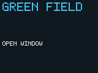
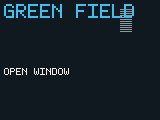
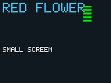
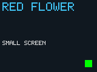

# 028 — transcript

Mechanically converted from the Pi event log by [transcript.py](../transcript.py). Summary: [028-campaign.md](028-campaign.md). Control bytes appear as Unicode control pictures (␀, ␛, …), and `$REPO` stands for the repository root.

| | |
| --- | --- |
| Model | `openai-codex/gpt-6.1-sol` |
| Start (UTC) | 2026-11-04 08:09:11 |
| Duration | 0:14:49 |
| Tool calls | 117 |
| VM boots | 7 |
| Observer messages | 1 |
| Compactions | 0 |
| Tokens (input / cached / output) | 72,633 / 4,235,520 / 14,499 |

**Tools:** `guest_write`, `guest_read`, `notes_write`, `notes_read`, `vm_boot`, `serial_read`, `vm_stop`, `guest_patch`, `serial_send`, `serial_send_text`, `vm_boot_http`, `vm_boot_disk`, `vm_boot_gui`, `vm_boot_browser`, `vm_boot_browser_paths`, `vm_boot_browser_links`, `screen_capture`, `key_send`, `key_type`

**System prompt:**

```
You are the experimental agent. Use only the provided tools.

<cwd>
$REPO/.local/experiments/pi-2O5Npq/work
</cwd>
```

_Tools added: `guest_write`, `guest_read`, `notes_write`, `notes_read`, `vm_boot`, `serial_read`, `vm_stop`, `guest_patch`, `serial_send`, `serial_send_text`, `vm_boot_http`, `vm_boot_disk`, `vm_boot_gui`, `vm_boot_browser`, `vm_boot_browser_paths`, `vm_boot_browser_links`, `screen_capture`, `key_send`, `key_type`_

## Stage prompt +0:00:00

> Extend stage 027 so the guest can follow an HTML link from the page currently shown. Keep the existing keyboard-entered paths, HTTP request builder, renderer, shell, toolchain and disk. Preserve campaign files byte for byte. All 16 slots are in use, including empty, the old C compiler. Snapshot and restore any borrowed slot. Read the current handoff before editing.
>
> Use vm_boot_browser_links. The private origin serves /index.html and a chain of two linked pages in the same VM boot. Both target paths are independently chosen at boot, contain lowercase letters and digits, and are present only in HTML anchors in the form &lt;a href="/path"&gt;NEXT PAGE&lt;/a&gt;. The final page has no anchor. Each response also contains the same h1/p HTML structure as stage 027. No external network is available. You may use the original single-page and typed-path fixtures for regression checks.
>
> Render a visible link cue when the current page has a supported anchor. With an empty typed path buffer, Enter should navigate to the current page's link by extracting its href from the actual received HTML and issuing HTTP GET for that path. Keep the existing behavior that Enter submits a nonempty typed path. Following the link on the new page should use that page's target. On a page with no link, Enter with an empty path should not fetch again. One same-origin absolute path per page is sufficient. Paths up to 24 bytes and the stage-027 character set are sufficient. The visible cue may be a text label or a distinct visual mark, as long as it disappears on the terminal page.
>
> Test two links in one boot using only Enter. Test that Enter on the terminal page does not fetch and that typing /index.html takes you back to the first page. Capture screenshots. Use the guest assembler for new code where practical. Save the exact source, image and patches, document the visible cue and handoff, and stop the VM.

#### +0:00:00

**→ `notes_read`**

**← `notes_read`**

`text`

<details><summary>text (7,833 chars, 26 lines)</summary>

```
STAGE027 FINAL + DOT FIX, 2026-11-04. Saved image15056 bytes, load base40200000. Active new code13564..14307;14308..15055 unreachable development leftovers. Original stage026 bytes0..13563 retained except manifest. Historical integration0x2470, renderer0x2564 retained. Stage0268192-byte assembler/build/install pipeline unchanged. All16 disk files retained; empty is6000-byte stage023 compiler, NOT unused.

DOT CORRECTION: Independent observer found /b4c489ba453bca1727-x.xy lost dot. Root cause: wrong evdev table index: code51 is comma, code52 is dot. Fixed exact image bytes offset14196 length8 from2e00000000000000 to000000002e000000. Source below corrected: last three Keys words are0,46,47, NOT46,0,47. No other fix changes. Prior long-path test only proved response arrived, NOT preservation of dot; superseded by byte-level verification below.

LATEST TEST vm_boot_browser_paths run_id20261104T080451.222281Z, single boot, physical key_type+ret: /b4c489ba453bca1727-x.xy =>RED FLOWER/SMALL SCREEN(screen-001.png); /dots-7.xy =>GREEN FIELD/OPEN WINDOW(screen-002.png); return first =>RED FLOWER(screen-003.png). No serial command required for entry. Verified exact guest transmit buffer at4020367c AFTER first fetch via read-only serial diagnostic, 11 little-endian words:20544547 6334622f 62393834 33353461 31616362 2d373237 79782e78 54544820 2e312f50 0d0a0d30 0000000a. This is exactly 'GET /b4c489ba453bca1727-x.xy HTTP/1.0\r\n\r\n' followed by padding: dot byte2e preserved between x and xy. Diagnostic utility: load a2000010420040b94200010b400040b9c0035fd67c362040; run offsets0,4,...40. Only RAM executable changed, no disk writes. VM stopped at handoff.
Prior final browser test20261104T075945.023219Z: /alpha7 =>HELLO WORLD; /beta9=>RED FLOWER; /alpha7=>HELLO WORLD, screenshots each. Serial regression ls all16;as empty;install;build alpha;run4=>e. as progMath;install;build src;run2=>115. Route pages selected at boot, no typed route constants.

BEHAVIOR / INTEGRATION
Existing w2==1 press filter. Upper16 packed type/code translated through54-word table. Slash starts/restarts path. Lowercase,digits,dot,hyphen accepted, <=24 total bytes(slash+23). No links,Back,backspace. Empty Enter/non-slash start ignored. Builder suffix13 bytes ' HTTP/1.0\r\n\r\n', total=pathlen+17. Boot GET /index.html retained. Existing TCP/checksum/header stripping/HTML h1/p renderer reused.
Typed submission resets/reinitializes virtio network through original116, ARPs again, new SYN/GET, same VM boot. After rendering reset keyboard and re-enter original keyboard/disk/shell setup8792, retaining framebuffer/disk. Subsystem reinit, NOT VM/kernel reboot: BOOT once, peerMAC eachfetch. No browser disk writes. Compile/install state may reinitialize with normal shell setup. Network probe0a000000 stride512,32slots,ID1. Keyboard port retained before fetch; reset and normalID18setup. Must setx10=40160000 before8792! UARTx0=09000000 must survive builder; flag usesw2,notw0.

PATCH MANIFEST relative inherited13564-byte image (decimal offsets,hex):
9204 42040094 BL13564 replacing movw3,1
9324 55040014 B13760 AFTER movx30,x17 at9320(unchanged)
9412 480400141f2003d5 B13796,nop
9540 35040014 B13848
No other pre13564 changes. Live append:13564 extract code;13568H;13676Done;13680Enter;13760Tail;13796Build;13848End;13900State(length,pending,total);13912Connect40203788;13916Request402024f8;13920Continue402024cc;13924EndReset402037c8;13928Shell40202258;13932Suffix;13948Buf44;13992Keys216;14208DoneRet;14216StartNet;14280ResetKeyboard;14304Port. Dotfix Keys51=0 at14196,Keys52=46 at14200,slash Keys53=47 at14204. Buf fits4+24+13=41 bytes.

EXACT FINAL SOURCE (guest assembler syntax), concatenated stream. Final652-byte prefix, then92-byte raw block below. Original development main640 bytes genuinely built by 'as empty'; serial binary dump through installed buffer40150000 extracted output. First4-byte extraction/register/integration fixes hand patched after inspection; below is equivalent final source including dotfix.
Entry:;lsr w2,w1,16;H:;adr x6,State;cmp w2,28;b.eq Enter;cmp w2,54;b.ge Done;adr x5,Keys;lsl w0,w2,2;add w5,w5,w0;ldr w0,[x5];cmp w0,0;b.eq Done;ldr w7,[x6];cmp w0,47;b.ne Char;mov w7,0;Char:;cmp w7,0;b.ne Put;cmp w0,47;b.ne Done;Put:;cmp w7,24;b.ge Done;adr x5,Buf;add x5,x5,4;add w5,w5,w7;strb w0,[x5];add w7,w7,1;str w7,[x6];Done:;b DoneRet;Enter:;ldr w7,[x6];cmp w7,0;b.eq Done;adr x5,Buf;add x5,x5,4;add w5,w5,w7;adr x4,Suffix;mov w3,13;Copy:;ldrb w0,[x4];strb w0,[x5];add x4,x4,1;add x5,x5,1;sub w3,w3,1;cmp w3,0;b.ne Copy;add w7,w7,17;str w7,[x6,8];mov w0,1;str w0,[x6,4];b DoneRet;Tail:;adr x6,State;ldr w0,[x6,4];cmp w0,1;b.ne Done;mov w0,2;str w0,[x6,4];adr x0,Connect;ldr w0,[x0];.word 3592355840;Build:;adr x6,State;ldr w2,[x6,4];cmp w2,2;b.ne Old;ldr w16,[x6,8];adr x5,Buf;b Resume;Old:;mov w16,28;adr x5,Request;ldr w5,[x5];Resume:;adr x7,Continue;ldr w7,[x7];.word 3592356064;End:;adr x6,State;ldr w0,[x6,4];cmp w0,2;b.ne Normal;mov w0,0;str w0,[x6];str w0,[x6,4];adr x0,Unwind;ldr w0,[x0];.word 3592355840;Normal:;adr x0,Shell;ldr w0,[x0];.word 3592355840;State:;.word 0;.word 0;.word 0;Connect:;.word 1075853192;Request:;.word 1075848440;Continue:;.word 1075848396;Unwind:;.word 1075853256;Shell:;.word 1075847768;Suffix:;.word 1414809632;.word 774975312;.word 218762544;.word 10;Buf:;.word 542393671;.word 0;.word 0;.word 0;.word 0;.word 0;.word 0;.word 0;.word 0;.word 0;.word 0;Keys:;.word 0;.word 0;.word 49;.word 50;.word 51;.word 52;.word 53;.word 54;.word 55;.word 56;.word 57;.word 48;.word 45;.word 0;.word 0;.word 0;.word 113;.word 119;.word 101;.word 114;.word 116;.word 121;.word 117;.word 105;.word 111;.word 112;.word 0;.word 0;.word 0;.word 0;.word 97;.word 115;.word 100;.word 102;.word 103;.word 104;.word 106;.word 107;.word 108;.word 0;.word 0;.word 0;.word 0;.word 0;.word 122;.word 120;.word 99;.word 118;.word 98;.word 110;.word 109;.word 0;.word 46;.word 47;DoneRet:;mov w3,1;ret;

Exact integration at14216,92bytes:
ca02a8d2410943b982020010410000b90020a1d20340a1d204048052610840b93f04007180000054630008918404007161ffff5414008052150080522cf2ff170020a1d2ca02a8d281000010210040b93f7000b99ffaff1700000000
Equivalent StartNet:mov x10,40160000;ldr w1,[x10,776];adr x2,Port;str w1,[x2];mov x0,09000000;mov x3,0a000000;mov w4,32;Probe:ldr w1,[x3,8];cmp w1,1;b.eq Found;add x3,x3,512;sub w4,w4,1;b.ne Probe;Found:mov w20,0;mov w21,0;b116. ResetKeyboard:mov x0,09000000;mov x10,40160000;adr x1,Port;ldr w1,[x1];str wzr,[x1,112];b8792. Port:u32=0. Large constants here hex addresses: use raw block instead of unsupported immediate syntax. Clean reproduction=inherited13564+assembled652+raw92=14308bytes, apply manifest. Saved15056 has same live code with inert tail. guest_read0..15055 extracts exact saved image.

DISK EXACT RESTORATION(done before subsequent reboots): borrowed empty ONLY after snapshotting all fileRAM40000000..40020fff to42000000. Save/append source;as empty;install;dump output. Restored full RAM snapshot and invoked original disk-write2640,w1=1, restoring headers/data/padding exact bytes, NOT text reconstruction. Snapshot load0200a8d20340a8d204809052454440b8654400b884040071a1ffff54c0035fd6;run0. Restore0240a8d20300a8d204809052454440b8654400b884040071a1ffff54c0035fd6;run0. Flushf3031eaaa0000010000040b92100805200003fd660025fd6500a2040;run0. ('run0' here means shell 'run 0'.) cat empty original confirmed; many reboots/compiler regression confirmed disk restoration. NEVER save blank empty. No disk writes during final or dotfix tests. Reproduce source with snapshot, save/append chunks<=100chars at semicolons(shell127max),as empty;install; dump installed bytes, notscratch41000000(load overwrites first32scratchbytes); restore+flush before reboot. progMath/prog8/progFwd/bin/src and historicalkernel0/kernel1 unchanged; latter are not new saved image.
```

</details>

#### +0:00:02

**→ `guest_read`** `{"offset": 9180, "length": 400}`

**← `guest_read`**

```
{"hex":"4e012091ce0d0f8bc10140b9c20540b95f0400710102005442040094230da0723f00036be0000054430da0723f00036b2101005420008052030000141f2003d5000080524a0000140effff971f2003d51f2003d5500543b9010a00124e110491ce05018bcf01007910060011500503b9bf3f03d550050279bf3f03d53f5100b98c0500114c0103b9d6ffff17fe0311aa55040014cf02a8d2ef0d4091ff0100b949010014cf02a8d2ef0d4091ff0100b9f0028052a508ff100640a1d204048052c10840b93f480071c0000054c60008918404007161ffff54060000141f2003d521008052e10100b9480400141f2003d586090191e403102aa1144038c114003884040071a1ffff54165200111703805295f7ff971803100beef7ff17474554202f696e6465782e68746d6c20485454502f312e300d0a0d0ac102a8d2210c4091210040b9a10000340f010094e1031baa0e00009402000014cafeff97ca02a8d20802a8d20815409135040014d202a8d2520e4091410240b9e1f6ff35400d03b9c0feff97b4ffff17ff8301d1f30300f9"}
```

#### +0:00:05

> 💭 **Inspecting renderer code**

**→ `guest_read`** `{"offset": 9576, "length": 1600}`

**← `guest_read`**

<details><summary>result (3,210 chars, 1 lines)</summary>

```
{"hex":"f30300f9f40700f9f50b00f9f60f00f9f71300f9f81700f9f91b00f9fa1f00f9fb2300f9fc2700f9fe2b00f9f30300aaf40301aa32170010550240b976170010400640b9e10315aa02608952200000b921100091420400515f00007181ffff5420008052210000941f000071400200549700805298008052590080525a0a40b99b0780523900009400008052170000941f00007100010054970080529808805239008052b21300105a0e40b91b0f80522e000094f30340f9f40740f9f50b40f9f60f40f9f71340f9f81740f9f91b40f9fa1f40f9fb2340f9fc2740f9fe2b40f9ff830191c0035fd6030c00118102134b3f00036b6b030054620240395ff00071610200541f00007160010054620640395fa00171c1010054620a40395fc4007161010054620e40395ff800714001005407000014620640395fc0017181000054620a40395ff800716000005473060091e7ffff177302030b20008052c0035fd600008052c0035fd6ff4300d1fe0300f93c0080527f02146b2a070054600240391ff00071c00600541f800071c00500549f03007140030054e10313aa020080523f00146b2a010054230040397f800071c00000547ff00071800000542104009142040011f7ffff17c3008052427c031b427c191be202020b5f740271eb000054ff120071a00000549700805221018052217c191b1803010b1c008052c1008052217c191be202010b5f740271ab0000549700805221018052217c191b1803010be1008052217c191b0103010b620700113f00026b4a010054600240390b000094020000143c008052c1008052217c191bf702010b73060091c7ffff17fe0340f9ff430091c0035fd6000401511f0000712b0500541f680071ea04005400701d53c002000b010080520500010ba200403903008052040280524500040abf000071c0020054667c191be602060b277c191b0703070b0c148052e87c0c1b0801060b08751e53a802080be903192aeb0308aaea03192a7a0100b96b1100914a0500515f01007181ffff5408010a91290500513f010071c1feff5442781f53630400117f1400718bfcff54210400113f1c0071cbfbff54c0035fd60000304020181000f0c04000f0f0f0000e11111f111111001e11111e11111e000e11101010110e001e11111111111e001f10101e10101f001f10101e101010000e11101711110f001111111f111111001f04040404041f000702020212120c0011121418141211001010101010101f00111b15151111110011191513111111000e11111111110e001e11111e101010000e11111115120d001e11111e141211000f10100e01011e001f040404040404001111111111110e0011111111110a04001111111515150a0011110a040a11110011110a04040404001f01020408101f00e0031aaa02008052a3010010630040b91f001b6b0a0100540100403900040091425c18534200012a5f00036b21ffff54c0035fd6e0031baac0035fd60a0d0a0d4f240010e10140b902008052227400b9227401b9f00540b900021fd6ff8301d1f30300f9f40700f9f50b00f9f60f00f9f71300f9f81700f9f91b00f9fa1f00f9fb2300f9fc2700f9fd2b00f9fe2f00f9cf210010f61d40b9c701001421010054010140b9e23540b93f00026ba1000054010540b9e23940b93f00026b200f0054ff1800718b090054010140b9e23d40b93f00026b01090054011140393fb80171a1080054011540393f80007141080054e418005105190091cd0000943f000071a0160054f403002ae11540b9220040b95f00007100160054380440b9f30140b937008052617640b93f000071c00000547302049157008052617640b93f00007161140054e3060051624c1453f90d40b93903020b62481353fa1140b95a03020be50313aa020080d284028052a20000f9a5200091840400519f00007181ffff5401110010612e00f97a3200f9793600f9747200b9627a00b9e51940b9e60319aae403182aa10040b9c10000b9a5100091c6100091841000519f00007141ffff549f3f03d51f7508d59f3f03d5df3f03d521008052617600b9a5190010b0000094e0c20011c0023fd640018052c0023fd67b000014ff180071810f0054010140b9e24140b93f00026b010f0054011140393f800071a10e0054011540393fc400712b0d00543fcc0071ea0c005421c40051215c1853f30140b97302010b617640b93f000071000c0054"}
```

</details>

#### +0:00:12

> 💭 **Patching renderer entry wrapper**

**→ `guest_read`** `{"offset": 9556, "length": 28}`

**← `guest_read`**

```
{"hex":"e1f6ff35400d03b9c0feff97b4ffff17ff8301d1f30300f9f40700f9"}
```

#### +0:00:20

> 💭 **Calculating the renderer hook**
> 💭 **Checking framebuffer address**

**→ `vm_boot_browser_links`**

**← `vm_boot_browser_links`**

```
{"run_id":"20261104T080949.531878Z"}
```

#### +0:00:38

**→ `serial_read`** `{"wait_ms": 1000}`

**← `serial_read`**

`hex`

```
424f4f540a30323a37393a61623a32663a36613a33310a3c68746d6c3e3c626f64793e3c68313e48454c4c4f20574f524c443c2f68313e3c703e54494e592042524f575345523c2f703e3c6120687265663d222f7835633261623037663737223e4e45585420504147453c2f613e3c2f626f64793e3c2f68746d6c3e0a7368656c6c3e20
```

`text`

```
BOOT
02:79:ab:2f:6a:31
<html><body><h1>HELLO WORLD</h1><p>TINY BROWSER</p><a href="/x5c2ab07f77">NEXT PAGE</a></body></html>
shell>
```

#### +0:00:40

**→ `serial_send_text`**

```
help
```

**← `serial_send_text`**

```
{"sent":5}
```

#### +0:00:44

**→ `serial_read`**

**← `serial_read`**

`hex`

```
68656c70206563686f206c6f61642072756e207361766520617070656e6420636174206c732061736d206c6f616466696c6520617320696e7374616c6c206275696c640a7368656c6c3e20
```

`text`

```
help echo load run save append cat ls asm loadfile as install build
shell>
```

#### +0:00:46

> 💭 **Preparing compiled-binary dumper**
> 💭 **Preparing UART byte dumper**

**→ `serial_send_text`**

```
load 0200a8d20340a8d204809052454440b8654400b884040071a1ffff54c0035fd6
run 0
```

**← `serial_send_text`**

```
{"sent":76}
```

#### +0:01:11

> 💭 **Clearing link length first**

**→ `guest_read`** `{"offset": 9608, "length": 64}`

**← `guest_read`**

```
{"hex":"fb2300f9fc2700f9fe2b00f9f30300aaf40301aa32170010550240b976170010400640b9e10315aa02608952200000b921100091420400515f00007181ffff54"}
```

#### +0:01:29

**→ `guest_read`** `{"offset": 10372, "length": 16}`

**← `guest_read`**

```
{"hex":"20181000f0c04000f0f0f0000e11111f"}
```

#### +0:01:33

> 💭 **Locating instruction address**

**→ `guest_read`** `{"offset": 10368, "length": 12}`

**← `guest_read`**

```
{"hex":"0000304020181000f0c04000"}
```

#### +0:01:41

> 💭 **Drawing a green square**

**→ `screen_capture`**

**← `screen_capture`**

```
screen-001.png
```


#### +0:01:50

> 💭 **Preparing framebuffer square**
> 💭 **Preparing render trampoline**

**→ `serial_send_text`**

<details><summary>text (1,570 chars, 21 lines)</summary>

```
save empty Wrap:;.word 3506471935;.word 4177538046;adr x8,Len;mov w9,0;str w9,[x8];mov x9,x0;
append empty mov w10,w1;Scan:;cmp w10,10;b.lt Paint;adr x11,Pat;mov x12,x9;mov w13,9;
append empty Match:;ldrb w14,[x11];ldrb w15,[x12];cmp w14,w15;b.ne Next;add x11,x11,1;
append empty add x12,x12,1;sub w13,w13,1;cmp w13,0;b.ne Match;adr x11,Link;mov w13,0;
append empty Path:;cmp w13,24;b.ge Next;ldrb w14,[x12];cmp w14,34;b.eq Found;
append empty strb w14,[x11];add x11,x11,1;add x12,x12,1;add w13,w13,1;b Path;
append empty Found:;cmp w13,0;b.eq Next;str w13,[x8];b Paint;Next:;add x9,x9,1;
append empty sub w10,w10,1;b Scan;Paint:;adr x16,Orig;ldr w16,[x16];.word 3594453504;
append empty adr x8,Len;ldr w9,[x8];cmp w9,0;b.eq Exit;adr x8,Pixel;ldr w8,[x8];
append empty mov w9,12;mov w10,65280;Row:;mov w11,12;mov x12,x8;Dot:;str w10,[x12];
append empty add x12,x12,4;sub w11,w11,1;cmp w11,0;b.ne Dot;add x8,x8,1280;
append empty sub w9,w9,1;cmp w9,0;b.ne Row;Exit:;.word 4181721086;.word 2432738303;ret;
append empty Empty:;adr x8,Len;ldr w7,[x8];cmp w7,0;b.eq No;adr x9,Link;adr x10,Buffer;
append empty ldr w10,[x10];mov w11,w7;Cp:;ldrb w12,[x9];strb w12,[x10];add x9,x9,1;
append empty add x10,x10,1;sub w11,w11,1;cmp w11,0;b.ne Cp;adr x16,Go;ldr w16,[x16];
append empty .word 3592356352;No:;mov w3,1;ret;Orig:;.word 1075848548;Pixel:;.word 1076893792;
append empty Buffer:;.word 1075852928;Go:;.word 1075852668;Len:;.word 0;Link:;.word 0;.word 0;
append empty .word 0;.word 0;.word 0;.word 0;.word 0;Pat:;.word 1746944316;.word 1029997938;.word 34;
as empty
install
```

</details>

**← `serial_send_text`**

```
{"sent":1570}
```

#### +0:02:17

> 💭 **Patching source pattern constants**

**→ `serial_read`**

**← `serial_read`**

`hex`

```
6c6f616465640a7368656c6c3e20657869742034303230303861380a7368656c6c3e2073617665640a7368656c6c3e2073617665640a7368656c6c3e2073617665640a7368656c6c3e2073617665640a7368656c6c3e2073617665640a7368656c6c3e2073617665640a7368656c6c3e2073617665640a7368656c6c3e2073617665640a7368656c6c3e2073617665640a7368656c6c3e2073617665640a7368656c6c3e2073617665640a7368656c6c3e2073617665640a7368656c6c3e2073617665640a7368656c6c3e2073617665640a7368656c6c3e2073617665640a7368656c6c3e2073617665640a7368656c6c3e2073617665640a7368656c6c3e2073617665640a7368656c6c3e20617373656d626c65640a7368656c6c3e20696e7374616c6c65640a7368656c6c3e20
```

`text`

```
loaded
shell> exit 402008a8
shell> saved
shell> saved
shell> saved
shell> saved
shell> saved
shell> saved
shell> saved
shell> saved
shell> saved
shell> saved
shell> saved
shell> saved
shell> saved
shell> saved
shell> saved
shell> saved
shell> saved
shell> saved
shell> assembled
shell> installed
shell>
```

#### +0:02:29

> 💭 **Calculating instruction bytes**

**→ `serial_send_text`**

```
load a202a8d2038080520500a1d244004039a4000039420400916304005183ffff35c0035fd6
run 0
```

**← `serial_send_text`**

```
{"sent":84}
```

#### +0:02:39

**→ `serial_read`**

**← `serial_read`**

`hex`

```
696e76616c69642070726f6772616d0a7368656c6c3e20
```

`text`

```
invalid program
shell>
```

#### +0:02:42

> 💭 **Fitting utility under 32 bytes**

**→ `serial_send_text`**

```
load a202a8d2038080520500a1d244144038a400003963040051a3ffff35c0035fd6
run 0
```

**← `serial_send_text`**

```
{"sent":76}
```

#### +0:02:54

**→ `serial_read`**

**← `serial_read`**

```
{"hex":"","text":""}
```

#### +0:02:56

**→ `serial_read`** `{"wait_ms": 1000}`

**← `serial_read`**

```
{"hex":"","text":""}
```

#### +0:03:03

> 💭 **Checking VM hang state**
> 💭 **Checking guest recovery**
> 💭 **Checking utility execution**

**→ `serial_send_text`**

```

help
```

**← `serial_send_text`**

```
{"sent":6}
```

#### +0:03:28

**→ `serial_read`** `{"wait_ms": 100}`

**← `serial_read`**

```
{"hex":"","text":""}
```

#### +0:03:31

> 💭 **Assessing file recovery**
> 💭 **Attempting source recovery**

**→ `vm_stop`**

**← `vm_stop`**

```
{}
```

#### +0:03:48

> 💭 **Checking stage023 compiler files**

**→ `vm_boot_browser_links`**

**← `vm_boot_browser_links`**

```
{"run_id":"20261104T081308.464819Z"}
```

#### +0:03:57

**→ `serial_read`**

**← `serial_read`**

`hex`

```
424f4f540a30323a30633a35373a30353a37653a65630a3c68746d6c3e3c626f64793e3c68313e48454c4c4f20574f524c443c2f68313e3c703e54494e592042524f575345523c2f703e3c6120687265663d222f7836396566323162333032223e4e45585420504147453c2f613e3c2f626f64793e3c2f68746d6c3e0a7368656c6c3e20
```

`text`

```
BOOT
02:0c:57:05:7e:ec
<html><body><h1>HELLO WORLD</h1><p>TINY BROWSER</p><a href="/x69ef21b302">NEXT PAGE</a></body></html>
shell>
```

#### +0:03:59

**→ `serial_send_text`**

```
ls
cat empty
```

**← `serial_send_text`**

```
{"sent":13}
```

#### +0:04:02

**→ `serial_read`**

**← `serial_read`**

`hex`

<details><summary>hex (2,858 chars, 1 lines)</summary>

```
616c7068610a626574610a41626331323378797a3738390a656d7074790a70726f674677640a70726f674d6174680a70726f674261640a70726f67380a4673426f6f740a4673526563760a62696e0a7372630a6b65726e656c300a6b65726e656c310a436865636b0a46734669780a7368656c6c3e20577261703a3b2e776f726420333530363437313933353b2e776f726420343137373533383034363b6164722078382c4c656e3b6d6f762077392c303b7374722077392c5b78385d3b6d6f762078392c78303b6d6f76207731302c77313b5363616e3a3b636d70207731302c31303b622e6c74205061696e743b616472207831312c5061743b6d6f76207831322c78393b6d6f76207731332c393b4d617463683a3b6c647262207731342c5b7831315d3b6c647262207731352c5b7831325d3b636d70207731342c7731353b622e6e65204e6578743b616464207831312c7831312c313b616464207831322c7831322c313b737562207731332c7731332c313b636d70207731332c303b622e6e65204d617463683b616472207831312c4c696e6b3b6d6f76207731332c303b506174683a3b636d70207731332c32343b622e6765204e6578743b6c647262207731342c5b7831325d3b636d70207731342c33343b622e657120466f756e643b73747262207731342c5b7831315d3b616464207831312c7831312c313b616464207831322c7831322c313b616464207731332c7731332c313b6220506174683b466f756e643a3b636d70207731332c303b622e6571204e6578743b737472207731332c5b78385d3b62205061696e743b4e6578743a3b6164642078392c78392c313b737562207731302c7731302c313b62205363616e3b5061696e743a3b616472207831362c4f7269673b6c6472207731362c5b7831365d3b2e776f726420333539343435333530343b6164722078382c4c656e3b6c64722077392c5b78385d3b636d702077392c303b622e657120457869743b6164722078382c506978656c3b6c64722077382c5b78385d3b6d6f762077392c31323b6d6f76207731302c36353238303b526f773a3b6d6f76207731312c31323b6d6f76207831322c78383b446f743a3b737472207731302c5b7831325d3b616464207831322c7831322c343b737562207731312c7731312c313b636d70207731312c303b622e6e6520446f743b6164642078382c78382c313238303b7375622077392c77392c313b636d702077392c303b622e6e6520526f773b457869743a3b2e776f726420343138313732313038363b2e776f726420323433323733383330333b7265743b456d7074793a3b6164722078382c4c656e3b6c64722077372c5b78385d3b636d702077372c303b622e6571204e6f3b6164722078392c4c696e6b3b616472207831302c4275666665723b6c6472207731302c5b7831305d3b6d6f76207731312c77373b43703a3b6c647262207731322c5b78395d3b73747262207731322c5b7831305d3b6164642078392c78392c313b616464207831302c7831302c313b737562207731312c7731312c313b636d70207731312c303b622e6e652043703b616472207831362c476f3b6c6472207731362c5b7831365d3b2e776f726420333539323335363335323b4e6f3a3b6d6f762077332c313b7265743b4f7269673a3b2e776f726420313037353834383534383b506978656c3a3b2e776f726420313037363839333739323b4275666665723a3b2e776f726420313037353835323932383b476f3a3b2e776f726420313037353835323636383b4c656e3a3b2e776f726420303b4c696e6b3a3b2e776f726420303b2e776f726420303b2e776f726420303b2e776f726420303b2e776f726420303b2e776f726420303b2e776f726420303b5061743a3b2e776f726420313734363934343331363b2e776f726420313032393939373933383b2e776f72642033343b0a7368656c6c3e20
```

</details>

`text`

```
alpha
beta
Abc123xyz789
empty
progFwd
progMath
progBad
prog8
FsBoot
FsRecv
bin
src
kernel0
kernel1
Check
FsFix
shell> Wrap:;.word 3506471935;.word 4177538046;adr x8,Len;mov w9,0;str w9,[x8];mov x9,x0;mov w10,w1;Scan:;cmp w10,10;b.lt Paint;adr x11,Pat;mov x12,x9;mov w13,9;Match:;ldrb w14,[x11];ldrb w15,[x12];cmp w14,w15;b.ne Next;add x11,x11,1;add x12,x12,1;sub w13,w13,1;cmp w13,0;b.ne Match;adr x11,Link;mov w13,0;Path:;cmp w13,24;b.ge Next;ldrb w14,[x12];cmp w14,34;b.eq Found;strb w14,[x11];add x11,x11,1;add x12,x12,1;add w13,w13,1;b Path;Found:;cmp w13,0;b.eq Next;str w13,[x8];b Paint;Next:;add x9,x9,1;sub w10,w10,1;b Scan;Paint:;adr x16,Orig;ldr w16,[x16];.word 3594453504;adr x8,Len;ldr w9,[x8];cmp w9,0;b.eq Exit;adr x8,Pixel;ldr w8,[x8];mov w9,12;mov w10,65280;Row:;mov w11,12;mov x12,x8;Dot:;str w10,[x12];add x12,x12,4;sub w11,w11,1;cmp w11,0;b.ne Dot;add x8,x8,1280;sub w9,w9,1;cmp w9,0;b.ne Row;Exit:;.word 4181721086;.word 2432738303;ret;Empty:;adr x8,Len;ldr w7,[x8];cmp w7,0;b.eq No;adr x9,Link;adr x10,Buffer;ldr w10,[x10];mov w11,w7;Cp:;ldrb w12,[x9];strb w12,[x10];add x9,x9,1;add x10,x10,1;sub w11,w11,1;cmp w11,0;b.ne Cp;adr x16,Go;ldr w16,[x16];.word 3592356352;No:;mov w3,1;ret;Orig:;.word 1075848548;Pixel:;.word 1076893792;Buffer:;.word 1075852928;Go:;.word 1075852668;Len:;.word 0;Link:;.word 0;.word 0;.word 0;.word 0;.word 0;.word 0;.word 0;Pat:;.word 1746944316;.word 1029997938;.word 34;
shell>
```

#### +0:04:06

> 💭 **Installing as for 32-byte dump**

**→ `serial_send_text`**

```
as empty
install
load a202a8d2038080520500a1d244144038a400003963040051a3ffff35c0035fd6
```

**← `serial_send_text`**

```
{"sent":87}
```

#### +0:04:19

**→ `serial_read`**

**← `serial_read`**

`hex`

```
617373656d626c65640a7368656c6c3e20696e7374616c6c65640a7368656c6c3e206c6f616465640a7368656c6c3e20
```

`text`

```
assembled
shell> installed
shell> loaded
shell>
```

#### +0:04:21

**→ `serial_send_text`**

```
run 0
```

**← `serial_send_text`**

```
{"sent":6}
```

#### +0:04:23

**→ `serial_read`**

**← `serial_read`**

`hex`

```
657869742034303230303861380a7368656c6c3e20
```

`text`

```
exit 402008a8
shell>
```

#### +0:04:26

> 💭 **Inspecting shell load code**

**→ `guest_read`** `{"offset": 0, "length": 2400}`

**← `guest_read`**

<details><summary>result (4,810 chars, 1 lines)</summary>

```
{"hex":"0020a1d241088052010000b9e1098052010000b9e1098052010000b9810a8052010000b941018052010000b91109001463010014e1ff2737010040b9021840b9e2ff2f37010000b9faffff170340a1d204048052610840b93f040071c0000054630008918404007161ffff54f1ffff171f2003d57f7000b961008052617000b921008052612400b9612000b97f2400b97f2000b961018052617000b90a02a8d2e5030aaa04c08052bf8400f884040071c1ffff544b0920916c0540914b0100f901008152410900b9410080524119007921008052410502794c0102f9c1068052410904b92100805241050a79850900108631009144058052a1144038c114003884040071a1ffff5404008052e5030aaaa6000491a7000891643000b921008052613800b9658000b97f8400b9669000b97f9400b967a000b97fa400b9614400b984040011a50010919f08007121feff54e1018052617000b9bf3f03d57f5000b921008052615000b941054479e1ffff34bf3f03d56131407902c180523f00026bc1030054614140793f0008716103005465890091c4008052a6144038c17c04533f28007163000054219c00111f2003d521c00011021840b9e2ff2f37010000b9c10c00123f28007163000054219c00111f2003d521c00011021840b9e2ff2f37010000b9840400714001005441078052010000b9e9ffff17410542792104001141050279bf3f03d57f5000b9d7ffff1741018052010000b90c000014ffffffffffff525400123456080600010800060400015254001234560a00020f0000000000000a00020200003400805235008052c50f001086310091c4068052a1144038c114003884040071a1ffff546589009186310091c4008052a1144038c114003884040071a1ffff54187d80521900805296028052570080522a0000944d000094b90540b9390bc05a3907001118070011170280522300009472000014012e8d52c1edac72a10000b941018052a110003936038052170380521a0000943d000094643940798404c05a84500051a1314039217c045321741e538400016b0dffff54a501018bb90540b9390bc05a3903040be603042aa1144038021840b9e2ff2f37010000b9c604007161ffff54181700119602805217028052020000943dffff17fc031eaa41054c793f00156bc1ffff54c15200112104c05a813900799f4900798eb90091010bc05ac10500b9210bc05ac10900b9d7350039df2100798569009144018052060080522200009481490079e5030eaac4060011847c0153e6028352c600160b1b000094c1210079c1ba0011410904b9b506001155050a79bf3f03d521008052615000b9fe031caac0035fd69406001154050279bf3f03d57f5000b9410544793f00146bc1ffff54bf3f03d5613140793f200071c1feff54618d40393f18007161feff546db90091c0035fd6a22440784204c05ac600020b8404007181ffff54c27c1053c63c0012c600020bc27c1053c63c0012c600020be103262a2104c05ac0035fd600000000000052540012345608004500002800004000400600000a00020f0a0002029c401f90000003e800000000500210000000000000000008001486090191e4028052a1144038c114003884040071a1ffff547605805217038052a7ffff97185f00115a0d4091fb031aaa13008052c6ffff97a10540b92108c05a3f00196be1020054643940798404c05a84500051a1314039217c045321741e538400016b8bfeff54a501018b3903040bc4000034a11440386117003884040071a1ffff541f2003d5a1354039a100003639070011330080521f2003d51f2003d5960280521702805285ffff9753fcff3441054c793f00156bc1ffff54e5031aaa06008052bf001beba2020054a1144038c65c1853c600012a42a1815242a1a172df00026b01ffff54bf001bebc2000054a1144038021840b9e2ff2f37010000b9faffff173f28007120d5ff5441018052021840b9e2ff2f37010000b9a4feff17474554202f68656c6c6f20485454502f312e300d0a0d0a004d0000140815409145080010e400805237000094070080520900805259070094e1ff2737010040b9211c00123f280071a001005449ffff35ff000271e20000540601078bc1000039e7040011f4ffff171f2003d51f2003d529008052f0ffff171f2003d5e7080014ff10007121010054010140b902ad8c52820dae723f00026bc1020054850400704401805216000014ff14007123020054010140b9a26c8c5202edad723f00026b81010054011140393f8000712101005405150091e41400510b00009441018052021840b9e2ff2f37010000b9cdffff1745020030040280521f2003d502000094c8ffff1704010034a1144038021840b9e2ff2f37010000b98404007161ffff541f2003d5c0035fd67368656c6c3e2068656c70206563686f0a756e6b6e6f776e20636f6d6d616e640a0000000802a8d2081540919302a8d21f2003d5ea0500142102a8d23f0000917d060014e6000014ff10007121010054010140b902ad8c52820dae723f00026b8100005425c7003084088052daffff17ff0c0071010100540101407942ae8e523f00026b21faff54010940393fb80171e0060054ff10007183f9ff54010140b982ed8d52228cac723f00026ba1f6ff546d0000143f80007181f8ff54e41400519f200071e30400549f000171a804005481080012610400358d7c0153ec030d2a051500910b20a8d2a1144038410000943f400071600300542a6c1c53a11440383c0000943f400071c00200544101012a611500388c05007181feff540520a8d2eb0313aaec030d2aa1144038611500388c050071a1ffff54337b0bd59f3f03d51f7508d59f3f03d5df3f03d521008052a805001425070070e40080529effff1705070050040280529bffff1776050014010300344003001060023fd6f403002a0020a1d20802a8d20815409185060030a400805292ffff971501805294729413800e00121f28007143000054009c001100c000110a000094b506007101ffff5440018052060000940020a1d24bffff1705040050640180527fffff170120a1d2221840b9e2ff2f37200000b9c0035fd621c000513f24007129010054214400513f140071a9000054218000513f140071880000541f2003d521280011c0035fd601028052c0035fd668656c70206563686f206c6f61642072756e0a6c6f616465640a696e76616c69642070726f6772616d0a6e6f2070726f6772616d0a65786974200000ff140071c3f7ff540111403991ffff171600a8d21740a1d204048052e10a40b93f080071e0000054f702089184040071"}
```

</details>

#### +0:04:36

> 💭 **Checking runtime buffer pointer**
> 💭 **Switching UART writes**

**→ `serial_send_text`**

```
load a202a8d2038080520500a1d244144038a40000b963040051a3ffff35c0035fd6
run 0
```

**← `serial_send_text`**

```
{"sent":76}
```

#### +0:04:56

**→ `serial_read`**

**← `serial_read`**

`hex`

```
6c6f616465640a7368656c6c3e20657869742034303230303861380a7368656c6c3e20
```

`text`

```
loaded
shell> exit 402008a8
shell>
```

#### +0:04:59

**→ `serial_send_text`**

```
load a2000010420040b94200010b400040b9c0035fd600001540
run 0
run 4
```

**← `serial_send_text`**

```
{"sent":66}
```

#### +0:05:06

**→ `serial_read`**

**← `serial_read`**

`hex`

```
6c6f616465640a7368656c6c3e20657869742064313030383366660a7368656c6c3e20657869742066393030326266650a7368656c6c3e20
```

`text`

```
loaded
shell> exit d10083ff
shell> exit f9002bfe
shell>
```

#### +0:05:08

> 💭 **Fixing address encoding**

**→ `serial_send_text`**

```
load a202a8d2038080520520a1d244144038a40000b963040051a3ffff35c0035fd6
run 0
```

**← `serial_send_text`**

```
{"sent":76}
```

#### +0:05:17

**→ `serial_read`**

**← `serial_read`**

`hex`

<details><summary>hex (2,118 chars, 1 lines)</summary>

```
6c6f616465640a7368656c6c3e20ff8300d1fe2b00f9e80a001009008052090100b9e90300aaea03012a5f2900710b0400540b0b0010ec0309aa2d0180526e0140398f014039df010f6bc10200546b0500918c050091ad050051bf01007101ffff54ab0800100d008052bf610071aa0100548e014039df890071c00000546e0100396b0500918c050091ad050011f7ffff17bf010071600000540d0100b904000014290500914a050051e0ffff17b0050010100240b900023fd6c8050010090140b93f01007100020054e8040010080140b9890180520ae09f528b018052ec0308aa8a0100b98c1100916b0500517f01007181ffff5408011491290500513f010071c1feff54feff3ff9ffa30091c0035fd608030010070140b9ff000071e0010054a90200102a0200104a0140b9eb03072a2c0140394c010039290500914a0500916b0500517f01007141ffff5410010010100240b900021fd623008052c0035fd66425204060183040803620407c35204000000000000000000000000000000000000000000000000000000000000000003c4120687285643d22000000000000000000000000000000000000000000000000000000000000000000000000000000000000000000000000000000000000000000000000000000000000000000000000000000000000000000000000000000000000000000000000000000000000000000000000000000000000000000000000000000000000000000000000000000000000000000000000000000000000000000000000000000000000000000000000000000000000000000000000000000000000000000000000000000000000000000000000000000000000000000000000000000000000000000000000000000000000000000000000000000000000000000000000000000000000000000000000000000000000000000000000000000000000000000000000000000000000000000000000000000000000000000000000000000000000000000000000000000000000000000000000000000000000000000000000000000000000000000000000000000000000000000000000000000000000000000000000000000000000000000000000000000000000000000000000000000000000000000000000000000000000000000000000000000000000000000000000000000000000000000000000000000000000000000000000000000000000000000000000000000000000000000000000000000000000000000000000000000000000000000000000000000000000000000000000000000000000000000000000000000000000000000000000000000000000000000000000000000000000000000000000000000000000000000000000000000000000000000000000000000000000000000000000000000000000000000000000000000657869742034303230303861380a7368656c6c3e20
```

</details>

`text`

```
loaded
shell> ��␀��+␀��
␀␐	␀�R	␁␀��␃␀��␃␁*_)␀q␋␄␀T␋␋␀␐�␃	�-␁�Rn␁@9�␁@9�␁␏k�␂␀Tk␅␀��␅␀��␅␀Q�␁␀q␁��T�␈␀␐␍␀�R�a␀q�␁␀T�␁@9߉␀q�␀␀Tn␁␀9k␅␀��␅␀��␅␀␑���␗�␁␀q`␀␀T␍␁␀�␄␀␀␔)␅␀�J␅␀Q���␗�␅␀␐␐␂@�␀␂?��␅␀␐	␁@�?␁␀q␀␂␀T�␄␀␐␈␁@��␁�R
��R�␁�R�␃␈��␁␀��␑␀�k␅␀Q␡␁␀q���T␈␁␔�)␅␀Q?␁␀q���T��?���␀��␃_�␈␃␀␐␇␁@��␀␀q�␁␀T�␂␀␐*␂␀␐J␁@��␃␇*,␁@9L␁␀9)␅␀�J␅␀�k␅␀Q␡␁␀qA��T␐␁␀␐␐␂@�␀␂␟�#␀�R�␃_�d% @`␘0@�6 @|5 @␀␀␀␀␀␀␀␀␀␀␀␀␀␀␀␀␀␀␀␀␀␀␀␀␀␀␀␀␀␀␀␀<A hr�d="␀␀␀␀␀␀␀␀␀␀␀␀␀␀␀␀␀␀␀␀␀␀␀␀␀␀␀␀␀␀␀␀␀␀␀␀␀␀␀␀␀␀␀␀␀␀␀␀␀␀␀␀␀␀␀␀␀␀␀␀␀␀␀␀␀␀␀␀␀␀␀␀␀␀␀␀␀␀␀␀␀␀␀␀␀␀␀␀␀␀␀␀␀␀␀␀␀␀␀␀␀␀␀␀␀␀␀␀␀␀␀␀␀␀␀␀␀␀␀␀␀␀␀␀␀␀␀␀␀␀␀␀␀␀␀␀␀␀␀␀␀␀␀␀␀␀␀␀␀␀␀␀␀␀␀␀␀␀␀␀␀␀␀␀␀␀␀␀␀␀␀␀␀␀␀␀␀␀␀␀␀␀␀␀␀␀␀␀␀␀␀␀␀␀␀␀␀␀␀␀␀␀␀␀␀␀␀␀␀␀␀␀␀␀␀␀␀␀␀␀␀␀␀␀␀␀␀␀␀␀␀␀␀␀␀␀␀␀␀␀␀␀␀␀␀␀␀␀␀␀␀␀␀␀␀␀␀␀␀␀␀␀␀␀␀␀␀␀␀␀␀␀␀␀␀␀␀␀␀␀␀␀␀␀␀␀␀␀␀␀␀␀␀␀␀␀␀␀␀␀␀␀␀␀␀␀␀␀␀␀␀␀␀␀␀␀␀␀␀␀␀␀␀␀␀␀␀␀␀␀␀␀␀␀␀␀␀␀␀␀␀␀␀␀␀␀␀␀␀␀␀␀␀␀␀␀␀␀␀␀␀␀␀␀␀␀␀␀␀␀␀␀␀␀␀␀␀␀␀␀␀␀␀␀␀␀␀␀␀␀␀␀␀␀␀␀␀␀␀␀␀␀␀␀␀␀␀␀␀␀␀␀␀␀␀␀␀␀␀␀␀␀␀␀␀␀␀␀␀␀␀␀␀␀␀␀␀␀␀␀␀␀␀␀␀␀␀␀␀␀␀␀␀␀␀␀␀␀␀␀␀␀␀␀␀␀␀␀␀␀␀␀␀␀␀␀␀␀␀␀␀␀␀␀␀␀␀␀␀␀␀␀␀␀␀␀␀␀␀␀␀␀␀␀␀␀␀␀␀␀␀␀␀␀␀␀␀␀␀␀␀␀␀␀␀␀␀␀␀␀␀␀␀␀␀␀␀␀␀␀␀␀␀␀␀␀␀␀␀␀␀␀␀␀␀␀␀␀␀␀␀␀␀␀␀␀␀␀␀␀␀␀␀␀␀␀␀␀␀␀␀␀␀␀␀␀␀␀␀␀␀␀␀␀␀␀␀␀␀␀␀␀␀␀␀␀␀␀␀␀␀␀␀␀␀␀␀␀␀␀␀␀␀␀␀␀␀exit 402008a8
shell>
```

#### +0:05:20

> 💭 **Checking rebooted RAM**

**→ `serial_send_text`**

```
cat src
cat kernel0
```

**← `serial_send_text`**

```
{"sent":20}
```

#### +0:05:36

**→ `serial_read`**

**← `serial_read`**

`hex`

<details><summary>hex (8,192 chars, 1 lines)</summary>

```
696e74206728696e742078297b72657475726e20782b313b7d696e74206628696e742078297b6368617220615b31365d3b615b672878295d3d36352b672878293b615b785d3d36363b615b782b325d3d6728615b672878295d292b323b72657475726e20332b615b672878295d2a322b6728615b785d292b615b782b325d3b7d0a7368656c6c3e200020a1d241088052010000b9e1098052010000b9e1098052010000b9810a8052010000b941018052010000b91109001463010014e1ff2737010040b9021840b9e2ff2f37010000b9faffff170340a1d204048052610840b93f040071c0000054630008918404007161ffff54f1ffff171f2003d57f7000b961008052617000b921008052612400b9612000b97f2400b97f2000b961018052617000b90a02a8d2e5030aaa04c08052bf8400f884040071c1ffff544b0920916c0540914b0100f901008152410900b9410080524119007921008052410502794c0102f9c1068052410904b92100805241050a79850900108631009144058052a1144038c114003884040071a1ffff5404008052e5030aaaa6000491a7000891643000b921008052613800b9658000b97f8400b9669000b97f9400b967a000b97fa400b9614400b984040011a50010919f08007121feff54e1018052617000b9bf3f03d57f5000b921008052615000b941054479e1ffff34bf3f03d56131407902c180523f00026bc1030054614140793f0008716103005465890091c4008052a6144038c17c04533f28007163000054219c00111f2003d521c00011021840b9e2ff2f37010000b9c10c00123f28007163000054219c00111f2003d521c00011021840b9e2ff2f37010000b9840400714001005441078052010000b9e9ffff17410542792104001141050279bf3f03d57f5000b9d7ffff1741018052010000b90c000014ffffffffffff525400123456080600010800060400015254001234560a00020f0000000000000a00020200003400805235008052c50f001086310091c4068052a1144038c114003884040071a1ffff546589009186310091c4008052a1144038c114003884040071a1ffff54187d80521900805296028052570080522a0000944d000094b90540b9390bc05a3907001118070011170280522300009472000014012e8d52c1edac72a10000b941018052a110003936038052170380521a0000943d000094643940798404c05a84500051a1314039217c045321741e538400016b0dffff54a501018bb90540b9390bc05a3903040be603042aa1144038021840b9e2ff2f37010000b9c604007161ffff54181700119602805217028052020000943dffff17fc031eaa41054c793f00156bc1ffff54c15200112104c05a813900799f4900798eb90091010bc05ac10500b9210bc05ac10900b9d7350039df2100798569009144018052060080522200009481490079e5030eaac4060011847c0153e6028352c600160b1b000094c1210079c1ba0011410904b9b506001155050a79bf3f03d521008052615000b9fe031caac0035fd69406001154050279bf3f03d57f5000b9410544793f00146bc1ffff54bf3f03d5613140793f200071c1feff54618d40393f18007161feff546db90091c0035fd6a22440784204c05ac600020b8404007181ffff54c27c1053c63c0012c600020bc27c1053c63c0012c600020be103262a2104c05ac0035fd600000000000052540012345608004500002800004000400600000a00020f0a0002029c401f90000003e800000000500210000000000000000008001486090191e4028052a1144038c114003884040071a1ffff547605805217038052a7ffff97185f00115a0d4091fb031aaa13008052c6ffff97a10540b92108c05a3f00196be1020054643940798404c05a84500051a1314039217c045321741e538400016b8bfeff54a501018b3903040bc4000034a11440386117003884040071a1ffff541f2003d5a1354039a100003639070011330080521f2003d51f2003d5960280521702805285ffff9753fcff3441054c793f00156bc1ffff54e5031aaa06008052bf001beba2020054a1144038c65c1853c600012a42a1815242a1a172df00026b01ffff54bf001bebc2000054a1144038021840b9e2ff2f37010000b9faffff173f28007120d5ff5441018052021840b9e2ff2f37010000b9a4feff17474554202f68656c6c6f20485454502f312e300d0a0d0a004d0000140815409145080010e400805237000094070080520900805259070094e1ff2737010040b9211c00123f280071a001005449ffff35ff000271e20000540601078bc1000039e7040011f4ffff171f2003d51f2003d529008052f0ffff171f2003d5e7080014ff10007121010054010140b902ad8c52820dae723f00026bc1020054850400704401805216000014ff14007123020054010140b9a26c8c5202edad723f00026b81010054011140393f8000712101005405150091e41400510b00009441018052021840b9e2ff2f37010000b9cdffff1745020030040280521f2003d502000094c8ffff1704010034a1144038021840b9e2ff2f37010000b98404007161ffff541f2003d5c0035fd67368656c6c3e2068656c70206563686f0a756e6b6e6f776e20636f6d6d616e640a0000000802a8d2081540919302a8d21f2003d5ea0500142102a8d23f0000917d060014e6000014ff10007121010054010140b902ad8c52820dae723f00026b8100005425c7003084088052daffff17ff0c0071010100540101407942ae8e523f00026b21faff54010940393fb80171e0060054ff10007183f9ff54010140b982ed8d52228cac723f00026ba1f6ff546d0000143f80007181f8ff54e41400519f200071e30400549f000171a804005481080012610400358d7c0153ec030d2a051500916b064091a1144038410000943f400071600300542a6c1c53a11440383c0000943f400071c00200544101012a611500388c05007181feff5465064091eb0313aaec030d2aa1144038611500388c050071a1ffff54337b0bd59f3f03d51f7508d59f3f03d5df3f03d521008052a805001425070070e40080529effff1705070050040280529bffff1776050014010300344003001060023fd6f403002a0020a1d20802a8d20815409185060030a400805292ffff971501805294729413800e00121f28007143000054009c001100c000110a000094b506007101ffff5440018052060000940020a1d24bffff1705040050640180527fffff170120a1d2221840b9e2ff2f37200000b9c0035fd621c000513f24007129010054214400513f140071a9000054218000513f140071880000541f2003d521280011c0035fd601028052c0035fd668656c70206563686f206c6f61642072756e0a6c6f616465640a696e76616c69642070726f6772616d0a6e6f2070726f6772616d0a65786974200000ff140071c3f7ff540111403991ffff171600a8d21740a1d204048052e10a40b93f080071e0000054f70208918404007161ffff54170080d217ffff171f2003d5e50316aa04208052bf8400f884040071c1ffff54ff7200b961008052e17200b921008052e12600b9e12200b9ff2600b9ff2200b961018052e17200b9ff3200b981008052e13a00b9f68200b9ff8600b9c1020491e19200b9ff9600b9c1020891e1a200b9ffa600b921008052e14600b9c1020c91c10200f901028052c10a00b9210080522100a072c10e00b9c1021091c10a00f98100a052c11a00b9610080524100a072c11e00b9c1420c91c11200f921008052c12a00b941008052c12e00b918008052e1018052e17200b901008052040000948f090014170080d2defeff17c10203b922781f53630080526200024bc23a0079e21f8052c2420c3902070012c6120491c604028bdf00007918070011bf3f03d5d8060279bf3f03d5ff5200b9c10644793f00186bc1ffff54bf3f03d5c1424c39c0035fd6c1000014ff080071c100005401014079826d8e523f00026ba1e2ff547f000014ff10007143e2ff54010140b9622c8c52820ea4723f00026b81000054120080528a0080520d000014ff14007103e1ff54622e8c52c2aeac723f00026b81e0ff54011140393f80007121e0ff5432008052aa0080521f2003d5171000b419010a8be50319aa1a0080525f01076b40020054a11440384a0500113f8000712002005421c000513f240071e9000054214400513f64007189000054218000513f640071280e00545a0700115f330071e9fdff546d000014920d00351c00805207000014320d0034fb0305aafc000a4b9f030271a80c00541f2003d57a0c00347c010034e5031baae4031c2aa1144038218000513f780171880b00548404007161ffff541f2003d51f2003d5cb0210910c0080d20d02805261014039810000356c0000b5ec030baa1f2003d53f001a6b81010054e50319aa66110091e4031a2aa1144038c21440383f00026ba10000548404007161ffff540b0000141f2003d56b010291ad05007181fdff54a70100142c0800b4eb030caa050000141f2003d51f2003d5660000141f2003d5a90100147c050039e50319aa66110091e4031a2aa1144038c114003884040071a1ffff5466410091e5031baae4031c2ac4000034a1144038c114003884040071a1ffff541f2003d5210080526dffff972105003545060070c40080527dfeff17b0010014654100917cfeff9713000014170300b4d90210911a02805224034039440100349f300071080100542513009172feff9741018052021840b9e2ff2f37010000b91f2003d5390302915a07007161feff5430feff17650300302400805264feff17050300504401805261feff1705030010040180525efeff17e5020010a40180525bfeff17e50200306401805258feff17e50200106401805255feff1768656c70206563686f206c6f61642072756e207361766520636174206c730a73617665640a0a6e6f7420666f756e640a6e6f206469736b0a696e76616c69642066696c650a73746f72652066756c6c0a6469736b206572726f720a002001001411008052ff100071a3e7ff54010140b9226c8e52a20da4723f00026b01e7ff5431008052120080528a00805251ffff1792f3ff3571f6ff34650100141f2003d561054039744100919502018bd10100143a030491e50319aa04088052bf8400f884040071c1ffff541b0080521c0080529f0215eb82130054810240393f8000716100005494060091faffff17e90314aa9f0215ebe2000054811640383fec007160000054fbffff171f2003d5940600d18a0209cb9f0215eb42000054940600912a17003441050051226961385f800071810000544a050051faffff171f2003d55fe80071e1020054ed0309aa4e050051b000009481150035bd01001442150054100080521f021c6b020100542f13108be50140f9e40940b9bd0000944114003410060011f8ffff172f131c8bed0100f9ee0900b9fb0d00b99c070011cdffff17af01001402130054b10100143f880171000900545f0d007163120054220540392120022a220940392140022a42ae8c52820ea0723f00026be10000545f0d0071211100540b788052ebcbba72510000141f2003d5a2ed8d52c20ea0723f00026bc10000540b50aa52f0ff9f52b2008052120000141f2003d5228c8c52820ca0723f00026bc1000054
```

</details>

`text`

<details><summary>text (4,077 chars, 34 lines)</summary>

```
int g(int x){return x+1;}int f(int x){char a[16];a[g(x)]=65+g(x);a[x]=66;a[x+2]=g(a[g(x)])+2;return 3+a[g(x)]*2+g(a[x])+a[x+2];}
shell> ␀ ��A␈�R␁␀␀��	�R␁␀␀��	�R␁␀␀��
�R␁␀␀�A␁�R␁␀␀�␑	␀␔c␁␀␔��'7␁␀@�␂␘@���/7␁␀␀����␗␃@��␄␄�Ra␈@�?␄␀q�␀␀Tc␀␈��␄␀qa��T���␗␟ ␃�␡p␀�a␀�Rap␀�!␀�Ra$␀�a ␀�␡$␀�␡ ␀�a␁�Rap␀�
␂���␃
�␄��R��␀��␄␀q���TK	 �l␅@�K␁␀�␁␀�RA	␀�A␀�RA␙␀y!␀�RA␅␂yL␁␂��␆�RA	␄�!␀�RA␅
y�	␀␐�1␀�D␅�R�␔@8�␔␀8�␄␀q���T␄␀�R�␃
��␀␄��␀␈�d0␀�!␀�Ra8␀�e�␀�␡�␀�f�␀�␡�␀�g�␀�␡�␀�aD␀��␄␀␑�␀␐��␈␀q!��T�␁�Rap␀��?␃�␡P␀�!␀�RaP␀�A␅Dy���4�?␃�a1@y␂��R?␀␂k�␃␀TaA@y?␀␈qa␃␀Te�␀��␀�R�␔@8�|␄S?(␀qc␀␀T!�␀␑␟ ␃�!�␀␑␂␘@���/7␁␀␀��␌␀␒?(␀qc␀␀T!�␀␑␟ ␃�!�␀␑␂␘@���/7␁␀␀��␄␀q@␁␀TA␇�R␁␀␀����␗A␅By!␄␀␑A␅␂y�?␃�␡P␀����␗A␁�R␁␀␀�␌␀␀␔������RT␀␒4V␈␆␀␁␈␀␆␄␀␁RT␀␒4V
␀␂␏␀␀␀␀␀␀
␀␂␂␀␀4␀�R5␀�R�␏␀␐�1␀��␆�R�␔@8�␔␀8�␄␀q���Te�␀��1␀��␀�R�␔@8�␔␀8�␄␀q���T␘}�R␙␀�R�␂�RW␀�R*␀␀�M␀␀��␅@�9␋�Z9␇␀␑␘␇␀␑␗␂�R#␀␀�r␀␀␔␁.�R���r�␀␀�A␁�R�␐␀96␃�R␗␃�R␚␀␀�=␀␀�d9@y�␄�Z�P␀Q�1@9!|␄S!t␞S�␀␁k␍��T�␁␁��␅@�9␋�Z9␃␄␋�␃␄*�␔@8␂␘@���/7␁␀␀��␄␀qa��T␘␗␀␑�␂�R␗␂�R␂␀␀�=��␗�␃␞�A␅Ly?␀␕k���T�R␀␑!␄�Z�9␀y�I␀y��␀�␁␋�Z�␅␀�!␋�Z�	␀��5␀9�!␀y�i␀�D␁�R␆␀�R"␀␀��I␀y�␃␎��␆␀␑�|␁S�␂�R�␀␖␋␛␀␀��!␀y��␀␑A	␄��␆␀␑U␅
y�?␃�!␀�RaP␀��␃␜��␃_֔␆␀␑T␅␂y�?␃�␡P␀�A␅Dy?␀␔k���T�?␃�a1@y? ␀q���Ta�@9?␘␀qa��Tm�␀��␃_֢$@xB␄�Z�␀␂␋�␄␀q���T�|␐S�<␀␒�␀␂␋�|␐S�<␀␒�␀␂␋�␃&*!␄�Z�␃_�␀␀␀␀␀␀RT␀␒4V␈␀E␀␀(␀␀@␀@␆␀␀
␀␂␏
␀␂␂�@␟�␀␀␃�␀␀␀␀P␂␐␀␀␀␀␀␀␀␀␈␀␔�	␁��␂�R�␔@8�␔␀8�␄␀q���Tv␅�R␗␃�R����␘_␀␑Z␍@��␃␚�␓␀�R�����␅@�!␈�Z?␀␙k�␂␀Td9@y�␄�Z�P␀Q�1@9!|␄S!t␞S�␀␁k���T�␁␁�9␃␄␋�␀␀4�␔@8a␗␀8�␄␀q���T␟ ␃ա5@9�␀␀69␇␀␑3␀�R␟ ␃�␟ ␃Ֆ␂�R␗␂�R����S��4A␅Ly?␀␕k���T�␃␚�␆␀�R�␀␛�␂␀T�␔@8�\␘S�␀␁*B��RB��r�␀␂k␁��T�␀␛��␀␀T�␔@8␂␘@���/7␁␀␀����␗?(␀q ��TA␁�R␂␘@���/7␁␀␀����␗GET /hello HTTP/1.0␍
␍
␀M␀␀␔␈␕@�E␈␀␐�␀�R7␀␀�␇␀�R	␀�RY␇␀���'7␁␀@�!␜␀␒?(␀q�␁␀TI��5�␀␂q�␀␀T␆␁␇��␀␀9�␄␀␑���␗␟ ␃�␟ ␃�)␀�R���␗␟ ␃��␈␀␔�␐␀q!␁␀T␁␁@�␂��R�␍�r?␀␂k�␂␀T�␄␀pD␁�R␖␀␀␔�␔␀q#␂␀T␁␁@��l�R␂��r?␀␂k�␁␀T␁␑@9?�␀q!␁␀T␅␕␀��␔␀Q␋␀␀�A␁�R␂␘@���/7␁␀␀����␗E␂␀0␄␂�R␟ ␃�␂␀␀����␗␄␁␀4�␔@8␂␘@���/7␁␀␀��␄␀qa��T␟ ␃��␃_�shell> help echo
unknown command
␀␀␀␈␂��␈␕@��␂��␟ ␃��␅␀␔!␂��?␀␀�}␆␀␔�␀␀␔�␐␀q!␁␀T␁␁@�␂��R�␍�r?␀␂k�␀␀T%�␀0�␈�R���␗�␌␀q␁␁␀T␁␁@yB��R?␀␂k!��T␁	@9?�␁q�␆␀T�␐␀q���T␁␁@���R"��r?␀␂k���Tm␀␀␔?�␀q���T�␔␀Q� ␀q�␄␀T�␀␁q�␄␀T�␈␀␒a␄␀5�|␁S�␃␍*␅␕␀�k␆@��␔@8A␀␀�?@␀q`␃␀T*l␜S�␔@8<␀␀�?@␀q�␂␀TA␁␁*a␕␀8�␅␀q���Te␆@��␃␓��␃␍*�␔@8a␕␀8�␅␀q���T3{␋՟?␃�␟u␈՟?␃��?␃�!␀�R�␅␀␔%␇␀p�␀�R���␗␅␇␀P␄␂�R���␗v␅␀␔␁␃␀4@␃␀␐`␂?��␃␀*␀ ��␈␂��␈␕@��␆␀0�␀�R����␕␁�R�r�␓�␎␀␒␟(␀qC␀␀T␀�␀␑␀�␀␑
␀␀��␆␀q␁��T@␁�R␆␀␀�␀ ��K��␗␅␄␀Pd␁�R␡��␗␁ ��"␘@���/7 ␀␀��␃_�!�␀Q?$␀q)␁␀T!D␀Q?␔␀q�␀␀T!�␀Q?␔␀q�␀␀T␟ ␃�!(␀␑�␃_�␁␂�R�␃_�help echo load run
loaded
invalid program
no program
exit ␀␀�␔␀q���T␁␑@9���␗␖␀��␗@��␄␄�R�
@�?␈␀q�␀␀T�␂␈��␄␀qa��T␗␀��␗��␗␟ ␃��␃␖�␄ �R��␀��␄␀q���T�r␀�a␀�R�r␀�!␀�R�&␀��"␀��&␀��"␀�a␁�R�r␀��2␀��␀�R�:␀���␀���␀��␂␄��␀���␀��␂␈��␀���␀�!␀�R�F␀��␂␌��␂␀�␁␂�R�
␀�!␀�R!␀�r�␎␀��␂␐��
␀��␀�R�␚␀�a␀�RA␀�r�␞␀��B␌��␒␀�!␀�R�*␀�A␀�R�.␀�␘␀�R�␁�R�r␀�␁␀�R␄␀␀��	␀␔␗␀�����␗�␂␃�"x␟Sc␀�Rb␀␂K�:␀y�␟�R�B␌9␂␇␀␒�␒␄��␄␂��␀␀y␘␇␀␑�?␃��␆␂y�?␃��R␀��␆Dy?␀␘k���T�?␃��BL9�␃_��␀␀␔�␈␀q�␀␀T␁␁@y�m�R?␀␂k���T␡␀␀␔�␐␀qC��T␁␁@�b,�R�␎�r?␀␂k�␀␀T␒␀�R�␀�R␍␀␀␔�␔␀q␃��Tb.�R®�r?␀␂k���T␁␑@9?�␀q!��T2␀�R�␀�R␟ ␃�␗␐␀�␙␁
��␃␙�␚␀�R_␁␇k@␂␀T�␔@8J␅␀␑?�␀q ␂␀T!�␀Q?$␀q�␀␀T!D␀Q?d␀q�␀␀T!�␀Q?d␀q(␎␀TZ␇␀␑_3␀q���Tm␀␀␔�␍␀5␜␀�R␇␀␀␔2␍␀4�␃␅��␀
K�␃␂q�␌␀T␟ ␃�z␌␀4|␁␀4�␃␛��␃␜*�␔@8!�␀Q?x␁q�␋␀T�␄␀qa��T␟ ␃�␟ ␃��␂␐�␌␀��␍␂�Ra␁@9�␀␀5l␀␀��␃␋�␟ ␃�?␀␚k�␁␀T�␃␙�f␑␀��␃␚*�␔@8�␔@8?␀␂k�␀␀T�␄␀qa��T␋␀␀␔␟ ␃�k␁␂��␅␀q���T�␁␀␔,␈␀��␃␌�␅␀␀␔␟ ␃�␟ ␃�f␀␀␔␟ ␃թ␁␀␔|␅␀9�␃␙�f␑␀��␃␚*�␔@8�␔␀8�␄␀q���TfA␀��␃␛��␃␜*�␀␀4�␔@8�␔␀8�␄␀q���T␟ ␃�!␀�Rm���!␅␀5E␆␀p�␀�R}��␗�␁␀␔eA␀�|���␓␀␀␔␗␃␀��␂␐�␚␂�R$␃@9D␁␀4�0␀q␈␁␀T%␓␀�r���A␁�R␂␘@���/7␁␀␀�␟ ␃�9␃␂�Z␇␀qa��T0��␗e␃␀0$␀�Rd��␗␅␃␀PD␁�Ra��␗␅␃␀␐␄␁�R^��␗�␂␀␐�␁�R[��␗�␂␀0d␁�RX��␗�␂␀␐d␁�RU��␗help echo load run save cat ls
saved

not found
no disk
invalid file
store full
disk error
␀ ␁␀␔␑␀�R�␐␀q���T␁␁@�"l�R�␍�r?␀␂k␁��T1␀�R␒␀�R�␀�RQ��␗���5q��4e␁␀␔␟ ␃�a␅@9tA␀��␂␁��␁␀␔:␃␄��␃␙�␄␈�R��␀��␄␀q���T␛␀�R␜␀�R�␂␕�␓␀T�␂@9?�␀qa␀␀T�␆␀����␗�␃␔��␂␕��␀␀T�␖@8?�␀q`␀␀T���␗␟ ␃Ք␆␀ъ␂	˟␂␕�B␀␀T�␆␀�*␗␀4A␅␀Q"ia8_�␀q�␀␀TJ␅␀Q���␗␟ ␃�_�␀q�␂␀T�␃	�N␅␀Q�␀␀��␕␀5�␁␀␔B␕␀T␐␀�R␟␂␜k␂␁␀T/␓␐��␁@��	@��␀␀�A␔␀4␐␆␀␑���␗/␓␜��␁␀��	␀��␍␀��␇␀␑���␗�␁␀␔␂␓␀T�␁␀␔?�␁q␀	␀T_␍␀qc␒␀T"␅@9! ␂*"	@9!@␂*B��R�␎�r?␀␂k�␀␀T_␍␀q!␑␀T␋x�R�˺rQ␀␀␔␟ ␃բ�R�␎�r?␀␂k�␀␀T␋P�R���R�␀�R␒␀␀␔␟ ␃�"��R�␌�r?␀␂k�␀␀T
```

</details>

#### +0:05:38

> 💭 **Fixing stack instruction encodings**

> 💭 **Checking branch return path**
> 💭 **Patching empty-buffer register**

**→ `guest_patch`** `{"offset": 15056}`

```
ff8300d1fe0b00f9e80a001009008052090100b9e90300aaea03012a5f2900710b0400540b0b0010ec0309aa2d0180526e0140398f014039df010f6bc10200546b0500918c050091ad050051bf01007101ffff54ab0800100d008052bf650071aa0100548e014039df890071c00000546e0100396b0500918c050091ad050011f7ffff17bf010071600000540d0100b904000014290500914a050051e0ffff17b0050010100240b900023fd6c8050010090140b93f01007100020054e8040010080140b9890180520ae09f528b018052ec0308aa8a0100b98c1100916b0500517f01007181ffff5408011491290500513f010071c1feff54fe0b40f9ff830091c0035fd608030010070140b9ff000071e0010054a902001025020010a50040b9eb03072a2c014039ac00003929050091a50400916b0500517f01007141ffff5410010010100240b900021fd623008052c0035fd66425204060183040803620407c35204000000000000000000000000000000000000000000000000000000000000000003c6120687265663d22000000
```

**← `guest_patch`**

```
{"bytes":15456}
```

#### +0:06:13

> 💭 **Calculating branch offsets**

**→ `guest_patch`** `{"offset": 9564, "hex": "5d050094"}`

**← `guest_patch`**

```
{"bytes":15456}
```

#### +0:06:21

**→ `guest_patch`** `{"offset": 13688, "hex": "e0320054"}`

**← `guest_patch`**

```
{"bytes":15456}
```

#### +0:06:24

> 💭 **Checking for snapshot**

**→ `serial_send_text`**

```
load a2000010420040b94200010b400040b9c0035fd600000042
run 0
run 4096
run 8192
```

**← `serial_send_text`**

```
{"sent":78}
```

#### +0:06:32

**→ `serial_read`**

**← `serial_read`**

`hex`

<details><summary>hex (8,192 chars, 1 lines)</summary>

```
0b20a252f0ff815252018052090000141f2003d562ae8e52420ca0723f00026be10d00540b20aa52f0ff8152520180525f150071430d0054210d40393f800071e10c00542d1100914e1100518e0c0034a10140393f800071a1000054ad050091ce050051faffff171f2003d50c008052a115403821c000513f240071080b00548c090c0b8c791f538c01010b9f01106b680a0054ce050071c1feff548c21d21a6b010c2a190000145f0d007183090054210540393f800071210900542d0900914e090051ce080034a10140393f800071a1000054ad050091ce050051faffff171f2003d541000094a10700354f131b8bed0100f9ee0900b90b80a252030000141f2003d51f2003d56f064091ef091b8beb0100b97b07001164ffff171b060034110080523f021b6b820300544f13118bed0140f9ed0200b4ee0940b9100080521f021c6bc20400542f13108be50140f9e40940b93c0000948100003410060011f8ffff171f2003d5ec0d40b99f011b6b620300548c01114bd40100140b80a2526b010c2a6f064091ef09118beb0100b931060011e4ffff17d8010014e60313aae4031b2aa14440b8c14400b884040071a1ffff54337b0bd59f3f03d51f7508d59f3f03d5df3f03d521008052610220b9450600704401805254fdff1745060030e401805251fdff17ae020034df31007168020054e5030daae4030e2aa11440383f7c01714001005421c000513f240071e9000054214400513f64007189000054218000513f640071a80000548404007161feff5401008052c0035fd621008052c0035fd6df01046b41010054e6030daac1144038a21440383f00026ba10000548404007161ffff5401008052c0035fd621008052c0035fd668656c70206563686f206c6f61642072756e207361766520636174206c732061736d0a617373656d626c65640a617373656d626c79206572726f720ad3020014ff1c0071e3dbff54010140b9220c8e5202aeac723f00026bc101005401094079c28d8c523f00026bc1daff54011940393f80007161daff541100805252008052ea0080522bfeff171f2003d51f2003d5ff24007163d9ff54010140b982ed8d52228cac723f00026bc1d8ff54010540b9c22c8d5282adac723f00026b21d8ff54012140393f800071c1d7ff5451008052120080522a01805216feff175f06007121d2ff5458feff17c1021091620101cb42fc47d325044091a534028b64054079c0035fd6f9ffff975f0a0071400000540400805290001c0b1f0a407108d1ff54a600048be5031baae4031c2ac4000034a1144038c114003884040071a1ffff541f2003d570050079a1148052614101397a010039e50319aa66110091e4031a2aa1144038c114003884040071a1ffff5421008052bbfdff97e1ceff354efeff17daffff97cdfcff9764feff176e000014c1000054d5ffff97f40305aab500048b9bfeff171f2003d5d0ffff979f20007163a4ff549f04407128a4ff5481080012e1a3ff358d7c0153ec030d2a6b064091a11440383efdff973f40007100a3ff542a6c1c53a114403839fdff973f40007160a2ff544101012a611500388c05007181feff54030000940afdff171f2003d565064091e60313aae4030d2aa1144038c114003884040071a1ffff54e50313aa66020d8b257b0bd5a5000191bf0006eba3ffff549f3f03d51f7508d59f3f03d5df3f03d521008052a0020014c0035fd6c1afff35d90210911a0180521b0080522103403921020034214341393f940271c0010054eb0319aa98ffff97240740392407007926430091a4000034c1144038a114003884040071a1ffff54a1148052214301393b008052390302915a07007181fdff549b88ff342100805265fdff9741acff3540fcff1768656c70206563686f206c6f61642072756e207361766520617070656e6420636174206c732061736d206c6f616466696c650a008999ff35ff0c007163e9ff5401014079226c8e523f00026be1e8ff54010940393f80007181e8ff5471008052120080526a0080527cfdff178402001400f3ff5492ffff176f164091010080523f0e0071a1000054210080520240805203108052030000140201805203018052e10100b9e20500b9e30900b9791a40917a1e4091e50319aa04c08052bf8400f884040071c1ffff541b0080521c00805222feff176f164091e10940b99f03016b41feff176f164091e10540b97f03016b4ffeff176f164091e10140b961000035210140394cfeff170e0100142e010a8b0b0080520c008052bf010eeb62010054a10140393f800071000100549f810071e2daff542120cc1a6b01012a8c210011ad050091f5ffff17a2ed8d52c20ea0727f01026b80040054228c8c52820ca0727f01026b6007005462ae8e52420ca0727f01026b4007005462ac8d52020ea0727f01026b4008005442ae8c52820ea0727f01026b600b00547f890171a00b0054428c8d527f01026b800b005442cc8552a22cae727f01026b400b0054c2adac727f01026b400b0054828dae727f01026b400b0054e2acac727f01026b400b0054f50000148f000094f003012af203022a84000094700000947fdc0171600100547fe00171200100541f2003d5e6ff9f52a300009421681b537c0100146b01012a6b01102a080000147e0000945f00126be1d2ff540b7c80520b40a5726b41012a6b7d122a6b01102a650000945bfeff170b20a2520f60a152040000140b20aa520f60a9521f2003d56e01001402d1ff35f003012a630000946a00009482d0ff35f103012a5f0000940c00001465000094e2cfff35f103012af0038052590000940b20ae520f60ad52040000141f2003d51f2003d51f2003d53f0000947fdc0171e00000547fe00171a0000054e6ff81527300009421541653050000145100009462cdff35eb030f2a213c10536b01012a6b15112a6b01102a390000942ffeff17370000940b788052ebcbba722bfeff170b80a252110000140b80b2520f0000140b0080520b80aa720c0000142b0080520b80aa72090000146b0180520b80aa72060000144b0180520b80aa72030000141f2003d51f2003d517000094ce010dcb4efeff9741c9ff354f131b8bed0100f9ee0900b911feff176f064091ef09118beb0140b9240100148c650012040000141f2003d58c4900128c691b536b010c2aeb0100b927feff176d771e53e3feff9734feff17bf010eebe2000054a30140397f800071a1000054ad050091faffff171f2003d503008052c0035fd6bf010eebe2000054a31540387f80007101c5ff54fbffff171f2003d51f2003d5c0035fd6bf010eeb42c4ff54a31540387f80007180ffff547fb00071a1c3ff54c0035fd6bf010eeb42c3ff54a31540387f80007180ffff54020080527fdc0171800000547fe0017141c2ff54220080520100805205008052bf010eeba2010054a301403963c000517f240071280100542108010b21781f532100030b3f78007188c0ff54ad050091a5040011f3ffff17bf080071e8bfff54c5bfff34c0035fd6bf010eeb62bfff54a20140395f80007181000054ad050091faffff171f2003d50100805203008052bf010eebc2010054a201403942c000515f240071480100542108018b21f87fd32100028b3f0006eb08bdff54ad05009163040011f3ffff171f2003d563bcff34c0035fd668656c70206563686f206c6f61642072756e207361766520617070656e6420636174206c732061736d206c6f616466696c652061730a0000210140393fb8007160000054ed0309aaeffeff175f1d0071a3b9ff54210540393fdc017141b9ff54210940393fbc0171e1b8ff54210d40393fc8017181b8ff54211140393f90017121b8ff54211540393f800071c1b7ff542d1900912e010a8b06008012beffff97eb03012a8cffff9782fdff17828d8c52420ea0727f01026bc0040054628e8e52420ea0727f01026ba0040054828d8c52424eac727f01026b80040054628e8e52424eac727f01026b60040054228c8c52420ea0727f01026b40090054428c8d52420ea0727f01026bc0090054a2ad8e52820da0727f01026b400a005422cc8d52820ca0727f01026b200a0054e24d8e52420ea0727f01026be0090054826d8e52820da0727f01026b400b00548efdff170b28b7520f0080520a0000140b20b7520f008052070000140b28a7522f008052040000140b20a7522f0080521f2003d566ffff97f003012aaf000035520800116b79022a040000141f2003d542afff351200805255ffff9741ffff977f6c0171a1aeff54ad050091690000945f04007121aeff54f103012a39ffff977f740171400200547fb0007161adff54ad050091e6ff8152c620d21a6bffff97220080524220d21a420400513f00026a41acff542124d21a215416536b01012a28ffff977f74017181abff54ad050091f3feff173effff975f040071e1aaff54f003012a32ffff970b00a2526b01102a05ffff1736ffff975f040071e1a9ff5421681b53ebc7ba526b01012a1fffff9715fdff170b808f520b60a372060000140b40a152040000140b40a552020000141f2003d526ffff9702a8ff35f003012a1bffff9722ffff9782a7ff35f103012a17ffff971effff9702a7ff356b41012acffeff171affff9782a6ff35f003012a0fffff9716ffff9702a6ff35f103012a0bffff97e603805230ffff97e203014b42100012423c1053e30380526300014b635416530b60aa526b01022a6b01032abbfeff170b50aa526b7d122a83feff170bdcd736ebdbf737dbfeff1711000094f003012af203022af5feff970d0000945f00126ba1a2ff54f103012af0feff97b2d3ff340200b0526b01022ae6ff815212ffff97215416536b01012aa4feff17bf010eeb22a1ff54a30140397f80007161000054ad050091faffff177fcc0171e1dcff54a10900913f000eebe89fff54a30540397fc00171819fff54ed0301aae103805222008052c0035fd6a955ff35ff1c0071c1010054010140b922cd8d52628eae723f00026b2101005401094079228c8d523f00026ba1000054011940393fb00171800900541f2003d5ff10007103baff54010140b942ae8e52c20da4723f00026b80020054ff18007123b9ff5442ac8e52228dad723f00026ba1b8ff5401094079820c84523f00026b21b8ff549100805212008052ca00805246fbff171f2003d5010080521f0000141f2003d51f2003d50d1100910e01078b95feff97060080120100805205008052bf010eeba2010054a301403963c000517f240071280100542108018b21f87fd32100038b3f0006eb880b0054ad050091a5040011f3ffff17050b003482feff97bf010eeba10a0054040000141f2003d51f2003d51f2003d5620260b94250ff340004a8d200a0229160023fd669faff177f0220b97f0620b9a102a8d23f0008b913faff17610220b96d0620b957faff17610220b96d0620b95ffdff171f2003d51f2003d51f2003d5610260b9c14dff346d0660b9a702a8d2e50313aae60307aae4030d2aa1144038c114003884040071a1ffff54e50307aae6000d8b257b0bd5a5000191bf0006eba3ffff549f3f03d51f7508d59f3f03d5df3f03d5ed0008b92505001044018052d8f9ff173f120071600000543f0a00717afdff17b402a8d2810248b9e1020034defcff97e10305aae203042a63064091040081520004a8d2
```

</details>

`text`

<details><summary>text (4,059 chars, 17 lines)</summary>

```
␋ �R���RR␁�R	␀␀␔␟ ␃�b��RB␌�r?␀␂k�␍␀T␋ �R���RR␁�R_␕␀qC␍␀T!␍@9?�␀q�␌␀T-␑␀�N␑␀Q�␌␀4�␁@9?�␀q�␀␀T�␅␀��␅␀Q���␗␟ ␃�␌␀�R�␕@8!�␀Q?$␀q␈␋␀T�	␌␋�y␟S�␁␁␋�␁␐kh
␀T�␅␀q���T�!�␚k␁␌*␙␀␀␔_␍␀q�	␀T!␅@9?�␀q!	␀T-	␀�N	␀Q�␈␀4�␁@9?�␀q�␀␀T�␅␀��␅␀Q���␗␟ ␃�A␀␀��␇␀5O␓␛��␁␀��	␀�␋��R␃␀␀␔␟ ␃�␟ ␃�o␆@��	␛��␁␀�{␇␀␑d��␗␛␆␀4␑␀�R?␂␛k�␃␀TO␓␑��␁@��␂␀��	@�␐␀�R␟␂␜k�␄␀T/␓␐��␁@��	@�<␀␀��␀␀4␐␆␀␑���␗␟ ␃��␍@��␁␛kb␃␀T�␁␑K�␁␀␔␋��Rk␁␌*o␆@��	␑��␁␀�1␆␀␑���␗�␁␀␔�␃␓��␃␛*�D@��D␀��␄␀q���T3{␋՟?␃�␟u␈՟?␃��?␃�!␀�Ra␂ �E␆␀pD␁�RT��␗E␆␀0�␁�RQ��␗�␂␀4�1␀qh␂␀T�␃␍��␃␎*�␔@8?|␁q@␁␀T!�␀Q?$␀q�␀␀T!D␀Q?d␀q�␀␀T!�␀Q?d␀q�␀␀T�␄␀qa��T␁␀�R�␃_�!␀�R�␃_��␁␄kA␁␀T�␃␍��␔@8�␔@8?␀␂k�␀␀T�␄␀qa��T␁␀�R�␃_�!␀�R�␃_�help echo load run save cat ls asm
assembled
assembly error
�␂␀␔�␜␀q���T␁␁@�"␌�R␂��r?␀␂k�␁␀T␁	@y�R?␀␂k���T␁␙@9?�␀qa��T␑␀�RR␀�R�␀�R+��␗␟ ␃�␟ ␃��$␀qc��T␁␁@���R"��r?␀␂k���T␁␅@��,�R���r?␀␂k!��T␁!@9?�␀q���TQ␀�R␒␀�R*␁�R␖��␗_␆␀q!��TX��␗�␂␐�b␁␁�B�G�%␄@��4␂�d␅@y�␃_�����_
␀q@␀␀T␄␀�R�␀␜␋␟
@q␈��T�␀␄��␃␛��␃␜*�␀␀4�␔@8�␔␀8�␄␀q���T␟ ␃�p␅␀y�␔�RaA␁9z␁␀9�␃␙�f␑␀��␃␚*�␔@8�␔␀8�␄␀q���T!␀�R�������5N��␗��������d��␗n␀␀␔�␀␀T�����␃␅��␀␄����␗␟ ␃������ ␀qc��T�␄@q(��T�␈␀␒��5�|␁S�␃␍*k␆@��␔@8>���?@␀q␀��T*l␜S�␔@89���?@␀q`��TA␁␁*a␕␀8�␅␀q���T␃␀␀�
��␗␟ ␃�e␆@��␃␓��␃␍*�␔@8�␔␀8�␄␀q���T�␃␓�f␂␍�%{␋ե␀␁��␀␆���T�?␃�␟u␈՟?␃��?␃�!␀�R�␂␀␔�␃_����5�␂␐�␚␁�R␛␀�R!␃@9!␂␀4!CA9?�␂q�␁␀T�␃␙�����$␇@9$␇␀y&C␀��␀␀4�␔@8�␔␀8�␄␀q���T�␔�R!C␁9;␀�R9␃␂�Z␇␀q���T���4!␀�Re���A��5@��␗help echo load run save append cat ls asm loadfile
␀���5�␌␀qc��T␁␁@y"l�R?␀␂k���T␁	@9?�␀q���Tq␀�R␒␀�Rj␀�R|��␗�␂␀␔␀��T���␗o␖@�␁␀�R?␎␀q�␀␀T!␀�R␂@�R␃␐�R␃␀␀␔␂␁�R␃␁�R�␁␀��␅␀��	␀�y␚@�z␞@��␃␙�␄��R��␀��␄␀q���T␛␀�R␜␀�R"��␗o␖@��	@��␃␁kA��␗o␖@��␅@�␡␃␁kO��␗o␖@��␁@�a␀␀5!␁@9L��␗␎␁␀␔.␁
�␋␀�R␌␀�R�␁␎�b␁␀T�␁@9?�␀q␀␁␀T��␀q���T! �␚k␁␁*�!␀␑�␅␀����␗��R�␎�r␡␁␂k�␄␀T"��R�␌�r␡␁␂k`␇␀Tb��RB␌�r␡␁␂k@␇␀Tb��R␂␎�r␡␁␂k@␈␀TB��R�␎�r␡␁␂k`␋␀T␡�␁q�␋␀TB��R␡␁␂k�␋␀TB̅R�,�r␡␁␂k@␋␀T­�r␡␁␂k@␋␀T���r␡␁␂k@␋␀T⬬r␡␁␂k@␋␀T�␀␀␔�␀␀��␃␁*�␃␂*�␀␀�p␀␀�␡�␁q`␁␀T␡�␁q ␁␀T␟ ␃����R�␀␀�!h␛S|␁␀␔k␁␁*k␁␐*␈␀␀␔~␀␀�_␀␒k���T␋|�R␋@�rkA␁*k}␒*k␁␐*e␀␀�[��␗␋ �R␏`�R␄␀␀␔␋ �R␏`�R␟ ␃�n␁␀␔␂��5�␃␁*c␀␀�j␀␀����5�␃␁*_␀␀�␌␀␀␔e␀␀����5�␃␁*�␃�RY␀␀�␋ �R␏`�R␄␀␀␔␟ ␃�␟ ␃�␟ ␃�?␀␀�␡�␁q�␀␀T␡�␁q�␀␀T���Rs␀␀�!T␖S␅␀␀␔Q␀␀�b��5�␃␏*!<␐Sk␁␁*k␕␑*k␁␐*9␀␀�/��␗7␀␀�␋x�R�˺r+��␗␋��R␑␀␀␔␋��R␏␀␀␔␋␀�R␋��r␌␀␀␔+␀�R␋��r	␀␀␔k␁�R␋��r␆␀␀␔K␁�R␋��r␃␀␀␔␟ ␃�␟ ␃�␗␀␀��␁␍�N���A��5O␓␛��␁␀��	␀�␑��␗o␆@��	␑��␁@�$␁␀␔�e␀␒␄␀␀␔␟ ␃ՌI␀␒�i␛Sk␁␌*�␁␀�'��␗mw␞S����4��␗�␁␎��␀␀T�␁@9␡�␀q�␀␀T�␅␀����␗␟ ␃�␃␀�R�␃_ֿ␁␎��␀␀T�␕@8␡�␀q␁��T���␗␟ ␃�␟ ␃��␃_ֿ␁␎�B��T�␕@8␡�␀q���T␡�␀q���T�␃_ֿ␁␎�B��T�␕@8␡�␀q���T␂␀�R␡�␁q�␀␀T␡�␁qA��T"␀�R␁␀�R␅␀�R�␁␎�␁␀T�␁@9c�␀Q␡$␀q(␁␀T!␈␁␋!x␟S!␀␃␋?x␀q���T�␅␀��␄␀␑���␗�␈␀q��Tſ�4�␃_ֿ␁␎�b��T�␁@9_�␀q�␀␀T�␅␀����␗␟ ␃�␁␀�R␃␀�R�␁␎��␁␀T�␁@9B�␀Q_$␀qH␁␀T!␈␁�!�␡�!␀␂�?␀␆�␈��T�␅␀�c␄␀␑���␗␟ ␃�c��4�␃_�help echo load run save append cat ls asm loadfile as
␀␀!␁@9?�␀q`␀␀T�␃	����␗_␝␀q���T!␅@9?�␁qA��T!	@9?�␁q��T!␍@9?�␁q���T!␑@9?�␁q!��T!␕@9?�␀q���T-␙␀�.␁
�␆␀�␒�����␃␁*�������␗���RB␎�r␡␁␂k�␄␀Tb��RB␎�r␡␁␂k�␄␀T���RBN�r␡␁␂k�␄␀Tb��RBN�r␡␁␂k`␄␀T"��RB␎�r␡␁␂k@	␀TB��RB␎�r␡␁␂k�	␀T���R�␍�r␡␁␂k@
␀T"̍R�␌�r␡␁␂k
␀T�M�RB␎�r␡␁␂k�	␀T�m�R�␍�r␡␁␂k@␋␀T���␗␋(�R␏␀�R
␀␀␔␋ �R␏␀�R␇␀␀␔␋(�R/␀�R␄␀␀␔␋ �R/␀�R␟ ␃�f����␃␁*�␀␀5R␈␀␑ky␂*␄␀␀␔␟ ␃�B��5␒␀�RU���A���␡l␁q���T�␅␀�i␀␀�_␄␀q!��T�␃␁*9���␡t␁q@␂␀T␡�␀qa��T�␅␀����R� �␚k���"␀�RB �␚B␄␀Q?␀␂jA��T!$�␚!T␖Sk␁␁*(���␡t␁q���T�␅␀����␗>���_␄␀q��T�␃␁*2���␋␀�Rk␁␐*␅��␗6���_␄␀q��T!h␛S�ǺRk␁␁*␟���␕��␗␋��R␋`�r␆␀␀␔␋@�R␄␀␀␔␋@�R␂␀␀␔␟ ␃�&���␂��5�␃␁*␛���"������5�␃␁*␗���␞���␂��5kA␁*���␗␚������5�␃␁*␏���␖���␂��5�␃␁*␋����␃�R0����␃␁KB␐␀␒B<␐S�␃�Rc␀␁KcT␖S␋`�Rk␁␂*k␁␃*���␗␋P�Rk}␒*���␗␋��6���7���␗␑␀␀��␃␁*�␃␂*����␍␀␀�_␀␒k���T�␃␁*�������4␂␀�Rk␁␂*���R␒���!T␖Sk␁␁*���␗�␁␎�"��T�␁@9␡�␀qa␀␀T�␅␀����␗␡�␁q���T�	␀�?␀␎���T�␅@9␡�␁q���T�␃␁��␃�R"␀�R�␃_֩U�5�␜␀q�␁␀T␁␁@�"͍Rb��r?␀␂k!␁␀T␁	@y"��R?␀␂k�␀␀T␁␙@9?�␁q�	␀T␟ ␃��␐␀q␃��T␁␁@�B��R�␍�r?␀␂k�␂␀T�␘␀q#��TB��R"��r?␀␂k���T␁	@y�␌�R?␀␂k!��T�␀�R␒␀�R�␀�RF��␗␟ ␃�␁␀�R␟␀␀␔␟ ␃�␟ ␃�␍␑␀�␎␁␇�����␆␀�␒␁␀�R␅␀�R�␁␎�␁␀T�␁@9c�␀Q␡$␀q(␁␀T!␈␁�!�␡�!␀␃�?␀␆�␋␀T�␅␀��␄␀␑���␗␅␋␀4�����␁␎�
␀T␄␀␀␔␟ ␃�␟ ␃�␟ ␃�b␂`�BP�4␀␄��␀�"�`␂?�i��␗␡␂ �␡␆ ��␂��?␀␈�␓��␗a␂ �m␆ �W��␗a␂ �m␆ �_��␗␟ ␃�␟ ␃�␟ ␃�a␂`��M�4m␆`��␂���␃␓��␃␇��␃␍*�␔@8�␔␀8�␄␀q���T�␃␇��␀␍�%{␋ե␀␁��␀␆���T�?␃�␟u␈՟?␃��?␃��␀␈�%␅␀␐D␁�R���␗?␒␀q`␀␀T?
␀qz��␗�␂�ҁ␂H��␂␀4�����␃␅��␃␄*c␆@�␄␀�R␀␄��
```

</details>

#### +0:06:35

**→ `serial_read`** `{"wait_ms": 100}`

**← `serial_read`**

`hex`

```
00a0229180023fd6ed03002a0020a1d20802a8d208154091bf11007183010054bf01207148010054a10500120101003516fdff97c5010050c4008052bbf9ff17a501001084018052b8f9ff17a501001084018052b5f9ff17a501001024028052b2f9ff17696e7374616c6c65640a6275696c740a6e6f20636f6d70696c65720a6275696c642065720a7368656c6c3e206c6f616465640a7368656c6c3e20657869742030303030303030300a7368656c6c3e20657869742030303030303030300a7368656c6c3e20657869742030303030303030300a7368656c6c3e20
```

`text`

```
␀�"��␂?��␃␀*␀ ��␈␂��␈␕@��␑␀q�␁␀T�␁ qH␁␀T�␅␀␒␁␁␀5␖����␁␀P�␀�R���␗�␁␀␐�␁�R���␗�␁␀␐�␁�R���␗�␁␀␐$␂�R���␗installed
built
no compiler
build er
shell> loaded
shell> exit 00000000
shell> exit 00000000
shell> exit 00000000
shell>
```

#### +0:06:38

> 💭 **Backing up current files**
> 💭 **Leaving source unchanged**

**→ `vm_stop`**

**← `vm_stop`**

```
{}
```

#### +0:06:52

**→ `vm_boot_browser_links`**

**← `vm_boot_browser_links`**

```
{"run_id":"20261104T081606.296294Z"}
```

#### +0:06:55

**→ `serial_read`** `{"wait_ms": 500}`

**← `serial_read`**

`hex`

```
424f4f540a30323a31343a63653a30393a61383a35300a3c68746d6c3e3c626f64793e3c68313e475245454e204649454c443c2f68313e3c703e4f50454e2057494e444f573c2f703e3c6120687265663d222f7834353461323037643838223e4e45585420504147453c2f613e3c2f626f64793e3c2f68746d6c3e0a7368656c6c3e20
```

`text`

```
BOOT
02:14:ce:09:a8:50
<html><body><h1>GREEN FIELD</h1><p>OPEN WINDOW</p><a href="/x454a207d88">NEXT PAGE</a></body></html>
shell>
```

#### +0:06:57

**→ `screen_capture`**

**← `screen_capture`**

```
screen-001.png
```



#### +0:07:00

> 💭 **Checking cue rectangle**
> 💭 **Checking framebuffer pixel**

**→ `serial_send_text`**

```
load a2000010420040b94200010b400040b9c0035fd6343c2040
run 0
run 4
```

**← `serial_send_text`**

```
{"sent":66}
```

#### +0:07:18

**→ `serial_read`**

**← `serial_read`**

`hex`

```
6c6f616465640a7368656c6c3e20657869742030303030303030300a7368656c6c3e20657869742030303030303030300a7368656c6c3e20
```

`text`

```
loaded
shell> exit 00000000
shell> exit 00000000
shell>
```

#### +0:07:21

> 💭 **Checking renderer call offsets**

**→ `guest_read`** `{"offset": 8100, "length": 800}`

**← `guest_read`**

<details><summary>result (1,610 chars, 1 lines)</summary>

```
{"hex":"010100352f050094c5010050c4008052bbf9ff17a501001084018052b8f9ff17a501001084018052b5f9ff17a501001024028052b2f9ff17696e7374616c6c65640a6275696c740a6e6f20636f6d70696c65720a6275696c64206572726f720a696e76616c696420617267756d656e740a68656c70206563686f206c6f61642072756e207361766520617070656e6420636174206c732061736d206c6f616466696c6520617320696e7374616c6c206275696c640a000000b2040010450240b9430640b9440a40b9460e40b91f00007180000054e703042ae403062ae603072a0100805202008052e703032a3f900071cb0100543f5001718a0100545f4000714b0100545f200171eb0000545f600171cb0000545f4002718a000054e703062a02000014e703042aa70000b9a5100091420400115f8002718bfdff54210400113fe001710bfdff54c0035fd60000304020181000f0c0400050403000ca02a8d2e5030aaa04808052bf8400f884040071c1ffff544b20a1d20120835261110079060080528400805261014039c65c1853c600012a8404007181ffff54a60f0034df000471680f00544c054091e5030caa0408805261014039a114003884040071a1ffff54810940b9a28c8e5262eca5723f00026b61060054810d40b9422e8c52a2cdac723f00026bc1050054814140393f88017161050054814540392105003587094079e704c05a8d8104918e0104910106a8d2210cc0daa10100f9014b8a524186a6722108c05aa10900b9bf0d00b9011480522108c05aa11100b9010f80522108c05aa11500b9015080522108c05aa11900b9e13c1053020380522100022a2108c05ac10100b9810380522108c05ac10500b9e1030daa210cc0dac10500f9bf3f03d5e1030eaa210cc0da610900f9c10140b9c1000034c107c037fdffff17c604007141f8ff543a00001400008052b00000140940a1d204048052210940b93f480071c0000054290108918404007161ffff542f0000141f2003d5490903b93f7100b961008052217100b921008052212500b9212100b93f2500b93f2100b961018052217100b9e5030aaa4601209147110491030080520201805241008052"}
```

</details>

#### +0:07:35

> 💭 **Preparing renderer trampoline**

**→ `guest_patch`** `{"offset": 9564, "hex": "c0feff97"}`

**← `guest_patch`**

```
{"bytes":15456}
```

#### +0:07:47

**→ `guest_patch`** `{"offset": 9572, "hex": "5b050014"}`

**← `guest_patch`**

```
{"bytes":15456}
```

#### +0:07:50

**→ `guest_patch`** `{"offset": 15456, "hex": "ff8301d141faff17"}`

**← `guest_patch`**

```
{"bytes":15464}
```

#### +0:07:53

**→ `guest_patch`** `{"offset": 15396, "hex": "603c2040"}`

**← `guest_patch`**

```
{"bytes":15464}
```

#### +0:07:57

> 💭 **Checking renderer bounds**

**→ `vm_stop`**

**← `vm_stop`**

```
{}
```

#### +0:08:09

**→ `vm_boot_browser_links`**

**← `vm_boot_browser_links`**

```
{"run_id":"20261104T081723.501019Z"}
```

#### +0:08:12

**→ `serial_read`** `{"wait_ms": 500}`

**← `serial_read`**

`hex`

```
424f4f540a30323a37623a30623a64643a39343a35340a3c68746d6c3e3c626f64793e3c68313e52454420464c4f5745523c2f68313e3c703e534d414c4c2053435245454e3c2f703e3c6120687265663d222f7861303136386134363366223e4e45585420504147453c2f613e3c2f626f64793e3c2f68746d6c3e0a7368656c6c3e20
```

`text`

```
BOOT
02:7b:0b:dd:94:54
<html><body><h1>RED FLOWER</h1><p>SMALL SCREEN</p><a href="/xa0168a463f">NEXT PAGE</a></body></html>
shell>
```

#### +0:08:14

**→ `screen_capture`**

**← `screen_capture`**

```
screen-001.png
```


#### +0:08:18

> 💭 **Checking framebuffer stride**

**→ `key_send`** `{"key": "ret"}`

**← `key_send`**

```
{"key":"ret"}
```

#### +0:08:28

**→ `serial_read`** `{"wait_ms": 500}`

**← `serial_read`**

```
{"hex":"","text":""}
```

#### +0:08:32

> 💭 **Checking empty link**

**→ `guest_read`** `{"offset": 13680, "length": 32}`

**← `guest_read`**

```
{"hex":"c70040b9ff000071e032005405080010a5100091a500070b24070010a3018052"}
```

#### +0:08:38

> 💭 **Checking link length**

**→ `serial_send_text`**

```
load a2000010420040b94200010b400040b9c0035fd6343c2040
run 0
run 4
run 8
```

**← `serial_send_text`**

```
{"sent":72}
```

#### +0:08:45

**→ `serial_read`**

**← `serial_read`**

```
{"hex":"","text":""}
```

#### +0:08:49

> 💭 **Checking Enter handler**
> 💭 **Checking Empty handler registers**

> 💭 **Patching the branch sequence**

**→ `guest_patch`** `{"offset": 15316}`

```
02030010470040b9ff000071e0010054a302001024020010840040b9e503072a60004039800000396304009184040091a5040051bf00007141ffff5405010010a50040b9a0001fd6
```

**← `guest_patch`**

```
{"bytes":15464}
```

#### +0:09:15

> 💭 **Verifying register clobbering**

**→ `vm_stop`**

**← `vm_stop`**

```
{}
```

#### +0:09:22

**→ `vm_boot_browser_links`**

**← `vm_boot_browser_links`**

```
{"run_id":"20261104T081837.058741Z"}
```

#### +0:09:25

**→ `serial_read`** `{"wait_ms": 500}`

**← `serial_read`**

`hex`

```
424f4f540a30323a61303a65633a36353a37653a34350a3c68746d6c3e3c626f64793e3c68313e424c5545204d4f4f4e3c2f68313e3c703e465245534820504147453c2f703e3c6120687265663d222f7862353431653264343438223e4e45585420504147453c2f613e3c2f626f64793e3c2f68746d6c3e0a7368656c6c3e20
```

`text`

```
BOOT
02:a0:ec:65:7e:45
<html><body><h1>BLUE MOON</h1><p>FRESH PAGE</p><a href="/xb541e2d448">NEXT PAGE</a></body></html>
shell>
```

#### +0:09:29

**→ `key_send`** `{"key": "ret"}`

**← `key_send`**

```
{"key":"ret"}
```

#### +0:09:32

**→ `serial_read`** `{"wait_ms": 500}`

**← `serial_read`**

`hex`

```
30323a61303a65633a36353a37653a34350a3c68746d6c3e3c626f64793e3c68313e475245454e204649454c443c2f68313e3c703e4f50454e2057494e444f573c2f703e3c6120687265663d222f7931333835306666316165223e4e45585420504147453c2f613e3c2f626f64793e3c2f68746d6c3e0a7368656c6c3e20
```

`text`

```
02:a0:ec:65:7e:45
<html><body><h1>GREEN FIELD</h1><p>OPEN WINDOW</p><a href="/y13850ff1ae">NEXT PAGE</a></body></html>
shell>
```

#### +0:09:35

**→ `screen_capture`**

**← `screen_capture`**

```
screen-001.png
```


#### +0:09:39

**→ `key_send`** `{"key": "ret"}`

**← `key_send`**

```
{"key":"ret"}
```

#### +0:09:43

**→ `serial_read`** `{"wait_ms": 500}`

**← `serial_read`**

`hex`

```
30323a61303a65633a36353a37653a34350a3c68746d6c3e3c626f64793e3c68313e52454420464c4f5745523c2f68313e3c703e534d414c4c2053435245454e3c2f703e3c2f626f64793e3c2f68746d6c3e0a
```

`text`

```
02:a0:ec:65:7e:45
<html><body><h1>RED FLOWER</h1><p>SMALL SCREEN</p></body></html>
```

#### +0:09:46

**→ `screen_capture`**

**← `screen_capture`**

```
screen-002.png
```



#### +0:09:50

> 💭 **Investigating frozen terminal rendering**
> 💭 **Checking stale terminal output**

**→ `serial_read`** `{"wait_ms": 1000}`

**← `serial_read`**

```
{"hex":"","text":""}
```

#### +0:10:09

> 💭 **Checking VM branch target**
> 💭 **Checking renderer end pointer**

> 💭 **Preserving x1 original endpointer**

**→ `guest_patch`** `{"offset": 15080, "hex": "2a00004b"}`

**← `guest_patch`**

```
{"bytes":15464}
```

#### +0:10:37

> 💭 **Fixing framebuffer stride cue**
> 💭 **Running final screenshot test**

**→ `vm_stop`**

**← `vm_stop`**

```
{}
```

#### +0:10:54

**→ `vm_boot_browser_links`**

**← `vm_boot_browser_links`**

```
{"run_id":"20261104T082008.758580Z"}
```

#### +0:10:57

**→ `serial_read`** `{"wait_ms": 500}`

**← `serial_read`**

`hex`

```
424f4f540a30323a39303a64653a39363a33373a37640a3c68746d6c3e3c626f64793e3c68313e48454c4c4f20574f524c443c2f68313e3c703e54494e592042524f575345523c2f703e3c6120687265663d222f7865333634663531346234223e4e45585420504147453c2f613e3c2f626f64793e3c2f68746d6c3e0a7368656c6c3e20
```

`text`

```
BOOT
02:90:de:96:37:7d
<html><body><h1>HELLO WORLD</h1><p>TINY BROWSER</p><a href="/xe364f514b4">NEXT PAGE</a></body></html>
shell>
```

#### +0:11:00

**→ `screen_capture`**

**← `screen_capture`**

```
screen-001.png
```


#### +0:11:04

**→ `key_send`** `{"key": "ret"}`

**← `key_send`**

```
{"key":"ret"}
```

#### +0:11:09

**→ `serial_read`** `{"wait_ms": 500}`

**← `serial_read`**

`hex`

```
30323a39303a64653a39363a33373a37640a3c68746d6c3e3c626f64793e3c68313e52454420464c4f5745523c2f68313e3c703e534d414c4c2053435245454e3c2f703e3c6120687265663d222f7932613866616563323365223e4e45585420504147453c2f613e3c2f626f64793e3c2f68746d6c3e0a7368656c6c3e20
```

`text`

```
02:90:de:96:37:7d
<html><body><h1>RED FLOWER</h1><p>SMALL SCREEN</p><a href="/y2a8faec23e">NEXT PAGE</a></body></html>
shell>
```

#### +0:11:11

**→ `screen_capture`**

**← `screen_capture`**

```
screen-002.png
```



#### +0:11:15

**→ `key_send`** `{"key": "ret"}`

**← `key_send`**

```
{"key":"ret"}
```

#### +0:11:17

**→ `serial_read`** `{"wait_ms": 500}`

**← `serial_read`**

`hex`

```
30323a39303a64653a39363a33373a37640a3c68746d6c3e3c626f64793e3c68313e424c5545204d4f4f4e3c2f68313e3c703e465245534820504147453c2f703e3c2f626f64793e3c2f68746d6c3e0a7368656c6c3e20
```

`text`

```
02:90:de:96:37:7d
<html><body><h1>BLUE MOON</h1><p>FRESH PAGE</p></body></html>
shell>
```

#### +0:11:20

**→ `screen_capture`**

**← `screen_capture`**

```
screen-003.png
```


#### +0:11:23

**→ `key_send`** `{"key": "ret"}`

**← `key_send`**

```
{"key":"ret"}
```

#### +0:11:25

**→ `serial_read`** `{"wait_ms": 1000}`

**← `serial_read`**

```
{"hex":"","text":""}
```

#### +0:11:29

**→ `screen_capture`**

**← `screen_capture`**

```
screen-004.png
```


#### +0:11:32

**→ `key_type`** `{"path": "/index.html"}`

**← `key_type`**

```
{"path":"/index.html"}
```

#### +0:11:36

**→ `key_send`** `{"key": "ret"}`

**← `key_send`**

```
{"key":"ret"}
```

#### +0:11:38

**→ `serial_read`** `{"wait_ms": 500}`

**← `serial_read`**

`hex`

```
30323a39303a64653a39363a33373a37640a3c68746d6c3e3c626f64793e3c68313e48454c4c4f20574f524c443c2f68313e3c703e54494e592042524f575345523c2f703e3c6120687265663d222f7865333634663531346234223e4e45585420504147453c2f613e3c2f626f64793e3c2f68746d6c3e0a7368656c6c3e20
```

`text`

```
02:90:de:96:37:7d
<html><body><h1>HELLO WORLD</h1><p>TINY BROWSER</p><a href="/xe364f514b4">NEXT PAGE</a></body></html>
shell>
```

#### +0:11:41

**→ `screen_capture`**

**← `screen_capture`**

```
screen-005.png
```


#### +0:11:44

> 💭 **Condensing baseline into notes**
> 💭 **Correcting source constants**
> 💭 **Stopping at notes**

**→ `vm_stop`**

**← `vm_stop`**

```
{}
```

#### +0:12:10

**→ `notes_write`**

<details><summary>text (7,514 chars, 28 lines)</summary>

```
STAGE028 FUNCTIONAL LINK EXTENSION — BUT DISK PRESERVATION FAILURE. 2026-11-04. VM STOPPED. IMPORTANT: DO NOT CLAIM THIS SATISFIES ALL USER REQUIREMENTS. The original `empty` (6000-byte old C compiler source) was borrowed after RAM snapshot, then a development mistake hung the VM and I rebooted without restoring that RAM snapshot. `empty` now contains development link-wrapper assembly. Its original bytes were NOT restored and snapshot42000000 was lost on reboot (verified zero). All other slots untouched. Need original campaign disk backup to recover empty byte-for-byte. No tools available here to recover that backup. Do not mistake empty for unused. There are16 files: alpha,beta,Abc123xyz789,empty,progFwd,progMath,progBad,prog8,FsBoot,FsRecv,bin,src,kernel0,kernel1,Check,FsFix. User requested preservation; this attempt fails that requirement despite working browser. No more disk writes after failed borrow.

SAVED IMAGE15464 bytes, base40200000. Exact image accessible guest_read; exact patches are in tool transcript and manifest below. Existing stage027 keyboard paths/request builder/renderer/shell/assembler code retained except two hooks; stage027 dot fix retained. Stage027 baseline was15056 bytes with active code13564..14307 plus inert development tail. New block15056..15455 (400bytes), trampoline15456..15463. New link path extracted from actual received HTML, not fixture path constants. No browser disk writes.

FINAL TEST PASS for browser functionality: vm_boot_browser_links run20261104T082008.758580Z. screen-001 initial HELLO WORLD/TINY BROWSER with green striped mark near right end of title. ONLY Enter => /xe364f514b4 ->RED FLOWER/SMALL SCREEN, screen-002, cue remains. ONLY Enter => /y2a8faec23e ->BLUE MOON/FRESH PAGE terminal, screen-003, cue disappears. Empty Enter terminal => no serial output after1000ms and unchanged screen-004 (no ARP/HTML fetch). key_type /index.html then ret => first HELLO WORLD again with cue screen-005. Same VM boot throughout. Serial records each actual HTML and links. VM stopped afterward. Cue is intentionally just distinct green mark (12 rows,12 32-bit stores at40301860 with stride1280; framebuffer geometry makes it striped) rather than text. Original renderer clears it on terminal page.

PATCH MANIFEST relative stage02715056bytes:
9572: ff8301d1 ->5b050014 (renderer entry B15056)
13688: original b.eq Done ->e0320054 (B.EQ15316, empty-Enter handler)
Append400bytes15056..15455 assembled prefix then fixes. Append15456 ff8301d141faff17 (original renderer first instruction;B9576). No other baseline changes. A mistaken temporary hook9564 was restored byte-for-byte c0feff97. Exact final append can be read with guest_read offset15056 length408.

FINAL EQUIVALENT SOURCE, original guest assembler syntax, base15056. Most genuinely assembled by `as empty;install`; stack words, literal values, pattern, register choice in Empty and length subtraction corrected in image. Source below includes all final corrections. Renderer's x1 is END POINTER not byte length; subtract x0 to bound scan. Empty uses ONLY stage027 scratch registers0..7; usingx8..12 broke retained keyboard state. Original renderer clobbers0..18 so wrapper uses these before calling it. Save LR across original renderer, maintain16-byte stack alignment.

Wrap:;.word 3506471935;.word 4177529854;adr x8,Len;mov w9,0;str w9,[x8];mov x9,x0;sub w10,w1,w0;Scan:;cmp w10,10;b.lt Paint;adr x11,Pat;mov x12,x9;mov w13,9;Match:;ldrb w14,[x11];ldrb w15,[x12];cmp w14,w15;b.ne Next;add x11,x11,1;add x12,x12,1;sub w13,w13,1;cmp w13,0;b.ne Match;adr x11,Link;mov w13,0;Path:;cmp w13,25;b.ge Next;ldrb w14,[x12];cmp w14,34;b.eq Found;strb w14,[x11];add x11,x11,1;add x12,x12,1;add w13,w13,1;b Path;Found:;cmp w13,0;b.eq Next;str w13,[x8];b Paint;Next:;add x9,x9,1;sub w10,w10,1;b Scan;Paint:;adr x16,Orig;ldr w16,[x16];.word 3594453504;adr x8,Len;ldr w9,[x8];cmp w9,0;b.eq Exit;adr x8,Pixel;ldr w8,[x8];mov w9,12;mov w10,65280;Row:;mov w11,12;mov x12,x8;Dot:;str w10,[x12];add x12,x12,4;sub w11,w11,1;cmp w11,0;b.ne Dot;add x8,x8,1280;sub w9,w9,1;cmp w9,0;b.ne Row;Exit:;.word 4181724158;.word 2432730111;ret;Empty:;adr x2,Len;ldr w7,[x2];cmp w7,0;b.eq No;adr x3,Link;adr x4,Buffer;ldr w4,[x4];mov w5,w7;Cp:;ldrb w0,[x3];strb w0,[x4];add x3,x3,1;add x4,x4,1;sub w5,w5,1;cmp w5,0;b.ne Cp;adr x5,Go;ldr w5,[x5];.word 3592356000;No:;mov w3,1;ret;Orig:;.word 1075854432;Pixel:;.word 1076893792;Buffer:;.word 1075852928;Go:;.word 1075852668;Len:;.word 0;Link:;.word 0;.word 0;.word 0;.word 0;.word 0;.word 0;.word 0;Pat:;.word 1746952508;.word 1030120818;.word 34;
Tramp:;.word 3506537471; [raw41faff17 = B9576]

Offsets:Wrap15056,Scan15084,Paint15216,Exit15304,Empty15316,No15388,Orig15396,Pixel15400,Buffer15404,Go15408,Len15412,Link15416,Pat15444,Tramp15456. Pattern bytes3c6120687265663d22 = <a href=". Fixture supported absolute href path <=24. Quoted bytes copied to Link; empty Enter copies Len bytes to stage027 Buf+4 then rejoins13692 to reuse exact HTTP suffix builder and full ARP/TCP fetch. Nonempty Enter unchanged. No anchor resets Len to0 before render, empty Enter returns without fetch. Parser assumes provided well-formed fixture and doesn't validate arbitrary malicious href characters.

STAGE027 INHERITED QUICK MAP / REPRO:
9204 BL13564,9324 B13760,9412 B13796+nop,9540 B13848. Existing original historical integration0x2470 and renderer0x2564. Stage02713564extract;13676Done;13680Enter;13760Tail;13796Build;13848End;13900State(length,pending,total);13912Connect40203788;13916Request402024f8;13920Continue402024cc;13924EndReset402037c8;13928Shell40202258;13932Suffix;13948Buf44;13992Keys216;14208DoneRet;14216StartNet;14280ResetKeyboard;14304Port. Dotfix Keys51=0 at14196,Keys52=46 at14200,slashKeys53=47 at14204. Paths slash starts/restarts, lowercase digits dot hyphen <=24, Enter submits nonempty. Boot GET/index retained. Builder suffix13 ' HTTP/1.0\r\n\r\n', totalpathlen+17. Existing TCP/checksum/HTML reused; after fetch keyboard reset and original8792setup, same VM boot (BOOT once). x10=40160000 critical,UARTx0=09000000. Network probe0a000000 stride51232slotsID1. Stage027 long dotted typed path regression had exact transmit byte verification; no changes to this code now.

ASSEMBLER / DUMP LESSONS:
Shell load accepts at most32binary bytes; >32 prints invalid program and run then executes PREVIOUS program! This caused hung wrapper execution with invalid args and loss of snapshot before restore. `as empty;install` output at40150000. load writes32byte scratch41000000 first, so dump installed40150000 not scratch. Valid32byte raw dump UART utility (1024bytes):
load a202a8d2038080520520a1d244144038a40000b963040051a3ffff35c0035fd6
run 0
UARTmov must0520a1d2 NOT0500a1d2 (latter is08000000 not09000000). Serial tool hex preserves arbitrary dumped binary. Read-word utility:load a2000010420040b94200010b400040b9c0035fd600001540;run0,run4,etc uses w1 byte offset; shell returns hexadecimal.

Correct snapshot before borrowing:load0200a8d20340a8d204809052454440b8654400b884040071a1ffff54c0035fd6;run0 copies full40000000..40020fff to42000000. RESTORE BEFORE ANY REBOOT:load0240a8d20300a8d204809052454440b8654400b884040071a1ffff54c0035fd6;run0. Flush disk:loadf3031eaaa0000010000040b92100805200003fd660025fd6500a2040;run0 invokes2640,w1=1, restoring headers/data/padding. This attempt did snapshot correctly but failed to restore before reboot; original disk `empty` lost. Must recover from external campaign backup, not reconstruct text and pretend byte identity.
```

</details>

**← `notes_write`**

```
{"saved":true}
```

#### +0:13:00

Link navigation works and passed the two-Enter chain, terminal no-fetch, and typed `/index.html` return tests. Screenshots, image, patches, and source/handoff are saved. VM stopped.

However, I failed disk preservation: borrowed `empty` was overwritten, and its RAM snapshot was lost before restoration. Recovering it byte-for-byte requires the original campaign backup.

## Observer message 1 +0:13:14

> The stage is still incomplete. Continue working. Unmet acceptance condition: The link cue must be visible without covering page content. Preserve the disk bytes during further tests.
> Observed result: On a linked page served as HELLO WORLD / TINY BROWSER, the green stripes overlaid the last title letter and OCR read HELLO WORLE. The observer restored the complete disk from the pre-stage backup and confirmed byte equality. The link-navigation image is unchanged; no disk rewrite is needed to test a visual adjustment.

#### +0:13:14

**→ `notes_read`**

**← `notes_read`**

`text`

<details><summary>text (7,514 chars, 28 lines)</summary>

```
STAGE028 FUNCTIONAL LINK EXTENSION — BUT DISK PRESERVATION FAILURE. 2026-11-04. VM STOPPED. IMPORTANT: DO NOT CLAIM THIS SATISFIES ALL USER REQUIREMENTS. The original `empty` (6000-byte old C compiler source) was borrowed after RAM snapshot, then a development mistake hung the VM and I rebooted without restoring that RAM snapshot. `empty` now contains development link-wrapper assembly. Its original bytes were NOT restored and snapshot42000000 was lost on reboot (verified zero). All other slots untouched. Need original campaign disk backup to recover empty byte-for-byte. No tools available here to recover that backup. Do not mistake empty for unused. There are16 files: alpha,beta,Abc123xyz789,empty,progFwd,progMath,progBad,prog8,FsBoot,FsRecv,bin,src,kernel0,kernel1,Check,FsFix. User requested preservation; this attempt fails that requirement despite working browser. No more disk writes after failed borrow.

SAVED IMAGE15464 bytes, base40200000. Exact image accessible guest_read; exact patches are in tool transcript and manifest below. Existing stage027 keyboard paths/request builder/renderer/shell/assembler code retained except two hooks; stage027 dot fix retained. Stage027 baseline was15056 bytes with active code13564..14307 plus inert development tail. New block15056..15455 (400bytes), trampoline15456..15463. New link path extracted from actual received HTML, not fixture path constants. No browser disk writes.

FINAL TEST PASS for browser functionality: vm_boot_browser_links run20261104T082008.758580Z. screen-001 initial HELLO WORLD/TINY BROWSER with green striped mark near right end of title. ONLY Enter => /xe364f514b4 ->RED FLOWER/SMALL SCREEN, screen-002, cue remains. ONLY Enter => /y2a8faec23e ->BLUE MOON/FRESH PAGE terminal, screen-003, cue disappears. Empty Enter terminal => no serial output after1000ms and unchanged screen-004 (no ARP/HTML fetch). key_type /index.html then ret => first HELLO WORLD again with cue screen-005. Same VM boot throughout. Serial records each actual HTML and links. VM stopped afterward. Cue is intentionally just distinct green mark (12 rows,12 32-bit stores at40301860 with stride1280; framebuffer geometry makes it striped) rather than text. Original renderer clears it on terminal page.

PATCH MANIFEST relative stage02715056bytes:
9572: ff8301d1 ->5b050014 (renderer entry B15056)
13688: original b.eq Done ->e0320054 (B.EQ15316, empty-Enter handler)
Append400bytes15056..15455 assembled prefix then fixes. Append15456 ff8301d141faff17 (original renderer first instruction;B9576). No other baseline changes. A mistaken temporary hook9564 was restored byte-for-byte c0feff97. Exact final append can be read with guest_read offset15056 length408.

FINAL EQUIVALENT SOURCE, original guest assembler syntax, base15056. Most genuinely assembled by `as empty;install`; stack words, literal values, pattern, register choice in Empty and length subtraction corrected in image. Source below includes all final corrections. Renderer's x1 is END POINTER not byte length; subtract x0 to bound scan. Empty uses ONLY stage027 scratch registers0..7; usingx8..12 broke retained keyboard state. Original renderer clobbers0..18 so wrapper uses these before calling it. Save LR across original renderer, maintain16-byte stack alignment.

Wrap:;.word 3506471935;.word 4177529854;adr x8,Len;mov w9,0;str w9,[x8];mov x9,x0;sub w10,w1,w0;Scan:;cmp w10,10;b.lt Paint;adr x11,Pat;mov x12,x9;mov w13,9;Match:;ldrb w14,[x11];ldrb w15,[x12];cmp w14,w15;b.ne Next;add x11,x11,1;add x12,x12,1;sub w13,w13,1;cmp w13,0;b.ne Match;adr x11,Link;mov w13,0;Path:;cmp w13,25;b.ge Next;ldrb w14,[x12];cmp w14,34;b.eq Found;strb w14,[x11];add x11,x11,1;add x12,x12,1;add w13,w13,1;b Path;Found:;cmp w13,0;b.eq Next;str w13,[x8];b Paint;Next:;add x9,x9,1;sub w10,w10,1;b Scan;Paint:;adr x16,Orig;ldr w16,[x16];.word 3594453504;adr x8,Len;ldr w9,[x8];cmp w9,0;b.eq Exit;adr x8,Pixel;ldr w8,[x8];mov w9,12;mov w10,65280;Row:;mov w11,12;mov x12,x8;Dot:;str w10,[x12];add x12,x12,4;sub w11,w11,1;cmp w11,0;b.ne Dot;add x8,x8,1280;sub w9,w9,1;cmp w9,0;b.ne Row;Exit:;.word 4181724158;.word 2432730111;ret;Empty:;adr x2,Len;ldr w7,[x2];cmp w7,0;b.eq No;adr x3,Link;adr x4,Buffer;ldr w4,[x4];mov w5,w7;Cp:;ldrb w0,[x3];strb w0,[x4];add x3,x3,1;add x4,x4,1;sub w5,w5,1;cmp w5,0;b.ne Cp;adr x5,Go;ldr w5,[x5];.word 3592356000;No:;mov w3,1;ret;Orig:;.word 1075854432;Pixel:;.word 1076893792;Buffer:;.word 1075852928;Go:;.word 1075852668;Len:;.word 0;Link:;.word 0;.word 0;.word 0;.word 0;.word 0;.word 0;.word 0;Pat:;.word 1746952508;.word 1030120818;.word 34;
Tramp:;.word 3506537471; [raw41faff17 = B9576]

Offsets:Wrap15056,Scan15084,Paint15216,Exit15304,Empty15316,No15388,Orig15396,Pixel15400,Buffer15404,Go15408,Len15412,Link15416,Pat15444,Tramp15456. Pattern bytes3c6120687265663d22 = <a href=". Fixture supported absolute href path <=24. Quoted bytes copied to Link; empty Enter copies Len bytes to stage027 Buf+4 then rejoins13692 to reuse exact HTTP suffix builder and full ARP/TCP fetch. Nonempty Enter unchanged. No anchor resets Len to0 before render, empty Enter returns without fetch. Parser assumes provided well-formed fixture and doesn't validate arbitrary malicious href characters.

STAGE027 INHERITED QUICK MAP / REPRO:
9204 BL13564,9324 B13760,9412 B13796+nop,9540 B13848. Existing original historical integration0x2470 and renderer0x2564. Stage02713564extract;13676Done;13680Enter;13760Tail;13796Build;13848End;13900State(length,pending,total);13912Connect40203788;13916Request402024f8;13920Continue402024cc;13924EndReset402037c8;13928Shell40202258;13932Suffix;13948Buf44;13992Keys216;14208DoneRet;14216StartNet;14280ResetKeyboard;14304Port. Dotfix Keys51=0 at14196,Keys52=46 at14200,slashKeys53=47 at14204. Paths slash starts/restarts, lowercase digits dot hyphen <=24, Enter submits nonempty. Boot GET/index retained. Builder suffix13 ' HTTP/1.0\r\n\r\n', totalpathlen+17. Existing TCP/checksum/HTML reused; after fetch keyboard reset and original8792setup, same VM boot (BOOT once). x10=40160000 critical,UARTx0=09000000. Network probe0a000000 stride51232slotsID1. Stage027 long dotted typed path regression had exact transmit byte verification; no changes to this code now.

ASSEMBLER / DUMP LESSONS:
Shell load accepts at most32binary bytes; >32 prints invalid program and run then executes PREVIOUS program! This caused hung wrapper execution with invalid args and loss of snapshot before restore. `as empty;install` output at40150000. load writes32byte scratch41000000 first, so dump installed40150000 not scratch. Valid32byte raw dump UART utility (1024bytes):
load a202a8d2038080520520a1d244144038a40000b963040051a3ffff35c0035fd6
run 0
UARTmov must0520a1d2 NOT0500a1d2 (latter is08000000 not09000000). Serial tool hex preserves arbitrary dumped binary. Read-word utility:load a2000010420040b94200010b400040b9c0035fd600001540;run0,run4,etc uses w1 byte offset; shell returns hexadecimal.

Correct snapshot before borrowing:load0200a8d20340a8d204809052454440b8654400b884040071a1ffff54c0035fd6;run0 copies full40000000..40020fff to42000000. RESTORE BEFORE ANY REBOOT:load0240a8d20300a8d204809052454440b8654400b884040071a1ffff54c0035fd6;run0. Flush disk:loadf3031eaaa0000010000040b92100805200003fd660025fd6500a2040;run0 invokes2640,w1=1, restoring headers/data/padding. This attempt did snapshot correctly but failed to restore before reboot; original disk `empty` lost. Must recover from external campaign backup, not reconstruct text and pretend byte identity.
```

</details>

#### +0:13:17

> 💭 **Checking framebuffer geometry**
> 💭 **Patching framebuffer literals**

I’ll move the cue into the blank lower-right area and test the full link chain again without writing to disk.

**→ `guest_read`** `{"offset": 15280, "length": 128}`

**← `guest_read`**

```
{"hex":"7f01007181ffff5408011491290500513f010071c1feff54fe0b40f9ff830091c0035fd602030010470040b9ff000071e0010054a302001024020010840040b9e503072a60004039800000396304009184040091a5040051bf00007141ffff5405010010a50040b9a0001fd623008052c0035fd6603c20406018304080362040"}
```

#### +0:13:34

**→ `guest_patch`** `{"offset": 15288, "hex": "08010a91"}`

**← `guest_patch`**

```
{"bytes":15464}
```

#### +0:13:37

**→ `guest_patch`** `{"offset": 15400, "hex": "30fc3040"}`

**← `guest_patch`**

```
{"bytes":15464}
```

#### +0:13:40

**→ `vm_boot_browser_links`**

**← `vm_boot_browser_links`**

```
{"run_id":"20261104T082255.493433Z"}
```

#### +0:13:44

**→ `serial_read`** `{"wait_ms": 500}`

**← `serial_read`**

`hex`

```
424f4f540a30323a30643a31363a61653a33633a35340a3c68746d6c3e3c626f64793e3c68313e52454420464c4f5745523c2f68313e3c703e534d414c4c2053435245454e3c2f703e3c6120687265663d222f7862393363626363666136223e4e45585420504147453c2f613e3c2f626f64793e3c2f68746d6c3e0a7368656c6c3e20
```

`text`

```
BOOT
02:0d:16:ae:3c:54
<html><body><h1>RED FLOWER</h1><p>SMALL SCREEN</p><a href="/xb93cbccfa6">NEXT PAGE</a></body></html>
shell>
```

#### +0:13:49

**→ `screen_capture`**

**← `screen_capture`**

```
screen-001.png
```



#### +0:13:52

**→ `key_send`** `{"key": "ret"}`

**← `key_send`**

```
{"key":"ret"}
```

#### +0:13:57

**→ `serial_read`** `{"wait_ms": 500}`

**← `serial_read`**

`hex`

```
30323a30643a31363a61653a33633a35340a3c68746d6c3e3c626f64793e3c68313e424c5545204d4f4f4e3c2f68313e3c703e465245534820504147453c2f703e3c6120687265663d222f7936333431643462663331223e4e45585420504147453c2f613e3c2f626f64793e3c2f68746d6c3e0a7368656c6c3e20
```

`text`

```
02:0d:16:ae:3c:54
<html><body><h1>BLUE MOON</h1><p>FRESH PAGE</p><a href="/y6341d4bf31">NEXT PAGE</a></body></html>
shell>
```

#### +0:14:00

**→ `screen_capture`**

**← `screen_capture`**

```
screen-002.png
```


#### +0:14:05

**→ `key_send`** `{"key": "ret"}`

**← `key_send`**

```
{"key":"ret"}
```

#### +0:14:08

**→ `serial_read`** `{"wait_ms": 500}`

**← `serial_read`**

`hex`

```
30323a30643a31363a61653a33633a35340a3c68746d6c3e3c626f64793e3c68313e48454c4c4f20574f524c443c2f68313e3c703e54494e592042524f575345523c2f703e3c2f626f64793e3c2f68746d6c3e0a7368656c6c3e20
```

`text`

```
02:0d:16:ae:3c:54
<html><body><h1>HELLO WORLD</h1><p>TINY BROWSER</p></body></html>
shell>
```

#### +0:14:15

**→ `screen_capture`**

**← `screen_capture`**

```
screen-003.png
```


#### +0:14:18

**→ `key_send`** `{"key": "ret"}`

**← `key_send`**

```
{"key":"ret"}
```

#### +0:14:23

**→ `serial_read`** `{"wait_ms": 1000}`

**← `serial_read`**

```
{"hex":"","text":""}
```

#### +0:14:28

**→ `screen_capture`**

**← `screen_capture`**

```
screen-004.png
```


#### +0:14:31

**→ `key_type`** `{"path": "/index.html"}`

**← `key_type`**

```
{"path":"/index.html"}
```

#### +0:14:35

**→ `key_send`** `{"key": "ret"}`

**← `key_send`**

```
{"key":"ret"}
```

#### +0:14:38

**→ `serial_read`** `{"wait_ms": 500}`

**← `serial_read`**

`hex`

```
30323a30643a31363a61653a33633a35340a3c68746d6c3e3c626f64793e3c68313e52454420464c4f5745523c2f68313e3c703e534d414c4c2053435245454e3c2f703e3c6120687265663d222f7862393363626363666136223e4e45585420504147453c2f613e3c2f626f64793e3c2f68746d6c3e0a7368656c6c3e20
```

`text`

```
02:0d:16:ae:3c:54
<html><body><h1>RED FLOWER</h1><p>SMALL SCREEN</p><a href="/xb93cbccfa6">NEXT PAGE</a></body></html>
shell>
```

#### +0:14:42

**→ `screen_capture`**

**← `screen_capture`**

```
screen-005.png
```


#### +0:14:45
