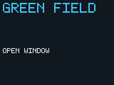

# 031 — transcript

Mechanically converted from the Pi event log by [transcript.py](../transcript.py). Summary: [031-campaign.md](031-campaign.md). Control bytes appear as Unicode control pictures (␀, ␛, …), and `$REPO` stands for the repository root.

| | |
| --- | --- |
| Model | `openai-codex/gpt-6.1-sol` |
| Start (UTC) | 2026-11-04 09:10:49 |
| Duration | 0:20:34 |
| Tool calls | 110 |
| VM boots | 7 |
| Observer messages | 0 |
| Compactions | 0 |
| Tokens (input / cached / output) | 74,462 / 4,771,840 / 21,831 |

**Tools:** `guest_write`, `guest_read`, `notes_write`, `notes_read`, `vm_boot`, `serial_read`, `vm_stop`, `guest_patch`, `serial_send`, `serial_send_text`, `vm_boot_http`, `vm_boot_disk`, `vm_boot_gui`, `vm_boot_browser`, `screen_capture`, `key_send`

**System prompt:**

```
You are the experimental agent. Use only the provided tools.

<cwd>
$REPO/.local/experiments/pi-2O5Npq/work
</cwd>
```

_Tools added: `guest_write`, `guest_read`, `notes_write`, `notes_read`, `vm_boot`, `serial_read`, `vm_stop`, `guest_patch`, `serial_send`, `serial_send_text`, `vm_boot_http`, `vm_boot_disk`, `vm_boot_gui`, `vm_boot_browser`, `screen_capture`, `key_send`_

## Stage prompt +0:00:00

> Give the guest enough persistent source storage to bootstrap a compiler written in C. Starting with the stage-029 kernel and the stage-030 disk, extend the guest filesystem to support at least 24 named files and at least 32768 bytes per file. The virtual disk has 1 MiB. The exact format and memory layout are yours to choose. Perform any legacy migration in the guest itself. Preserve all 16 inherited files, names and exact logical contents, including the stage-030 compiler src, its demo bin, the earlier compilers and assembler, and the two historical kernel snapshots. The observer has backed up the old disk. Do not overwrite an inherited file for a test unless you restore it, including after migration.
>
> Keep recv NAME N binary safe and make cat, save/append, as, build, and the existing process file reads work with the expanded filesystem. Demonstrate a file of at least 32768 bytes, new files beyond the inherited sixteen, and persistence across reboot. Demonstrate a source larger than 8192 bytes accepted by as or build, with its actual instructions or code at the end. An 8192-byte machine-code limit remains sufficient for this stage. Reject over-limit imports without overwriting existing files. Retain the normal shell, toolchain, process and browser behavior.
>
> Use guest assembly for implementation where practical. Save the kernel image and any source/patch manifest needed to reproduce it. Document the exact disk format before/after migration, memory locations, byte and file limits, how to extract source files, and test results. Stop the VM after testing.

#### +0:00:00

**→ `guest_read`** `{"offset": 0, "length": 64}`

**← `guest_read`**

```
{"hex":"0020a1d241088052010000b9e1098052010000b9e1098052010000b9810a8052010000b941018052010000b91109001463010014e1ff2737010040b9021840b9"}
```

#### +0:00:02

**→ `notes_read`**

**← `notes_read`**

`text`

<details><summary>text (5,775 chars, 26 lines)</summary>

```
C variables milestone COMPLETE. Final compiler's EXACT guest-assembler source is disk slot `src` (7456 bytes; last measured7450 before final insertion `b gen;`, six bytes). `bin` contains exact final C runtime demo below. Kernel/image unchanged. Only bin and src repurposed; progMath (inherited stage025 compiler), prog8, progFwd, empty and all other slots preserved. No slots added; all16 still occupied. VM stopped after final tests.

REPRO after boot: `as src` -> assembled; `install` -> installed; `build bin` -> built; `run 0`, `run 2`, `run 5`. Compiler ABI and existing guest assembler/build pipeline unchanged. Final source was flushed, VM rebooted, and assembled/installed successfully in final boot20261104T090817.343313Z. Do not mistake progMath for new compiler: it remains ORIGINAL; new implementation is src.

FINAL bin EXACT CONTENT (concatenate lines WITHOUT newline; save/append store literal text):
int g(int helper_arg){helper_arg=helper_arg+1;return helper_arg*3;}int f(int input_value){int commonPrefix=input_value+1;int commonPrefix2=commonPrefix*2;int third_3=g(commonPrefix2);int Fourth=third_3+commonPrefix;if(input_value){Fourth=Fourth+2;}while(input_value){input_value=input_value-1;third_3=third_3+1;}return Fourth+third_3;}
ONE build, same executable: run0 -> exit00000013 (19); run2 -> exit00000031 (49); run5 -> exit0000005b (91). Repeated on final compiler after final reboot. Four locals, common-prefix12/13-character names, mixed case, underscore/digit, initializers referencing prior locals and parameter, helper and helper-parameter assignment, if/while local and parameter assignments, arithmetic and local reads. Expected formula 13*(n+1)+6+n+(n!=0?2:0).

IMPLEMENTATION: inherited lexical S/P, K/B keyword-boundary matching, precedence E/V, numeric bounds, output emitter W/C, G/H expression stack, helper-call template, loop/if fixups and transactional return0 on failure retained. New N scans ASCII identifiers [A-Za-z_][A-Za-z0-9_]*, accepting1..31characters (rejects32+). Supported reserved keywords int,char,return,if,while rejected as identifiers. L compares full byte length AND exact case-sensitive bytes, not hashes/prefixes. Static tab `tb` has five (source-pointer32,length32) records: parameter index0 and locals1..4. Count at40, declaration temporaries44/48 and lookup length52. J resets per-function parameter binding, so f/g names independent. Parameter remains runtime w1. f general path reserves16-byte aligned frame, x4=SP stable local base, four local slots offsets0,4,8,12. Runtime local LDR/STR instructions synthesized using templates plus (index-1)<<10. Expression pushes change SP but not x4. Existing helper ABI preserves x4, parameter and caller temporaries. Return frees frame. Table insertion happens AFTER initializer so self/forward references fail. Consecutive declarations only before statements; at most four named ints. No new block scopes/types/functions/arguments. Helper now also accepts parameter assignment statements before return. T performs exact keyword lookahead so identifiers beginning i/r/w/c (input, Return etc.) are not misdispatched as keywords. A final unconditional branch to general path after char-array detection avoids treating first statement `input=...` as `int...`.

LEGACY FORMS: fixed char a[N] and int y / int *p=&y retained. General f frame16 also serves pointer case. dp requires exactly one prior local named y, then consumes fixed pointer declaration, mode2; yp preserves direct y assignment. Existing pointer/array syntax restrictions otherwise retained. No uninitialized direct pointer declaration. Old scalar y works through new general locals.

FINAL BOOT REGRESSION exact sources and results:
1) int f(int input){input=input+1;return input;} -> build; run3=4, run8=9.
2) int g(int x){return x+3;}int f(int x){int y=x+1;int *p=&y;*p=g(*p)+2;return *p+x;} -> build; run4=14,run9=24.
3) int g(int x){return x+1;}int f(int x){char a[4];a[0]=g(x);a[1]=a[0]+2;return a[1]+x;} -> build;run4=11,run9=21.
4) final four-local demo above ->19,49,91.
Earlier same implementation also built `int /*c*/ *p=&y;` and direct y=y+2 then *p=*p+3 ->14,24; scalar int y=x+1;y=y+2;return y+x ->11,21.

OTHER TESTS (before final six-byte dispatch fix; same binding/checking logic):
int/*ok*/g(int _Long_param12){return _Long_param12+1;}int f(int Input){int a=Input;int ab=a+1;int A=ab+1;int _1=A+g(a);Input=Input+2;return a+ab+A+_1+Input;} ->run3=26,run8=56. Separate AA/aa reference rejected, previous run3 remained26.
Case/prefix weighted locals a=1,ab=2,A=3,_1=4 returned4321+x (run0=0x10e1,run7=0x10e8).
Repeated build errors followed by run2 returned SAME prior demo49 each time: duplicate parameter/local; duplicate locals; undeclared initializer; undeclared assignment target; digit-first parameter; digit-first local; hyphenated identifier; self-reference initializer; unterminated block comment. Return-keyword parameter rejected. Pointer &y without prior named y rejected. Failures preserve loaded executable transactionally, including after partial output generation. No reinstall between failure vectors.

DEVELOPMENT CAUTION for future agents: all work used provided guest tools. Guest assembler lacks LSR mnemonic and b.gt; .word can encode missing instructions. Shell line bound128. There is guest filesystem cached metadata: editing src content/legacy length directly from a utility, then invoking as in SAME boot caused misleading assembly errors/stale lengths; flush by a subsequent save bin, reboot, then as src succeeded. Final disk is synchronized and final source assembles after boot. Utility temporary writes were confined to bin/src and scratch RAM; nothing in kernel or other file slots altered. No utilities left on disk; bin is final demo and src is compiler.
```

</details>

#### +0:00:05

**→ `vm_boot_disk`**

**← `vm_boot_disk`**

```
{"run_id":"20261104T091057.196408Z"}
```

#### +0:00:07

**→ `serial_read`** `{"wait_ms": 1000}`

**← `serial_read`**

`hex`

```
424f4f540a7368656c6c3e20
```

`text`

```
BOOT
shell>
```

#### +0:00:10

**→ `serial_send_text`**

```
help
ls
```

**← `serial_send_text`**

```
{"sent":8}
```

#### +0:00:13

**→ `serial_read`** `{"wait_ms": 1000}`

**← `serial_read`**

`hex`

```
68656c70206563686f206c6f61642072756e207361766520617070656e6420636174206c732061736d206c6f616466696c6520617320696e7374616c6c206275696c640a7368656c6c3e20616c7068610a626574610a41626331323378797a3738390a656d7074790a70726f674677640a70726f674d6174680a70726f674261640a70726f67380a4673426f6f740a4673526563760a62696e0a7372630a6b65726e656c300a6b65726e656c310a436865636b0a46734669780a7368656c6c3e20
```

`text`

```
help echo load run save append cat ls asm loadfile as install build
shell> alpha
beta
Abc123xyz789
empty
progFwd
progMath
progBad
prog8
FsBoot
FsRecv
bin
src
kernel0
kernel1
Check
FsFix
shell>
```

#### +0:00:15

> 💭 **Inspecting kernel content**

**→ `guest_read`** `{"offset": 0, "length": 8192}`

**← `guest_read`**

<details><summary>result (16,394 chars, 1 lines)</summary>

```
{"hex":"0020a1d241088052010000b9e1098052010000b9e1098052010000b9810a8052010000b941018052010000b91109001463010014e1ff2737010040b9021840b9e2ff2f37010000b9faffff170340a1d204048052610840b93f040071c0000054630008918404007161ffff54f1ffff171f2003d57f7000b961008052617000b921008052612400b9612000b97f2400b97f2000b961018052617000b90a02a8d2e5030aaa04c08052bf8400f884040071c1ffff544b0920916c0540914b0100f901008152410900b9410080524119007921008052410502794c0102f9c1068052410904b92100805241050a79850900108631009144058052a1144038c114003884040071a1ffff5404008052e5030aaaa6000491a7000891643000b921008052613800b9658000b97f8400b9669000b97f9400b967a000b97fa400b9614400b984040011a50010919f08007121feff54e1018052617000b9bf3f03d57f5000b921008052615000b941054479e1ffff34bf3f03d56131407902c180523f00026bc1030054614140793f0008716103005465890091c4008052a6144038c17c04533f28007163000054219c00111f2003d521c00011021840b9e2ff2f37010000b9c10c00123f28007163000054219c00111f2003d521c00011021840b9e2ff2f37010000b9840400714001005441078052010000b9e9ffff17410542792104001141050279bf3f03d57f5000b9d7ffff1741018052010000b90c000014ffffffffffff525400123456080600010800060400015254001234560a00020f0000000000000a00020200003400805235008052c50f001086310091c4068052a1144038c114003884040071a1ffff546589009186310091c4008052a1144038c114003884040071a1ffff54187d80521900805296028052570080522a0000944d000094b90540b9390bc05a3907001118070011170280522300009472000014012e8d52c1edac72a10000b941018052a110003936038052170380521a0000943d000094643940798404c05a84500051a1314039217c045321741e538400016b0dffff54a501018bb90540b9390bc05a3903040be603042aa1144038021840b9e2ff2f37010000b9c604007161ffff54181700119602805217028052020000943dffff17fc031eaa41054c793f00156bc1ffff54c15200112104c05a813900799f4900798eb90091010bc05ac10500b9210bc05ac10900b9d7350039df2100798569009144018052060080522200009481490079e5030eaac4060011847c0153e6028352c600160b1b000094c1210079c1ba0011410904b9b506001155050a79bf3f03d521008052615000b9fe031caac0035fd69406001154050279bf3f03d57f5000b9410544793f00146bc1ffff54bf3f03d5613140793f200071c1feff54618d40393f18007161feff546db90091c0035fd6a22440784204c05ac600020b8404007181ffff54c27c1053c63c0012c600020bc27c1053c63c0012c600020be103262a2104c05ac0035fd600000000000052540012345608004500002800004000400600000a00020f0a0002029c401f90000003e800000000500210000000000000000008001486090191e4028052a1144038c114003884040071a1ffff547605805217038052a7ffff97185f00115a0d4091fb031aaa13008052c6ffff97a10540b92108c05a3f00196be1020054643940798404c05a84500051a1314039217c045321741e538400016b8bfeff54a501018b3903040bc4000034a11440386117003884040071a1ffff541f2003d5a1354039a100003639070011330080521f2003d51f2003d5960280521702805285ffff9753fcff3441054c793f00156bc1ffff54e5031aaa06008052bf001beba2020054a1144038c65c1853c600012a42a1815242a1a172df00026b01ffff54bf001bebc2000054a1144038021840b9e2ff2f37010000b9faffff173f28007120d5ff5441018052021840b9e2ff2f37010000b9a4feff17474554202f68656c6c6f20485454502f312e300d0a0d0a004d0000140815409145080010e400805237000094070080520900805259070094e1ff2737010040b9211c00123f280071a001005449ffff35ff000271e20000540601078bc1000039e7040011f4ffff171f2003d51f2003d529008052f0ffff171f2003d5e7080014ff10007121010054010140b902ad8c52820dae723f00026bc1020054850400704401805216000014ff14007123020054010140b9a26c8c5202edad723f00026b81010054011140393f8000712101005405150091e41400510b00009441018052021840b9e2ff2f37010000b9cdffff1745020030040280521f2003d502000094c8ffff1704010034a1144038021840b9e2ff2f37010000b98404007161ffff541f2003d5c0035fd67368656c6c3e2068656c70206563686f0a756e6b6e6f776e20636f6d6d616e640a0000000802a8d2081540919302a8d21f2003d5ea0500142102a8d23f0000917d060014e6000014550d001421010054010140b902ad8c52820dae723f00026b8100005425c7003084088052daffff17ff0c0071010100540101407942ae8e523f00026b21faff54010940393fb80171e0060054ff10007183f9ff54010140b982ed8d52228cac723f00026ba1f6ff546d0000143f80007181f8ff54e41400519f200071e30400549f000171a804005481080012610400358d7c0153ec030d2a051500910b20a8d2a1144038410000943f400071600300542a6c1c53a11440383c0000943f400071c00200544101012a611500388c05007181feff540520a8d2eb0313aaec030d2aa1144038611500388c050071a1ffff54337b0bd59f3f03d51f7508d59f3f03d5df3f03d521008052a805001425070070e40080529effff1705070050040280529bffff1776050014010300344003001060023fd6f403002a0020a1d20802a8d20815409185060030a400805292ffff971501805294729413800e00121f28007143000054009c001100c000110a000094b506007101ffff5440018052060000940020a1d24bffff1705040050640180527fffff170120a1d2221840b9e2ff2f37200000b9c0035fd621c000513f24007129010054214400513f140071a9000054218000513f140071880000541f2003d521280011c0035fd601028052c0035fd668656c70206563686f206c6f61642072756e0a6c6f616465640a696e76616c69642070726f6772616d0a6e6f2070726f6772616d0a65786974200000ff140071c3f7ff540111403991ffff171600a8d21740a1d204048052e10a40b93f080071e0000054f70208918404007161ffff54170080d217ffff171f2003d5e50316aa04208052bf8400f884040071c1ffff54ff7200b961008052e17200b921008052e12600b9e12200b9ff2600b9ff2200b961018052e17200b9ff3200b981008052e13a00b9f68200b9ff8600b9c1020491e19200b9ff9600b9c1020891e1a200b9ffa600b921008052e14600b9c1020c91c10200f901028052c10a00b9210080522100a072c10e00b9c1021091c10a00f98100a052c11a00b9610080524100a072c11e00b9c1420c91c11200f921008052c12a00b941008052c12e00b918008052e1018052e17200b901008052040000948f090014170080d2defeff17c10203b922781f53630080526200024bc23a0079e21f8052c2420c3902070012c6120491c604028bdf00007918070011bf3f03d5d8060279bf3f03d5ff5200b9c10644793f00186bc1ffff54bf3f03d5c1424c39c0035fd6c1000014ff080071c100005401014079826d8e523f00026ba1e2ff547f000014ff10007143e2ff54010140b9622c8c52820ea4723f00026b81000054120080528a0080520d000014ff14007103e1ff54622e8c52c2aeac723f00026b81e0ff54011140393f80007121e0ff5432008052aa0080521f2003d5171000b419010a8be50319aa1a0080525f01076b40020054a11440384a0500113f8000712002005421c000513f240071e9000054214400513f64007189000054218000513f640071280e00545a0700115f330071e9fdff546d000014920d00351c00805207000014320d0034fb0305aafc000a4b9f030271a80c00541f2003d57a0c00347c010034e5031baae4031c2aa1144038218000513f780171880b00548404007161ffff541f2003d51f2003d5cb0210910c0080d20d02805261014039810000356c0000b5ec030baa1f2003d53f001a6b81010054e50319aa66110091e4031a2aa1144038c21440383f00026ba10000548404007161ffff540b0000141f2003d56b010291ad05007181fdff54a70100142c0800b4eb030caa050000141f2003d51f2003d5660000141f2003d5a90100147c050039e50319aa66110091e4031a2aa1144038c114003884040071a1ffff5466410091e5031baae4031c2ac4000034a1144038c114003884040071a1ffff541f2003d5210080526dffff972105003545060070c40080527dfeff17b0010014654100917cfeff9713000014170300b4d90210911a02805224034039440100349f300071080100542513009172feff9741018052021840b9e2ff2f37010000b91f2003d5390302915a07007161feff5430feff17650300302400805264feff17050300504401805261feff1705030010040180525efeff17e5020010a40180525bfeff17e50200306401805258feff17e50200106401805255feff1768656c70206563686f206c6f61642072756e207361766520636174206c730a73617665640a0a6e6f7420666f756e640a6e6f206469736b0a696e76616c69642066696c650a73746f72652066756c6c0a6469736b206572726f720a002001001411008052ff100071a3e7ff54010140b9226c8e52a20da4723f00026b01e7ff5431008052120080528a00805251ffff1792f3ff3571f6ff34650100141f2003d561054039744100919502018bd10100143a030491e50319aa04088052bf8400f884040071c1ffff541b0080521c0080529f0215eb82130054810240393f8000716100005494060091faffff17e90314aa9f0215ebe2000054811640383fec007160000054fbffff171f2003d5940600d18a0209cb9f0215eb42000054940600912a17003441050051226961385f800071810000544a050051faffff171f2003d55fe80071e1020054ed0309aa4e050051b000009481150035bd01001442150054100080521f021c6b020100542f13108be50140f9e40940b9bd0000944114003410060011f8ffff172f131c8bed0100f9ee0900b9fb0d00b99c070011cdffff17af01001402130054b10100143f880171000900545f0d007163120054220540392120022a220940392140022a42ae8c52820ea0723f00026be10000545f0d0071211100540b788052ebcbba72510000141f2003d5a2ed8d52c20ea0723f00026bc10000540b50aa52f0ff9f52b2008052120000141f2003d5228c8c52820ca0723f00026bc10000540b20a252f0ff815252018052090000141f2003d562ae8e52420ca0723f00026be10d00540b20aa52f0ff8152520180525f150071430d0054210d40393f800071e10c00542d1100914e1100518e0c0034a10140393f800071a1000054ad050091ce050051faffff171f2003d50c008052a115403821c000513f240071080b00548c090c0b8c791f538c01010b9f01106b680a0054ce050071c1feff548c21d21a6b010c2a190000145f0d007183090054210540393f800071210900542d0900914e090051ce080034a10140393f800071a1000054ad050091ce050051faffff171f2003d541000094a10700354f131b8bed0100f9ee0900b90b80a252030000141f2003d51f2003d50f20a8d2ef091b8beb0100b97b07001164ffff171b060034110080523f021b6b820300544f13118bed0140f9ed0200b4ee0940b9100080521f021c6bc20400542f13108be50140f9e40940b93c0000948100003410060011f8ffff171f2003d5ec0d40b99f011b6b620300548c01114bd40100140b80a2526b010c2a0f20a8d2ef09118beb0100b931060011e4ffff17d8010014e60313aae4031b2aa14440b8c14400b884040071a1ffff54337b0bd59f3f03d51f7508d59f3f03d5df3f03d521008052610220b9450600704401805254fdff1745060030e401805251fdff17ae020034df31007168020054e5030daae4030e2aa11440383f7c01714001005421c000513f240071e9000054214400513f64007189000054218000513f640071a80000548404007161feff5401008052c0035fd621008052c0035fd6df01046b41010054e6030daac1144038a21440383f00026ba10000548404007161ffff5401008052c0035fd621008052c0035fd668656c70206563686f206c6f61642072756e207361766520636174206c732061736d0a617373656d626c65640a617373656d626c79206572726f720ad3020014ff1c0071e3dbff54010140b9220c8e5202aeac723f00026bc101005401094079c28d8c523f00026bc1daff54011940393f80007161daff541100805252008052ea0080522bfeff171f2003d51f2003d5ff24007163d9ff54010140b982ed8d52228cac723f00026bc1d8ff54010540b9c22c8d5282adac723f00026b21d8ff54012140393f800071c1d7ff5451008052120080522a01805216feff175f06007121d2ff5458feff17c1021091620101cb42fc47d325044091a534028b64054079c0035fd6f9ffff975f0a0071400000540400805290001c0b1f0a407108d1ff54a600048be5031baae4031c2ac4000034a1144038c114003884040071a1ffff541f2003d570050079a1148052614101397a010039e50319aa66110091e4031a2aa1144038c114003884040071a1ffff5421008052bbfdff97e1ceff354efeff17daffff97cdfcff9764feff176e000014c1000054d5ffff97f40305aab500048b9bfeff171f2003d5d0ffff979f20007163a4ff549f04407128a4ff5481080012e1a3ff358d7c0153ec030d2a6b064091a11440383efdff973f40007100a3ff542a6c1c53a114403839fdff973f40007160a2ff544101012a611500388c05007181feff54030000940afdff171f2003d53b080014e60313aae4030d2aa1144038c114003884040071a1ffff54e50313aa66020d8b257b0bd5a5000191bf0006eba3ffff549f3f03d51f7508d59f3f03d5df3f03d521008052a0020014c0035fd6c1afff35d90210911a0180521b0080522103403921020034214341393f940271c0010054eb0319aa98ffff97240740392407007926430091a4000034c1144038a114003884040071a1ffff54a1148052214301393b008052390302915a07007181fdff549b88ff342100805265fdff9741acff3540fcff1768656c70206563686f206c6f61642072756e207361766520617070656e6420636174206c732061736d206c6f616466696c650a008999ff35ff0c007163e9ff5401014079226c8e523f00026be1e8ff54010940393f80007181e8ff5471008052120080526a0080527cfdff178402001400f3ff5492ffff176f164091010080523f0e0071a1000054210080520200845203108052030000140201805203018052e10100b9e20500b9e30900b9791a40917a1e4091e50319aa04c08052bf8400f884040071c1ffff541b0080521c00805222feff176f164091e10940b99f03016b41feff176f164091e10540b97f03016b4ffeff176f164091e10140b961000035210140394cfeff170e0100142e010a8b0b0080520c008052bf010eeb62010054a10140393f800071000100549f810071e2daff542120cc1a6b01012a8c210011ad050091f5ffff17a2ed8d52c20ea0727f01026b80040054228c8c52820ca0727f01026b6007005462ae8e52420ca0727f01026b4007005462ac8d52020ea0727f01026b4008005442ae8c52820ea0727f01026b600b00547f890171a00b0054428c8d527f01026b800b005442cc8552a22cae727f01026b400b0054c2adac727f01026b400b0054828dae727f01026b400b0054e2acac727f01026b400b0054f50000148f000094f003012af203022a84000094700000947fdc0171600100547fe00171200100541f2003d5e6ff9f52a300009421681b537c0100146b01012a6b01102a080000147e0000945f00126be1d2ff540b7c80520b40a5726b41012a6b7d122a6b01102a650000945bfeff170b20a2520f60a152040000140b20aa520f60a9521f2003d56e01001402d1ff35f003012a630000946a00009482d0ff35f103012a5f0000940c00001465000094e2cfff35f103012af0038052590000940b20ae520f60ad52040000141f2003d51f2003d51f2003d53f0000947fdc0171e00000547fe00171a0000054e6ff81527300009421541653050000145100009462cdff35eb030f2a213c10536b01012a6b15112a6b01102a390000942ffeff17370000940b788052ebcbba722bfeff170b80a252110000140b80b2520f0000140b0080520b80aa720c0000142b0080520b80aa72090000146b0180520b80aa72060000144b0180520b80aa72030000141f2003d51f2003d517000094ce010dcb4efeff9741c9ff354f131b8bed0100f9ee0900b911feff170f20a8d2ef09118beb0140b9240100148c650012040000141f2003d58c4900128c691b536b010c2aeb0100b927feff176d771e53e3feff9734feff17bf010eebe2000054a30140397f800071a1000054ad050091faffff171f2003d503008052c0035fd6bf010eebe2000054a31540387f80007101c5ff54fbffff171f2003d51f2003d5c0035fd6bf010eeb42c4ff54a31540387f80007180ffff547fb00071a1c3ff54c0035fd6bf010eeb42c3ff54a31540387f80007180ffff54020080527fdc0171800000547fe0017141c2ff54220080520100805205008052bf010eeba2010054a301403963c000517f240071280100542108010b21781f532100030b3f78007188c0ff54ad050091a5040011f3ffff17bf080071e8bfff54c5bfff34c0035fd6bf010eeb62bfff54a20140395f80007181000054ad050091faffff171f2003d50100805203008052bf010eebc2010054a201403942c000515f240071480100542108018b21f87fd32100028b3f0006eb08bdff54ad05009163040011f3ffff171f2003d563bcff34c0035fd668656c70206563686f206c6f61642072756e207361766520617070656e6420636174206c732061736d206c6f616466696c652061730a0000210140393fb8007160000054ed0309aaeffeff175f1d0071a3b9ff54210540393fdc017141b9ff54210940393fbc0171e1b8ff54210d40393fc8017181b8ff54211140393f90017121b8ff54211540393f800071c1b7ff542d1900912e010a8b06008012beffff97eb03012a8cffff9782fdff17828d8c52420ea0727f01026bc0040054628e8e52420ea0727f01026ba0040054828d8c52424eac727f01026b80040054628e8e52424eac727f01026b60040054228c8c52420ea0727f01026b40090054428c8d52420ea0727f01026bc0090054a2ad8e52820da0727f01026b400a005422cc8d52820ca0727f01026b200a0054e24d8e52420ea0727f01026be0090054826d8e52820da0727f01026b400b00548efdff170b28b7520f0080520a0000140b20b7520f008052070000140b28a7522f008052040000140b20a7522f0080521f2003d566ffff97f003012aaf000035520800116b79022a040000141f2003d542afff351200805255ffff9741ffff977f6c0171a1aeff54ad050091690000945f04007121aeff54f103012a39ffff977f740171400200547fb0007161adff54ad050091e6ff8152c620d21a6bffff97220080524220d21a420400513f00026a41acff542124d21a215416536b01012a28ffff977f74017181abff54ad050091f3feff173effff975f040071e1aaff54f003012a32ffff970b00a2526b01102a05ffff1736ffff975f040071e1a9ff5421681b53ebc7ba526b01012a1fffff9715fdff170b808f520b60a372060000140b40a152040000140b40a552020000141f2003d526ffff9702a8ff35f003012a1bffff9722ffff9782a7ff35f103012a17ffff971effff9702a7ff356b41012acffeff171affff9782a6ff35f003012a0fffff9716ffff9702a6ff35f103012a0bffff97e603805230ffff97e203014b42100012423c1053e30380526300014b635416530b60aa526b01022a6b01032abbfeff170b50aa526b7d122a83feff170bdcd736ebdbf737dbfeff1711000094f003012af203022af5feff970d0000945f00126ba1a2ff54f103012af0feff97b2d3ff340200b0526b01022ae6ff815212ffff97215416536b01012aa4feff17bf010eeb22a1ff54a30140397f80007161000054ad050091faffff177fcc0171e1dcff54a10900913f000eebe89fff54a30540397fc00171819fff54ed0301aae103805222008052c0035fd6a955ff35ff1c0071c1010054010140b922cd8d52628eae723f00026b2101005401094079228c8d523f00026ba1000054011940393fb00171800900541f2003d5ff10007103baff54010140b942ae8e52c20da4723f00026b80020054ff18007123b9ff5442ac8e52228dad723f00026ba1b8ff5401094079820c84523f00026b21b8ff549100805212008052ca00805246fbff171f2003d5010080521f0000141f2003d51f2003d50d1100910e01078b95feff97060080120100805205008052bf010eeba2010054a301403963c000517f240071280100542108018b21f87fd32100038b3f0006eb880b0054ad050091a5040011f3ffff17050b003482feff97bf010eeba10a0054040000141f2003d51f2003d51f2003d5620260b94250ff340004a8d200a0229160023fd669faff177f0220b97f0620b9a102a8d23f0008b913faff17610220b96d0620b957faff17610220b96d0620b95ffdff171f2003d51f2003d51f2003d5610260b9c14dff346d0660b9a702a8d2e50313aae60307aae4030d2aa1144038c114003884040071a1ffff54e50307aae6000d8b257b0bd5a5000191bf0006eba3ffff549f3f03d51f7508d59f3f03d5df3f03d5ed0020b92505001044018052d8f9ff173f120071600000543f0a00717afdff17b402a8d2810260b9e1020034defcff97e10305aae203042a0320a8d2040084520004a8d200a0229144050094ed03002a0020a1d20802a8d208154091bf11007183010054bf09407148010054a1050012010100352f050094c5010050c4008052bbf9ff17a501001084018052b8f9ff17a501001084018052b5f9ff17a501001024028052b2f9ff17696e7374616c6c65640a6275696c740a6e6f20636f6d70696c65720a6275696c64206572"}
```

</details>

#### +0:00:20

> 💭 **Inspecting the tail**

**→ `guest_read`** `{"offset": 8192, "length": 20000}`

**← `guest_read`**

<details><summary>result (15,266 chars, 1 lines)</summary>

```
{"hex":"726f720a696e76616c696420617267756d656e740a68656c70206563686f206c6f61642072756e207361766520617070656e6420636174206c732061736d206c6f616466696c6520617320696e7374616c6c206275696c640a000000b2040010450240b9430640b9440a40b9460e40b91f00007180000054e703042ae403062ae603072a0100805202008052e703032a3f900071cb0100543f5001718a0100545f4000714b0100545f200171eb0000545f600171cb0000545f4002718a000054e703062a02000014e703042aa70000b9a5100091420400115f8002718bfdff54210400113fe001710bfdff54c0035fd60000304020181000f0c0400050403000ca02a8d2e5030aaa04808052bf8400f884040071c1ffff544b20a1d20120835261110079060080528400805261014039c65c1853c600012a8404007181ffff54a60f0034df000471680f00544c054091e5030caa0408805261014039a114003884040071a1ffff54810940b9a28c8e5262eca5723f00026b61060054810d40b9422e8c52a2cdac723f00026bc1050054814140393f88017161050054814540392105003587094079e704c05a8d8104918e0104910106a8d2210cc0daa10100f9014b8a524186a6722108c05aa10900b9bf0d00b9011480522108c05aa11100b9010f80522108c05aa11500b9015080522108c05aa11900b9e13c1053020380522100022a2108c05ac10100b9810380522108c05ac10500b9e1030daa210cc0dac10500f9bf3f03d5e1030eaa210cc0da610900f9c10140b9c1000034c107c037fdffff17c604007141f8ff543a00001400008052b00000140940a1d204048052210940b93f480071c0000054290108918404007161ffff542f0000141f2003d5490903b93f7100b961008052217100b921008052212500b9212100b93f2500b93f2100b961018052217100b9e5030aaa4601209147110491030080520201805241008052a60000f9a20800b9a1180079e3240078a5400091c6200091630400117f20007101ffff540101805241050279410503b93f3100b9213900b92a8100b93f8500b941010491219100b93f9500b94101089121a100b93fa500b921008052214500b9e1018052217100b9bf3f03d53f5100b90020a1d282f9ff17ff8302d1e00700a9e20f01a9e41702a9e61f03a9e82704a9ea2f05a9ec3706a9ee3f07a9f04708a9f27b09a910000094e00740a9e20f41a9e41742a9e61f43a9e82744a9ea2f45a9ec3746a9ee3f47a9f04748a9f27b49a9ff830291011840b9c0035fd61f2003d51f2003d5f1031eaaca02a8d2490943b9a90500344c0143b94d0544799f010d6b20050054bf3f03d5810900124e110891ce0d018bcf0140b94e012091ce0d0f8bc10140b9c20540b95f0400710102005442040094230da0723f00036be0000054430da0723f00036b2101005420008052030000141f2003d5000080524a0000140effff971f2003d51f2003d5500543b9010a00124e110491ce05018bcf01007910060011500503b9bf3f03d550050279bf3f03d53f5100b98c0500114c0103b9d6ffff17fe0311aa55040014cf02a8d2ef0d4091ff0100b949010014cf02a8d2ef0d4091ff0100b9f0028052a508ff100640a1d204048052c10840b93f480071c0000054c60008918404007161ffff54060000141f2003d521008052e10100b9480400141f2003d586090191e403102aa1144038c114003884040071a1ffff54165200111703805295f7ff971803100beef7ff17474554202f696e6465782e68746d6c20485454502f312e300d0a0d0ac102a8d2210c4091210040b9a10000340f010094e1031baa0e00009402000014cafeff97ca02a8d20802a8d20815409135040014d202a8d2520e4091410240b9e1f6ff35400d03b9c0feff97b4ffff175b050014f30300f9f40700f9f50b00f9f60f00f9f71300f9f81700f9f91b00f9fa1f00f9fb2300f9fc2700f9fe2b00f9f30300aaf40301aa32170010550240b976170010400640b9e10315aa02608952200000b921100091420400515f00007181ffff5420008052210000941f000071400200549700805298008052590080525a0a40b99b0780523900009400008052170000941f00007100010054970080529808805239008052b21300105a0e40b91b0f80522e000094f30340f9f40740f9f50b40f9f60f40f9f71340f9f81740f9f91b40f9fa1f40f9fb2340f9fc2740f9fe2b40f9ff830191c0035fd6030c00118102134b3f00036b6b030054620240395ff00071610200541f00007160010054620640395fa00171c1010054620a40395fc4007161010054620e40395ff800714001005407000014620640395fc0017181000054620a40395ff800716000005473060091e7ffff177302030b20008052c0035fd600008052c0035fd6ff4300d1fe0300f93c0080527f02146b2a070054600240391ff00071c00600541f800071c00500549f03007140030054e10313aa020080523f00146b2a010054230040397f800071c00000547ff00071800000542104009142040011f7ffff17c3008052427c031b427c191be202020b5f740271eb000054ff120071a00000549700805221018052217c191b1803010b1c008052c1008052217c191be202010b5f740271ab0000549700805221018052217c191b1803010be1008052217c191b0103010b620700113f00026b4a010054600240390b000094020000143c008052c1008052217c191bf702010b73060091c7ffff17fe0340f9ff430091c0035fd6000401511f0000712b0500541f680071ea04005400701d53c002000b010080520500010ba200403903008052040280524500040abf000071c0020054667c191be602060b277c191b0703070b0c148052e87c0c1b0801060b08751e53a802080be903192aeb0308aaea03192a7a0100b96b1100914a0500515f01007181ffff5408010a91290500513f010071c1feff5442781f53630400117f1400718bfcff54210400113f1c0071cbfbff54c0035fd60000304020181000f0c04000f0f0f0000e11111f111111001e11111e11111e000e11101010110e001e11111111111e001f10101e10101f001f10101e101010000e11101711110f001111111f111111001f04040404041f000702020212120c0011121418141211001010101010101f00111b15151111110011191513111111000e11111111110e001e11111e101010000e11111115120d001e11111e141211000f10100e01011e001f040404040404001111111111110e0011111111110a04001111111515150a0011110a040a11110011110a04040404001f01020408101f00e0031aaa02008052a3010010630040b91f001b6b0a0100540100403900040091425c18534200012a5f00036b21ffff54c0035fd6e0031baac0035fd60a0d0a0d4f240010e10140b902008052227400b9227401b9f00540b900021fd6ff8301d1f30300f9f40700f9f50b00f9f60f00f9f71300f9f81700f9f91b00f9fa1f00f9fb2300f9fc2700f9fd2b00f9fe2f00f9cf210010f61d40b9c701001421010054010140b9e23540b93f00026ba1000054010540b9e23940b93f00026b200f0054ff1800718b090054010140b9e23d40b93f00026b01090054011140393fb80171a1080054011540393f80007141080054e418005105190091cd0000943f000071a0160054f403002ae11540b9220040b95f00007100160054380440b9f30140b937008052617640b93f000071c00000547302049157008052617640b93f00007161140054e3060051624c1453f90d40b93903020b62481353fa1140b95a03020be50313aa020080d284028052a20000f9a5200091840400519f00007181ffff5401110010612e00f97a3200f9793600f9747200b9627a00b9e51940b9e60319aae403182aa10040b9c10000b9a5100091c6100091841000519f00007141ffff549f3f03d51f7508d59f3f03d5df3f03d521008052617600b9a5190010b0000094e0c20011c0023fd640018052c0023fd67b000014ff180071810f0054010140b9e24140b93f00026b010f0054011140393f800071a10e0054011540393fc400712b0d00543fcc0071ea0c005421c40051215c1853f30140b97302010b617640b93f000071000c00543f080071410c0054747a40b9051600109100009415018052807e1c531f2800716b000054005c01110200001400c00011c0023fd6946e1c53b5060051bf020071c1feff5440018052c0023fd601008052617600b950000014ea0940b9e10140b921000491410100b9e1030091410500f98f100010e90140b9ea0940b94b0140b97f01096b4100005429010491217540b93f04007140010054ec0140b93f010c6b610000542901049102000014e9030c2a217540b93f040071e1060054490100b92b3140f97f010091303540f9330140f9340540f9350940f9360d40f9371140f9381540f9391940f93a1d40f93b2140f93c2540f93d2940f93e2d40f9e01d40b9217140b94200001077000014aa0b00104a0940b9490140b9330100f9340500f9350900f9360d00f9371100f9381500f9391900f93a1d00f93b2100f93c2500f93d2900f93e2d00f9eb0300912b3100f93e3500f9070000144a0900104a0940b9490140b9207900b941008052217500b94b0540f97f010091beffff17c50a001004000014c50a001002000014850a0010310000946f070010f02140b902000014f02540b9e02940b9e82d40b9f30340f9f40740f9f50b40f9f60f40f9f71340f9f81740f9f91b40f9fa1f40f9fb2340f9fc2740f9fd2b40f9fe2f40f9ff83019100021fd69f0400712b0300549f2c0071ea0200540000805242018052e63140b9a300403963c000517f0000710b0200547f280071ca0100541f00066b8b000054610100547f1800712a010054007c021b0000030ba5040091840400519f00007101feff5421008052c0035fd601008052c0035fd6ff4300d1fe0300f9a00040391f00007180000054a5040091c0023fd6fbffff17fe0340f9ff430091c0035fd6000017404c0020400002174000001840004018400020144000001440a8082040c4052040100720400000000900501040999999197363686564756c657370617777616974706964200000000065786974200000006e6f207069640a006572726f720a00004300001000021fd6c40d0010850040b9a50040b9a50002911f040071800600541f0c0071e0040054210c00513f0000712b0c00543f080071ea0b0054216c1c53a500018ba60040f9df000071400b00541f100071e00200541f080071c10a0054a70840b9a80c40b90801074b7f00086b43000054e303082ae003032ae800030ba80800b9c600078b7f00007180090054c900403949000039c604009142040091630400517f00007141ffff54c0035fd6060080d2a60000f900008052c0035fd63f04007181070054e003032a860c40b97f0000714007005447004039c70000b94204009163040051faffff175f0400712b0600545f340071ea05005470008052a60040f9df000071c0000054a540009190008052a60040f9df000071c1040054860440b9880840b90f028052c7004039ff00026b41030054c7004039ff000071e0020054c9100091ea0301aaeb03022a2c0140394d0140399f010d6b01020054290500914a0500916b0500517f01007101ffff54a80000f907008052a70800b9c7084039c90c4039295d1853e700092aa70c00b90f000014c0035fd6c6000291080940911f2003d5ef050051ff010071e1fbff540000805200040051c0035fd600021740000400400014004000000009c94041393f950271a0000054c8400091a80000f9c7044039a70c00b9e003102ac0035fd6c9023091210140b93f084071a0030054ea008052c5021091a5002091a5002091424d1453a500020bc6021091c6002091c600209142491353c600020b04008252a10040b9c10000b9a5100091c6100091841000519f00007141ffff544a0500515f0100718afdff5401008452210100b921008052d0000010100240b900023fd690000010100240b900021fd6500a204050342040ff100071cb140054010140b962160010420040b93f00026b21140054bb0000140b130054011140393f800071a11200541515009119008052e50315aa1d01070bbf001d6bea110054a00040391f8000718002005401c000513f2800714b010054010401513f6800718b000054018401513f6800716a1000543f0000712b100054030000143f000071cb0f0054390700113f3700716a0f0054a5040091e9ffff173f030071e00e0054a5040091bf001d6b8a0e00541400805202008452a100403921c000513f000071cb0d00543f2800718a0d005443018052947e031b9402010b9f02026b4b000054c10c0054a5040091bf001d6b4bfeff54ff020071200c0054cb0210910a0280521a0080d2600140391f000071a10000545f03007161020054fa030baa110000141f00196be101005465110091e60315aae403192aa0004039c10040391f00016b01010054a5040091c6040091840400519f00007101ffff54f3030baa080000146b0102914a0500515f010071c1fcff545f03007120080054f3031aaadc0a00109c0340b9bb0a00107b0340b9e50a001045000094fd03142abf03007160010054811b40b9020280522100020a3f00007181ffff54810340b9610300397b070091bd070051f5ffff17c30210916202034b427c0753424813537a00020b5a0320915a032091bb0700107b0340b9e403142a9f000071e000005461034039410300397b0700915a07009184040051f9ffff17803e10530000192a600200b966120091e50315aae403192aa1004039c1000039a5040091c6040091840400519f00007141ffff5466420191a1148052c10000392100805250040010100240b900023fd6f81700f93f00007181000054250400100d00009405000014fc0200109c0340b9c503001008000094d0020010100240b900021fd6ff20007170020010100240b900021fd6ff4300d1fe0300f9a00040391f00007180000054800300b9a5040091fbffff17fe0340f9ff430091c0035fd6726563760000000900000540500a20403c2d2040fc29204072656164790a000073617665640a00006572726f720a0000f60f40f91740a1d204048052e10a40b93f080071a0000054f70208918404007161ffff54170080d2d8064279ff2000713affff170100805270000010100240b900021fd6501420400520a8d2e7f7ff170520a8d2e4031b2a2af7ff17fe0f1ff880023fd609008052fe0741f8c0035fd6ff8302d1e10b00a9e31301a9e51b02a9e72303a9e92b04a9eb3305a9ed3b06a9ef4307a9f14b08a9fe4b00f980023fd6e10b40a9e31341a9e51b42a9e72343a9e92b44a9eb3345a9ed3b46a9ef4347a9f14b48a9fe4b40f9ff830291c0035fd6bf09407128e3fe540520a8d2c3f7ff17227c1053660a00105f700071400300545fd80071ea020054a50c001040741e53a500000ba00040b91f00007120020054c70040b91fbc00714100005407008052ff000071610000541fbc007121010054ff600071ea00005445090010a5100091a500070ba0000039e7040011c70000b985000014c70040b9ff000071e032005405080010a5100091a500070b24070010a301805280004039a000003984040091a5040091630400517f00007141ffff54e7440011c70800b920008052c00400b97100001466040010c00440b91f04007101fdff5440008052c00400b900040010000040b900001fd646030010c20440b95f08007181000054d00840b9250400100400001490038052c5020010a50040b9a7020010e70040b9e0001fd6a6010010c00440b91f080071e100005400008052c00000b9c00400b980010010000040b900001fd640010010000040b900001fd600000000000000000000000088372040f8242040cc242040c83720405822204020485454502f312e300d0a0d0a00000047455420000000000000000000000000000000000000000000000000000000000000000000000000000000000000000000000000310000003200000033000000340000003500000036000000370000003800000039000000300000002d00000000000000000000000000000071000000770000006500000072000000740000007900000075000000690000006f00000070000000000000000000000000000000000000006100000073000000640000006600000067000000680000006a0000006b0000006c00000000000000000000000000000000000000000000007a000000780000006300000076000000620000006e0000006d000000000000002e0000002f00000023008052c0035fd6ca02a8d2410943b982020010410000b90020a1d20340a1d204048052610840b93f04007180000054630008918404007161ffff5414008052150080522cf2ff170020a1d2ca02a8d281000010210040b93f7000b99ffaff17000000004208805202000039f9f2ff1781310091c2068052241440380400003942040071a1ffff54f2f2ff170340a1d204048052610840b93f04007180000054630008918404007161ffff540020a1d2a40000144b0920916c0540915405447955054a7996000014ff4301d1f35300a9f55b01a9f76302a9f96b03a9fb7304a915000014f35340a9f55b41a9f76342a9f96b43a9fb7344a9ff430191bcfaff170020a1d2a20880520200003906eeff1063ffff170020a1d2e143019102148052241440380400003942040071a1ffff54edffff17e103009162000010410000f9d3ffff170000000000000000c2ffff10410040f93f000091e3ffff170060a8d2135000a9155801a9176002a9196803a91b7004a9e1030091012800f918000014e203009103058052444440b8044400b863040071a1ffff54420000140060a8d2135040a9155841a9176042a9196843a91b7044a9012840f93f00009100800191e203009103058052044440b8444400b863040071a1ffff5404000014112c00f900800191e7ffff170060a8d2112c40f90020a1d2fe0311aac0035fd60020a1d20160a8d2020c8052241440380400003942040071a1ffff54e1ffff170020a1d20160a8d22180019102148052241440380400003942040071a1ffff54d8ffff17420b80520200003901000014e00740a9e20f41a9e41742a9e61f43a9e82744a9ea2f45a9ec3746a9ee3f47a9f04748a9f27b49a9ff830291011840b9e2031e2a02000039427c085302000039427c085302000039427c085302000039c0035fd6c102a8d20262a8d203008252244440b8444400b863040071a1ffff5474ffff170162a8d2c202a8d203008252244440b8444400b863040071a1ffff54b0ffff170220a1d2400000391f080071eefeff170020a1d20a62a8d2410943b93f7000b9f6f9ff170020a1d20a62a8d2410943b93f7000b9ca02a8d2f0f9ff1701010010380040b918a30f11380000b9190080529602805257008052f8f1ff17e80300000020a1d214008052150080526af1ff17ff8300d1fe0b00f9e80a001009008052090100b9e90300aa2a00004b5f2900710b0400540b0b0010ec0309aa2d0180526e0140398f014039df010f6bc10200546b0500918c050091ad050051bf01007101ffff54ab0800100d008052bf650071aa0100548e014039df890071c00000546e0100396b0500918c050091ad050011f7ffff17bf010071600000540d0100b904000014290500914a050051e0ffff17b0050010100240b900023fd6c8050010090140b93f01007100020054e8040010080140b9890180520ae09f528b018052ec0308aa8a0100b98c1100916b0500517f01007181ffff5408010a91290500513f010071c1feff54fe0b40f9ff830091c0035fd602030010470040b9ff000071e0010054a302001024020010840040b9e503072a60004039800000396304009184040091a5040051bf00007141ffff5405010010a50040b9a0001fd623008052c0035fd6603c204030fc3040803620407c35204000000000000000000000000000000000000000000000000000000000000000003c6120687265663d22000000ff8301d141faff17ff1000716b080054020140b9a3080010630040b95f00036bc1070054ff10007180000054021140395f800071210700544600001401008052e2030091e50302aa031100910401070b7f00046bca02005466004039df8000716100005463040091faffff173f2000718a030054a30000f9a5200091210400117f00046b4a01005466004039df8000716000005463040091faffff17060080526600003963040091eaffff170600805286000039060080d2a60000f93f0000710001005440030010000040b960023fd6ff830191f0020010100240b900021fd6ff830191e5020010a401805286020010c60040b9a2004039c20000b9a5040091840400519f00007161ffff5450010010100240b900021fd6ff100071f0000010100240b900021fd665786563a808204048082040c03d20401807204000000009696e76616c696420657865630a000000ff8301d1660260b966fcff34b8ffff170802a8d20020a1d2fef1ff17"}
```

</details>

#### +0:00:27

> 💭 **Locating FsBoot/FsFix sources**

**→ `serial_send_text`**

```
cat FsBoot
cat FsFix
cat FsRecv
```

**← `serial_send_text`**

```
{"sent":32}
```

#### +0:00:38

**→ `serial_read`** `{"wait_ms": 1000}`

**← `serial_read`**

`hex`

<details><summary>hex (8,192 chars, 1 lines)</summary>

```
6164642078392c7832322c333037323b6c64722077312c5b78395d3b2e776f726420313930303032313832333b622e657120474f3b6d6f76207731302c373b4d4c3a3b6164642078352c7832322c313032343b6164642078352c78352c323034383b6164642078352c78352c323034383b6c736c2077322c7731302c31323b6164642077352c77352c77323b6164642078362c7832322c313032343b6164642078362c78362c323034383b6164642078362c78362c323034383b6c736c2077322c7731302c31333b6164642077362c77362c77323b6d6f762077342c343039363b4d433a3b6c64722077312c5b78355d3b7374722077312c5b78365d3b6164642078352c78352c343b6164642078362c78362c343b7375622077342c77342c343b636d702077342c303b622e6e65204d433b737562207731302c7731302c313b636d70207731302c303b622e6765204d4c3b6d6f762077312c383139323b7374722077312c5b78395d3b6d6f762077312c313b616472207831362c44443b6c6472207731362c5b7831365d3b626c72207831363b474f3a3b616472207831362c53483b6c6472207731362c5b7831365d3b2e776f726420333539323335363335323b44443a3b2e776f726420313037353834313631363b53483a3b2e776f726420313037353835323336380a7368656c6c3e206c6472207832322c5b73702c32345d3b2e776f726420333533333738333036333b6d6f762077342c33323b4c503a3b6c64722077312c5b7832332c385d3b636d702077312c323b622e657120444e3b616464207832332c7832332c3531323b7375622077342c77342c313b622e6e65204c503b6d6f76207832332c303b444e3a3b2e776f726420323033343337303236343b636d702077372c383b2e776f7264203430323635323938363b42523a3b6d6f762077312c303b616472207831362c53483b6c6472207731362c5b7831365d3b2e776f726420333539323335363335323b53483a3b2e776f726420313037353834343137363b3b3b0a7368656c6c3e20622045583b424f3a3b636d702077372c343b622e6c742046423b6c64722077312c5b78385d3b6164722078322c52433b6c64722077322c5b78325d3b636d702077312c77323b622e6e652046423b636d702077372c383b622e6c742045523b6c6472622077312c5b78382c345d3b636d702077312c33323b622e6e652045523b616464207832312c78382c353b6d6f76207732352c303b6d6f762078352c7832313b616464207732392c77382c77373b4e503a3b636d702077352c7732393b622e67652045523b6c6472622077302c5b78355d3b636d702077302c33323b622e657120535a3b7375622077312c77302c34383b636d702077312c31303b622e6c74204e303b7375622077312c77302c36353b636d702077312c32363b622e6c74204e313b7375622077312c77302c39373b636d702077312c32363b622e67652045523b4e313a3b636d702077312c303b622e6c742045523b62204e563b4e303a3b636d702077312c303b622e6c742045523b4e563a3b616464207732352c7732352c313b636d70207732352c31333b622e67652045523b6164642078352c78352c313b62204e503b535a3a3b636d70207732352c303b622e65712045523b6164642078352c78352c313b636d702077352c7732393b622e67652045523b6d6f76207732302c303b6d6f762077322c383139323b4e4c3a3b6c6472622077312c5b78355d3b7375622077312c77312c34383b636d702077312c303b622e6c742045523b636d702077312c31303b622e67652045523b6d6f762077332c31303b6d756c207732302c7732302c77333b616464207732302c7732302c77313b636d70207732302c77323b622e6c74204e4b3b622e6e652045523b4e4b3a3b6164642078352c78352c313b636d702077352c7732393b622e6c74204e4c3b636d70207732332c303b622e65712045523b616464207831312c7832322c313032343b6d6f76207731302c31363b6d6f76207832362c303b46533a3b6c6472622077302c5b7831315d3b636d702077302c303b622e6e65204e4d3b636d70207732362c303b622e6e6520464e3b6d6f76207832362c7831313b6220464e3b4e4d3a3b636d702077302c7732353b622e6e6520464e3b6164642078352c7831312c343b6d6f762078362c7832313b6d6f762077342c7732353b4e433a3b6c6472622077302c5b78355d3b6c6472622077312c5b78365d3b636d702077302c77313b622e6e6520464e3b6164642078352c78352c313b6164642078362c78362c313b7375622077342c77342c313b636d702077342c303b622e6e65204e433b6d6f76207831392c7831313b62204f4b3b464e3a3b616464207831312c7831312c3132383b737562207731302c7731302c313b636d70207731302c303b622e6e652046533b636d70207732362c303b622e65712045523b6d6f76207831392c7832363b4f4b3a3b616472207832382c55553b6c6472207732382c5b7832385d3b616472207832372c53423b6c6472207732372c5b7832375d3b6164722078352c52443b626c2050533b6d6f76207732392c7732303b52503a3b636d70207732392c303b622e65712053563b57543a3b6c64722077312c5b7832382c32345d3b6d6f762077322c31363b2e776f7264203136373930333236353b636d702077312c303b622e6e652057543b6c64722077312c5b7832385d3b2e776f7264203935363330323137373b616464207832372c7832372c313b737562207732392c7732392c313b622052503b53563a3b6164642078332c7832322c313032343b7375622077322c7731392c77333b2e776f726420313339323939393439303b6c736c2077322c77322c31333b616464207732362c77332c77323b616464207832362c7832362c323034383b616464207832362c7832362c323034383b616472207832372c53423b6c6472207732372c5b7832375d3b6d6f762077342c7732303b43503a3b636d702077342c303b622e65712048443b6c6472622077312c5b7832375d3b2e776f7264203935363330323134353b616464207832372c7832372c313b616464207832362c7832362c313b7375622077342c77342c313b622043503b48443a3b6c736c2077302c7732302c31363b6f72722077302c77302c7732353b7374722077302c5b7831395d3b6164642078362c7831392c343b6d6f762078352c7832313b6d6f762077342c7732353b434e3a3b6c6472622077312c5b78355d3b2e776f7264203935363330313530353b6164642078352c78352c313b6164642078362c78362c313b7375622077342c77342c313b636d702077342c303b622e6e6520434e3b6164642078362c7831392c38303b6d6f762077312c3136353b2e776f7264203935363330313530353b6d6f762077312c313b616472207831362c44443b6c6472207731362c5b7831365d3b626c72207831363b737472207832342c5b73702c34305d3b636d702077312c303b622e6e652045523b6164722078352c53413b626c2050533b622052543b45523a3b616472207832382c55553b6c6472207732382c5b7832385d3b6164722078352c45453b626c2050533b52543a3b616472207831362c52523b6c6472207731362c5b7831365d3b2e776f726420333539323335363335323b46423a3b636d702077372c383b616472207831362c46463b6c6472207731362c5b7831365d3b2e776f726420333539323335363335323b50533a3b7375622073702c73702c31363b737472207833302c5b73705d3b504c3a3b6c6472622077302c5b78355d3b636d702077302c303b622e65712050453b7374722077302c5b7832385d3b6164642078352c78352c313b6220504c3b50453a3b6c6472207833302c5b73705d3b6164642073702c73702c31363b7265743b52433a3b2e776f726420313938363232353532323b55553a3b2e776f7264203135303939343934343b53423a3b2e776f726420313037343036393530343b44443a3b2e776f726420313037353834313631363b52523a3b2e776f726420313037353835303535363b46463a3b2e776f726420313037353834393732343b52443a3b2e776f726420313638343130343536323b2e776f726420323638313b53413a3b2e776f726420313730323235373031313b2e776f726420323636303b45453a3b2e776f726420313836393737313336353b2e776f726420323637343b454e3a3b45583a3b7375622073702c73702c34383b737472207831392c5b73705d3b737472207832302c5b73702c385d3b737472207832312c5b73702c31365d3b737472207833302c5b73702c32345d3b616472207831392c424f3b616472207832302c454e3b616472207832312c55553b6c6472207732312c5b7832315d3b584c3a3b6c6472622077332c5b7831395d3b2e776f726420313339323830323931323b626c2048583b6c6472622077332c5b7831395d3b2e776f726420313339323531323039363b626c2048583b616464207831392c7831392c313b636d70207731392c7732303b622e6e6520584c3b6c6472207831392c5b73705d3b6c6472207832302c5b73702c385d3b6c6472207832312c5b73702c31365d3b6c6472207833302c5b73702c32345d3b6164642073702c73702c34383b7265743b48583a3b636d702077302c31303b622e6c742044473b6164642077302c77302c38373b62204f553b44473a3b6164642077302c77302c34383b4f553a3b7374722077302c5b7832315d3b7265743b2e776f726420303b2e776f726420303b2e776f726420303b2e776f726420303b2e776f726420303b2e776f726420303b2e776f726420303b2e776f726420303b2e776f726420303b2e776f726420303b2e776f726420303b2e776f726420303b2e776f726420303b2e776f726420303b2e776f726420303b2e776f726420303b2e776f726420303b2e776f726420303b2e776f726420303b2e776f726420303b2e776f726420303b2e776f726420303b2e776f726420303b2e776f726420303b2e776f726420303b2e776f726420303b2e776f726420303b2e776f726420303b2e776f726420303b2e776f726420303b2e776f726420303b2e776f726420303b2e776f726420303b2e776f726420303b2e776f726420303b2e776f726420303b2e776f726420303b2e776f726420303b2e776f726420303b2e776f726420303b2e776f726420303b2e776f726420303b2e776f726420303b2e776f726420303b2e776f726420303b2e776f726420303b2e776f726420303b2e776f726420303b2e776f726420303b2e776f726420303b2e776f726420303b2e776f726420303b2e776f726420303b2e776f726420303b2e776f726420303b2e776f726420303b2e776f726420303b2e776f726420303b2e776f726420303b2e776f726420303b2e776f726420303b2e776f726420303b2e776f726420303b2e776f726420303b2e776f726420303b2e776f726420303b2e776f726420303b2e776f726420303b2e776f726420303b2e776f726420303b2e776f726420303b2e776f726420303b2e776f726420303b2e776f726420303b2e776f726420303b2e776f726420303b2e776f726420303b2e776f726420303b
```

</details>

`text`

<details><summary>text (4,096 chars, 3 lines)</summary>

```
add x9,x22,3072;ldr w1,[x9];.word 1900021823;b.eq GO;mov w10,7;ML:;add x5,x22,1024;add x5,x5,2048;add x5,x5,2048;lsl w2,w10,12;add w5,w5,w2;add x6,x22,1024;add x6,x6,2048;add x6,x6,2048;lsl w2,w10,13;add w6,w6,w2;mov w4,4096;MC:;ldr w1,[x5];str w1,[x6];add x5,x5,4;add x6,x6,4;sub w4,w4,4;cmp w4,0;b.ne MC;sub w10,w10,1;cmp w10,0;b.ge ML;mov w1,8192;str w1,[x9];mov w1,1;adr x16,DD;ldr w16,[x16];blr x16;GO:;adr x16,SH;ldr w16,[x16];.word 3592356352;DD:;.word 1075841616;SH:;.word 1075852368
shell> ldr x22,[sp,24];.word 3533783063;mov w4,32;LP:;ldr w1,[x23,8];cmp w1,2;b.eq DN;add x23,x23,512;sub w4,w4,1;b.ne LP;mov x23,0;DN:;.word 2034370264;cmp w7,8;.word 402652986;BR:;mov w1,0;adr x16,SH;ldr w16,[x16];.word 3592356352;SH:;.word 1075844176;;;
shell> b EX;BO:;cmp w7,4;b.lt FB;ldr w1,[x8];adr x2,RC;ldr w2,[x2];cmp w1,w2;b.ne FB;cmp w7,8;b.lt ER;ldrb w1,[x8,4];cmp w1,32;b.ne ER;add x21,x8,5;mov w25,0;mov x5,x21;add w29,w8,w7;NP:;cmp w5,w29;b.ge ER;ldrb w0,[x5];cmp w0,32;b.eq SZ;sub w1,w0,48;cmp w1,10;b.lt N0;sub w1,w0,65;cmp w1,26;b.lt N1;sub w1,w0,97;cmp w1,26;b.ge ER;N1:;cmp w1,0;b.lt ER;b NV;N0:;cmp w1,0;b.lt ER;NV:;add w25,w25,1;cmp w25,13;b.ge ER;add x5,x5,1;b NP;SZ:;cmp w25,0;b.eq ER;add x5,x5,1;cmp w5,w29;b.ge ER;mov w20,0;mov w2,8192;NL:;ldrb w1,[x5];sub w1,w1,48;cmp w1,0;b.lt ER;cmp w1,10;b.ge ER;mov w3,10;mul w20,w20,w3;add w20,w20,w1;cmp w20,w2;b.lt NK;b.ne ER;NK:;add x5,x5,1;cmp w5,w29;b.lt NL;cmp w23,0;b.eq ER;add x11,x22,1024;mov w10,16;mov x26,0;FS:;ldrb w0,[x11];cmp w0,0;b.ne NM;cmp w26,0;b.ne FN;mov x26,x11;b FN;NM:;cmp w0,w25;b.ne FN;add x5,x11,4;mov x6,x21;mov w4,w25;NC:;ldrb w0,[x5];ldrb w1,[x6];cmp w0,w1;b.ne FN;add x5,x5,1;add x6,x6,1;sub w4,w4,1;cmp w4,0;b.ne NC;mov x19,x11;b OK;FN:;add x11,x11,128;sub w10,w10,1;cmp w10,0;b.ne FS;cmp w26,0;b.eq ER;mov x19,x26;OK:;adr x28,UU;ldr w28,[x28];adr x27,SB;ldr w27,[x27];adr x5,RD;bl PS;mov w29,w20;RP:;cmp w29,0;b.eq SV;WT:;ldr w1,[x28,24];mov w2,16;.word 167903265;cmp w1,0;b.ne WT;ldr w1,[x28];.word 956302177;add x27,x27,1;sub w29,w29,1;b RP;SV:;add x3,x22,1024;sub w2,w19,w3;.word 1392999490;lsl w2,w2,13;add w26,w3,w2;add x26,x26,2048;add x26,x26,2048;adr x27,SB;ldr w27,[x27];mov w4,w20;CP:;cmp w4,0;b.eq HD;ldrb w1,[x27];.word 956302145;add x27,x27,1;add x26,x26,1;sub w4,w4,1;b CP;HD:;lsl w0,w20,16;orr w0,w0,w25;str w0,[x19];add x6,x19,4;mov x5,x21;mov w4,w25;CN:;ldrb w1,[x5];.word 956301505;add x5,x5,1;add x6,x6,1;sub w4,w4,1;cmp w4,0;b.ne CN;add x6,x19,80;mov w1,165;.word 956301505;mov w1,1;adr x16,DD;ldr w16,[x16];blr x16;str x24,[sp,40];cmp w1,0;b.ne ER;adr x5,SA;bl PS;b RT;ER:;adr x28,UU;ldr w28,[x28];adr x5,EE;bl PS;RT:;adr x16,RR;ldr w16,[x16];.word 3592356352;FB:;cmp w7,8;adr x16,FF;ldr w16,[x16];.word 3592356352;PS:;sub sp,sp,16;str x30,[sp];PL:;ldrb w0,[x5];cmp w0,0;b.eq PE;str w0,[x28];add x5,x5,1;b PL;PE:;ldr x30,[sp];add sp,sp,16;ret;RC:;.word 1986225522;UU:;.word 150994944;SB:;.word 1074069504;DD:;.word 1075841616;RR:;.word 1075850556;FF:;.word 1075849724;RD:;.word 1684104562;.word 2681;SA:;.word 1702257011;.word 2660;EE:;.word 1869771365;.word 2674;EN:;EX:;sub sp,sp,48;str x19,[sp];str x20,[sp,8];str x21,[sp,16];str x30,[sp,24];adr x19,BO;adr x20,EN;adr x21,UU;ldr w21,[x21];XL:;ldrb w3,[x19];.word 1392802912;bl HX;ldrb w3,[x19];.word 1392512096;bl HX;add x19,x19,1;cmp w19,w20;b.ne XL;ldr x19,[sp];ldr x20,[sp,8];ldr x21,[sp,16];ldr x30,[sp,24];add sp,sp,48;ret;HX:;cmp w0,10;b.lt DG;add w0,w0,87;b OU;DG:;add w0,w0,48;OU:;str w0,[x21];ret;.word 0;.word 0;.word 0;.word 0;.word 0;.word 0;.word 0;.word 0;.word 0;.word 0;.word 0;.word 0;.word 0;.word 0;.word 0;.word 0;.word 0;.word 0;.word 0;.word 0;.word 0;.word 0;.word 0;.word 0;.word 0;.word 0;.word 0;.word 0;.word 0;.word 0;.word 0;.word 0;.word 0;.word 0;.word 0;.word 0;.word 0;.word 0;.word 0;.word 0;.word 0;.word 0;.word 0;.word 0;.word 0;.word 0;.word 0;.word 0;.word 0;.word 0;.word 0;.word 0;.word 0;.word 0;.word 0;.word 0;.word 0;.word 0;.word 0;.word 0;.word 0;.word 0;.word 0;.word 0;.word 0;.word 0;.word 0;.word 0;.word 0;.word 0;.word 0;.word 0;.word 0;.word 0;.word 0;.word 0;.word 0;.word 0;
```

</details>

#### +0:00:43

> 💭 **Preparing kernel disassembly**
> 💭 **Mapping kernel cache layout**

> 💭 **Expanding metadata slots**
> 💭 **Preparing temporary source slots**
> 💭 **Implementing kernel pattern scanner**

**→ `serial_send_text`**

```
save empty mov w0,0;ret;
as empty
run
```

**← `serial_send_text`**

```
{"sent":38}
```

#### +0:01:42

**→ `serial_read`** `{"wait_ms": 1000}`

**← `serial_read`**

`hex`

<details><summary>hex (1,942 chars, 1 lines)</summary>

```
2e776f726420303b2e776f726420303b2e776f726420303b2e776f726420303b2e776f726420303b2e776f726420303b2e776f726420303b2e776f726420303b2e776f726420303b2e776f726420303b2e776f726420303b2e776f726420303b2e776f726420303b2e776f726420303b2e776f726420303b2e776f726420303b2e776f726420303b2e776f726420303b2e776f726420303b2e776f726420303b2e776f726420303b2e776f726420303b2e776f726420303b2e776f726420303b2e776f726420303b2e776f726420303b2e776f726420303b2e776f726420303b2e776f726420303b2e776f726420303b2e776f726420303b2e776f726420303b2e776f726420303b2e776f726420303b2e776f726420303b2e776f726420303b2e776f726420303b2e776f726420303b2e776f726420303b2e776f726420303b2e776f726420303b2e776f726420303b2e776f726420303b2e776f726420303b2e776f726420303b2e776f726420303b2e776f726420303b2e776f726420303b2e776f726420303b2e776f726420303b2e776f726420303b2e776f726420303b2e776f726420303b2e776f726420303b2e776f726420303b2e776f726420303b2e776f726420303b2e776f726420303b2e776f726420303b2e776f726420303b2e776f726420303b2e776f726420303b2e776f726420303b2e776f726420303b2e776f726420303b2e776f726420303b2e776f726420303b2e776f726420303b2e776f726420303b2e776f726420303b2e776f726420303b2e776f726420303b2e776f726420303b2e776f726420303b2e776f726420303b2e776f726420303b2e776f726420303b2e776f726420303b2e776f726420303b2e776f726420303b2e776f726420303b2e776f726420303b2e776f726420303b2e776f726420303b2e776f726420303b2e776f726420303b2e776f726420303b2e776f726420303b2e776f726420303b2e776f726420303b2e776f726420303b2e776f726420303b2e776f726420303b2e776f726420303b2e776f726420303b2e776f726420303b2e776f726420303b2e776f726420303b2e776f726420303b2e776f726420303b2e776f726420303b2e776f726420303b2e776f726420303b2e776f726420303b2e776f726420303b2e776f726420303b2e776f726420303b2e776f726420303b2e776f726420303b2e776f726420303b2e776f726420303b2e776f726420303b2e776f726420303b2e776f726420303b0a7368656c6c3e2073617665640a7368656c6c3e20617373656d626c65640a7368656c6c3e20657869742030303030303030300a7368656c6c3e20
```

</details>

`text`

```
.word 0;.word 0;.word 0;.word 0;.word 0;.word 0;.word 0;.word 0;.word 0;.word 0;.word 0;.word 0;.word 0;.word 0;.word 0;.word 0;.word 0;.word 0;.word 0;.word 0;.word 0;.word 0;.word 0;.word 0;.word 0;.word 0;.word 0;.word 0;.word 0;.word 0;.word 0;.word 0;.word 0;.word 0;.word 0;.word 0;.word 0;.word 0;.word 0;.word 0;.word 0;.word 0;.word 0;.word 0;.word 0;.word 0;.word 0;.word 0;.word 0;.word 0;.word 0;.word 0;.word 0;.word 0;.word 0;.word 0;.word 0;.word 0;.word 0;.word 0;.word 0;.word 0;.word 0;.word 0;.word 0;.word 0;.word 0;.word 0;.word 0;.word 0;.word 0;.word 0;.word 0;.word 0;.word 0;.word 0;.word 0;.word 0;.word 0;.word 0;.word 0;.word 0;.word 0;.word 0;.word 0;.word 0;.word 0;.word 0;.word 0;.word 0;.word 0;.word 0;.word 0;.word 0;.word 0;.word 0;.word 0;.word 0;.word 0;.word 0;.word 0;.word 0;.word 0;.word 0;.word 0;.word 0;.word 0;.word 0;.word 0;.word 0;.word 0;.word 0;.word 0;.word 0;
shell> saved
shell> assembled
shell> exit 00000000
shell>
```

#### +0:01:46

> 💭 **Checking file metadata**
> 💭 **Restoring empty content**

**→ `serial_send_text`**

```
recv empty 0
```

**← `serial_send_text`**

```
{"sent":13}
```

#### +0:02:04

**→ `serial_read`** `{"wait_ms": 1000}`

**← `serial_read`**

`hex`

```
72656164790a73617665640a7368656c6c3e20
```

`text`

```
ready
saved
shell>
```

#### +0:02:08

> 💭 **Checking Check for verifier**

**→ `serial_send_text`**

```
cat Check
```

**← `serial_send_text`**

```
{"sent":10}
```

#### +0:02:20

**→ `serial_read`** `{"wait_ms": 1000}`

**← `serial_read`**

`hex`

```
636d702077312c313b622e65712056463b6164722078352c4b543b6c64722077352c5b78355d3b6164722078362c44543b6c64722077362c5b78365d3b6d6f762077342c333335333b43503a3b6c64722077302c5b78355d3b7374722077302c5b78365d3b6164642078352c78352c343b6164642078362c78362c343b7375622077342c77342c313b636d702077342c303b622e6e652043503b6164722078362c48443b6c64722077362c5b78365d3b6164722078352c48303b6c64722077302c5b78355d3b7374722077302c5b78365d3b6c64722077302c5b78352c385d3b7374722077302c5b78362c345d3b6c64722077302c5b78352c31325d3b7374722077302c5b78362c385d3b6164642078362c78362c3132383b6c64722077302c5b78352c345d3b7374722077302c5b78365d3b6c64722077302c5b78352c385d3b7374722077302c5b78362c345d3b6c64722077302c5b78352c31365d3b7374722077302c5b78362c385d3b6d6f762077302c303b7265743b4b543a3b2e776f726420313037353833383937363b44543a3b2e776f726420313037333834353234383b48443a3b2e776f726420313037333734343338343b48303a3b2e776f7264203533363837303931393b2e776f7264203334323039373932373b2e776f726420313835323939303832373b2e776f726420333137333437373b2e776f726420333233393031333b56463a3b6164722078352c4b543b6c64722077352c5b78355d3b6164722078362c44543b6c64722077362c5b78365d3b6d6f762077302c303b6d6f762077342c31333431323b563a3b6c6472622077322c5b78355d3b6c6472622077332c5b78365d3b636d702077322c77333b622e6e6520523b6164642078352c78352c313b6164642078362c78362c313b6164642077302c77302c313b636d702077302c77343b622e6c7420563b523a3b7265740a7368656c6c3e20
```

`text`

```
cmp w1,1;b.eq VF;adr x5,KT;ldr w5,[x5];adr x6,DT;ldr w6,[x6];mov w4,3353;CP:;ldr w0,[x5];str w0,[x6];add x5,x5,4;add x6,x6,4;sub w4,w4,1;cmp w4,0;b.ne CP;adr x6,HD;ldr w6,[x6];adr x5,H0;ldr w0,[x5];str w0,[x6];ldr w0,[x5,8];str w0,[x6,4];ldr w0,[x5,12];str w0,[x6,8];add x6,x6,128;ldr w0,[x5,4];str w0,[x6];ldr w0,[x5,8];str w0,[x6,4];ldr w0,[x5,16];str w0,[x6,8];mov w0,0;ret;KT:;.word 1075838976;DT:;.word 1073845248;HD:;.word 1073744384;H0:;.word 536870919;.word 342097927;.word 1852990827;.word 3173477;.word 3239013;VF:;adr x5,KT;ldr w5,[x5];adr x6,DT;ldr w6,[x6];mov w0,0;mov w4,13412;V:;ldrb w2,[x5];ldrb w3,[x6];cmp w2,w3;b.ne R;add x5,x5,1;add x6,x6,1;add w0,w0,1;cmp w0,w4;b.lt V;R:;ret
shell>
```

#### +0:02:25

> 💭 **Preparing scanner utility**

**→ `serial_send_text`**

```
save empty sub sp,sp,16;str x30,[sp];adr x5,KB;ldr w5,[x5];mov w6,16384;mov w7,0;b LP;
append empty HX:;mov w12,8;HL:;.word 1394359296;cmp w0,10;b.lt DG;add w0,w0,87;b OU;DG:;add w0,w0,48;
append empty OU:;adr x13,UA;ldr w13,[x13];str w0,[x13];lsl w11,w11,4;sub w12,w12,1;cmp w12,0;b.ne HL;ret;
append empty LP:;ldr w8,[x5];.word 1392851209;mov w10,65535;and w9,w9,w10;cmp w9,16;b.eq PR;cmp w9,8192;b.eq PR;
append empty add w7,w7,4;add x5,x5,4;cmp w7,w6;b.lt LP;ldr x30,[sp];add sp,sp,16;mov w0,0;ret;
append empty PR:;mov w11,w7;bl HX;mov w0,32;str w0,[x13];mov w11,w8;bl HX;mov w0,10;str w0,[x13];
append empty add w7,w7,4;add x5,x5,4;cmp w7,w6;b.lt LP;ldr x30,[sp];add sp,sp,16;mov w0,0;ret;
append empty KB:;.word 1075838976;UA:;.word 150994944;
as empty
run
```

**← `serial_send_text`**

```
{"sent":764}
```

#### +0:02:40

**→ `serial_read`** `{"wait_ms": 1000}`

**← `serial_read`**

`hex`

```
73617665640a7368656c6c3e2073617665640a7368656c6c3e2073617665640a7368656c6c3e2073617665640a7368656c6c3e2073617665640a7368656c6c3e2073617665640a7368656c6c3e2073617665640a7368656c6c3e2073617665640a7368656c6c3e20617373656d626c79206572726f720a7368656c6c3e20657869742030303030303030300a7368656c6c3e20
```

`text`

```
saved
shell> saved
shell> saved
shell> saved
shell> saved
shell> saved
shell> saved
shell> saved
shell> assembly error
shell> exit 00000000
shell>
```

#### +0:02:46

> 💭 **Rewriting source for opcodes**
> 💭 **Calculating opcode values**

**→ `serial_send_text`**

```
save empty sub sp,sp,16;str x30,[sp];adr x5,KB;ldr w5,[x5];mov w6,16384;mov w7,0;b LP;
append empty HX:;mov w12,8;HL:;.word 1394376032;cmp w0,10;b.lt DG;add w0,w0,87;b OU;DG:;add w0,w0,48;
append empty OU:;adr x13,UA;ldr w13,[x13];str w0,[x13];lsl w11,w11,4;sub w12,w12,1;cmp w12,0;b.ne HL;ret;
append empty LP:;ldr w8,[x5];.word 1392868617;mov w10,65535;.word 168427817;cmp w9,16;b.eq PR;cmp w9,8192;b.eq PR;
append empty NX:;add w7,w7,4;add x5,x5,4;cmp w7,w6;b.lt LP;ldr x30,[sp];add sp,sp,16;mov w0,0;ret;
append empty PR:;mov w11,w7;bl HX;mov w0,32;str w0,[x13];mov w11,w8;bl HX;mov w0,10;str w0,[x13];b NX;
append empty KB:;.word 1075838976;UA:;.word 150994944;
as empty
run
```

**← `serial_send_text`**

```
{"sent":680}
```

#### +0:03:09

**→ `serial_read`** `{"wait_ms": 1000}`

**← `serial_read`**

`hex`

```
73617665640a7368656c6c3e2073617665640a7368656c6c3e2073617665640a7368656c6c3e2073617665640a7368656c6c3e2073617665640a7368656c6c3e2073617665640a7368656c6c3e2073617665640a7368656c6c3e20617373656d626c79206572726f720a7368656c6c3e20657869742030303030303030300a7368656c6c3e20
```

`text`

```
saved
shell> saved
shell> saved
shell> saved
shell> saved
shell> saved
shell> saved
shell> assembly error
shell> exit 00000000
shell>
```

#### +0:03:12

> 💭 **Testing smaller operands**

**→ `serial_send_text`**

```
save empty mov w0,65535;ret;
as empty
save empty sub sp,sp,16;str x30,[sp];mov w6,16384;mov w0,0;ldr x30,[sp];add sp,sp,16;ret;
as empty
```

**← `serial_send_text`**

```
{"sent":137}
```

#### +0:03:21

**→ `serial_read`** `{"wait_ms": 1000}`

**← `serial_read`**

`hex`

```
73617665640a7368656c6c3e20617373656d626c65640a7368656c6c3e2073617665640a7368656c6c3e20617373656d626c65640a7368656c6c3e20
```

`text`

```
saved
shell> assembled
shell> saved
shell> assembled
shell>
```

#### +0:03:24

> 💭 **Fixing the immediate comparison**

**→ `serial_send_text`**

```
save empty sub sp,sp,16;str x30,[sp];adr x5,KB;ldr w5,[x5];mov w6,16384;mov w7,0;mov w14,8192;b LP;
append empty HX:;mov w12,8;HL:;.word 1394376032;cmp w0,10;b.lt DG;add w0,w0,87;b OU;DG:;add w0,w0,48;
append empty OU:;adr x13,UA;ldr w13,[x13];str w0,[x13];lsl w11,w11,4;sub w12,w12,1;cmp w12,0;b.ne HL;ret;
append empty LP:;ldr w8,[x5];.word 1392868617;mov w10,65535;.word 168427817;cmp w9,16;b.eq PR;cmp w9,w14;b.eq PR;
append empty NX:;add w7,w7,4;add x5,x5,4;cmp w7,w6;b.lt LP;ldr x30,[sp];add sp,sp,16;mov w0,0;ret;
append empty PR:;mov w11,w7;bl HX;mov w0,32;str w0,[x13];mov w11,w8;bl HX;mov w0,10;str w0,[x13];b NX;
append empty KB:;.word 1075838976;UA:;.word 150994944;
as empty
run
```

**← `serial_send_text`**

```
{"sent":692}
```

#### +0:03:36

**→ `serial_read`** `{"wait_ms": 1000}`

**← `serial_read`**

`hex`

```
73617665640a7368656c6c3e2073617665640a7368656c6c3e2073617665640a7368656c6c3e2073617665640a7368656c6c3e2073617665640a7368656c6c3e2073617665640a7368656c6c3e2073617665640a7368656c6c3e20617373656d626c65640a7368656c6c3e2030303030303234342030303030303230320a30303030303262302035323830303231370a30303030303333342035323830303231370a30303030303532382035323830303231370a30303030303639382035323830303230340a30303030303833302035323830303230340a30303030303865632035323830303230310a30303030303965382035323830303230310a30303030306264382035323830303230640a30303030306363382035323830303231610a30303030313535342035323834303030320a30303030316637302035323834303030340a30303030323366302035343030303230310a30303030323766632035323830303230340a30303030326462342035343030303230620a30303030326662342035323830303230660a30303030326665382035343030303230310a30303030333065382035323834303030310a30303030333066382062393430303231300a30303030333130342062393430303231300a30303030333163632035323834303030320a30303030333231382035323830303230610a30303030333263302035323830303230320a30303030333337342062393430303231300a30303030333361382062393430303231300a30303030333362382062393430303231300a30303030333435382062393430303231300a30303030336237342062393430303231300a30303030336238382035343030303230300a30303030336433382062393430303231300a30303030336437302062393430303231300a30303030336438302062393430303231300a657869742030303030303030300a7368656c6c3e20
```

`text`

```
saved
shell> saved
shell> saved
shell> saved
shell> saved
shell> saved
shell> saved
shell> assembled
shell> 00000244 00000202
000002b0 52800217
00000334 52800217
00000528 52800217
00000698 52800204
00000830 52800204
000008ec 52800201
000009e8 52800201
00000bd8 5280020d
00000cc8 5280021a
00001554 52840002
00001f70 52840004
000023f0 54000201
000027fc 52800204
00002db4 5400020b
00002fb4 5280020f
00002fe8 54000201
000030e8 52840001
000030f8 b9400210
00003104 b9400210
000031cc 52840002
00003218 5280020a
000032c0 52800202
00003374 b9400210
000033a8 b9400210
000033b8 b9400210
00003458 b9400210
00003b74 b9400210
00003b88 54000200
00003d38 b9400210
00003d70 b9400210
00003d80 b9400210
exit 00000000
shell>
```

#### +0:03:39

> 💭 **Locating guest_read offsets**

**→ `guest_read`** `{"offset": 12288, "length": 1024}`

**← `guest_read`**

<details><summary>result (2,058 chars, 1 lines)</summary>

```
{"hex":"a80000f907008052a70800b9c7084039c90c4039295d1853e700092aa70c00b90f000014c0035fd6c6000291080940911f2003d5ef050051ff010071e1fbff540000805200040051c0035fd600021740000400400014004000000009c94041393f950271a0000054c8400091a80000f9c7044039a70c00b9e003102ac0035fd6c9023091210140b93f084071a0030054ea008052c5021091a5002091a5002091424d1453a500020bc6021091c6002091c600209142491353c600020b04008252a10040b9c10000b9a5100091c6100091841000519f00007141ffff544a0500515f0100718afdff5401008452210100b921008052d0000010100240b900023fd690000010100240b900021fd6500a204050342040ff100071cb140054010140b962160010420040b93f00026b21140054bb0000140b130054011140393f800071a11200541515009119008052e50315aa1d01070bbf001d6bea110054a00040391f8000718002005401c000513f2800714b010054010401513f6800718b000054018401513f6800716a1000543f0000712b100054030000143f000071cb0f0054390700113f3700716a0f0054a5040091e9ffff173f030071e00e0054a5040091bf001d6b8a0e00541400805202008452a100403921c000513f000071cb0d00543f2800718a0d005443018052947e031b9402010b9f02026b4b000054c10c0054a5040091bf001d6b4bfeff54ff020071200c0054cb0210910a0280521a0080d2600140391f000071a10000545f03007161020054fa030baa110000141f00196be101005465110091e60315aae403192aa0004039c10040391f00016b01010054a5040091c6040091840400519f00007101ffff54f3030baa080000146b0102914a0500515f010071c1fcff545f03007120080054f3031aaadc0a00109c0340b9bb0a00107b0340b9e50a001045000094fd03142abf03007160010054811b40b9020280522100020a3f00007181ffff54810340b9610300397b070091bd070051f5ffff17c30210916202034b427c0753424813537a00020b5a0320915a032091bb0700107b0340b9e403142a9f000071e000005461034039410300397b0700915a07009184040051f9ffff17803e10530000192a600200b966120091e50315aae403192aa1004039c1000039a5040091c6040091840400519f00007141ffff5466420191a1148052c10000392100805250040010100240b900023fd6f81700f93f00007181000054250400100d00009405000014fc0200109c0340b9c503001008000094d0020010100240b900021fd6ff20007170020010100240b900021fd6ff4300d1fe0300f9a00040391f00007180000054800300b9a5040091fbffff17fe0340f9ff430091c0035fd6726563760000000900000540500a20403c2d2040"}
```

</details>

#### +0:03:52

> 💭 **Checking filesystem stride mapping**
> 💭 **Scanning shift-13 operations**

**→ `guest_read`** `{"offset": 5376, "length": 1280}`

**← `guest_read`**

<details><summary>result (2,570 chars, 1 lines)</summary>

```
{"hex":"ff0c007163e9ff5401014079226c8e523f00026be1e8ff54010940393f80007181e8ff5471008052120080526a0080527cfdff178402001400f3ff5492ffff176f164091010080523f0e0071a1000054210080520200845203108052030000140201805203018052e10100b9e20500b9e30900b9791a40917a1e4091e50319aa04c08052bf8400f884040071c1ffff541b0080521c00805222feff176f164091e10940b99f03016b41feff176f164091e10540b97f03016b4ffeff176f164091e10140b961000035210140394cfeff170e0100142e010a8b0b0080520c008052bf010eeb62010054a10140393f800071000100549f810071e2daff542120cc1a6b01012a8c210011ad050091f5ffff17a2ed8d52c20ea0727f01026b80040054228c8c52820ca0727f01026b6007005462ae8e52420ca0727f01026b4007005462ac8d52020ea0727f01026b4008005442ae8c52820ea0727f01026b600b00547f890171a00b0054428c8d527f01026b800b005442cc8552a22cae727f01026b400b0054c2adac727f01026b400b0054828dae727f01026b400b0054e2acac727f01026b400b0054f50000148f000094f003012af203022a84000094700000947fdc0171600100547fe00171200100541f2003d5e6ff9f52a300009421681b537c0100146b01012a6b01102a080000147e0000945f00126be1d2ff540b7c80520b40a5726b41012a6b7d122a6b01102a650000945bfeff170b20a2520f60a152040000140b20aa520f60a9521f2003d56e01001402d1ff35f003012a630000946a00009482d0ff35f103012a5f0000940c00001465000094e2cfff35f103012af0038052590000940b20ae520f60ad52040000141f2003d51f2003d51f2003d53f0000947fdc0171e00000547fe00171a0000054e6ff81527300009421541653050000145100009462cdff35eb030f2a213c10536b01012a6b15112a6b01102a390000942ffeff17370000940b788052ebcbba722bfeff170b80a252110000140b80b2520f0000140b0080520b80aa720c0000142b0080520b80aa72090000146b0180520b80aa72060000144b0180520b80aa72030000141f2003d51f2003d517000094ce010dcb4efeff9741c9ff354f131b8bed0100f9ee0900b911feff170f20a8d2ef09118beb0140b9240100148c650012040000141f2003d58c4900128c691b536b010c2aeb0100b927feff176d771e53e3feff9734feff17bf010eebe2000054a30140397f800071a1000054ad050091faffff171f2003d503008052c0035fd6bf010eebe2000054a31540387f80007101c5ff54fbffff171f2003d51f2003d5c0035fd6bf010eeb42c4ff54a31540387f80007180ffff547fb00071a1c3ff54c0035fd6bf010eeb42c3ff54a31540387f80007180ffff54020080527fdc0171800000547fe0017141c2ff54220080520100805205008052bf010eeba2010054a301403963c000517f240071280100542108010b21781f532100030b3f78007188c0ff54ad050091a5040011f3ffff17bf080071e8bfff54c5bfff34c0035fd6bf010eeb62bfff54a20140395f80007181000054ad050091faffff171f2003d50100805203008052bf010eebc2010054a201403942c000515f240071480100542108018b21f87fd32100028b3f0006eb08bdff54ad05009163040011f3ffff171f2003d563bcff34c0035fd668656c70206563686f206c6f61642072756e207361766520617070656e6420636174206c732061736d206c6f61646669"}
```

</details>

#### +0:04:14

> 💭 **Inspecting 0x2100 tail**

**→ `guest_read`** `{"offset": 8448, "length": 1792}`

**← `guest_read`**

<details><summary>result (3,594 chars, 1 lines)</summary>

```
{"hex":"ca02a8d2e5030aaa04808052bf8400f884040071c1ffff544b20a1d20120835261110079060080528400805261014039c65c1853c600012a8404007181ffff54a60f0034df000471680f00544c054091e5030caa0408805261014039a114003884040071a1ffff54810940b9a28c8e5262eca5723f00026b61060054810d40b9422e8c52a2cdac723f00026bc1050054814140393f88017161050054814540392105003587094079e704c05a8d8104918e0104910106a8d2210cc0daa10100f9014b8a524186a6722108c05aa10900b9bf0d00b9011480522108c05aa11100b9010f80522108c05aa11500b9015080522108c05aa11900b9e13c1053020380522100022a2108c05ac10100b9810380522108c05ac10500b9e1030daa210cc0dac10500f9bf3f03d5e1030eaa210cc0da610900f9c10140b9c1000034c107c037fdffff17c604007141f8ff543a00001400008052b00000140940a1d204048052210940b93f480071c0000054290108918404007161ffff542f0000141f2003d5490903b93f7100b961008052217100b921008052212500b9212100b93f2500b93f2100b961018052217100b9e5030aaa4601209147110491030080520201805241008052a60000f9a20800b9a1180079e3240078a5400091c6200091630400117f20007101ffff540101805241050279410503b93f3100b9213900b92a8100b93f8500b941010491219100b93f9500b94101089121a100b93fa500b921008052214500b9e1018052217100b9bf3f03d53f5100b90020a1d282f9ff17ff8302d1e00700a9e20f01a9e41702a9e61f03a9e82704a9ea2f05a9ec3706a9ee3f07a9f04708a9f27b09a910000094e00740a9e20f41a9e41742a9e61f43a9e82744a9ea2f45a9ec3746a9ee3f47a9f04748a9f27b49a9ff830291011840b9c0035fd61f2003d51f2003d5f1031eaaca02a8d2490943b9a90500344c0143b94d0544799f010d6b20050054bf3f03d5810900124e110891ce0d018bcf0140b94e012091ce0d0f8bc10140b9c20540b95f0400710102005442040094230da0723f00036be0000054430da0723f00036b2101005420008052030000141f2003d5000080524a0000140effff971f2003d51f2003d5500543b9010a00124e110491ce05018bcf01007910060011500503b9bf3f03d550050279bf3f03d53f5100b98c0500114c0103b9d6ffff17fe0311aa55040014cf02a8d2ef0d4091ff0100b949010014cf02a8d2ef0d4091ff0100b9f0028052a508ff100640a1d204048052c10840b93f480071c0000054c60008918404007161ffff54060000141f2003d521008052e10100b9480400141f2003d586090191e403102aa1144038c114003884040071a1ffff54165200111703805295f7ff971803100beef7ff17474554202f696e6465782e68746d6c20485454502f312e300d0a0d0ac102a8d2210c4091210040b9a10000340f010094e1031baa0e00009402000014cafeff97ca02a8d20802a8d20815409135040014d202a8d2520e4091410240b9e1f6ff35400d03b9c0feff97b4ffff175b050014f30300f9f40700f9f50b00f9f60f00f9f71300f9f81700f9f91b00f9fa1f00f9fb2300f9fc2700f9fe2b00f9f30300aaf40301aa32170010550240b976170010400640b9e10315aa02608952200000b921100091420400515f00007181ffff5420008052210000941f000071400200549700805298008052590080525a0a40b99b0780523900009400008052170000941f00007100010054970080529808805239008052b21300105a0e40b91b0f80522e000094f30340f9f40740f9f50b40f9f60f40f9f71340f9f81740f9f91b40f9fa1f40f9fb2340f9fc2740f9fe2b40f9ff830191c0035fd6030c00118102134b3f00036b6b030054620240395ff00071610200541f00007160010054620640395fa00171c1010054620a40395fc4007161010054620e40395ff800714001005407000014620640395fc0017181000054620a40395ff800716000005473060091e7ffff177302030b20008052c0035fd600008052c0035fd6ff4300d1fe0300f93c0080527f02146b2a070054600240391ff00071c00600541f800071c00500549f03007140030054e10313aa020080523f00146b2a010054230040397f800071c00000547ff00071800000542104009142040011f7ffff17c3008052427c031b427c191be202020b5f740271eb000054ff120071a00000549700805221018052217c191b1803010b1c008052c1008052217c191be202010b5f740271ab0000549700805221018052217c191b1803010be1008052217c191b0103010b620700113f00026b4a010054600240390b000094020000143c008052c1008052217c191bf702010b73060091c7ffff17fe0340f9ff430091c0035fd6000401511f0000712b0500541f680071ea04005400701d53c002000b010080520500010ba20040390300805204028052"}
```

</details>

#### +0:04:25

> 💭 **Inspecting queue descriptors**

**→ `guest_read`** `{"offset": 2304, "length": 768}`

**← `guest_read`**

<details><summary>result (1,546 chars, 1 lines)</summary>

```
{"hex":"61642072756e0a6c6f616465640a696e76616c69642070726f6772616d0a6e6f2070726f6772616d0a65786974200000ff140071c3f7ff540111403991ffff171600a8d21740a1d204048052e10a40b93f080071e0000054f70208918404007161ffff54170080d217ffff171f2003d5e50316aa04208052bf8400f884040071c1ffff54ff7200b961008052e17200b921008052e12600b9e12200b9ff2600b9ff2200b961018052e17200b9ff3200b981008052e13a00b9f68200b9ff8600b9c1020491e19200b9ff9600b9c1020891e1a200b9ffa600b921008052e14600b9c1020c91c10200f901028052c10a00b9210080522100a072c10e00b9c1021091c10a00f98100a052c11a00b9610080524100a072c11e00b9c1420c91c11200f921008052c12a00b941008052c12e00b918008052e1018052e17200b901008052040000948f090014170080d2defeff17c10203b922781f53630080526200024bc23a0079e21f8052c2420c3902070012c6120491c604028bdf00007918070011bf3f03d5d8060279bf3f03d5ff5200b9c10644793f00186bc1ffff54bf3f03d5c1424c39c0035fd6c1000014ff080071c100005401014079826d8e523f00026ba1e2ff547f000014ff10007143e2ff54010140b9622c8c52820ea4723f00026b81000054120080528a0080520d000014ff14007103e1ff54622e8c52c2aeac723f00026b81e0ff54011140393f80007121e0ff5432008052aa0080521f2003d5171000b419010a8be50319aa1a0080525f01076b40020054a11440384a0500113f8000712002005421c000513f240071e9000054214400513f64007189000054218000513f640071280e00545a0700115f330071e9fdff546d000014920d00351c00805207000014320d0034fb0305aafc000a4b9f030271a80c00541f2003d57a0c00347c010034e5031baae4031c2aa1144038218000513f780171880b00548404007161ffff541f2003d51f2003d5cb0210910c0080d20d02805261014039810000356c0000b5ec030baa1f2003d53f001a6b81010054e50319aa66110091"}
```

</details>

#### +0:04:39

> 💭 **Calculating DMA buffer bounds**
> 💭 **Locating FsBoot implementation**

> 💭 **Computing target, scanning image**
> 💭 **Building opcode-match scanner**

**→ `serial_send_text`**

```
save empty sub sp,sp,16;str x30,[sp];adr x5,KB;ldr w5,[x5];mov w6,16384;mov w7,0;b LP;
append empty HX:;mov w12,8;HL:;.word 1394376032;cmp w0,10;b.lt DG;add w0,w0,87;b OU;DG:;add w0,w0,48;
append empty OU:;adr x13,UA;ldr w13,[x13];str w0,[x13];lsl w11,w11,4;sub w12,w12,1;cmp w12,0;b.ne HL;ret;
append empty LP:;ldr w8,[x5];.word 1392868617;.word 1392868649;mov w10,4095;.word 168427817;
append empty cmp w9,2;b.eq PR;cmp w9,3072;b.eq PR;mov w10,63;.word 168427817;cmp w9,13;b.eq PR;cmp w9,18;b.eq PR;
append empty NX:;add w7,w7,4;add x5,x5,4;cmp w7,w6;b.lt LP;ldr x30,[sp];add sp,sp,16;mov w0,0;ret;
append empty PR:;mov w11,w7;bl HX;mov w0,32;str w0,[x13];mov w11,w8;bl HX;mov w0,10;str w0,[x13];b NX;
append empty KB:;.word 1075838976;UA:;.word 150994944;
as empty
run
```

**← `serial_send_text`**

```
{"sent":772}
```

#### +0:05:30

**→ `serial_read`** `{"wait_ms": 1000}`

**← `serial_read`**

`hex`

<details><summary>hex (7,556 chars, 1 lines)</summary>

```
73617665640a7368656c6c3e2073617665640a7368656c6c3e2073617665640a7368656c6c3e2073617665640a7368656c6c3e2073617665640a7368656c6c3e2073617665640a7368656c6c3e2073617665640a7368656c6c3e2073617665640a7368656c6c3e20617373656d626c65640a7368656c6c3e2030303030303030342035323830303834310a30303030303030632035323830303965310a30303030303031342035323830303965310a30303030303031632035323830306138310a30303030303032632031343030303931310a30303030303035342062393430303836310a30303030303063342062393030303934310a30303030303065632031303030303938350a30303030303134382037313030303839660a30303030303261342035616330306233390a30303030303330382035616330306233390a30303030303335632037393030343939660a30303030303336342035616330306230310a30303030303336632035616330306232310a30303030303337302062393030303963310a30303030303337342033393030333564370a30303030303338632037393030343938310a30303030303438302031343030303830300a30303030303463302035616330303832310a30303030303530632033393430333561310a30303030303563342031303030303834350a30303030303632302031343030303865370a30303030303733342035323830303838340a30303030303735342033393430303930310a30303030303739632031323030303838310a30303030303934632062393430306165310a30303030303935302037313030303833660a30303030303965632062393030306163310a30303030306130302066393030306163310a30303030306134342031343030303938660a30303030306161632037313030303866660a30303030306262632035343030306238380a30303030306333342062343030303832630a30303030306530382035323830303830340a30303030306563342062393430303965340a30303030306565302062393030303965650a30303030306630302035343030303930300a30303030306631342033393430303932320a30303030306666342035343030306230380a30303030313030382035343030306136380a30303030313032342035343030303938330a30303030313033302035343030303932310a30303030313033342039313030303932640a30303030313033382035313030303934650a30303030313033632033343030303863650a30303030313036632062393030303965650a30303030313062302062393430303965650a30303030313063382062393430303965340a30303030313234632037393430303930310a30303030313265382038623032333461350a30303030313266382037313030306135660a30303030313330382037313430306131660a30303030313361632031323030303838310a30303030313430302031343030303833620a30303030313531382033393430303930310a30303030313537302062393030303965330a30303030313561302062393430303965310a30303030313634632035343030303834300a30303030313635632035343030306236300a30303030313636342035343030306261300a30303030313637302035343030306238300a30303030313638302035343030306234300a30303030313638632035343030306234300a30303030313639382035343030306234300a30303030313661342035343030306234300a30303030313833382062393030303965650a30303030313835632031323030343938630a30303030313935342037313030303862660a30303030316130342030303030306137330a30303030316133302033393430303932310a30303030316163382035343030303934300a30303030316164382035343030303963300a30303030316165382035343030306134300a30303030316166382035343030306132300a30303030316230382035343030303965300a30303030316231382035343030306234300a30303030316235632031313030303835320a30303030316431302035326230303030320a30303030316435302039313030303961310a30303030316439382037393430303930310a30303030316462302035343030303938300a30303030316465632037393430303930310a30303030316536302035343030306238380a30303030316537302033343030306230350a30303030316537632035343030306161310a30303030316634632037313030306133660a30303030316639382037313430303962660a30303030323036382062393430306134340a30303030323066302034303330303030300a30303030323135342035323830303830340a30303030323136382062393430303938310a30303030323161342037393430303938370a30303030323163302035323861346230310a30303030323163382035616330303832310a30303030323163632062393030303961310a30303030323164382035616330303832310a30303030323165342035616330303832310a30303030323166302035616330303832310a30303030323230342035616330303832310a30303030323231302035616330303832310a30303030323233302066393030303936310a30303030323236302062393430303932310a30303030323236342037313030343833660a30303030323263382062393030303861320a30303030323335382061393036333765630a30303030323338342061393436333765630a30303030323363632031323030303938310a30303030323433342031323030306130310a30303030323439632062393430303863310a30303030323461302037313030343833660a30303030323537302066393030306266350a30303030323565342062393430306135610a30303030323630342035323830303839380a30303030323632342066393430306266350a30303030323638302033393430306136320a30303030323661382033393430306136320a30303030323838302034303330303030300a30303030323963382066393030306266350a30303030326130342062393430333565320a30303030326132342035343030303938620a30303030326133342035343030303930310a30303030326134302035343030303861310a30303030326134632035343030303834310a30303030326162342035333133343836320a30303030326165632066393030333637390a30303030326261382037313030303833660a30303030326330302062393430303965610a30303030326332302062393430303965610a30303030326337302066393430333533300a30303030326337632066393430303933350a30303030326362342031303030306261610a30303030326362382062393430303934610a30303030326363382066393030303933350a30303030326366382066393030333533650a30303030326430302031303030303934610a30303030326430342062393430303934610a30303030326432342031303030306163350a30303030326432632031303030306163350a30303030326433342031303030306138350a30303030326435632066393430306266350a30303030326538382030303030306137320a30303030326563302037313030303833660a30303030326563342035343030306265610a30303030326564382035343030306234300a30303030326565342037313030303831660a30303030326565382035343030306163310a30303030326565632062393430303861370a30303030326630632062393030303861380a30303030326631382035343030303938300a30303030326638302037313030333435660a30303030326662302062393430303838380a30303030333030382062393030303861370a30303030333030632033393430303863370a30303030333032632039313430303930380a30303030333038302039313330303263390a30303030333038382037313430303833660a30303030333062342035333133343934320a30303030333131302034303230333435300a30303030333161342037313030333733660a30303030333239302035343030303832300a30303030333239382031303030306164630a30303030333261302031303030306162620a30303030333261382031303030306165350a30303030333266302035333133343834320a30303030333430382030303030306137390a30303030333431302030303030306136340a30303030333431382030303030306137320a30303030333432382062393430306165310a30303030333432632037313030303833660a30303030333439302061393030306265310a30303030333462302061393038346266310a30303030333462342066393030346266650a30303030333462632061393430306265310a30303030333464632061393438346266310a30303030333465302066393430346266650a30303030333465632037313430303962660a30303030333530302031303030306136360a30303030333535342031303030303934350a30303030333537632031303030303830350a30303030333562302062393030303863370a30303030333565632037313030303835660a30303030333566342062393430303864300a30303030333632302037313030303831660a30303030333635382034303230333738380a30303030333636342034303230333763380a30303030333636632035343534343832300a30303030333761342062393430303836310a30303030333765342035323830303834320a30303030333831342062393430303836310a30303030333838342035323830303861320a30303030333963302035323830306234320a30303030333965342061393436333765630a30303030336136382037313030303831660a30303030336164342066393030306266650a30303030336164382031303030306165380a30303030336166342031303030306230620a30303030336232342031303030303861620a30303030336263382066393430306266650a30303030336332632034303230333638300a30303030336333302034303230333537630a30303030336336632035343030303836620a30303030336337342031303030303861330a657869742030303030303030300a7368656c6c3e20
```

</details>

`text`

<details><summary>text (3,778 chars, 213 lines)</summary>

```
saved
shell> saved
shell> saved
shell> saved
shell> saved
shell> saved
shell> saved
shell> saved
shell> assembled
shell> 00000004 52800841
0000000c 528009e1
00000014 528009e1
0000001c 52800a81
0000002c 14000911
00000054 b9400861
000000c4 b9000941
000000ec 10000985
00000148 7100089f
000002a4 5ac00b39
00000308 5ac00b39
0000035c 7900499f
00000364 5ac00b01
0000036c 5ac00b21
00000370 b90009c1
00000374 390035d7
0000038c 79004981
00000480 14000800
000004c0 5ac00821
0000050c 394035a1
000005c4 10000845
00000620 140008e7
00000734 52800884
00000754 39400901
0000079c 12000881
0000094c b9400ae1
00000950 7100083f
000009ec b9000ac1
00000a00 f9000ac1
00000a44 1400098f
00000aac 710008ff
00000bbc 54000b88
00000c34 b400082c
00000e08 52800804
00000ec4 b94009e4
00000ee0 b90009ee
00000f00 54000900
00000f14 39400922
00000ff4 54000b08
00001008 54000a68
00001024 54000983
00001030 54000921
00001034 9100092d
00001038 5100094e
0000103c 340008ce
0000106c b90009ee
000010b0 b94009ee
000010c8 b94009e4
0000124c 79400901
000012e8 8b0234a5
000012f8 71000a5f
00001308 71400a1f
000013ac 12000881
00001400 1400083b
00001518 39400901
00001570 b90009e3
000015a0 b94009e1
0000164c 54000840
0000165c 54000b60
00001664 54000ba0
00001670 54000b80
00001680 54000b40
0000168c 54000b40
00001698 54000b40
000016a4 54000b40
00001838 b90009ee
0000185c 1200498c
00001954 710008bf
00001a04 00000a73
00001a30 39400921
00001ac8 54000940
00001ad8 540009c0
00001ae8 54000a40
00001af8 54000a20
00001b08 540009e0
00001b18 54000b40
00001b5c 11000852
00001d10 52b00002
00001d50 910009a1
00001d98 79400901
00001db0 54000980
00001dec 79400901
00001e60 54000b88
00001e70 34000b05
00001e7c 54000aa1
00001f4c 71000a3f
00001f98 714009bf
00002068 b9400a44
000020f0 40300000
00002154 52800804
00002168 b9400981
000021a4 79400987
000021c0 528a4b01
000021c8 5ac00821
000021cc b90009a1
000021d8 5ac00821
000021e4 5ac00821
000021f0 5ac00821
00002204 5ac00821
00002210 5ac00821
00002230 f9000961
00002260 b9400921
00002264 7100483f
000022c8 b90008a2
00002358 a90637ec
00002384 a94637ec
000023cc 12000981
00002434 12000a01
0000249c b94008c1
000024a0 7100483f
00002570 f9000bf5
000025e4 b9400a5a
00002604 52800898
00002624 f9400bf5
00002680 39400a62
000026a8 39400a62
00002880 40300000
000029c8 f9000bf5
00002a04 b94035e2
00002a24 5400098b
00002a34 54000901
00002a40 540008a1
00002a4c 54000841
00002ab4 53134862
00002aec f9003679
00002ba8 7100083f
00002c00 b94009ea
00002c20 b94009ea
00002c70 f9403530
00002c7c f9400935
00002cb4 10000baa
00002cb8 b940094a
00002cc8 f9000935
00002cf8 f900353e
00002d00 1000094a
00002d04 b940094a
00002d24 10000ac5
00002d2c 10000ac5
00002d34 10000a85
00002d5c f9400bf5
00002e88 00000a72
00002ec0 7100083f
00002ec4 54000bea
00002ed8 54000b40
00002ee4 7100081f
00002ee8 54000ac1
00002eec b94008a7
00002f0c b90008a8
00002f18 54000980
00002f80 7100345f
00002fb0 b9400888
00003008 b90008a7
0000300c 394008c7
0000302c 91400908
00003080 913002c9
00003088 7140083f
000030b4 53134942
00003110 40203450
000031a4 7100373f
00003290 54000820
00003298 10000adc
000032a0 10000abb
000032a8 10000ae5
000032f0 53134842
00003408 00000a79
00003410 00000a64
00003418 00000a72
00003428 b9400ae1
0000342c 7100083f
00003490 a9000be1
000034b0 a9084bf1
000034b4 f9004bfe
000034bc a9400be1
000034dc a9484bf1
000034e0 f9404bfe
000034ec 714009bf
00003500 10000a66
00003554 10000945
0000357c 10000805
000035b0 b90008c7
000035ec 7100085f
000035f4 b94008d0
00003620 7100081f
00003658 40203788
00003664 402037c8
0000366c 54544820
000037a4 b9400861
000037e4 52800842
00003814 b9400861
00003884 528008a2
000039c0 52800b42
000039e4 a94637ec
00003a68 7100081f
00003ad4 f9000bfe
00003ad8 10000ae8
00003af4 10000b0b
00003b24 100008ab
00003bc8 f9400bfe
00003c2c 40203680
00003c30 4020357c
00003c6c 5400086b
00003c74 100008a3
exit 00000000
shell>
```

</details>

#### +0:05:34

> 💭 **Sizing boot migration code**
> 💭 **Checking filesystem limit patches**

**→ `guest_read`** `{"offset": 4816, "length": 384}`

**← `guest_read`**

```
{"hex":"21d2ff5458feff17c1021091620101cb42fc47d325044091a534028b64054079c0035fd6f9ffff975f0a0071400000540400805290001c0b1f0a407108d1ff54a600048be5031baae4031c2ac4000034a1144038c114003884040071a1ffff541f2003d570050079a1148052614101397a010039e50319aa66110091e4031a2aa1144038c114003884040071a1ffff5421008052bbfdff97e1ceff354efeff17daffff97cdfcff9764feff176e000014c1000054d5ffff97f40305aab500048b9bfeff171f2003d5d0ffff979f20007163a4ff549f04407128a4ff5481080012e1a3ff358d7c0153ec030d2a6b064091a11440383efdff973f40007100a3ff542a6c1c53a114403839fdff973f40007160a2ff544101012a611500388c05007181feff54030000940afdff171f2003d53b080014e60313aae4030d2aa1144038c114003884040071a1ffff54e50313aa66020d8b257b0bd5a5000191bf0006eba3ffff549f3f03d51f7508d59f3f03d5df3f03d521008052a0020014c0035fd6"}
```

#### +0:06:01

> 💭 **Comparing cmpw cases**

**→ `guest_read`** `{"offset": 7920, "length": 240}`

**← `guest_read`**

```
{"hex":"e50313aae60307aae4030d2aa1144038c114003884040071a1ffff54e50307aae6000d8b257b0bd5a5000191bf0006eba3ffff549f3f03d51f7508d59f3f03d5df3f03d5ed0020b92505001044018052d8f9ff173f120071600000543f0a00717afdff17b402a8d2810260b9e1020034defcff97e10305aae203042a0320a8d2040084520004a8d200a0229144050094ed03002a0020a1d20802a8d208154091bf11007183010054bf09407148010054a1050012010100352f050094c5010050c4008052bbf9ff17a501001084018052b8f9ff17a501001084018052b5f9ff17a501001024028052b2f9ff17696e7374"}
```

#### +0:06:10

> 💭 **Locating source bounds**
> 💭 **Checking process-reader offsets**

**→ `guest_read`** `{"offset": 11936, "length": 480}`

**← `guest_read`**

```
{"hex":"a50002911f040071800600541f0c0071e0040054210c00513f0000712b0c00543f080071ea0b0054216c1c53a500018ba60040f9df000071400b00541f100071e00200541f080071c10a0054a70840b9a80c40b90801074b7f00086b43000054e303082ae003032ae800030ba80800b9c600078b7f00007180090054c900403949000039c604009142040091630400517f00007141ffff54c0035fd6060080d2a60000f900008052c0035fd63f04007181070054e003032a860c40b97f0000714007005447004039c70000b94204009163040051faffff175f0400712b0600545f340071ea05005470008052a60040f9df000071c0000054a540009190008052a60040f9df000071c1040054860440b9880840b90f028052c7004039ff00026b41030054c7004039ff000071e0020054c9100091ea0301aaeb03022a2c0140394d0140399f010d6b01020054290500914a0500916b0500517f01007101ffff54a80000f907008052a70800b9c7084039c90c4039295d1853e700092aa70c00b90f000014c0035fd6c6000291080940911f2003d5ef050051ff010071e1fbff540000805200040051c0035fd600021740000400400014004000000009c94041393f950271a0000054c8400091a80000f9c7044039a70c00b9e003102ac0035fd6"}
```

#### +0:06:39

> 💭 **Locating 0x2e90 for decoding**
> 💭 **Preserving initial notes**

**→ `guest_read`** `{"offset": 16000, "length": 512}`

**← `guest_read`**

```
{"hex":""}
```

#### +0:07:09

**→ `guest_read`** `{"offset": 15744, "length": 256}`

**← `guest_read`**

```
{"hex":"100240b900021fd665786563a808204048082040c03d20401807204000000009696e76616c696420657865630a000000ff8301d1660260b966fcff34b8ffff170802a8d20020a1d2fef1ff17"}
```

#### +0:07:12

> 💭 **Estimating the final size**

**→ `guest_read`** `{"offset": 15800, "length": 32}`

**← `guest_read`**

```
{"hex":"66fcff34b8ffff170802a8d20020a1d2fef1ff17"}
```

#### +0:07:20

> 💭 **Encoding migration branch**
> 💭 **Validating migration format**

**→ `serial_send_text`**

```
save empty b EX;BO:;add x9,x22,2048;add x9,x9,2048;ldr w2,[x9];mov w1,32768;cmp w1,w2;b.eq GO;mov w10,15;
append empty ML:;add x5,x22,1024;add x5,x5,2048;add x5,x5,2048;lsl w2,w10,13;add w5,w5,w2;
append empty add x6,x22,1024;add x6,x6,2048;add x6,x6,2048;lsl w2,w10,15;add w6,w6,w2;mov w4,8192;
append empty MC:;ldr w1,[x5];str w1,[x6];add x5,x5,4;add x6,x6,4;sub w4,w4,4;cmp w4,0;b.ne MC;
append empty sub w10,w10,1;cmp w10,0;b.ge ML;add x5,x22,3072;mov w4,1024;mov w1,0;
append empty ZR:;str w1,[x5];add x5,x5,4;sub w4,w4,4;cmp w4,0;b.ne ZR;mov w1,32768;str w1,[x9];
append empty mov w1,1;adr x16,DD;ldr w16,[x16];blr x16;GO:;adr x16,SH;ldr w16,[x16];.word 3592356352;
append empty DD:;.word 1075841616;SH:;.word 1075852368;EN:;EX:;sub sp,sp,48;str x19,[sp];str x20,[sp,8];
append empty str x21,[sp,16];str x30,[sp,24];adr x19,BO;adr x20,EN;adr x21,UU;ldr w21,[x21];
append empty XL:;ldrb w3,[x19];.word 1392802912;bl HX;ldrb w3,[x19];.word 1392512096;bl HX;
append empty add x19,x19,1;cmp w19,w20;b.ne XL;ldr x19,[sp];ldr x20,[sp,8];ldr x21,[sp,16];
append empty ldr x30,[sp,24];add sp,sp,48;ret;HX:;cmp w0,10;b.lt DG;add w0,w0,87;b OU;DG:;add w0,w0,48;
append empty OU:;str w0,[x21];ret;UU:;.word 150994944;
as empty
run
```

**← `serial_send_text`**

```
{"sent":1226}
```

#### +0:07:44

**→ `serial_read`** `{"wait_ms": 1000}`

**← `serial_read`**

`hex`

```
73617665640a7368656c6c3e2073617665640a7368656c6c3e2073617665640a7368656c6c3e2073617665640a7368656c6c3e2073617665640a7368656c6c3e2073617665640a7368656c6c3e2073617665640a7368656c6c3e2073617665640a7368656c6c3e2073617665640a7368656c6c3e2073617665640a7368656c6c3e2073617665640a7368656c6c3e2073617665640a7368656c6c3e2073617665640a7368656c6c3e20617373656d626c65640a7368656c6c3e2063393032323039313239303132303931323230313430623930313030393035323366303030323662613030343030353465613031383035326335303231303931613530303230393161353030323039313432343931333533613530303032306263363032313039316336303032303931633630303230393134323431313135336336303030323062303430303834353261313030343062396331303030306239613531303030393163363130303039313834313030303531396630303030373134316666666635343461303530303531356630313030373138616664666635346335303233303931303438303830353230313030383035326131303030306239613531303030393138343130303035313966303030303731383166666666353430313030393035323231303130306239323130303830353264303030303031303130303234306239303030323366643639303030303031303130303234306239303030323166643635303061323034303530333432303430657869742030303030303033300a7368656c6c3e20
```

`text`

```
saved
shell> saved
shell> saved
shell> saved
shell> saved
shell> saved
shell> saved
shell> saved
shell> saved
shell> saved
shell> saved
shell> saved
shell> saved
shell> assembled
shell> c902209129012091220140b9010090523f00026ba0040054ea018052c5021091a5002091a500209142491353a500020bc6021091c6002091c600209142411153c600020b04008452a10040b9c10000b9a5100091c6100091841000519f00007141ffff544a0500515f0100718afdff54c50230910480805201008052a10000b9a5100091841000519f00007181ffff5401009052210100b921008052d0000010100240b900023fd690000010100240b900021fd6500a204050342040exit 00000030
shell>
```

#### +0:07:47

> 💭 **Preparing migration patches**

**→ `serial_send_text`**

```
recv empty 0
```

**← `serial_send_text`**

```
{"sent":13}
```

#### +0:07:58

**→ `serial_read`** `{"wait_ms": 1000}`

**← `serial_read`**

`hex`

```
72656164790a73617665640a7368656c6c3e20
```

`text`

```
ready
saved
shell>
```

#### +0:08:01

**→ `vm_stop`**

**← `vm_stop`**

```
{}
```

#### +0:08:06

**→ `guest_patch`** `{"offset": 15820}`

```
c902209129012091220140b9010090523f00026ba0040054ea018052c5021091a5002091a500209142491353a500020bc6021091c6002091c600209142411153c600020b04008452a10040b9c10000b9a5100091c6100091841000519f00007141ffff544a0500515f0100718afdff54c50230910480805201008052a10000b9a5100091841000519f00007181ffff5401009052210100b921008052d0000010100240b900023fd690000010100240b900021fd6500a204050342040
```

**← `guest_patch`**

```
{"bytes":16008}
```

#### +0:08:12

> 💭 **Patching 188-byte block**

**→ `guest_patch`** `{"offset": 12416, "hex": "53030014"}`

**→ `guest_patch`** `{"offset": 2580, "hex": "c101a052"}`

**→ `guest_patch`** `{"offset": 3032, "hex": "0d038052"}`

**→ `guest_patch`** `{"offset": 3272, "hex": "1a038052"}`

**→ `guest_patch`** `{"offset": 12212, "hex": "0f038052"}`

**→ `guest_patch`** `{"offset": 12824, "hex": "0a038052"}`

**→ `guest_patch`** `{"offset": 4840, "hex": "a53c028b"}`

**→ `guest_patch`** `{"offset": 13040, "hex": "42401153"}`

**→ `guest_patch`** `{"offset": 12748, "hex": "02009052"}`

**→ `guest_patch`** `{"offset": 4872, "hex": "1f224071"}`

**← `guest_patch`**

```
{"bytes":16008}
```

**← `guest_patch`**

```
{"bytes":16008}
```

**← `guest_patch`**

```
{"bytes":16008}
```

**← `guest_patch`**

```
{"bytes":16008}
```

**← `guest_patch`**

```
{"bytes":16008}
```

**← `guest_patch`**

```
{"bytes":16008}
```

**← `guest_patch`**

```
{"bytes":16008}
```

**← `guest_patch`**

```
{"bytes":16008}
```

**← `guest_patch`**

```
{"bytes":16008}
```

**← `guest_patch`**

```
{"bytes":16008}
```

#### +0:08:20

**→ `guest_read`** `{"offset": 2544, "length": 80}`

**← `guest_read`**

```
{"hex":"210080522100a072c10e00b9c1021091c10a00f98100a052c11a00b9610080524100a072c101a052c1420c91c11200f921008052c12a00b941008052c12e00b918008052e1018052e17200b901008052"}
```

#### +0:08:27

> 💭 **Patching a04, restoring a14**

**→ `guest_patch`** `{"offset": 2580, "hex": "c11e00b9"}`

**→ `guest_patch`** `{"offset": 2564, "hex": "c101a052"}`

**← `guest_patch`**

```
{"bytes":16008}
```

**← `guest_patch`**

```
{"bytes":16008}
```

#### +0:08:37

> 💭 **Checking patch encodings**

**→ `vm_boot_disk`**

**← `vm_boot_disk`**

```
{"run_id":"20261104T091937.460764Z"}
```

#### +0:08:48

**→ `serial_read`** `{"wait_ms": 1000}`

**← `serial_read`**

`hex`

```
424f4f540a7368656c6c3e20
```

`text`

```
BOOT
shell>
```

#### +0:08:51

**→ `serial_send_text`**

```
ls
cat bin
as src
install
build bin
run 2
save new1 hello
cat new1
```

**← `serial_send_text`**

```
{"sent":67}
```

#### +0:08:55

**→ `serial_read`** `{"wait_ms": 1000}`

**← `serial_read`**

`hex`

```
616c7068610a626574610a41626331323378797a3738390a656d7074790a70726f674677640a70726f674d6174680a70726f674261640a70726f67380a4673426f6f740a4673526563760a62696e0a7372630a6b65726e656c300a6b65726e656c310a436865636b0a46734669780a7368656c6c3e20696e74206728696e742068656c7065725f617267297b68656c7065725f6172673d68656c7065725f6172672b313b72657475726e2068656c7065725f6172672a333b7d696e74206628696e7420696e7075745f76616c7565297b696e7420636f6d6d6f6e5072656669783d696e7075745f76616c75652b313b696e7420636f6d6d6f6e507265666978323d636f6d6d6f6e5072656669782a323b696e742074686972645f333d6728636f6d6d6f6e50726566697832293b696e7420466f757274683d74686972645f332b636f6d6d6f6e5072656669783b696628696e7075745f76616c7565297b466f757274683d466f757274682b323b7d7768696c6528696e7075745f76616c7565297b696e7075745f76616c75653d696e7075745f76616c75652d313b74686972645f333d74686972645f332b313b7d72657475726e20466f757274682b74686972645f333b7d0a7368656c6c3e20617373656d626c65640a7368656c6c3e20696e7374616c6c65640a7368656c6c3e206275696c740a7368656c6c3e20657869742030303030303033310a7368656c6c3e2073617665640a7368656c6c3e2068656c6c6f0a7368656c6c3e20
```

`text`

```
alpha
beta
Abc123xyz789
empty
progFwd
progMath
progBad
prog8
FsBoot
FsRecv
bin
src
kernel0
kernel1
Check
FsFix
shell> int g(int helper_arg){helper_arg=helper_arg+1;return helper_arg*3;}int f(int input_value){int commonPrefix=input_value+1;int commonPrefix2=commonPrefix*2;int third_3=g(commonPrefix2);int Fourth=third_3+commonPrefix;if(input_value){Fourth=Fourth+2;}while(input_value){input_value=input_value-1;third_3=third_3+1;}return Fourth+third_3;}
shell> assembled
shell> installed
shell> built
shell> exit 00000031
shell> saved
shell> hello
shell>
```

#### +0:08:58

> 💭 **Preparing 32KB guest file**
> 💭 **Preparing longasm source file**

**→ `serial_send_text`**

```
recv longasm 0
save new1 sub sp,sp,16;str x30,[sp];adr x5,DT;ldr w5,[x5];mov w4,32768;mov w1,32;
append new1 LP:;strb w1,[x5];add x5,x5,1;sub w4,w4,1;cmp w4,0;b.ne LP;sub x5,x5,14;adr x6,TX;mov w4,14;
append new1 CP:;ldrb w1,[x6];strb w1,[x5];add x5,x5,1;add x6,x6,1;sub w4,w4,1;cmp w4,0;b.ne CP;
append new1 adr x5,HD;ldr w5,[x5];mov w1,32768;strh w1,[x5,2];mov w1,1;adr x16,DD;ldr w16,[x16];blr x16;
append new1 ldr x30,[sp];add sp,sp,16;mov w0,0;ret;DT:;.word 1074304000;HD:;.word 1073745024;
append new1 DD:;.word 1075841616;TX:;.word 544108397;.word 929837175;.word 1701985079;.word 15220;
as new1
run
as longasm
run
```

**← `serial_send_text`**

```
{"sent":622}
```

#### +0:09:31

**→ `serial_read`** `{"wait_ms": 1000}`

**← `serial_read`**

`hex`

```
72656164790a73617665640a7368656c6c3e2073617665640a7368656c6c3e2073617665640a7368656c6c3e2073617665640a7368656c6c3e2073617665640a7368656c6c3e2073617665640a7368656c6c3e2073617665640a7368656c6c3e20617373656d626c79206572726f720a7368656c6c3e20657869742030303030303031330a7368656c6c3e20617373656d626c79206572726f720a7368656c6c3e20657869742030303030303031330a7368656c6c3e20
```

`text`

```
ready
saved
shell> saved
shell> saved
shell> saved
shell> saved
shell> saved
shell> saved
shell> assembly error
shell> exit 00000013
shell> assembly error
shell> exit 00000013
shell>
```

#### +0:09:35

> 💭 **Replacing unsupported instruction encodings**

**→ `serial_send_text`**

```
save new1 sub sp,sp,16;str x30,[sp];adr x5,DT;ldr w5,[x5];mov w4,32768;mov w1,32;
append new1 LP:;.word 956301473;add x5,x5,1;sub w4,w4,1;cmp w4,0;b.ne LP;sub x5,x5,14;adr x6,TX;mov w4,14;
append new1 CP:;ldrb w1,[x6];.word 956301473;add x5,x5,1;add x6,x6,1;sub w4,w4,1;cmp w4,0;b.ne CP;
append new1 adr x5,HD;ldr w5,[x5];mov w1,32768;.word 2030044321;mov w1,1;adr x16,DD;ldr w16,[x16];blr x16;
append new1 ldr x30,[sp];add sp,sp,16;mov w0,0;ret;DT:;.word 1074304000;HD:;.word 1073745024;
append new1 DD:;.word 1075841616;TX:;.word 544632685;.word 925642871;.word 1701985079;.word 15220;
as new1
run
```

**← `serial_send_text`**

```
{"sent":600}
```

#### +0:09:53

**→ `serial_read`** `{"wait_ms": 1000}`

**← `serial_read`**

`hex`

```
73617665640a7368656c6c3e2073617665640a7368656c6c3e2073617665640a7368656c6c3e2073617665640a7368656c6c3e2073617665640a7368656c6c3e2073617665640a7368656c6c3e20617373656d626c65640a7368656c6c3e20657869742030303030303030300a7368656c6c3e20
```

`text`

```
saved
shell> saved
shell> saved
shell> saved
shell> saved
shell> saved
shell> assembled
shell> exit 00000000
shell>
```

#### +0:09:58

> 💭 **Recording shell-length metadata**

**→ `vm_stop`**

**← `vm_stop`**

```
{}
```

#### +0:10:09

**→ `vm_boot_disk`**

**← `vm_boot_disk`**

```
{"run_id":"20261104T092103.227600Z"}
```

#### +0:10:13

**→ `serial_send_text`**

```
as longasm
run
ls
recv raw 8
```

**← `serial_send_text`**

```
{"sent":29}
```

#### +0:10:20

**→ `serial_read`** `{"wait_ms": 1000}`

**← `serial_read`**

`hex`

```
424f4f540a7368656c6c3e20617373656d626c65640a7368656c6c3e20657869742030303030303034640a7368656c6c3e20616c7068610a626574610a41626331323378797a3738390a656d7074790a70726f674677640a70726f674d6174680a70726f674261640a70726f67380a4673426f6f740a4673526563760a62696e0a7372630a6b65726e656c300a6b65726e656c310a436865636b0a46734669780a6e6577310a6c6f6e6761736d0a7368656c6c3e2072656164790a
```

`text`

```
BOOT
shell> assembled
shell> exit 0000004d
shell> alpha
beta
Abc123xyz789
empty
progFwd
progMath
progBad
prog8
FsBoot
FsRecv
bin
src
kernel0
kernel1
Check
FsFix
new1
longasm
shell> ready
```

#### +0:10:24

**→ `serial_send`** `{"hex": "000aff0d1b80417f"}`

**← `serial_send`**

```
{"sent":8}
```

#### +0:10:27

**→ `serial_send_text`**

```
cat raw
recv raw 32769
cat raw
save extra1 one
save extra2 two
save extra3 three
save extra4 four
save extra5 five
save extra6 six
ls
```

**← `serial_send_text`**

```
{"sent":134}
```

#### +0:10:31

**→ `serial_read`** `{"wait_ms": 1000}`

**← `serial_read`**

`hex`

```
73617665640a7368656c6c3e20000aff0d1b80417f0a7368656c6c3e206572726f720a7368656c6c3e20000aff0d1b80417f0a7368656c6c3e2073617665640a7368656c6c3e2073617665640a7368656c6c3e2073617665640a7368656c6c3e2073617665640a7368656c6c3e2073617665640a7368656c6c3e2073746f72652066756c6c0a7368656c6c3e20616c7068610a626574610a41626331323378797a3738390a656d7074790a70726f674677640a70726f674d6174680a70726f674261640a70726f67380a4673426f6f740a4673526563760a62696e0a7372630a6b65726e656c300a6b65726e656c310a436865636b0a46734669780a6e6577310a6c6f6e6761736d0a7261770a6578747261310a6578747261320a6578747261330a6578747261340a6578747261350a7368656c6c3e20
```

`text`

```
saved
shell> ␀
�␍␛�A␡
shell> error
shell> ␀
�␍␛�A␡
shell> saved
shell> saved
shell> saved
shell> saved
shell> saved
shell> store full
shell> alpha
beta
Abc123xyz789
empty
progFwd
progMath
progBad
prog8
FsBoot
FsRecv
bin
src
kernel0
kernel1
Check
FsFix
new1
longasm
raw
extra1
extra2
extra3
extra4
extra5
shell>
```

#### +0:10:34

> 💭 **Appending at limit**

**→ `serial_send_text`**

```
append longasm x
as longasm
run
as src
install
build bin
run 5
cat kernel0
```

**← `serial_send_text`**

```
{"sent":75}
```

#### +0:10:45

**→ `serial_read`** `{"wait_ms": 1000}`

**← `serial_read`**

`hex`

<details><summary>hex (8,192 chars, 1 lines)</summary>

```
696e76616c69642066696c650a7368656c6c3e20617373656d626c65640a7368656c6c3e20657869742030303030303034640a7368656c6c3e20617373656d626c65640a7368656c6c3e20696e7374616c6c65640a7368656c6c3e206275696c740a7368656c6c3e20657869742030303030303035620a7368656c6c3e200020a1d241088052010000b9e1098052010000b9e1098052010000b9810a8052010000b941018052010000b91109001463010014e1ff2737010040b9021840b9e2ff2f37010000b9faffff170340a1d204048052610840b93f040071c0000054630008918404007161ffff54f1ffff171f2003d57f7000b961008052617000b921008052612400b9612000b97f2400b97f2000b961018052617000b90a02a8d2e5030aaa04c08052bf8400f884040071c1ffff544b0920916c0540914b0100f901008152410900b9410080524119007921008052410502794c0102f9c1068052410904b92100805241050a79850900108631009144058052a1144038c114003884040071a1ffff5404008052e5030aaaa6000491a7000891643000b921008052613800b9658000b97f8400b9669000b97f9400b967a000b97fa400b9614400b984040011a50010919f08007121feff54e1018052617000b9bf3f03d57f5000b921008052615000b941054479e1ffff34bf3f03d56131407902c180523f00026bc1030054614140793f0008716103005465890091c4008052a6144038c17c04533f28007163000054219c00111f2003d521c00011021840b9e2ff2f37010000b9c10c00123f28007163000054219c00111f2003d521c00011021840b9e2ff2f37010000b9840400714001005441078052010000b9e9ffff17410542792104001141050279bf3f03d57f5000b9d7ffff1741018052010000b90c000014ffffffffffff525400123456080600010800060400015254001234560a00020f0000000000000a00020200003400805235008052c50f001086310091c4068052a1144038c114003884040071a1ffff546589009186310091c4008052a1144038c114003884040071a1ffff54187d80521900805296028052570080522a0000944d000094b90540b9390bc05a3907001118070011170280522300009472000014012e8d52c1edac72a10000b941018052a110003936038052170380521a0000943d000094643940798404c05a84500051a1314039217c045321741e538400016b0dffff54a501018bb90540b9390bc05a3903040be603042aa1144038021840b9e2ff2f37010000b9c604007161ffff54181700119602805217028052020000943dffff17fc031eaa41054c793f00156bc1ffff54c15200112104c05a813900799f4900798eb90091010bc05ac10500b9210bc05ac10900b9d7350039df2100798569009144018052060080522200009481490079e5030eaac4060011847c0153e6028352c600160b1b000094c1210079c1ba0011410904b9b506001155050a79bf3f03d521008052615000b9fe031caac0035fd69406001154050279bf3f03d57f5000b9410544793f00146bc1ffff54bf3f03d5613140793f200071c1feff54618d40393f18007161feff546db90091c0035fd6a22440784204c05ac600020b8404007181ffff54c27c1053c63c0012c600020bc27c1053c63c0012c600020be103262a2104c05ac0035fd600000000000052540012345608004500002800004000400600000a00020f0a0002029c401f90000003e800000000500210000000000000000008001486090191e4028052a1144038c114003884040071a1ffff547605805217038052a7ffff97185f00115a0d4091fb031aaa13008052c6ffff97a10540b92108c05a3f00196be1020054643940798404c05a84500051a1314039217c045321741e538400016b8bfeff54a501018b3903040bc4000034a11440386117003884040071a1ffff541f2003d5a1354039a100003639070011330080521f2003d51f2003d5960280521702805285ffff9753fcff3441054c793f00156bc1ffff54e5031aaa06008052bf001beba2020054a1144038c65c1853c600012a42a1815242a1a172df00026b01ffff54bf001bebc2000054a1144038021840b9e2ff2f37010000b9faffff173f28007120d5ff5441018052021840b9e2ff2f37010000b9a4feff17474554202f68656c6c6f20485454502f312e300d0a0d0a004d0000140815409145080010e400805237000094070080520900805259070094e1ff2737010040b9211c00123f280071a001005449ffff35ff000271e20000540601078bc1000039e7040011f4ffff171f2003d51f2003d529008052f0ffff171f2003d5e7080014ff10007121010054010140b902ad8c52820dae723f00026bc1020054850400704401805216000014ff14007123020054010140b9a26c8c5202edad723f00026b81010054011140393f8000712101005405150091e41400510b00009441018052021840b9e2ff2f37010000b9cdffff1745020030040280521f2003d502000094c8ffff1704010034a1144038021840b9e2ff2f37010000b98404007161ffff541f2003d5c0035fd67368656c6c3e2068656c70206563686f0a756e6b6e6f776e20636f6d6d616e640a0000000802a8d2081540919302a8d21f2003d5ea0500142102a8d23f0000917d060014e6000014ff10007121010054010140b902ad8c52820dae723f00026b8100005425c7003084088052daffff17ff0c0071010100540101407942ae8e523f00026b21faff54010940393fb80171e0060054ff10007183f9ff54010140b982ed8d52228cac723f00026ba1f6ff546d0000143f80007181f8ff54e41400519f200071e30400549f000171a804005481080012610400358d7c0153ec030d2a051500916b064091a1144038410000943f400071600300542a6c1c53a11440383c0000943f400071c00200544101012a611500388c05007181feff5465064091eb0313aaec030d2aa1144038611500388c050071a1ffff54337b0bd59f3f03d51f7508d59f3f03d5df3f03d521008052a805001425070070e40080529effff1705070050040280529bffff1776050014010300344003001060023fd6f403002a0020a1d20802a8d20815409185060030a400805292ffff971501805294729413800e00121f28007143000054009c001100c000110a000094b506007101ffff5440018052060000940020a1d24bffff1705040050640180527fffff170120a1d2221840b9e2ff2f37200000b9c0035fd621c000513f24007129010054214400513f140071a9000054218000513f140071880000541f2003d521280011c0035fd601028052c0035fd668656c70206563686f206c6f61642072756e0a6c6f616465640a696e76616c69642070726f6772616d0a6e6f2070726f6772616d0a65786974200000ff140071c3f7ff540111403991ffff171600a8d21740a1d204048052e10a40b93f080071e0000054f70208918404007161ffff54170080d217ffff171f2003d5e50316aa04208052bf8400f884040071c1ffff54ff7200b961008052e17200b921008052e12600b9e12200b9ff2600b9ff2200b961018052e17200b9ff3200b981008052e13a00b9f68200b9ff8600b9c1020491e19200b9ff9600b9c1020891e1a200b9ffa600b921008052e14600b9c1020c91c10200f901028052c10a00b9210080522100a072c10e00b9c1021091c10a00f98100a052c11a00b9610080524100a072c11e00b9c1420c91c11200f921008052c12a00b941008052c12e00b918008052e1018052e17200b901008052040000948f090014170080d2defeff17c10203b922781f53630080526200024bc23a0079e21f8052c2420c3902070012c6120491c604028bdf00007918070011bf3f03d5d8060279bf3f03d5ff5200b9c10644793f00186bc1ffff54bf3f03d5c1424c39c0035fd6c1000014ff080071c100005401014079826d8e523f00026ba1e2ff547f000014ff10007143e2ff54010140b9622c8c52820ea4723f00026b81000054120080528a0080520d000014ff14007103e1ff54622e8c52c2aeac723f00026b81e0ff54011140393f80007121e0ff5432008052aa0080521f2003d5171000b419010a8be50319aa1a0080525f01076b40020054a11440384a0500113f8000712002005421c000513f240071e9000054214400513f64007189000054218000513f640071280e00545a0700115f330071e9fdff546d000014920d00351c00805207000014320d0034fb0305aafc000a4b9f030271a80c00541f2003d57a0c00347c010034e5031baae4031c2aa1144038218000513f780171880b00548404007161ffff541f2003d51f2003d5cb0210910c0080d20d02805261014039810000356c0000b5ec030baa1f2003d53f001a6b81010054e50319aa66110091e4031a2aa1144038c21440383f00026ba10000548404007161ffff540b0000141f2003d56b010291ad05007181fdff54a70100142c0800b4eb030caa050000141f2003d51f2003d5660000141f2003d5a90100147c050039e50319aa66110091e4031a2aa1144038c114003884040071a1ffff5466410091e5031baae4031c2ac4000034a1144038c114003884040071a1ffff541f2003d5210080526dffff972105003545060070c40080527dfeff17b0010014654100917cfeff9713000014170300b4d90210911a02805224034039440100349f300071080100542513009172feff9741018052021840b9e2ff2f37010000b91f2003d5390302915a07007161feff5430feff17650300302400805264feff17050300504401805261feff1705030010040180525efeff17e5020010a40180525bfeff17e50200306401805258feff17e50200106401805255feff1768656c70206563686f206c6f61642072756e207361766520636174206c730a73617665640a0a6e6f7420666f756e640a6e6f206469736b0a696e76616c69642066696c650a73746f72652066756c6c0a6469736b206572726f720a002001001411008052ff100071a3e7ff54010140b9226c8e52a20da4723f00026b01e7ff5431008052120080528a00805251ffff1792f3ff3571f6ff34650100141f2003d561054039744100919502018bd10100143a030491e50319aa04088052bf8400f884040071c1ffff541b0080521c0080529f0215eb82130054810240393f8000716100005494060091faffff17e90314aa9f0215ebe2000054811640383fec007160000054fbffff171f2003d5940600d18a0209cb9f0215eb42000054940600912a17003441050051226961385f800071810000544a050051faffff171f2003d55fe80071e1020054ed0309aa4e050051b000009481150035bd01001442150054100080521f021c6b020100542f13108be50140f9e40940b9bd0000944114003410060011f8ffff172f131c8bed0100f9ee0900b9fb0d00b99c070011cdffff17af01001402130054b10100143f880171000900545f0d007163120054220540392120022a220940392140022a42ae8c52820ea0723f00026be10000545f0d0071211100540b788052ebcbba72510000141f2003d5a2ed8d52c20ea0723f00026bc10000540b50aa52f0ff9f52b2008052120000141f2003d5228c8c52820ca0723f00026bc10000540b20a252f0ff81525201
```

</details>

`text`

<details><summary>text (4,077 chars, 40 lines)</summary>

```
invalid file
shell> assembled
shell> exit 0000004d
shell> assembled
shell> installed
shell> built
shell> exit 0000005b
shell> ␀ ��A␈�R␁␀␀��	�R␁␀␀��	�R␁␀␀��
�R␁␀␀�A␁�R␁␀␀�␑	␀␔c␁␀␔��'7␁␀@�␂␘@���/7␁␀␀����␗␃@��␄␄�Ra␈@�?␄␀q�␀␀Tc␀␈��␄␀qa��T���␗␟ ␃�␡p␀�a␀�Rap␀�!␀�Ra$␀�a ␀�␡$␀�␡ ␀�a␁�Rap␀�
␂���␃
�␄��R��␀��␄␀q���TK	 �l␅@�K␁␀�␁␀�RA	␀�A␀�RA␙␀y!␀�RA␅␂yL␁␂��␆�RA	␄�!␀�RA␅
y�	␀␐�1␀�D␅�R�␔@8�␔␀8�␄␀q���T␄␀�R�␃
��␀␄��␀␈�d0␀�!␀�Ra8␀�e�␀�␡�␀�f�␀�␡�␀�g�␀�␡�␀�aD␀��␄␀␑�␀␐��␈␀q!��T�␁�Rap␀��?␃�␡P␀�!␀�RaP␀�A␅Dy���4�?␃�a1@y␂��R?␀␂k�␃␀TaA@y?␀␈qa␃␀Te�␀��␀�R�␔@8�|␄S?(␀qc␀␀T!�␀␑␟ ␃�!�␀␑␂␘@���/7␁␀␀��␌␀␒?(␀qc␀␀T!�␀␑␟ ␃�!�␀␑␂␘@���/7␁␀␀��␄␀q@␁␀TA␇�R␁␀␀����␗A␅By!␄␀␑A␅␂y�?␃�␡P␀����␗A␁�R␁␀␀�␌␀␀␔������RT␀␒4V␈␆␀␁␈␀␆␄␀␁RT␀␒4V
␀␂␏␀␀␀␀␀␀
␀␂␂␀␀4␀�R5␀�R�␏␀␐�1␀��␆�R�␔@8�␔␀8�␄␀q���Te�␀��1␀��␀�R�␔@8�␔␀8�␄␀q���T␘}�R␙␀�R�␂�RW␀�R*␀␀�M␀␀��␅@�9␋�Z9␇␀␑␘␇␀␑␗␂�R#␀␀�r␀␀␔␁.�R���r�␀␀�A␁�R�␐␀96␃�R␗␃�R␚␀␀�=␀␀�d9@y�␄�Z�P␀Q�1@9!|␄S!t␞S�␀␁k␍��T�␁␁��␅@�9␋�Z9␃␄␋�␃␄*�␔@8␂␘@���/7␁␀␀��␄␀qa��T␘␗␀␑�␂�R␗␂�R␂␀␀�=��␗�␃␞�A␅Ly?␀␕k���T�R␀␑!␄�Z�9␀y�I␀y��␀�␁␋�Z�␅␀�!␋�Z�	␀��5␀9�!␀y�i␀�D␁�R␆␀�R"␀␀��I␀y�␃␎��␆␀␑�|␁S�␂�R�␀␖␋␛␀␀��!␀y��␀␑A	␄��␆␀␑U␅
y�?␃�!␀�RaP␀��␃␜��␃_֔␆␀␑T␅␂y�?␃�␡P␀�A␅Dy?␀␔k���T�?␃�a1@y? ␀q���Ta�@9?␘␀qa��Tm�␀��␃_֢$@xB␄�Z�␀␂␋�␄␀q���T�|␐S�<␀␒�␀␂␋�|␐S�<␀␒�␀␂␋�␃&*!␄�Z�␃_�␀␀␀␀␀␀RT␀␒4V␈␀E␀␀(␀␀@␀@␆␀␀
␀␂␏
␀␂␂�@␟�␀␀␃�␀␀␀␀P␂␐␀␀␀␀␀␀␀␀␈␀␔�	␁��␂�R�␔@8�␔␀8�␄␀q���Tv␅�R␗␃�R����␘_␀␑Z␍@��␃␚�␓␀�R�����␅@�!␈�Z?␀␙k�␂␀Td9@y�␄�Z�P␀Q�1@9!|␄S!t␞S�␀␁k���T�␁␁�9␃␄␋�␀␀4�␔@8a␗␀8�␄␀q���T␟ ␃ա5@9�␀␀69␇␀␑3␀�R␟ ␃�␟ ␃Ֆ␂�R␗␂�R����S��4A␅Ly?␀␕k���T�␃␚�␆␀�R�␀␛�␂␀T�␔@8�\␘S�␀␁*B��RB��r�␀␂k␁��T�␀␛��␀␀T�␔@8␂␘@���/7␁␀␀����␗?(␀q ��TA␁�R␂␘@���/7␁␀␀����␗GET /hello HTTP/1.0␍
␍
␀M␀␀␔␈␕@�E␈␀␐�␀�R7␀␀�␇␀�R	␀�RY␇␀���'7␁␀@�!␜␀␒?(␀q�␁␀TI��5�␀␂q�␀␀T␆␁␇��␀␀9�␄␀␑���␗␟ ␃�␟ ␃�)␀�R���␗␟ ␃��␈␀␔�␐␀q!␁␀T␁␁@�␂��R�␍�r?␀␂k�␂␀T�␄␀pD␁�R␖␀␀␔�␔␀q#␂␀T␁␁@��l�R␂��r?␀␂k�␁␀T␁␑@9?�␀q!␁␀T␅␕␀��␔␀Q␋␀␀�A␁�R␂␘@���/7␁␀␀����␗E␂␀0␄␂�R␟ ␃�␂␀␀����␗␄␁␀4�␔@8␂␘@���/7␁␀␀��␄␀qa��T␟ ␃��␃_�shell> help echo
unknown command
␀␀␀␈␂��␈␕@��␂��␟ ␃��␅␀␔!␂��?␀␀�}␆␀␔�␀␀␔�␐␀q!␁␀T␁␁@�␂��R�␍�r?␀␂k�␀␀T%�␀0�␈�R���␗�␌␀q␁␁␀T␁␁@yB��R?␀␂k!��T␁	@9?�␁q�␆␀T�␐␀q���T␁␁@���R"��r?␀␂k���Tm␀␀␔?�␀q���T�␔␀Q� ␀q�␄␀T�␀␁q�␄␀T�␈␀␒a␄␀5�|␁S�␃␍*␅␕␀�k␆@��␔@8A␀␀�?@␀q`␃␀T*l␜S�␔@8<␀␀�?@␀q�␂␀TA␁␁*a␕␀8�␅␀q���Te␆@��␃␓��␃␍*�␔@8a␕␀8�␅␀q���T3{␋՟?␃�␟u␈՟?␃��?␃�!␀�R�␅␀␔%␇␀p�␀�R���␗␅␇␀P␄␂�R���␗v␅␀␔␁␃␀4@␃␀␐`␂?��␃␀*␀ ��␈␂��␈␕@��␆␀0�␀�R����␕␁�R�r�␓�␎␀␒␟(␀qC␀␀T␀�␀␑␀�␀␑
␀␀��␆␀q␁��T@␁�R␆␀␀�␀ ��K��␗␅␄␀Pd␁�R␡��␗␁ ��"␘@���/7 ␀␀��␃_�!�␀Q?$␀q)␁␀T!D␀Q?␔␀q�␀␀T!�␀Q?␔␀q�␀␀T␟ ␃�!(␀␑�␃_�␁␂�R�␃_�help echo load run
loaded
invalid program
no program
exit ␀␀�␔␀q���T␁␑@9���␗␖␀��␗@��␄␄�R�
@�?␈␀q�␀␀T�␂␈��␄␀qa��T␗␀��␗��␗␟ ␃��␃␖�␄ �R��␀��␄␀q���T�r␀�a␀�R�r␀�!␀�R�&␀��"␀��&␀��"␀�a␁�R�r␀��2␀��␀�R�:␀���␀���␀��␂␄��␀���␀��␂␈��␀���␀�!␀�R�F␀��␂␌��␂␀�␁␂�R�
␀�!␀�R!␀�r�␎␀��␂␐��
␀��␀�R�␚␀�a␀�RA␀�r�␞␀��B␌��␒␀�!␀�R�*␀�A␀�R�.␀�␘␀�R�␁�R�r␀�␁␀�R␄␀␀��	␀␔␗␀�����␗�␂␃�"x␟Sc␀�Rb␀␂K�:␀y�␟�R�B␌9␂␇␀␒�␒␄��␄␂��␀␀y␘␇␀␑�?␃��␆␂y�?␃��R␀��␆Dy?␀␘k���T�?␃��BL9�␃_��␀␀␔�␈␀q�␀␀T␁␁@y�m�R?␀␂k���T␡␀␀␔�␐␀qC��T␁␁@�b,�R�␎�r?␀␂k�␀␀T␒␀�R�␀�R␍␀␀␔�␔␀q␃��Tb.�R®�r?␀␂k���T␁␑@9?�␀q!��T2␀�R�␀�R␟ ␃�␗␐␀�␙␁
��␃␙�␚␀�R_␁␇k@␂␀T�␔@8J␅␀␑?�␀q ␂␀T!�␀Q?$␀q�␀␀T!D␀Q?d␀q�␀␀T!�␀Q?d␀q(␎␀TZ␇␀␑_3␀q���Tm␀␀␔�␍␀5␜␀�R␇␀␀␔2␍␀4�␃␅��␀
K�␃␂q�␌␀T␟ ␃�z␌␀4|␁␀4�␃␛��␃␜*�␔@8!�␀Q?x␁q�␋␀T�␄␀qa��T␟ ␃�␟ ␃��␂␐�␌␀��␍␂�Ra␁@9�␀␀5l␀␀��␃␋�␟ ␃�?␀␚k�␁␀T�␃␙�f␑␀��␃␚*�␔@8�␔@8?␀␂k�␀␀T�␄␀qa��T␋␀␀␔␟ ␃�k␁␂��␅␀q���T�␁␀␔,␈␀��␃␌�␅␀␀␔␟ ␃�␟ ␃�f␀␀␔␟ ␃թ␁␀␔|␅␀9�␃␙�f␑␀��␃␚*�␔@8�␔␀8�␄␀q���TfA␀��␃␛��␃␜*�␀␀4�␔@8�␔␀8�␄␀q���T␟ ␃�!␀�Rm���!␅␀5E␆␀p�␀�R}��␗�␁␀␔eA␀�|���␓␀␀␔␗␃␀��␂␐�␚␂�R$␃@9D␁␀4�0␀q␈␁␀T%␓␀�r���A␁�R␂␘@���/7␁␀␀�␟ ␃�9␃␂�Z␇␀qa��T0��␗e␃␀0$␀�Rd��␗␅␃␀PD␁�Ra��␗␅␃␀␐␄␁�R^��␗�␂␀␐�␁�R[��␗�␂␀0d␁�RX��␗�␂␀␐d␁�RU��␗help echo load run save cat ls
saved

not found
no disk
invalid file
store full
disk error
␀ ␁␀␔␑␀�R�␐␀q���T␁␁@�"l�R�␍�r?␀␂k␁��T1␀�R␒␀�R�␀�RQ��␗���5q��4e␁␀␔␟ ␃�a␅@9tA␀��␂␁��␁␀␔:␃␄��␃␙�␄␈�R��␀��␄␀q���T␛␀�R␜␀�R�␂␕�␓␀T�␂@9?�␀qa␀␀T�␆␀����␗�␃␔��␂␕��␀␀T�␖@8?�␀q`␀␀T���␗␟ ␃Ք␆␀ъ␂	˟␂␕�B␀␀T�␆␀�*␗␀4A␅␀Q"ia8_�␀q�␀␀TJ␅␀Q���␗␟ ␃�_�␀q�␂␀T�␃	�N␅␀Q�␀␀��␕␀5�␁␀␔B␕␀T␐␀�R␟␂␜k␂␁␀T/␓␐��␁@��	@��␀␀�A␔␀4␐␆␀␑���␗/␓␜��␁␀��	␀��␍␀��␇␀␑���␗�␁␀␔␂␓␀T�␁␀␔?�␁q␀	␀T_␍␀qc␒␀T"␅@9! ␂*"	@9!@␂*B��R�␎�r?␀␂k�␀␀T_␍␀q!␑␀T␋x�R�˺rQ␀␀␔␟ ␃բ�R�␎�r?␀␂k�␀␀T␋P�R���R�␀�R␒␀␀␔␟ ␃�"��R�␌�r?␀␂k�␀␀T␋ �R���RR␁
```

</details>

#### +0:10:48

> 💭 **Comparing preserved-data checksums**
> 💭 **Inspecting process file reads**
> 💭 **Checking process file slots**

> 💭 **Preparing the process-stride patch**
> 💭 **Relocating the disk cache**

> 💭 **Preparing stale data restoration**
> 💭 **Relocating cache storage**

> 💭 **Locating process patch offsets**

**→ `vm_stop`**

**← `vm_stop`**

```
{}
```

#### +0:12:14

**→ `guest_read`** `{"offset": 12352, "length": 64}`

**← `guest_read`**

```
{"hex":"0000805200040051c0035fd600021740000400400014004000000009c94041393f950271a0000054c8400091a80000f9c7044039a70c00b9e003102ac0035fd6"}
```

#### +0:12:18

> 💭 **Checking migration marker**

**→ `guest_patch`** `{"offset": 2360, "hex": "1608a8d2"}`

**→ `guest_patch`** `{"offset": 12332, "hex": "08214091"}`

**→ `guest_patch`** `{"offset": 12368, "hex": "0004404000144040"}`

**← `guest_patch`**

```
{"bytes":16008}
```

**← `guest_patch`**

```
{"bytes":16008}
```

**← `guest_patch`**

```
{"bytes":16008}
```

#### +0:12:29

**→ `guest_read`** `{"offset": 2352, "length": 32}`

**← `guest_read`**

```
{"hex":"ff140071c3f7ff541608a8d291ffff171600a8d21740a1d204048052e10a40b9"}
```

#### +0:12:35

> 💭 **Restoring ldrb at 0x938**

**→ `guest_patch`** `{"offset": 2360, "hex": "01114039"}`

**→ `guest_patch`** `{"offset": 2368, "hex": "1608a8d2"}`

**← `guest_patch`**

```
{"bytes":16008}
```

**← `guest_patch`**

```
{"bytes":16008}
```

#### +0:12:47

> 💭 **Testing boot**

**→ `vm_boot_disk`**

**← `vm_boot_disk`**

```
{"run_id":"20261104T092347.794125Z"}
```

#### +0:12:58

**→ `serial_send_text`**

```
ls
cat raw
as longasm
run
as src
install
build bin
run 2
```

**← `serial_send_text`**

```
{"sent":57}
```

#### +0:13:01

**→ `serial_read`** `{"wait_ms": 1000}`

**← `serial_read`**

`hex`

```
424f4f540a7368656c6c3e20616c7068610a626574610a41626331323378797a3738390a656d7074790a70726f674677640a70726f674d6174680a70726f674261640a70726f67380a4673426f6f740a4673526563760a62696e0a7372630a6b65726e656c300a6b65726e656c310a436865636b0a46734669780a6e6577310a6c6f6e6761736d0a7261770a6578747261310a6578747261320a6578747261330a6578747261340a6578747261350a7368656c6c3e20000aff0d1b80417f0a7368656c6c3e20617373656d626c65640a7368656c6c3e20657869742030303030303034640a7368656c6c3e20617373656d626c65640a7368656c6c3e20696e7374616c6c65640a7368656c6c3e206275696c740a7368656c6c3e20657869742030303030303033310a7368656c6c3e20
```

`text`

```
BOOT
shell> alpha
beta
Abc123xyz789
empty
progFwd
progMath
progBad
prog8
FsBoot
FsRecv
bin
src
kernel0
kernel1
Check
FsFix
new1
longasm
raw
extra1
extra2
extra3
extra4
extra5
shell> ␀
�␍␛�A␡
shell> assembled
shell> exit 0000004d
shell> assembled
shell> installed
shell> built
shell> exit 00000031
shell>
```

#### +0:13:07

> 💭 **Preparing a larger data test**
> 💭 **Checking receive-buffer limits**

> 💭 **Comparing inherited slot lengths**
> 💭 **Saving migration source**

**→ `serial_send_text`**

```
save new1 sub sp,sp,16;str x30,[sp];adr x5,DT;ldr w5,[x5];mov w4,32768;mov w1,32;
append new1 LP:;.word 956301473;add x5,x5,1;sub w4,w4,1;cmp w4,0;b.ne LP;sub x5,x5,14;adr x6,TX;mov w4,14;
append new1 CP:;ldrb w1,[x6];.word 956301473;add x5,x5,1;add x6,x6,1;sub w4,w4,1;cmp w4,0;b.ne CP;
append new1 adr x5,HD;ldr w5,[x5];mov w1,32768;.word 2030044321;mov w1,1;adr x16,DD;ldr w16,[x16];blr x16;
append new1 ldr x30,[sp];add sp,sp,16;mov w0,0;ret;DT:;.word 1078498304;HD:;.word 1077939328;
append new1 DD:;.word 1075841616;TX:;.word 544632685;.word 925642871;.word 1701985079;.word 15220;
recv extra1 0
save extra1 add x9,x22,2048;add x9,x9,2048;ldr w2,[x9];mov w1,32768;cmp w1,w2;b.eq GO;mov w10,15;
append extra1 ML:;add x5,x22,1024;add x5,x5,2048;add x5,x5,2048;lsl w2,w10,13;add w5,w5,w2;
append extra1 add x6,x22,1024;add x6,x6,2048;add x6,x6,2048;lsl w2,w10,15;add w6,w6,w2;mov w4,8192;
append extra1 MC:;ldr w1,[x5];str w1,[x6];add x5,x5,4;add x6,x6,4;sub w4,w4,4;cmp w4,0;b.ne MC;
append extra1 sub w10,w10,1;cmp w10,0;b.ge ML;add x5,x22,3072;mov w4,1024;mov w1,0;
append extra1 ZR:;str w1,[x5];add x5,x5,4;sub w4,w4,4;cmp w4,0;b.ne ZR;mov w1,32768;str w1,[x9];
append extra1 mov w1,1;adr x16,DD;ldr w16,[x16];blr x16;GO:;adr x16,SH;ldr w16,[x16];.word 3592356352;
append extra1 DD:;.word 1075841616;SH:;.word 1075852368;
```

**← `serial_send_text`**

```
{"sent":1329}
```

#### +0:14:08

**→ `serial_read`** `{"wait_ms": 1000}`

**← `serial_read`**

`hex`

```
73617665640a7368656c6c3e2073617665640a7368656c6c3e2073617665640a7368656c6c3e2073617665640a7368656c6c3e2073617665640a7368656c6c3e2073617665640a7368656c6c3e2072656164790a73617665640a7368656c6c3e2073617665640a7368656c6c3e2073617665640a7368656c6c3e2073617665640a7368656c6c3e2073617665640a7368656c6c3e2073617665640a7368656c6c3e2073617665640a7368656c6c3e2073617665640a7368656c6c3e2073617665640a7368656c6c3e20
```

`text`

```
saved
shell> saved
shell> saved
shell> saved
shell> saved
shell> saved
shell> ready
saved
shell> saved
shell> saved
shell> saved
shell> saved
shell> saved
shell> saved
shell> saved
shell> saved
shell>
```

#### +0:14:11

> 💭 **Mapping disk format layout**
> 💭 **Verifying descriptor transfer**

**→ `serial_send_text`**

```
save extra2 stage031 patch manifest. Base stage029 image 15820 bytes. Append assembled extra1 at hex3dcc (188 bytes).
append extra2 All offsets hex, replacement bytes LE: 0940=1608a8d2;0a04=c101a052;0bd8=0d038052;0cc8=1a038052;
append extra2 12e8=a53c028b;1308=1f224071;2fb4=0f038052;302c=08214091;3050=0004404000144040;
append extra2 3080=53030014;31cc=02009052;3218=0a038052;32f0=42401153. Final size16008. extra1 is migration assembly.
append extra2 new1 regenerates longasm in slot17; longasm is32768 bytes,32754 spaces then mov w0,77;ret; . as longasm/run=77.
append extra2 Disk directory24x128 at0; byte0 name length1..12,+2 LEu16 length,+4 name,+80=165 external; else inline at+16.
append extra2 Payload4096+32768*slot. Old:16 slots,stride8192,marker8192 at2048. New:marker32768 at3072. Disk IO917504 bytes.
append extra2 Cache40400000;directory40400400;payload40401400;marker40401000. recv staging40050000. Kernel40200000.
append extra2 Extract raw disk files via length at128*i+2 and payload4096+32768*i, or inline128*i+16 if flag not165.
append extra2 cat NAME emits exact bytes plus newline/prompt; recv NAME N consumes EXACT N bytes. N0..32768. Machinecode8192 max.
as new1
run
as longasm
run
append longasm x
recv raw 32769
cat raw
```

**← `serial_send_text`**

```
{"sent":1245}
```

#### +0:14:47

**→ `serial_read`** `{"wait_ms": 1000}`

**← `serial_read`**

`hex`

```
73617665640a7368656c6c3e2073617665640a7368656c6c3e2073617665640a7368656c6c3e2073617665640a7368656c6c3e2073617665640a7368656c6c3e2073617665640a7368656c6c3e2073617665640a7368656c6c3e2073617665640a7368656c6c3e2073617665640a7368656c6c3e20696e76616c69642070726f6772616d0a7368656c6c3e20617373656d626c65640a7368656c6c3e20657869742030303030303030300a7368656c6c3e20617373656d626c65640a7368656c6c3e20657869742030303030303034640a7368656c6c3e20696e76616c69642066696c650a7368656c6c3e206572726f720a7368656c6c3e20000aff0d1b80417f0a7368656c6c3e20
```

`text`

```
saved
shell> saved
shell> saved
shell> saved
shell> saved
shell> saved
shell> saved
shell> saved
shell> saved
shell> invalid program
shell> assembled
shell> exit 00000000
shell> assembled
shell> exit 0000004d
shell> invalid file
shell> error
shell> ␀
�␍␛�A␡
shell>
```

#### +0:14:53

> 💭 **Checking long assembly**
> 💭 **Implementing header workaround**

**→ `serial_send_text`**

```
append extra2 cat emits bytes then newline/prompt; recv consumes EXACT N bytes,0..32768; machinecode limit8192.
save extra3 adr x5,HD;ldr w5,[x5];ldr w0,[x5];mov w2,32768;lsl w2,w2,16;mov w3,7;orr w2,w2,w3;cmp w0,w2;b.ne ER;
append extra3 adr x5,DT;ldr w5,[x5];mov w4,32754;LP:;ldrb w0,[x5];cmp w0,32;b.ne ER;
append extra3 add x5,x5,1;sub w4,w4,1;cmp w4,0;b.ne LP;adr x6,TX;mov w4,14;
append extra3 CP:;ldrb w0,[x5];ldrb w2,[x6];cmp w0,w2;b.ne ER;add x5,x5,1;add x6,x6,1;sub w4,w4,1;cmp w4,0;b.ne CP;
append extra3 mov w0,32768;ret;ER:;mov w0,0;ret;DT:;.word 1078498304;HD:;.word 1077939328;
append extra3 TX:;.word 544632685;.word 925642871;.word 1701985079;.word 15220;
as extra3
run
```

**← `serial_send_text`**

```
{"sent":687}
```

#### +0:15:16

**→ `serial_read`** `{"wait_ms": 1000}`

**← `serial_read`**

`hex`

```
73617665640a7368656c6c3e2073617665640a7368656c6c3e2073617665640a7368656c6c3e2073617665640a7368656c6c3e2073617665640a7368656c6c3e2073617665640a7368656c6c3e2073617665640a7368656c6c3e20617373656d626c65640a7368656c6c3e20657869742030303030383030300a7368656c6c3e20
```

`text`

```
saved
shell> saved
shell> saved
shell> saved
shell> saved
shell> saved
shell> saved
shell> assembled
shell> exit 00008000
shell>
```

#### +0:15:19

> 💭 **Checking inherited file lengths**
> 💭 **Checking old FsBoot copy**

**→ `vm_stop`**

**← `vm_stop`**

```
{}
```

#### +0:15:40

**→ `vm_boot_browser`**

**← `vm_boot_browser`**

```
{"run_id":"20261104T092632.657565Z"}
```

#### +0:15:43

**→ `serial_send_text`**

```
as extra3
run
as longasm
run
cat raw
as src
install
build bin
run 0
run 5
```

**← `serial_send_text`**

```
{"sent":74}
```

#### +0:15:48

**→ `serial_read`** `{"wait_ms": 1000}`

**← `serial_read`**

`hex`

```
424f4f540a30323a35663a61623a32613a65343a38390a3c68746d6c3e3c626f64793e3c68313e475245454e204649454c443c2f68313e3c703e4f50454e2057494e444f573c2f703e3c2f626f64793e3c2f68746d6c3e0a7368656c6c3e20617373656d626c65640a7368656c6c3e20657869742030303030383030300a7368656c6c3e20617373656d626c65640a7368656c6c3e20657869742030303030303034640a7368656c6c3e20000aff0d1b80417f0a7368656c6c3e20617373656d626c65640a7368656c6c3e20696e7374616c6c65640a7368656c6c3e206275696c740a7368656c6c3e20657869742030303030303031330a7368656c6c3e20657869742030303030303035620a7368656c6c3e20
```

`text`

```
BOOT
02:5f:ab:2a:e4:89
<html><body><h1>GREEN FIELD</h1><p>OPEN WINDOW</p></body></html>
shell> assembled
shell> exit 00008000
shell> assembled
shell> exit 0000004d
shell> ␀
�␍␛�A␡
shell> assembled
shell> installed
shell> built
shell> exit 00000013
shell> exit 0000005b
shell>
```

#### +0:15:51

**→ `screen_capture`**

**← `screen_capture`**

```
screen-001.png
```



#### +0:15:55

> 💭 **Checking process behavior**

**→ `serial_send_text`**

```
spawn bin 2
ps
exec bin 2
ps
```

**← `serial_send_text`**

```
{"sent":29}
```

#### +0:16:07

**→ `serial_read`** `{"wait_ms": 1000}`

**← `serial_read`**

`hex`

```
6572726f720a7368656c6c3e20756e6b6e6f776e20636f6d6d616e640a7368656c6c3e20657869742030303030303033310a7368656c6c3e20756e6b6e6f776e20636f6d6d616e640a7368656c6c3e20
```

`text`

```
error
shell> unknown command
shell> exit 00000031
shell> unknown command
shell>
```

#### +0:16:14

> 💭 **Preparing oversize recv tests**
> 💭 **Checking kernel0 backup**

> 💭 **Rechecking runtime addresses**
> 💭 **Updating memory addresses**

> 💭 **Testing all 24 slots**
> 💭 **Saving reproducibility notes**

> 💭 **Modifying extra4 utility**
> 💭 **Preparing extra4 image**

**→ `serial_send_text`**

```
save extra4 sub sp,sp,16;str x30,[sp];adr x5,DT;ldr w5,[x5];mov w4,32754;mov w1,32;
append extra4 LP:;.word 956301473;add x5,x5,1;sub w4,w4,1;cmp w4,0;b.ne LP;
append extra4 adr x5,HD;ldr w5,[x5];mov w1,32754;.word 2030044321;mov w1,1;adr x16,DD;ldr w16,[x16];blr x16;
append extra4 ldr x30,[sp];add sp,sp,16;mov w0,0;ret;DT:;.word 1078694912;HD:;.word 1077940096;
append extra4 DD:;.word 1075841616;
as extra4
run
```

**← `serial_send_text`**

```
{"sent":415}
```

#### +0:17:55

**→ `serial_read`** `{"wait_ms": 1000}`

**← `serial_read`**

`hex`

```
73617665640a7368656c6c3e2073617665640a7368656c6c3e2073617665640a7368656c6c3e2073617665640a7368656c6c3e2073617665640a7368656c6c3e20617373656d626c65640a7368656c6c3e20657869742030303030303030300a7368656c6c3e20
```

`text`

```
saved
shell> saved
shell> saved
shell> saved
shell> saved
shell> assembled
shell> exit 00000000
shell>
```

#### +0:17:59

> 💭 **Checking header values**

**→ `vm_stop`**

**← `vm_stop`**

```
{}
```

#### +0:18:10

**→ `vm_boot_disk`**

**← `vm_boot_disk`**

```
{"run_id":"20261104T092905.780489Z"}
```

#### +0:18:16

**→ `serial_send_text`**

```
append extra5 mov w0,88;ret;
as extra5
run
append extra5 x
as extra5
run
as extra3
run
as src
install
exec bin 2
```

**← `serial_send_text`**

```
{"sent":113}
```

#### +0:18:20

**→ `serial_read`** `{"wait_ms": 1000}`

**← `serial_read`**

`hex`

```
424f4f540a7368656c6c3e2073617665640a7368656c6c3e20617373656d626c65640a7368656c6c3e20657869742030303030303035380a7368656c6c3e20696e76616c69642066696c650a7368656c6c3e20617373656d626c65640a7368656c6c3e20657869742030303030303035380a7368656c6c3e20617373656d626c65640a7368656c6c3e20657869742030303030383030300a7368656c6c3e20617373656d626c65640a7368656c6c3e20696e7374616c6c65640a7368656c6c3e20657869742030303030303030300a7368656c6c3e20
```

`text`

```
BOOT
shell> saved
shell> assembled
shell> exit 00000058
shell> invalid file
shell> assembled
shell> exit 00000058
shell> assembled
shell> exit 00008000
shell> assembled
shell> installed
shell> exit 00000000
shell>
```

#### +0:18:25

> 💭 **Checking exec bin2**

**→ `serial_send_text`**

```
build bin
run 2
exec bin 2
run 5
cat bin
```

**← `serial_send_text`**

```
{"sent":41}
```

#### +0:18:36

**→ `serial_read`** `{"wait_ms": 1000}`

**← `serial_read`**

`hex`

```
6275696c740a7368656c6c3e20657869742030303030303033310a7368656c6c3e20657869742030303030303033310a7368656c6c3e20657869742030303030303035620a7368656c6c3e20696e74206728696e742068656c7065725f617267297b68656c7065725f6172673d68656c7065725f6172672b313b72657475726e2068656c7065725f6172672a333b7d696e74206628696e7420696e7075745f76616c7565297b696e7420636f6d6d6f6e5072656669783d696e7075745f76616c75652b313b696e7420636f6d6d6f6e507265666978323d636f6d6d6f6e5072656669782a323b696e742074686972645f333d6728636f6d6d6f6e50726566697832293b696e7420466f757274683d74686972645f332b636f6d6d6f6e5072656669783b696628696e7075745f76616c7565297b466f757274683d466f757274682b323b7d7768696c6528696e7075745f76616c7565297b696e7075745f76616c75653d696e7075745f76616c75652d313b74686972645f333d74686972645f332b313b7d72657475726e20466f757274682b74686972645f333b7d0a7368656c6c3e20
```

`text`

```
built
shell> exit 00000031
shell> exit 00000031
shell> exit 0000005b
shell> int g(int helper_arg){helper_arg=helper_arg+1;return helper_arg*3;}int f(int input_value){int commonPrefix=input_value+1;int commonPrefix2=commonPrefix*2;int third_3=g(commonPrefix2);int Fourth=third_3+commonPrefix;if(input_value){Fourth=Fourth+2;}while(input_value){input_value=input_value-1;third_3=third_3+1;}return Fourth+third_3;}
shell>
```

#### +0:18:41

> 💭 **Preparing persistence test**

**→ `notes_write`**

<details><summary>text (7,262 chars, 42 lines)</summary>

```
Stage031 expanded filesystem implemented. Saved campaign guest image is 16008 bytes (stage029 15820-byte base plus188-byte guest-assembled migration). Persistent stage030 disk migrated IN GUEST. Final VM must be stopped (see final tool calls). Disk source files: src=UNCHANGED stage030 C compiler; bin=UNCHANGED four-local/helper demo. Earlier compilers/assembler and kernel0/kernel1 retained. All16 inherited names: alpha,beta,Abc123xyz789,empty,progFwd,progMath,progBad,prog8,FsBoot,FsRecv,bin,src,kernel0,kernel1,Check,FsFix. Temporary assembly development used empty, restored with recv empty 0 BEFORE migration. No other inherited file used for testing.

FINAL FORMAT (all offsets bytes, integers little-endian): virtual disk1MiB; driver reads/writes first0xe0000=917504 bytes. Directory at disk0, 24 fixed128-byte entries. byte0 name length (zero=unused), u16 at+2 logical byte length, name at+4 (1..12 ASCII alnum). +80=0xa5 means external payload at disk4096+slot*32768. Otherwise inherited inline data at entry+16 remains supported. Max24 files,32768 bytes/file, metadata u16 supports exact32768. New format marker u32=32768 at disk3072. Old disk had16 entries, external stride8192, same payload base4096; marker8192 at disk2048. Directory expansion consumes old marker. Unused directory bytes remain padding. No on-disk kernel boot sectors: kernel is campaign guest image, not either historical snapshot.

MIGRATION: appended code tests new marker; if absent, copies all16 old external8192-byte extents from slot15 DOWN to0 into32768-byte spaced extents; reverse slot order avoids overlap. Original128-byte entries and inline contents remain unchanged. Clears only new slots16..23 (1024 bytes), including old marker, sets new marker, writes disk. Then enters inherited shell. Rerun boots see marker and skip. No host disk conversion. This supports the inherited8192-stride stage030 disk, NOT arbitrary older4096-stride disks. Not power-fail-transactional; observer has original backup.

MEMORY: kernel40200000. Disk virtio workspace/cache base x22=40400000 (moved away from recv staging and existing runtime/network buffers); disk0 DMA maps40400400, directory40400400, external payload base40401400, new marker40401000. DMA ends404e0400. recv staging remains40050000..40058000, UART09000000. Existing code limits8192 retained. Process open metadata/payload base constants relocated40400400/40401400, its iteration count24 and external stride32768 patched. Main as/build/cat/save share external payload resolver patched to new stride. recv has separate resolver patched likewise, count24 and bound32768. Existing inline fallback unchanged. Shell line bound128 unchanged.

REPRODUCTION manifest also ON DISK extra2. extra1 is EXACT guest assembler migration source (188 bytes after as extra1); append assembled bytes at kernel offset0x3dcc. Base stage029 size0x3dcc=15820. Patch kernel offsets HEX with these literal replacement bytes (LE):
0940:1608a8d2 (x22 cache)
0a04:c101a052 (DMA length0xe0000)
0bd8:0d038052 (main file scan24)
0cc8:1a038052 (ls24)
12e8:a53c028b (shared data resolver shift15)
1308:1f224071 (save/append bound32768)
2fb4:0f038052 (process file scan24)
302c:08214091 (process file data stride32768)
3050:0004404000144040 (two process FS base pointers)
3080:53030014 (branch to migration3dcc)
31cc:02009052 (recv bound32768)
3218:0a038052 (recv scan24)
32f0:42401153 (recv stride shift15)
Appended hex EXACT:
c902209129012091220140b9010090523f00026ba0040054ea018052c5021091a5002091a500209142491353a500020bc6021091c6002091c600209142411153c600020b04008452a10040b9c10000b9a5100091c6100091841000519f00007141ffff544a0500515f0100718afdff54c50230910480805201008052a10000b9a5100091841000519f00007181ffff5401009052210100b921008052d0000010100240b900023fd690000010100240b900021fd6500a204050342040

EXTRA FILES (all8 beyond inherited16 occupied): new1=guest assembly generator of longasm; longasm=32768-byte assembler source (32754 ASCII spaces followed EXACTLY mov w0,77;ret;); raw=8 binary bytes 00 0a ff 0d 1b 80 41 7f; extra1=migration source; extra2=format/patch manifest text; extra3=longasm complete length+byte verifier; extra4=guest assembly generator of32754 spaces in extra5; extra5=32768-byte assembler source,32754 spaces then mov w0,88;ret;. new1/extra3 hardcode longasm slot17, extra4 hardcodes extra5 slot23. All new utility sources remain reproducible through as NAME/run. Do not execute extra1 as ordinary utility: it is kernel boot code. All inherited source/toolchain files untouched except temporary empty restored zero.

EXTRACTION: raw disk entry i at128*i. Read name via byte0 and+4. Read u16 length+2. If byte+80=a5 extract exactly length bytes at4096+32768*i, else at128*i+16. Do not strip whitespace or zero bytes. In guest cat NAME writes logical bytes then ONE extra newline/prompt; account for framing, especially for binary/32768-byte sources. cat src and cat extra1/extra2 expose compiler and implementation. recv NAME N consumes exactly N raw bytes without CR/LF interpretation, N0..32768. Rejects too-large N before ready and before modifying old file. No executable format capacity change.

TESTS:
- First migrated boot ls retained16 names; cat bin exact original demo; as src/install/build bin/run2 =>0x31(49). New save new1 hello/cat worked beyond inherited16.
- longasm generated in guest, flushed, rebooted: as longasm =>assembled; run=>0x4d(77). Instructions exist ONLY in final14 bytes beyond8192 (indeed beyond32754).
- extra3 verifies directory word size32768/name length7, ALL32754 spaces AND exact14-byte instruction suffix; run=>0x8000 after multiple reboots including browser boot.
- recv raw8 received NUL, LF, ff, CR, ESC,80,A,7f. cat raw serial HEX exactly000aff0d1b80417f plus framing. recv raw32769=>error; subsequent cat SAME bytes. Repeat after reboot/browser reboot confirms persistence.
- Filled slots16..23; ls lists24 names. Attempt save extra6 six=>store full; all24 remain.
- append longasm x at32768=>invalid file; as longasm/run still77.
- extra4 generated32754 spaces in extra5. Reboot; append extra5 mov w0,88;ret;=>saved. as extra5/run=>0x58(88). append extra5 x=>invalid file; as/run STILL88. Thus shell append accepts >8192-byte source and exact32768 boundary, rejects overflow transactionally.
- Final compiler as src/install/build bin: run0=19,run2=49,run5=91. exec bin2 after build=>49. (exec immediately after assembling compiler but before build ran currently loaded compiler and returned0, so build before exec.)
- vm_boot_browser20261104T092632.657565Z: normal HTTP/ARP boot prints GREEN FIELD HTML; screen-001.png renders GREEN FIELD/OPEN WINDOW correctly. Same boot verified longasm, raw and C toolchain results. Final disk boot20261104T092905.780489Z verified expanded append and C demo. No exhaustive independent pre/post content hash comparison of all inherited files was performed; migration preserves their headers and copies entire old extents.

Prior compiler ABI: src current inherited C implementation supports31-char case-sensitive identifiers, parameter and four locals, helper, control flow, arrays/pointers; bin four-local demo result run0=19/run2=49/run5=91. Reassemble/install/build after boot as needed; installed executable/compiler RAM not persisted.
```

</details>

**← `notes_write`**

```
{"saved":true}
```

#### +0:19:56

> 💭 **Verifying extra5 after reboot**

**→ `vm_stop`**

**← `vm_stop`**

```
{}
```

#### +0:20:08

**→ `vm_boot_disk`**

**← `vm_boot_disk`**

```
{"run_id":"20261104T093100.224604Z"}
```

#### +0:20:10

**→ `serial_send_text`**

```
as extra5
run
as extra3
run
cat raw
```

**← `serial_send_text`**

```
{"sent":36}
```

#### +0:20:19

**→ `serial_read`** `{"wait_ms": 1000}`

**← `serial_read`**

`hex`

```
424f4f540a7368656c6c3e20617373656d626c65640a7368656c6c3e20657869742030303030303035380a7368656c6c3e20617373656d626c65640a7368656c6c3e20657869742030303030383030300a7368656c6c3e20000aff0d1b80417f0a7368656c6c3e20
```

`text`

```
BOOT
shell> assembled
shell> exit 00000058
shell> assembled
shell> exit 00008000
shell> ␀
�␍␛�A␡
shell>
```

#### +0:20:23

**→ `vm_stop`**

**← `vm_stop`**

```
{}
```

#### +0:20:28

Implemented and saved.

- 24 named files, up to 32768 bytes each; guest-side migration.
- 32768-byte sources assembled successfully, with instructions at the end.
- Binary-safe `recv`, overflow rejection, expanded append, and reboot persistence tested.
- C toolchain and browser regression tests passed.
- Migration source: `extra1`; patch/format manifest: `extra2`; detailed handoff notes saved.

Inherited files retained; no exhaustive pre/post hash comparison performed. VM stopped.
